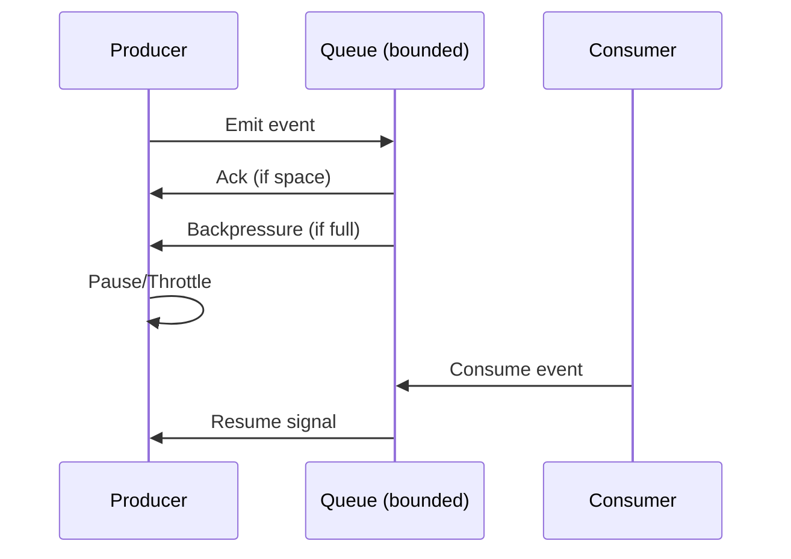

<!-- Generated by Groq via GitHub Actions -->
<!-- Topic ID: T077 -->
<!-- Category: Messaging & Event-Driven Architecture -->
<!-- Generated at UTC: 2026-10-11T07:27:46.101370+00:00 -->

# Backpressure

## 1. What problem does this solve?

**Motivation**  
In a distributed backend, services often produce data faster than downstream consumers can consume it. Think of a high‑traffic API that writes to a queue, but the worker pool that processes the queue is limited by CPU, memory, or external API rate limits. If the producer keeps sending messages, the queue grows unbounded, eventually exhausting memory or disk, and the system crashes or becomes unresponsive.

**What problem exists**  
- Uncontrolled growth of in‑memory or on‑disk buffers  
- Resource exhaustion (CPU, memory, network)  
- Increased latency or timeouts for clients  
- Cascading failures when downstream services back up

**Why the problem matters**  
- Service availability: a single overloaded component can bring down the whole system.  
- Cost: over‑provisioned resources or autoscaling triggered by spikes.  
- Data integrity: dropped or duplicated messages if buffers overflow.

**What happens if this concept is not used**  
- Queue or buffer overflows → crashes or data loss.  
- Clients experience high latency or timeouts.  
- Autoscaling may spin up many instances, inflating costs.  
- Downstream services may become unresponsive, propagating failures.

**Where this concept appears in real backend systems**  
- Message brokers (Kafka, RabbitMQ) with consumer lag.  
- HTTP servers handling burst traffic (Node.js event loop).  
- Stream processing (Kafka Streams, Flink).  
- Database write pipelines (PostgreSQL logical replication).  
- AI inference pipelines where GPU inference is slower than data ingestion.

---

## 2. Mental model

**Simple analogy**  
Imagine a water tap (producer) pouring water into a bucket (buffer). If the bucket is small and the tap runs continuously, the bucket overflows and water spills everywhere. Backpressure is like a valve that closes the tap when the bucket is full, preventing overflow and letting the bucket drain before more water comes in.

**Engineering model**  
- **Producer**: emits events or requests.  
- **Buffer/Queue**: holds events temporarily.  
- **Consumer**: processes events.  
- **Backpressure signal**: a feedback mechanism that tells the producer to slow down or pause until the consumer catches up.

---

## 3. Deep explanation

### Internals
- **Flow control**: Many protocols (TCP, HTTP/2, gRPC) implement backpressure natively.  
- **Queue capacity**: In-memory queues (e.g., `Array` in Node.js, `BlockingQueue` in Java) can be bounded.  
- **Consumer lag**: In Kafka, the consumer offset lag indicates how far behind the producer is.  
- **Windowing**: Sliding windows (e.g., `windowSize` in RxJS) limit the number of concurrent events.

### Important terminology
| Term | Meaning |
|------|---------|
| **Backpressure** | Mechanism to signal upstream to slow down. |
| **Consumer lag** | Number of messages the consumer is behind the producer. |
| **Flow control** | General term for regulating data transfer rate. |
| **Throttling** | Explicitly limiting rate (e.g., requests per second). |
| **Back‑pressure aware streams** | Streams that expose a `pause()`/`resume()` or `flow()` API. |
| **Bounded buffer** | Queue with a fixed maximum size. |

### Trade‑offs
| Aspect | Pros | Cons |
|--------|------|------|
| **Bounded buffer** | Prevents OOM, predictable memory usage | Requires careful sizing; may drop messages if full |
| **Backpressure signal** | Keeps system healthy, avoids spikes | Adds latency, complexity in API design |
| **Throttling** | Simple to implement | Can underutilize resources if set too low |

### Failure modes
- **Buffer overflow**: If backpressure is not respected, the buffer can grow until the process crashes.  
- **Deadlock**: If both producer and consumer wait on each other incorrectly.  
- **Starvation**: Over‑aggressive backpressure can starve the producer, reducing throughput.

### Limitations
- **Latency**: Backpressure can increase end‑to‑end latency because producers wait.  
- **Complexity**: Implementing correct backpressure in distributed systems requires coordination.  
- **Partial support**: Some protocols or libraries lack native backpressure support.

### Where this concept fits in a backend architecture
- **API Gateway → Service → Message Queue → Worker**  
  Backpressure is applied between the service and the queue, and between the queue and the worker.  
- **Event‑driven microservices**  
  Each service must handle its own backpressure to avoid cascading failures.

### Interaction with related concepts
- **Rate limiting**: Backpressure is dynamic; rate limiting is static.  
- **Circuit breakers**: Both protect downstream services, but circuit breakers open on failures, backpressure on overload.  
- **Autoscaling**: Backpressure can reduce the need for aggressive scaling by smoothing load.

---

## 4. How it works

1. **Producer emits** an event/message.  
2. **Queue receives** the event; if the queue is bounded and full, it sends a backpressure signal to the producer.  
3. **Producer receives** the signal and pauses or slows its emission rate.  
4. **Consumer processes** events from the queue, freeing space.  
5. **Once space is available**, the queue signals the producer to resume.  
6. **Cycle repeats** until the system stabilizes.



---

## 5. Practical implementation

### Node.js example: Backpressure with a bounded `stream` and `queue`

```ts
// backpressure-demo.ts
import { Readable, Writable } from 'stream';
import { setTimeout } from 'timers/promises';

// Simulate a fast producer
const producer = new Readable({
  read(size) {
    // Emit 10 items per tick
    for (let i = 0; i < 10; i++) {
      const ok = this.push(`msg-${Date.now()}-${i}`);
      if (!ok) {
        // Backpressure: stop pushing until drain
        console.log('Producer paused due to backpressure');
        return;
      }
    }
  },
});

// Bounded buffer: writable stream with highWaterMark
const consumer = new Writable({
  write(chunk, encoding, callback) {
    // Simulate slow processing
    setTimeout(100).then(() => {
      console.log(`Consumed: ${chunk.toString()}`);
      callback();
    });
  },
  highWaterMark: 5, // Bounded buffer size
});

producer.pipe(consumer);

consumer.on('drain', () => {
  console.log('Consumer drained, producer can resume');
});
```

**Key lines**

- `highWaterMark: 5` limits the internal buffer to 5 chunks.  
- `write()` simulates a slow consumer by awaiting 100 ms.  
- When the buffer is full, `write()` returns `false`, causing the `Readable` to pause automatically.  
- The `drain` event signals the producer to resume.

### Kafka example: Using consumer lag to trigger backpressure

```ts
// kafka-backpressure.ts
import { Kafka } from 'kafkajs';

const kafka = new Kafka({ brokers: ['kafka:9092'] });
const consumer = kafka.consumer({ groupId: 'my-group' });

await consumer.connect();
await consumer.subscribe({ topic: 'events', fromBeginning: true });

consumer.run({
  eachMessage: async ({ topic, partition, message }) => {
    // Process message
    await processEvent(message.value!);
  },
});

setInterval(async () => {
  const offsets = await consumer.fetchOffsets();
  const lag = offsets.reduce((sum, o) => sum + Number(o.offset), 0);
  if (lag > 1000) {
    console.warn('High consumer lag, consider scaling workers or throttling producers');
  }
}, 5000);
```

*Note*: Kafka itself does not enforce backpressure; you monitor lag and act (e.g., pause producers via API or adjust consumer concurrency).

---

## 6. Production considerations

| Concern | Tips |
|---------|------|
| **Scalability** | Use bounded queues; auto‑scale consumers based on lag. |
| **Reliability** | Persist queues (Kafka, RabbitMQ) to survive restarts. |
| **Security** | Ensure backpressure signals are authenticated (e.g., TLS). |
| **Observability** | Expose metrics: queue depth, consumer lag, backpressure events. |
| **Performance** | Tune `highWaterMark`, batch sizes, and consumer concurrency. |
| **Error handling** | On backpressure, retry with exponential backoff; log drops. |
| **Resource usage** | Bound memory; monitor CPU usage of consumers. |
| **Operational concerns** | Alert on sustained high lag; auto‑scale workers. |
| **Failure recovery** | Persist state; on restart, resume from last offset. |
| **Deployment** | Use container limits; separate producer and consumer services. |

---

## 7. Common mistakes

| Mistake | Why it’s problematic |
|---------|----------------------|
| **Ignoring queue capacity** | Leads to OOM or data loss. |
| **Using unbounded streams** | No backpressure, causing uncontrolled growth. |
| **Throttling without monitoring** | Over‑throttles, underutilizing resources. |
| **Assuming backpressure is automatic** | Many libraries require explicit handling. |
| **Not monitoring consumer lag** | Misses early signs of overload. |
| **Blocking the event loop** | In Node.js, long sync work blocks producers. |
| **Treating backpressure as a one‑time fix** | Needs continuous tuning as traffic patterns change. |

---

## 8. Senior engineer perspective

### What changes at scale?
- **Distributed backpressure**: Coordinating backpressure across microservices requires a shared state (e.g., Kafka consumer lag, Redis counters).  
- **Dynamic scaling**: Backpressure signals can trigger autoscaling of consumer pods.  
- **Cost control**: Prevent over‑provisioning by throttling producers when downstream is saturated.

### Design decisions
- **Queue choice**: Kafka for high throughput, RabbitMQ for complex routing.  
- **Bounded vs. unbounded**: Bounded buffers for safety; unbounded with graceful degradation for high‑volume pipelines.  
- **Backpressure granularity**: Per‑partition vs. global.  
- **Monitoring stack**: Prometheus metrics, Grafana dashboards, alerting on lag thresholds.  
- **Failure scenarios**: What if the backpressure signal is lost? Use idempotent producers and retries.  
- **Cost/performance**: Bounded buffers reduce memory cost but may increase latency; balance accordingly.  
- **When NOT to use**: If the downstream is truly elastic (e.g., serverless functions that auto‑scale instantly), backpressure may be unnecessary.

---

## 9. Interview questions

1. **Beginner**: *What is backpressure and why is it important in a Node.js stream?*  
   *Answer*: Backpressure is a mechanism that tells a producer to slow down when a consumer cannot keep up. It prevents memory exhaustion and ensures system stability.

2. **Beginner**: *How does the `highWaterMark` option affect a writable stream?*  
   *Answer*: It sets the maximum number of bytes (or chunks) the internal buffer can hold before `write()` returns `false`, signaling the producer to pause.

3. **Senior**: *Describe how you would implement backpressure in a Kafka‑based microservice architecture where producers are external services you cannot modify.*  
   *Answer*: Monitor consumer lag; if it exceeds a threshold, expose a rate‑limit endpoint or use Kafka’s `pause()` API on the consumer side, and optionally send a control message to producers via a separate topic or API to throttle them.

4. **Senior**: *Explain the trade‑offs between using a bounded in‑memory queue versus a persistent broker like Kafka for backpressure handling.*  
   *Answer*: In‑memory queues are fast but risk OOM; Kafka provides durability and can handle larger volumes but introduces latency and operational overhead.

5. **Scenario/Debugging**: *You notice that your API service’s latency spikes during traffic bursts, but the queue depth stays low. What could be happening and how would you investigate?*  
   *Answer*: Possible causes: CPU saturation, slow database writes, or a downstream service that throttles. Investigate with profiling, check consumer lag, monitor DB query times, and examine any rate‑limit headers or error codes from downstream.

---

## 10. Hands‑on task

**Task**: Build a simple producer‑consumer system in Node.js that demonstrates backpressure.

1. Create a `producer.ts` that emits a random string every 10 ms.  
2. Create a `consumer.ts` that processes each string with a 200 ms delay.  
3. Use a bounded `Writable` stream (`highWaterMark: 10`).  
4. Log when the producer pauses and resumes.  
5. Run the system and observe how backpressure keeps the buffer from growing beyond the limit.  
6. Extend the task: add a second consumer that runs in parallel and observe how the buffer behaves.

---

## 11. Quick revision

- Backpressure signals the producer to slow down when the consumer is overloaded.  
- In Node.js, `highWaterMark` controls the buffer size; `write()` returns `false` to pause.  
- `drain` event tells the producer it can resume.  
- Kafka consumer lag is a key metric for backpressure in distributed systems.  
- Bounded queues prevent OOM but may increase latency.  
- Monitoring queue depth, consumer lag, and backpressure events is essential.  
- Backpressure is distinct from rate limiting; the former is dynamic, the latter static.  
- Proper backpressure handling improves reliability and cost efficiency.  
- In microservices, backpressure can trigger autoscaling or throttling of upstream services.  
- Common pitfalls: ignoring queue capacity, using unbounded streams, not monitoring lag.

---

## 12. References

- [Node.js Streams – Backpressure](https://nodejs.org/api/stream.html#stream_backpressure)  
- [KafkaJS – Consumer Lag](https://kafka.js.org/docs/consumer#consumer-lag)  
- [RabbitMQ – Flow Control](https://www.rabbitmq.com/flow-control.html)  
- [gRPC – Flow Control](https://grpc.io/docs/what-is-grpc/core-concepts/#flow-control)  
- [Prometheus – Metrics for Queue Depth](https://prometheus.io/docs/introduction/overview/)  

---
