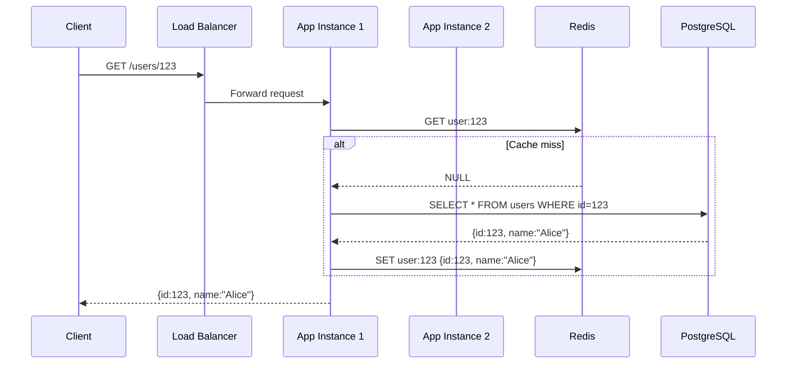
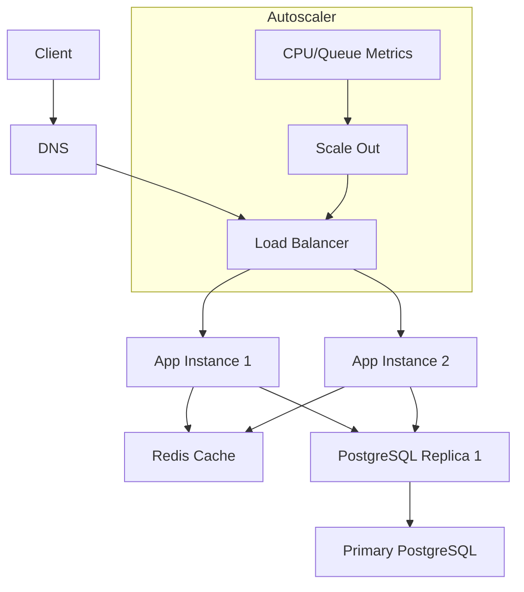

<!-- Generated by Groq via GitHub Actions -->
<!-- Topic ID: T078 -->
<!-- Category: System Design -->
<!-- Generated at UTC: 2026-10-11T07:27:46.101370+00:00 -->

# Scalability

## 1. What problem does this solve?

**Motivation**  
When a backend receives more traffic than it can handle, users experience slow responses, timeouts, or outages. Scalability is the set of techniques that let a system grow its capacity—CPU, memory, I/O, network—without breaking.

**What problem exists**  
- **Throughput limits**: A single server can process only a finite number of requests per second.  
- **Resource exhaustion**: CPU, memory, disk, or network saturate, causing latency spikes.  
- **Single point of failure**: One node going down brings the whole service down.

**Why the problem matters**  
- **Revenue loss**: Slow or unavailable services convert fewer users.  
- **Reputation damage**: Users expect instant responses; delays erode trust.  
- **Operational cost**: Over‑provisioning to avoid spikes wastes money; under‑provisioning leads to outages.

**What happens if this concept is not used**  
- **Service degradation**: Latency increases, error rates rise.  
- **Downtime**: A single failure can crash the entire system.  
- **Inability to grow**: New features or users cannot be supported.

**Where this concept appears in real backend systems**  
- **E‑commerce**: Handling flash sales, millions of concurrent users.  
- **Social media**: Real‑time feeds, likes, comments.  
- **Streaming services**: High‑throughput ingestion and delivery.  
- **AI inference**: Serving models to thousands of requests per second.

---

## 2. Mental model

### Analogy  
Think of a **highway**.  
- **Cars** are user requests.  
- **Lanes** are parallel instances of your service.  
- **Traffic lights** are load balancers.  
- **Road maintenance crews** are monitoring & autoscaling systems.  
If you add more lanes (horizontal scaling) or widen the road (vertical scaling), you can let more cars pass without congestion.

### Precise engineering model  
- **Horizontal scaling**: Add more stateless instances behind a load balancer.  
- **Vertical scaling**: Upgrade a single instance’s CPU/memory.  
- **Caching**: Store frequently accessed data in fast memory (Redis, CDN).  
- **Database scaling**: Replication, sharding, read‑replicas.  
- **Asynchronous processing**: Offload heavy work to message queues (Kafka, RabbitMQ).  
- **Statelessness**: Keep no per‑session data on the server; use external stores.

---

## 3. Deep explanation

### Internals
| Layer | What it does | Typical tech |
|-------|--------------|--------------|
| **Load Balancer** | Distributes incoming traffic across instances. | Nginx, HAProxy, AWS ELB |
| **Application Servers** | Handle business logic. | Node.js/Express, FastAPI |
| **Cache** | Fast in‑memory store for hot data. | Redis, Memcached |
| **Database** | Persistent storage. | PostgreSQL, MongoDB |
| **Message Queue** | Decouple producers/consumers. | Kafka, RabbitMQ |
| **CDN** | Edge caching for static assets. | Cloudflare, AWS CloudFront |

### Important terminology
- **Horizontal vs. Vertical scaling**  
- **Stateless vs. Stateful services**  
- **Read replicas**  
- **Sharding / Partitioning**  
- **CAP theorem** (Consistency, Availability, Partition tolerance)  
- **Eventual consistency**  
- **Backpressure**  
- **Rate limiting**  
- **Circuit breaker**  

### Trade‑offs
| Decision | Pros | Cons |
|----------|------|------|
| **Horizontal scaling** | Linear throughput, fault isolation | Requires statelessness, more network hops |
| **Vertical scaling** | Simpler deployment | Limited by hardware, single point of failure |
| **Cache** | Low latency | Stale data, cache invalidation complexity |
| **Sharding** | Massive write scaling | Complex queries across shards |
| **Read replicas** | Offload reads | Replication lag, consistency issues |
| **Async queues** | Decouple workloads | Increased latency for end‑to‑end flow |

### Failure modes
- **Cache stampede**: Many clients miss the cache and hit the DB simultaneously.  
- **Replica lag**: Reads may return stale data.  
- **Queue backlog**: Producers outpace consumers, leading to memory exhaustion.  
- **Hot spot**: One shard or node receives disproportionate traffic.  
- **Network partitions**: Causes split‑brain if not handled.

### Limitations
- **Stateful services**: Harder to scale horizontally.  
- **Strong consistency**: Hard to achieve at scale without sacrificing availability.  
- **Cost**: More instances, more storage, more network traffic.  
- **Operational complexity**: Monitoring, logging, and debugging across many nodes.

### Where it fits in a backend architecture
Scalability is a cross‑cutting concern that touches every layer: networking, application code, caching, storage, and orchestration. It is often implemented through a combination of:

1. **Stateless application servers** behind a load balancer.  
2. **Distributed cache** for hot data.  
3. **Read‑replica database cluster** for read scaling.  
4. **Sharded or partitioned databases** for write scaling.  
5. **Message queues** for heavy or long‑running tasks.  
6. **Autoscaling groups** to adjust instance count based on metrics.

### Interaction with related concepts
- **Observability**: Metrics (latency, QPS), logs, traces are essential to detect scaling bottlenecks.  
- **Security**: Load balancers must terminate TLS; statelessness simplifies session handling.  
- **Reliability**: Circuit breakers and retries prevent cascading failures.  
- **Cost**: Autoscaling and spot instances can reduce spend.

---

## 4. How it works

### Step‑by‑step flow

1. **Client** sends HTTP request to `api.example.com`.  
2. **DNS** resolves to the load balancer’s IP.  
3. **Load Balancer** (Nginx) forwards request to one of the healthy Node.js instances.  
4. **Node.js instance** checks Redis cache for the requested data.  
   - If cache hit → return data.  
   - If cache miss → query PostgreSQL.  
5. **PostgreSQL** returns data; Node.js stores it in Redis for future requests.  
6. **Response** is sent back through the load balancer to the client.  
7. **Metrics** (latency, error rate) are emitted to Prometheus.  
8. **Autoscaler** monitors CPU/queue depth and spins up/down instances as needed.



### Scaling diagram



---

## 5. Practical implementation

Below is a minimal, production‑ready Node.js/Express service that demonstrates horizontal scaling, caching, and autoscaling.

```ts
// src/server.ts
import express from 'express';
import { createClient } from 'redis';
import { Pool } from 'pg';
import { config } from 'dotenv';

config(); // Load .env

const app = express();
const port = process.env.PORT ?? 3000;

// PostgreSQL pool (read replica)
const pool = new Pool({
  connectionString: process.env.DATABASE_URL,
  max: 20, // pool size
});

// Redis client
const redis = createClient({
  url: process.env.REDIS_URL,
});
redis.on('error', (err) => console.error('Redis error', err));
await redis.connect();

// Simple cache key generator
const cacheKey = (id: string) => `user:${id}`;

// Route
app.get('/users/:id', async (req, res) => {
  const id = req.params.id;
  try {
    // 1. Try cache
    const cached = await redis.get(cacheKey(id));
    if (cached) {
      return res.json(JSON.parse(cached));
    }

    // 2. Query DB
    const { rows } = await pool.query('SELECT id, name, email FROM users WHERE id = $1', [id]);

    if (rows.length === 0) {
      return res.status(404).json({ error: 'Not found' });
    }

    const user = rows[0];

    // 3. Store in cache (TTL 60s)
    await redis.set(cacheKey(id), JSON.stringify(user), {
      EX: 60,
    });

    res.json(user);
  } catch (err) {
    console.error(err);
    res.status(500).json({ error: 'Internal server error' });
  }
});

// Graceful shutdown
const shutdown = async () => {
  await redis.quit();
  await pool.end();
  process.exit(0);
};
process.on('SIGINT', shutdown);
process.on('SIGTERM', shutdown);

app.listen(port, () => {
  console.log(`Server listening on ${port}`);
});
```

### Docker Compose for scaling

```yaml
# docker-compose.yml
version: '3.8'
services:
  app:
    build: .
    environment:
      - DATABASE_URL=postgres://user:pass@db:5432/app
      - REDIS_URL=redis://redis:6379
    ports:
      - "3000:3000"
    deploy:
      replicas: 3   # Horizontal scaling
      restart_policy:
        condition: on-failure
  db:
    image: postgres:15
    environment:
      POSTGRES_USER: user
      POSTGRES_PASSWORD: pass
      POSTGRES_DB: app
    volumes:
      - db-data:/var/lib/postgresql/data
  redis:
    image: redis:7
    command: redis-server --save 60 1 --loglevel warning
    volumes:
      - redis-data:/data

volumes:
  db-data:
  redis-data:
```

### Autoscaling with Kubernetes (simplified)

```yaml
# deployment.yaml
apiVersion: apps/v1
kind: Deployment
metadata:
  name: app
spec:
  replicas: 3
  selector:
    matchLabels:
      app: app
  template:
    metadata:
      labels:
        app: app
    spec:
      containers:
      - name: app
        image: myrepo/app:latest
        env:
        - name: DATABASE_URL
          value: postgres://user:pass@db:5432/app
        - name: REDIS_URL
          value: redis://redis:6379
        ports:
        - containerPort: 3000
---
apiVersion: autoscaling/v2
kind: HorizontalPodAutoscaler
metadata:
  name: app-hpa
spec:
  scaleTargetRef:
    apiVersion: apps/v1
    kind: Deployment
    name: app
  minReplicas: 2
  maxReplicas: 10
  metrics:
  - type: Resource
    resource:
      name: cpu
      target:
        type: Utilization
        averageUtilization: 70
```

---

## 6. Production considerations

| Concern | What to watch for | Mitigation |
|---------|-------------------|------------|
| **Scalability** | Bottlenecks in DB, cache, network | Use read replicas, sharding, CDN, autoscaling |
| **Reliability** | Single point of failure | Stateless services, load balancer, health checks |
| **Security** | TLS termination, credential leakage | TLS at LB, secrets in Vault/Secrets Manager |
| **Observability** | Latency, error rates | Prometheus + Grafana, OpenTelemetry traces |
| **Performance** | GC pauses, memory leaks | Node.js `--max-old-space-size`, heap snapshots |
| **Error handling** | Unhandled rejections, timeouts | Global error middleware, retry logic |
| **Resource usage** | CPU, memory, disk I/O | Profiling, right‑size instances |
| **Operational concerns** | Rolling updates, zero‑downtime | Blue/green or canary deployments |
| **Failure recovery** | Queue backlogs, cache misses | Backpressure, circuit breakers |
| **Deployment** | Immutable infra, versioning | Docker images, CI/CD pipelines |

---

## 7. Common mistakes

| Mistake | Why it’s problematic |
|---------|----------------------|
| **Keeping sessions in memory** | Breaks horizontal scaling; causes data loss on restart. |
| **Hard‑coding cache TTLs** | Either stale data or wasted cache space. |
| **Ignoring cache stampede** | DB overload during cache misses. |
| **Using a single database instance** | Bottleneck for writes; single point of failure. |
| **Not handling replica lag** | Serving stale reads in time‑sensitive apps. |
| **Over‑caching** | Consumes memory unnecessarily; may evict useful data. |
| **Skipping health checks** | Load balancer forwards traffic to dead instances. |
| **No circuit breaker** | One failing service can bring down the whole system. |
| **Not monitoring queue depth** | Backlogs grow until memory exhaustion. |
| **Deploying without canary** | Bugs can affect all users instantly. |

---

## 8. Senior engineer perspective

### What changes at scale
- **Statelessness becomes mandatory**: All state must live in external stores.  
- **Observability is non‑negotiable**: Distributed tracing, log aggregation, and alerting are required.  
- **Cost modeling**: Autoscaling can lead to unpredictable spend; need to set budgets and limits.  
- **Security hardening**: TLS termination, IAM roles, secrets management.  
- **Data consistency trade‑offs**: Often favor availability over strict consistency (CAP).  

### Design decisions
- **Architecture**: Microservices vs. monolith; event‑driven vs. request‑driven.  
- **Database choice**: Relational for ACID, NoSQL for horizontal scaling.  
- **Cache strategy**: Read‑through vs. write‑through; cache invalidation patterns.  
- **Message queue**: Kafka for high throughput, RabbitMQ for complex routing.  
- **Deployment**: Kubernetes vs. serverless; container orchestration.  

### Bottlenecks to watch
- **Single‑threaded Node.js event loop**: CPU‑bound tasks block the loop.  
- **Network I/O**: High latency between services can dominate response time.  
- **Database sharding complexity**: Querying across shards adds latency.  

### Failure scenarios
- **Network partition**: Use quorum reads/writes or eventual consistency.  
- **Replica lag**: Expose read‑only endpoints that tolerate staleness.  
- **Cache invalidation race**: Use optimistic locking or versioned keys.  

### Monitoring
- **Latency distribution** (p99, p95).  
- **Error rates** per endpoint.  
- **Queue depth** and consumer lag.  
- **Cache hit/miss ratios**.  

### Cost/performance
- **Spot instances** for non‑critical workers.  
- **Reserved instances** for steady‑state workloads.  
- **Cache sizing**: Balance memory cost vs. hit rate.  

### When NOT to use the approach
- **Very low traffic**: Over‑engineering adds maintenance cost.  
- **Strict consistency required**: Some sharding strategies break ACID.  
- **Real‑time constraints**: Message queues add latency; use synchronous processing if needed.  

---

## 9. Interview questions

| Level | Question | Answer points |
|-------|----------|---------------|
| **Beginner** | What is the difference between horizontal and vertical scaling? | Horizontal: add more machines; vertical: upgrade one machine. |
| | Why do we need stateless services for horizontal scaling? | Statelessness allows any instance to handle any request; simplifies load balancing and failover. |
| **Senior** | Explain how you would design a system that can handle 10k QPS for a user profile service. | Use load balancer, stateless Node.js instances, Redis cache, read replicas, sharding if needed, autoscaling, monitoring. |
| | How does the CAP theorem influence your choice of database for a highly available system? | You must choose between consistency and partition tolerance; often accept eventual consistency for availability. |
| **Scenario** | A new feature causes a cache stampede. How would you mitigate it? | Use a lock (e.g., Redis SETNX) or a “cache aside” pattern with a short TTL, or pre‑populate cache during low traffic. |

---

## 10. Hands‑on task

**Task**: Add a rate limiter to the `/users/:id` endpoint that allows 100 requests per minute per IP.  
- Use the `express-rate-limit` package.  
- Deploy the updated service with Docker Compose.  
- Verify that exceeding the limit returns HTTP 429.  
- Add a Prometheus metric to expose the current rate‑limit usage.

---

## 11. Quick revision

- Horizontal scaling = more instances; vertical scaling = stronger machine.  
- Stateless services are key for scaling out.  
- Load balancers distribute traffic and provide health checks.  
- Redis cache reduces DB load; watch for stampedes.  
- Read replicas offload reads; watch for lag.  
- Sharding partitions writes; increases complexity.  
- Message queues decouple heavy work; monitor consumer lag.  
- Autoscaling reacts to metrics (CPU, queue depth).  
- Observability (metrics, logs, traces) is essential.  
- Circuit breakers prevent cascading failures.  
- Security: TLS at LB, secrets in Vault.  
- Cost: spot vs. reserved instances; cache sizing.

---

## 12. References

- [Node.js Cluster Module](https://nodejs.org/api/cluster.html)  
- [Redis Documentation – SETNX](https://redis.io/commands/setnx)  
- [PostgreSQL Replication](https://www.postgresql.org/docs/current/warm-standby.html)  
- [Kafka Documentation – Consumer Lag](https://kafka.apache.org/documentation/#consumer_lag)  
- [CAP Theorem](https://en.wikipedia.org/wiki/CAP_theorem)  
- [Prometheus – Metrics](https://prometheus.io/docs/introduction/overview/)  
- [OpenTelemetry – Tracing](https://opentelemetry.io/docs/)  
- [Docker Compose](https://docs.docker.com/compose/)  
- [Kubernetes HorizontalPodAutoscaler](https://kubernetes.io/docs/tasks/run-application/horizontal-pod-autoscale/)  
- [Express Rate Limit](https://github.com/nfriedly/express-rate-limit)
