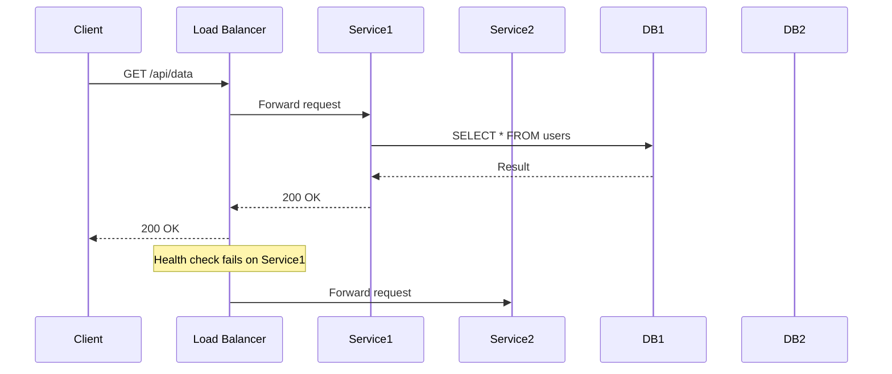

<!-- Generated by Groq via GitHub Actions -->
<!-- Topic ID: T079 -->
<!-- Category: System Design -->
<!-- Generated at UTC: 2026-10-11T18:18:04.126816+00:00 -->

# Availability

## 1. What problem does this solve?

- **Problem**: A single server or component can fail (hardware crash, software bug, network outage). If the system is not designed to tolerate such failures, users experience downtime.
- **Why it matters**: Modern web services expect *continuous* operation. Even a few minutes of outage can cost revenue, damage reputation, and violate SLAs.
- **Consequences of ignoring availability**:
  - Users see error pages or timeouts.
  - Automated monitoring alerts trigger, causing firefighting.
  - Data loss or corruption if writes are lost during a crash.
- **Real‑world appearance**:  
  - **E‑commerce**: checkout must stay online during traffic spikes.  
  - **Social media**: feeds must keep delivering even if a data center goes down.  
  - **Financial services**: trading platforms require 99.999% uptime.

## 2. Mental model

### Analogy: A city’s power grid
- **Single power plant** → one point of failure.  
- **Multiple plants + automatic switching** → if one plant fails, the grid keeps running.  
- **Load balancer** is like the grid’s switchboard, routing power (requests) to healthy plants (servers).  
- **Health checks** are the sensors that detect a plant’s status.

### Engineering model
- **Redundancy**: duplicate components (servers, databases).  
- **Failover**: automatic switch to a healthy replica when one fails.  
- **Health checks**: periodic probes that inform the load balancer which instances are alive.  
- **Graceful degradation**: if a non‑critical component fails, the system still serves core functionality.

## 3. Deep explanation

| Topic | Explanation |
|-------|-------------|
| **Internals** | • Load balancer (NGINX, HAProxy, AWS ELB) distributes traffic.<br>• Health‑check endpoints (`/health`) return 200 OK when healthy.<br>• Replicated databases (PostgreSQL streaming replication, MongoDB replica set, Redis Sentinel).<br>• Leader election (Raft, Paxos) for write‑consistency. |
| **Important terminology** | • **High Availability (HA)** – system uptime ≥ 99.99%.<br>• **Redundancy** – duplicate components.<br>• **Failover** – automatic switch to a backup.<br>• **Quorum** – majority of nodes required for a decision.<br>• **Circuit Breaker** – stops traffic to a failing service. |
| **Trade‑offs** | • **CAP theorem**: Consistency + Availability + Partition tolerance – you can only have two. <br>• **Latency vs. Replication**: More replicas → higher write latency.<br>• **Cost vs. Uptime**: Extra nodes, cross‑region replication increase spend. |
| **Failure modes** | • **Single point of failure (SPOF)**: e.g., one load balancer.<br>• **Network partition**: nodes cannot communicate.<br>• **Data loss**: writes lost before replication.<br>• **Health‑check flapping**: false positives/negatives. |
| **Limitations** | • 100 % uptime is impossible; you can only approach it.<br>• Adding redundancy introduces complexity and potential new failure modes. |
| **Where it fits** | • At the edge: load balancers, API gateways.<br>• In the middle: microservice clusters, message brokers.<br>• At the data layer: database replicas, sharding. |
| **Interactions** | • **Reliability**: Availability is a subset of reliability.<br>• **Observability**: health checks, metrics, logs are essential.<br>• **Performance**: load balancing can improve throughput.<br>• **Security**: ensure health‑check endpoints are protected. |

## 4. How it works

1. **Client sends request** → to DNS → resolves to load balancer IP.  
2. **Load balancer** receives request, checks its routing table.  
3. **Health check**: LB periodically queries `/health` on each backend.  
4. **Routing**: LB forwards request to a healthy instance.  
5. **Backend processes** request, may read/write to replicated DB.  
6. **Response** travels back through LB to client.  
7. **If a backend fails**: LB stops routing to it until health check passes again.



## 5. Practical implementation

### 5.1 Node.js + Express + NGINX load balancer

**`app.ts`**

```ts
import express from 'express';
const app = express();
const PORT = process.env.PORT || 3000;

// Simple health endpoint
app.get('/health', (_req, res) => {
  // In production, check DB, cache, etc.
  res.status(200).send('OK');
});

// Core API
app.get('/api/users', async (req, res) => {
  // Simulate DB read
  const users = await getUsersFromDB();
  res.json(users);
});

app.listen(PORT, () => {
  console.log(`Server listening on ${PORT}`);
});
```

**`nginx.conf`**

```nginx
events {}
http {
  upstream backend {
    server 127.0.0.1:3000 max_fails=3 fail_timeout=30s;
    server 127.0.0.1:3001 max_fails=3 fail_timeout=30s;
  }

  server {
    listen 80;

    location / {
      proxy_pass http://backend;
    }

    # Health check endpoint
    location /health {
      proxy_pass http://backend;
    }
  }
}
```

- Run two Node instances on ports 3000 & 3001.  
- NGINX will stop sending traffic to an instance that fails 3 times in 30 s.  
- Health checks are performed automatically by NGINX.

### 5.2 Redis Sentinel for HA

```ts
import { createClient } from 'redis';

const sentinel = createClient({
  sentinels: [
    { host: 'redis-1.example.com', port: 26379 },
    { host: 'redis-2.example.com', port: 26379 }
  ],
  name: 'mymaster'
});

sentinel.on('error', err => console.error('Redis error:', err));

async function get(key: string) {
  return await sentinel.get(key);
}
```

- Sentinel monitors the master and promotes a replica if the master fails.  
- The client automatically reconnects to the new master.

## 6. Production considerations

| Concern | What to do |
|---------|------------|
| **Scalability** | Use auto‑scaling groups; keep health checks lightweight. |
| **Reliability** | Deploy across multiple AZs/regions; use multi‑master or quorum. |
| **Security** | Secure health endpoints (TLS, auth); restrict LB IPs. |
| **Observability** | Emit metrics (`up`, `request_latency_seconds`), logs, and traces. |
| **Performance** | Cache health check responses; avoid heavy DB checks in `/health`. |
| **Error handling** | Return 503 when unhealthy; implement retries with backoff. |
| **Resource usage** | Avoid over‑provisioning; use container orchestration to manage replicas. |
| **Operational concerns** | Automate failover testing; monitor replication lag. |
| **Failure recovery** | Use automated scripts to restart failed services; keep backups. |
| **Deployment** | Blue/green or canary releases to test new instances before routing traffic. |

## 7. Common mistakes

| Mistake | Why it hurts |
|---------|--------------|
| **No health checks** | Load balancer will keep sending traffic to dead nodes. |
| **Single load balancer** | Becomes SPOF; add a second LB behind a DNS round‑robin or use a cloud ELB. |
| **Health check hits DB** | Can cause false negatives during heavy load; use lightweight checks. |
| **Ignoring replication lag** | Reads may see stale data; use read replicas with awareness. |
| **Over‑retrying** | Creates thundering herd; use exponential backoff. |
| **Hard‑coding IPs** | Breaks when scaling; use service discovery. |
| **Not testing failover** | You’ll discover issues only in production. |

## 8. Senior engineer perspective

- **Architecture decisions**:  
  - Multi‑region vs. single‑region HA.  
  - Consistency model: eventual vs. strong.  
  - Use of distributed consensus (Raft) for leader election.  
- **Trade‑offs**:  
  - Higher availability → higher cost (more nodes, cross‑region traffic).  
  - Strong consistency → lower availability under partitions.  
- **Bottlenecks**:  
  - Load balancer capacity.  
  - Database write throughput.  
  - Network latency between regions.  
- **Failure scenarios**:  
  - Network partition: use quorum to decide.  
  - Data center outage: rely on cross‑region replication.  
- **Monitoring**:  
  - Uptime dashboards, replication lag alerts, health‑check metrics.  
- **Cost/performance**:  
  - Evaluate cost of extra replicas vs. SLA penalties.  
- **When NOT to use**:  
  - For low‑traffic internal tools where 99.9% uptime is acceptable.  
  - When consistency is more critical than availability (e.g., banking).  

## 9. Interview questions

1. **Beginner**: *What is a health check and why is it important?*  
   *Answer*: A health check is an endpoint that reports whether a service is functioning. It allows load balancers to stop routing traffic to unhealthy instances, preventing user-facing errors.

2. **Beginner**: *Explain the difference between a load balancer and a reverse proxy.*  
   *Answer*: A load balancer distributes traffic across multiple backends, often with health checks. A reverse proxy forwards requests to a single backend and may cache responses. Many reverse proxies also provide load balancing features.

3. **Senior**: *How does the CAP theorem influence your design of a highly available database cluster?*  
   *Answer*: In a network partition, you must choose between consistency and availability. If you prioritize availability, you may allow writes to proceed on a majority of nodes (quorum) and resolve conflicts later. If you prioritize consistency, you may block writes until all nodes agree.

4. **Senior**: *Describe a scenario where a circuit breaker improves system availability.*  
   *Answer*: If a downstream microservice is overloaded, a circuit breaker trips after a threshold of failures, immediately returning a fallback response. This prevents cascading failures and gives the downstream service time to recover.

5. **Scenario/Debugging**: *A user reports intermittent 503 errors from your API. Your logs show that the load balancer is routing traffic to a backend that occasionally returns 500. What steps would you take to diagnose and fix the issue?*  
   *Answer*:  
   - Check backend health‑check logs to see if the instance is marked unhealthy.  
   - Verify that the health‑check endpoint is lightweight and not hitting the DB.  
   - Inspect the backend’s error logs for root causes (e.g., memory leak).  
   - Ensure the load balancer’s `max_fails` and `fail_timeout` settings are appropriate.  
   - If the issue is transient, consider adding a retry with backoff or a circuit breaker.  

## 10. Hands‑on task

**Goal**: Build a simple two‑instance Node.js service behind NGINX with health checks, then simulate a failure.

1. Clone the repo and run `npm install`.  
2. Start two Node instances: `node app.ts --port=3000` and `node app.ts --port=3001`.  
3. Start NGINX with the provided `nginx.conf`.  
4. Verify that `/api/users` works from a browser or `curl`.  
5. Stop one Node instance and observe that NGINX stops routing to it after 3 failures.  
6. Add a `/health` endpoint that randomly fails 30 % of the time and observe how NGINX reacts.  
7. Document the observed behavior and explain why NGINX stops sending traffic.

## 11. Quick revision

- Availability = uptime; goal is 99.99%+ for critical services.  
- Redundancy + failover = core of HA.  
- Load balancer routes traffic; health checks inform routing.  
- Replicated databases (PostgreSQL streaming, MongoDB replica set, Redis Sentinel).  
- CAP theorem: Availability vs. Consistency under partitions.  
- Circuit breakers prevent cascading failures.  
- Monitoring: uptime, health‑check metrics, replication lag.  
- Common pitfalls: no health checks, single LB, heavy health checks.  
- Senior decisions: multi‑region, quorum size, cost vs. SLA.  

## 12. References

- [Node.js – HTTP module](https://nodejs.org/api/http.html)  
- [Express – Health check middleware](https://expressjs.com/en/advanced/best-practice-performance.html)  
- [NGINX – Upstream health checks](https://nginx.org/en/docs/http/ngx_http_upstream_module.html#health_check)  
- [Redis Sentinel](https://redis.io/docs/management/sentinel/)  
- [CAP Theorem](https://en.wikipedia.org/wiki/CAP_theorem)  
- [AWS ELB – High Availability](https://docs.aws.amazon.com/elasticloadbalancing/latest/classic/elb-availability.html)  
- [Kubernetes – Pod Disruption Budgets](https://kubernetes.io/docs/tasks/run-application/configure-pdb/)  

---
