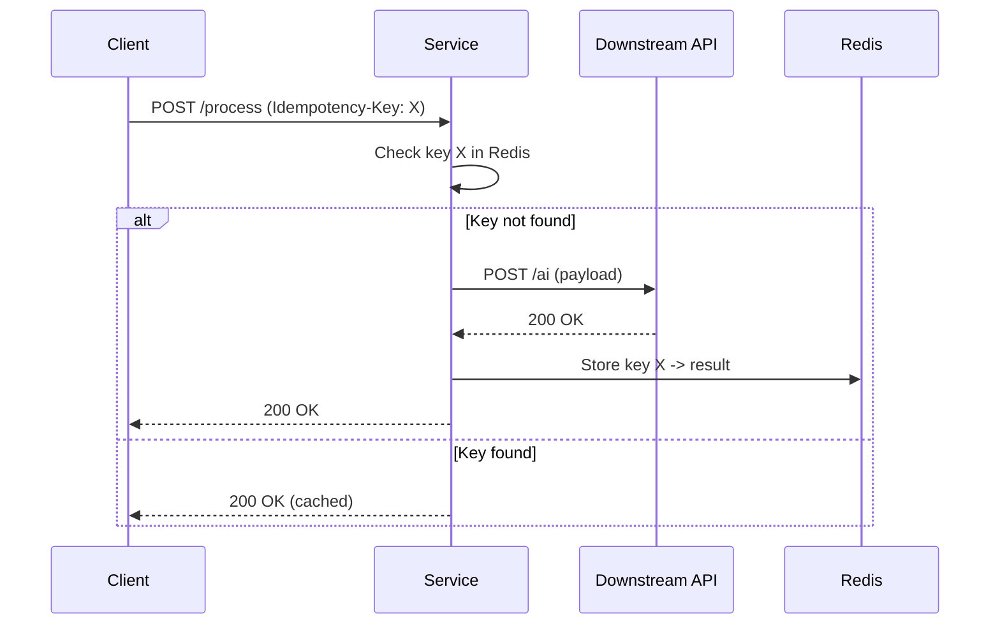

<!-- Generated by Groq via GitHub Actions -->
<!-- Topic ID: T080 -->
<!-- Category: System Design -->
<!-- Generated at UTC: 2026-10-11T18:18:04.126816+00:00 -->

# Reliability

## 1. What problem does this solve?

**Motivation**  
In a distributed backend, requests rarely travel a clean, uninterrupted path. Network glitches, temporary database outages, rate limits, or downstream service hiccups can cause a request to fail even though the underlying operation is perfectly valid. If we simply return the error to the caller, the user sees a failure, the system may lose data, or the same request may be retried automatically by a client, creating duplicate side effects.

**What problem exists**  
- *Transient failures*: short‑lived issues that resolve after a moment (e.g., a brief network partition).  
- *Non‑idempotent operations*: actions that change state (e.g., `POST /orders`) that, if repeated, create duplicates.  
- *Unpredictable latency*: a downstream service may be slow or unresponsive.

**Why the problem matters**  
- **User experience**: A single flaky request can make an app feel unreliable.  
- **Data integrity**: Duplicate orders, double charges, or inconsistent state.  
- **SLAs**: Service level agreements often require high availability and correctness.

**What happens if this concept is not used**  
- Lost or duplicated data.  
- Cascading failures (one failure triggers many).  
- Poor metrics and hard‑to‑debug bugs.

**Where this concept appears in real backend systems**  
- Payment gateways (retrying charge requests).  
- Microservice communication (HTTP/GRPC calls).  
- AI inference pipelines (retrying model calls).  
- Event‑driven architectures (re‑processing messages).

---

## 2. Mental model

### Analogy: The Post Office with a Delivery Guarantee  
Imagine you send a letter to a friend.  
- **Retry**: If the post office says the letter was lost, you ask them to resend it.  
- **Idempotency**: You attach a tracking number so that if the letter is delivered twice, the friend can recognize the duplicate and ignore it.

In engineering:  
- **Retry** is the “ask to resend” logic.  
- **Idempotency** is the tracking number that guarantees the same operation won’t be applied twice.

### Precise engineering model  
1. **Client** → **Service**: Send request with an *idempotency key* (unique per logical operation).  
2. **Service**:  
   - Check if the key already exists.  
   - If yes, return the cached result.  
   - If no, perform the operation.  
3. **Retry logic**: On transient error, wait an *exponential backoff* (with jitter) and resend the request, reusing the same idempotency key.

---

## 3. Deep explanation

| Topic | Explanation |
|-------|-------------|
| **Internals** | A retry loop that inspects the HTTP status or exception type, applies exponential backoff (`base * 2^attempt`) plus random jitter, and limits the number of attempts. |
| **Important terminology** | *Idempotent operation*: can be applied multiple times without changing the result beyond the first application.<br>*Idempotency key*: a client‑supplied identifier that uniquely represents a logical request.<br>*Transient error*: an error that is likely to succeed if retried (e.g., 5xx, network timeout).<br>*Permanent error*: an error that will not succeed on retry (e.g., 4xx validation). |
| **Trade‑offs** | More retries increase reliability but also latency and load on downstream services. Jitter reduces thundering herd but adds unpredictability. |
| **Failure modes** | • Infinite retry loops (no max attempts).<br>• Duplicate side effects if idempotency is not enforced.<br>• Back‑pressure on the service if many concurrent retries pile up. |
| **Limitations** | • Not all operations are idempotent; some (e.g., `POST /send-email`) may still produce duplicates if retried.<br>• Requires support from downstream services (e.g., they must honor idempotency keys). |
| **Where it fits** | Service‑to‑service HTTP/GRPC calls, external API integrations, database writes that need to be retried. |
| **Interaction with related concepts** | • **Circuit breaker**: stops retries when a service is unhealthy.<br>• **Bulkhead**: isolates retry traffic to avoid cascading failures.<br>• **Health checks**: inform whether to attempt a retry at all. |

---

## 4. How it works

1. **Client sends request** with an `Idempotency-Key` header.  
2. **Service receives request**.  
   - Checks a fast store (Redis or DB) for the key.  
   - If present, returns cached response.  
   - If absent, proceeds to step 3.  
3. **Service attempts the operation** (e.g., call external AI API).  
4. **If operation succeeds**: store result with the key, return to client.  
5. **If operation fails**:  
   - Inspect error.  
   - If transient, wait `backoff = base * 2^attempt + jitter`.  
   - Retry up to `maxAttempts`.  
6. **If max attempts reached**: return error to client.



---

## 5. Practical implementation

### 5.1 Retry wrapper (TypeScript)

```ts
// retry.ts
import fetch, { RequestInit, Response } from 'node-fetch';

export type RetryOptions = {
  /** Base delay in ms */
  baseDelayMs?: number;
  /** Maximum number of attempts (including the first) */
  maxAttempts?: number;
  /** Jitter factor (0-1) */
  jitter?: number;
  /** Function that decides if an error is retryable */
  isRetryable?: (error: any) => boolean;
};

const defaultOptions: RetryOptions = {
  baseDelayMs: 200,
  maxAttempts: 5,
  jitter: 0.5,
  isRetryable: (e) => {
    if (e instanceof Error) return true; // network errors
    if (e.status >= 500) return true;    // server errors
    return false;                        // client errors
  },
};

export async function retry<T>(
  fn: () => Promise<T>,
  opts: RetryOptions = {}
): Promise<T> {
  const {
    baseDelayMs,
    maxAttempts,
    jitter,
    isRetryable,
  } = { ...defaultOptions, ...opts };

  let attempt = 0;
  while (true) {
    try {
      return await fn();
    } catch (err) {
      attempt++;
      if (attempt >= (maxAttempts ?? 5) || !isRetryable?.(err)) {
        throw err; // give up
      }
      const delay = baseDelayMs! * 2 ** (attempt - 1);
      const jitterMs = delay * jitter! * Math.random();
      await new Promise((r) => setTimeout(r, delay + jitterMs));
    }
  }
}
```

### 5.2 Idempotent API route (Next.js)

```ts
// pages/api/process.ts
import type { NextApiRequest, NextApiResponse } from 'next';
import { retry } from '../../lib/retry';
import { v4 as uuidv4 } from 'uuid';
import { getRedisClient } from '../../lib/redis';

const redis = getRedisClient();

export default async function handler(
  req: NextApiRequest,
  res: NextApiResponse
) {
  if (req.method !== 'POST') {
    return res.status(405).end();
  }

  // 1. Grab or generate idempotency key
  const idempotencyKey =
    req.headers['idempotency-key']?.toString() || uuidv4();

  // 2. Check cache
  const cached = await redis.get(idempotencyKey);
  if (cached) {
    return res.status(200).json(JSON.parse(cached));
  }

  // 3. Perform operation with retry
  try {
    const result = await retry(async () => {
      const resp = await fetch('https://api.ai-service.com/v1/infer', {
        method: 'POST',
        headers: { 'Content-Type': 'application/json' },
        body: JSON.stringify(req.body),
      });

      if (!resp.ok) {
        const err = new Error(`AI service error: ${resp.status}`);
        (err as any).status = resp.status;
        throw err;
      }
      return resp.json();
    });

    // 4. Cache result with a TTL (e.g., 5 minutes)
    await redis.set(idempotencyKey, JSON.stringify(result), 'EX', 300);

    return res.status(200).json(result);
  } catch (err) {
    console.error('Processing failed', err);
    return res.status(502).json({ error: 'External service failed' });
  }
}
```

> **Key points**  
> *The idempotency key is stored in Redis with a TTL to avoid unbounded growth.*  
> *The retry wrapper uses exponential backoff + jitter to avoid thundering herd.*  
> *Only transient errors are retried; 4xx errors are returned immediately.*

---

## 6. Production considerations

| Concern | How to address |
|---------|----------------|
| **Scalability** | Use a fast, distributed cache (Redis Cluster) for idempotency keys. Keep TTL short to free memory. |
| **Reliability** | Persist keys in a durable store (PostgreSQL) if you need auditability. |
| **Security** | Treat idempotency keys as secrets; enforce HTTPS. |
| **Observability** | Emit metrics: `retry_attempts_total`, `retry_successful`, `retry_failed`. Log key usage. |
| **Performance** | Limit max attempts to 3–5. Use async/await to avoid blocking threads. |
| **Error handling** | Distinguish transient vs permanent errors. Return appropriate HTTP status codes. |
| **Resource usage** | Retries increase load; monitor downstream service health. |
| **Operational** | Alert on high retry rates or repeated failures. |
| **Failure recovery** | Circuit breaker to stop retries when downstream is unhealthy. |
| **Deployment** | Versioned API: new clients can opt‑in to idempotency. Backward compatibility: if key missing, generate one server‑side. |

---

## 7. Common mistakes

| Mistake | Why it’s problematic |
|---------|----------------------|
| Retrying non‑idempotent operations | Causes duplicate side effects (double charges). |
| Using fixed backoff | Leads to synchronized retries (thundering herd). |
| No jitter | Same as above; can overload downstream. |
| No max attempts | Infinite loops, resource exhaustion. |
| Not distinguishing error types | Retrying permanent errors wastes resources. |
| Not persisting idempotency keys | Duplicate requests may be processed twice. |
| Over‑caching results | Stale data served to clients. |
| Ignoring TTL on keys | Memory leaks in Redis. |

---

## 8. Senior engineer perspective

### What changes at scale?

- **Architecture**:  
  - Use a dedicated idempotency service or table with a composite key (`client_id + idempotency_key`).  
  - Employ event sourcing: each operation is an event that can be replayed.  
  - Consider message queues (Kafka) for retries instead of tight loops.

- **Trade‑offs**:  
  - *Consistency vs latency*: storing keys in a relational DB guarantees durability but adds latency.  
  - *Cost*: extra Redis slots, DB writes, and network calls.

- **Bottlenecks**:  
  - Single point of failure in the idempotency store.  
  - Contention on the same key (rare but possible).  
  - Back‑pressure on downstream services if many retries pile up.

- **Failure scenarios**:  
  - Race condition: two concurrent requests with the same key. Resolve by atomic `SETNX` or DB unique constraint.  
  - Cache miss + DB hit: double write. Use a single source of truth.

- **Monitoring**:  
  - Track `retry_latency`, `retry_success_rate`, `idempotency_cache_hit_rate`.  
  - Alert when retry rate > threshold.

- **Cost/performance**:  
  - Each retry adds cost to downstream APIs.  
  - Use a retry budget per service to cap usage.

- **When NOT to use**:  
  - For truly idempotent operations (e.g., `GET /status`) you can skip retries.  
  - For one‑off scripts or batch jobs where duplicate execution is acceptable.

---

## 9. Interview questions

| Level | Question | Answer points |
|-------|----------|---------------|
| Beginner | What is an idempotent operation? | • Applying it multiple times yields the same result.<br>• Example: `GET /users/1`. |
| Beginner | Why do we add jitter to backoff? | • Avoids thundering herd.<br>• Distributes retries over time. |
| Senior | How would you design an idempotency key store for 10k requests/sec? | • Use Redis with `SETNX` and TTL.<br>• Persist to Postgres for audit.<br>• Partition by client ID. |
| Senior | Explain how a circuit breaker complements retry logic. | • Stops retries when downstream is unhealthy.<br>• Prevents cascading failures.<br>• Keeps latency bounded. |
| Scenario | A payment service receives duplicate `POST /charge` requests due to a network glitch. How would you detect and handle duplicates? | • Require idempotency key.<br>• Store key + result in DB.<br>• Return cached result on duplicate.<br>• Log and alert on duplicates. |

---

## 10. Hands‑on task

**Task**:  
Add retry with exponential backoff and idempotency to the existing `/api/infer` endpoint in the repository.

**Steps**  
1. Create a `retry.ts` helper (see example).  
2. Modify the endpoint to read `Idempotency-Key` from headers or generate one.  
3. Store the key and response in Redis with a 5‑minute TTL.  
4. Use the retry helper to call the external AI service.  
5. Verify that repeated requests with the same key return the cached result and that transient failures are retried.

---

## 11. Quick revision

- **Reliability** = ability to keep working correctly under failure.  
- **Retry**: repeat a failed operation after a delay.  
- **Exponential backoff + jitter**: `delay = base * 2^n + jitter`.  
- **Idempotency key**: unique identifier for a logical request.  
- **Idempotent operation**: same result regardless of repetitions.  
- **Transient vs permanent errors**: decide whether to retry.  
- **Circuit breaker**: stops retries when a service is unhealthy.  
- **Bulkhead**: isolates retry traffic.  
- **Cache TTL**: prevents stale data and memory leaks.  
- **Observability**: metrics for retry attempts, success rate, latency.  
- **Common pitfalls**: no max attempts, no jitter, retrying non‑idempotent ops.

---

## 12. References

- [Node.js fetch API](https://nodejs.org/api/globals.html#fetch)  
- [Axios retry interceptor](https://github.com/softonic/axios-retry)  
- [AWS SDK retry strategy](https://docs.aws.amazon.com/sdk-for-javascript/v3/developer-guide/retries.html)  
- [Redis SETNX command](https://redis.io/commands/setnx)  
- [Circuit Breaker pattern](https://martinfowler.com/bliki/CircuitBreaker.html)  
- [CAP Theorem](https://en.wikipedia.org/wiki/CAP_theorem)  
- [Exponential backoff with jitter](https://aws.amazon.com/blogs/architecture/exponential-backoff-and-jitter/)  

---
