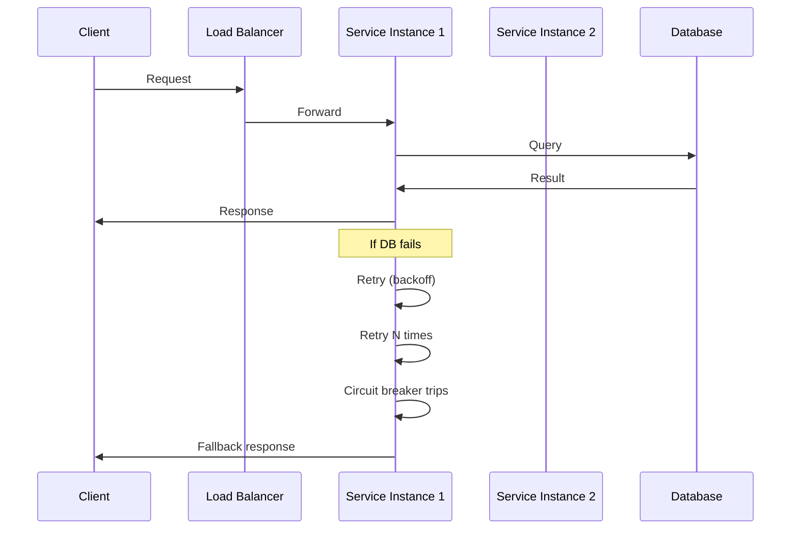

<!-- Generated by Groq via GitHub Actions -->
<!-- Topic ID: T081 -->
<!-- Category: System Design -->
<!-- Generated at UTC: 2026-10-12T07:35:36.608772+00:00 -->

# Fault tolerance

## 1. What problem does this solve?

**Motivation**  
In a distributed backend, components (services, databases, message queues, etc.) can fail for many reasons: hardware crashes, network partitions, software bugs, or resource exhaustion. If a single failure can bring down the entire system, users experience outages, data loss, or inconsistent state.

**What problem exists**  
- A single point of failure (SPOF) can halt a service or a critical path.
- Unhandled exceptions or timeouts can cascade, causing cascading failures.
- Clients may receive partial or corrupted data.

**Why the problem matters**  
- Downtime costs money and erodes user trust.
- Regulatory or SLA requirements often mandate high availability.
- Inconsistent data can lead to bugs that are hard to reproduce.

**What happens if this concept is not used**  
- Services crash or hang, leading to 5xx errors.
- Data may be lost or duplicated.
- Recovery may require manual intervention or full system restarts.

**Where this concept appears in real backend systems**  
- Load balancers and health checks in Kubernetes.
- Retry and circuit breaker patterns in microservices.
- Replicated databases (PostgreSQL streaming, MongoDB replica sets).
- Message queues with acknowledgments (Kafka, RabbitMQ).
- Distributed caches with failover (Redis Sentinel, Cluster).

---

## 2. Mental model

**Analogy**  
Imagine a city’s water supply. If the main pipeline bursts, the city can still get water from backup reservoirs and pumps. The system keeps running even though the primary source failed.

**Engineering model**  
Fault tolerance is the ability of a system to continue operating correctly even when one or more of its components fail. It is achieved through redundancy, graceful degradation, retries, and isolation of failure domains.

---

## 3. Deep explanation

### Internals
- **Redundancy**: Duplicate resources (e.g., multiple database replicas, multiple service instances behind a load balancer).
- **Isolation**: Separate failure domains (different AZs, containers, processes).
- **Graceful degradation**: Fallback logic that serves degraded but usable functionality.
- **Retry & backoff**: Reattempt operations with exponential backoff to handle transient failures.
- **Circuit breaker**: Detects repeated failures and stops sending traffic to a failing service until it recovers.
- **Health checks**: Periodic probes to determine if a component is healthy.

### Important terminology
| Term | Meaning |
|------|---------|
| **SPOF** | Single Point Of Failure |
| **Graceful degradation** | System continues to function at reduced capacity |
| **Retry** | Re-executing an operation after a failure |
| **Backoff** | Increasing delay between retries |
| **Circuit breaker** | Pattern that trips after consecutive failures |
| **Health check** | Probe that reports component status |
| **Failover** | Automatic switch to a standby component |
| **Redundancy** | Duplicate components that can take over |

### Trade‑offs
| Trade‑off | Pros | Cons |
|-----------|------|------|
| **Redundancy vs cost** | Higher availability | More infrastructure cost |
| **Retries vs latency** | Higher success rate | Increased response time |
| **Circuit breaker timeout** | Prevents cascading failures | May block legitimate traffic if timeout too long |
| **Graceful degradation vs feature completeness** | Keeps service up | Users may miss features |

### Failure modes
- **Transient**: Network hiccups, temporary DB overload. Handled by retries.
- **Permanent**: Service crash, data corruption. Requires failover or manual intervention.
- **Partition**: Network split causing split‑brain. Requires consensus protocols or careful data partitioning.

### Limitations
- **Complexity**: Adding fault tolerance increases code and operational complexity.
- **Testing**: Simulating failures in production is hard.
- **Consistency**: Replicated systems may sacrifice strong consistency for availability (CAP theorem).

### Where it fits in a backend architecture
- **Service layer**: Each microservice implements retries, circuit breakers, and health checks.
- **Infrastructure layer**: Load balancers, Kubernetes controllers, and cloud provider health probes.
- **Data layer**: Replicated databases, sharded caches, and message queues with acknowledgments.

### Interaction with related concepts
- **Scalability**: Horizontal scaling often relies on load balancers that also provide failover.
- **Observability**: Metrics (latency, error rates) and logs are essential to detect failures.
- **Security**: Retry loops can be abused for DoS; circuit breakers mitigate that.

---

## 4. How it works

1. **Client sends request** to a service instance.
2. **Load balancer** forwards to an instance that passes its health check.
3. Service **processes request**. If it needs to call another service:
   - It **issues a request** with a retry policy.
   - If the call fails, it **waits** (exponential backoff) and retries.
   - After N failures, the **circuit breaker trips** and the service returns a fallback response.
4. If the service instance crashes, the **health check fails**; the load balancer removes it from rotation.
5. A **new instance** is spun up (auto‑scaling) or an existing replica takes over.



---

## 5. Practical implementation

Below is a minimal Node.js/TypeScript example that demonstrates:
- **Retry with exponential backoff** using `axios-retry`.
- **Circuit breaker** using `opossum`.
- **Health check** endpoint.

```ts
// src/faultTolerance.ts
import axios from 'axios';
import axiosRetry from 'axios-retry';
import CircuitBreaker from 'opossum';
import express from 'express';

// ---------- Retry ----------
axiosRetry(axios, {
  retries: 3,
  retryDelay: (retryCount) => Math.pow(2, retryCount) * 100, // 100ms, 200ms, 400ms
  retryCondition: (error) => {
    // Retry on network errors or 5xx
    return axiosRetry.isNetworkOrIdempotentRequestError(error) || error.response?.status >= 500;
  },
});

// ---------- Circuit Breaker ----------
const breakerOptions = {
  timeout: 5000, // 5s
  errorThresholdPercentage: 50,
  resetTimeout: 30000, // 30s
};

const callExternalService = async (url: string) => {
  const response = await axios.get(url);
  return response.data;
};

const breaker = new CircuitBreaker(callExternalService, breakerOptions);

breaker.fallback(() => {
  return { message: 'Service temporarily unavailable. Please try again later.' };
});

// ---------- Express app ----------
const app = express();

app.get('/data', async (req, res) => {
  try {
    const data = await breaker.fire('https://api.example.com/resource');
    res.json(data);
  } catch (err) {
    res.status(502).json({ error: err.message });
  }
});

// Health check endpoint
app.get('/health', (req, res) => {
  // Simple check: if breaker is half-open or closed, we consider healthy
  const state = breaker.status.name; // 'closed', 'open', 'halfOpen'
  if (state === 'open') {
    return res.status(503).send('unhealthy');
  }
  res.send('ok');
});

const PORT = process.env.PORT ?? 3000;
app.listen(PORT, () => console.log(`Server listening on ${PORT}`));
```

**Key lines explained**

- `axiosRetry` automatically retries failed HTTP calls with exponential backoff.
- `CircuitBreaker` monitors failure rate; after 50% failures it opens the circuit, preventing further calls for 30 s.
- The `/health` endpoint reports `503` when the circuit is open, allowing load balancers to stop routing traffic to this instance.

---

## 6. Production considerations

| Concern | How fault tolerance addresses it | Practical tips |
|---------|----------------------------------|----------------|
| **Scalability** | Redundant instances can be added behind a load balancer. | Use Kubernetes Deployments with readiness/liveness probes. |
| **Reliability** | Circuit breakers prevent cascading failures. | Tune thresholds based on SLA and traffic patterns. |
| **Security** | Retry loops can be abused; circuit breakers mitigate DoS. | Rate‑limit retries, monitor for abuse. |
| **Observability** | Expose breaker state, retry counts, and health status. | Use Prometheus metrics (`opossum_*`), log retry attempts. |
| **Performance** | Retries add latency; circuit breakers add overhead. | Benchmark and set realistic timeout values. |
| **Error handling** | Fallbacks provide graceful degradation. | Design meaningful fallback responses. |
| **Resource usage** | Multiple instances consume more resources. | Use autoscaling with cost‑aware metrics. |
| **Operational concerns** | Need to monitor health checks and circuit breaker state. | Alert on circuit open events. |
| **Failure recovery** | Automatic failover via load balancer and replica sets. | Test failover scenarios in staging. |
| **Deployment** | Rolling updates must preserve health checks. | Use canary releases with health probes. |

---

## 7. Common mistakes

| Mistake | Why it’s problematic |
|---------|----------------------|
| **Hard‑coding retry counts** | Fixed retries may be too low for slow networks or too high for critical ops. |
| **No backoff** | Immediate retries cause thundering herd and overload downstream services. |
| **Ignoring circuit breaker state** | Sending traffic to an open circuit wastes resources and increases latency. |
| **Using health checks that always pass** | Load balancer keeps routing to unhealthy instances. |
| **Not handling partial failures** | Returning 200 with missing data can mislead clients. |
| **Over‑redundancy** | Unnecessary replicas increase cost without added resilience. |
| **Failing to test failure scenarios** | Hidden bugs surface only in production. |
| **Not monitoring retry/failure metrics** | Unable to detect emerging issues early. |

---

## 8. Senior engineer perspective

### What changes at scale?
- **Architecture decisions**: Decide between active‑active vs active‑passive replication, use of global load balancers, and placement of services across regions.
- **Trade‑offs**: Balancing consistency vs availability (CAP). Choosing eventual consistency for high write throughput vs strong consistency for financial ops.
- **Bottlenecks**: Circuit breaker reset time can become a bottleneck if many services trip simultaneously.
- **Failure scenarios**: Network partitions, AZ failures, or cascading microservice failures. Design for graceful degradation and data reconciliation.
- **Monitoring**: Centralized dashboards for circuit breaker state, retry rates, and health check status. Alerting on sustained open circuits.
- **Cost/performance**: Running multiple replicas and health probes increases cost; optimize by using spot instances or autoscaling policies.
- **When NOT to use**: For simple, low‑traffic services where a single instance is acceptable, adding circuit breakers may add unnecessary complexity.

---

## 9. Interview questions

1. **Beginner**: *What is a circuit breaker and why do we use it?*  
   **Answer**: A pattern that stops sending requests to a failing service after a threshold of failures, preventing cascading failures and allowing the service to recover.

2. **Beginner**: *Explain exponential backoff in the context of retries.*  
   **Answer**: Increasing delay between retry attempts (e.g., 100 ms, 200 ms, 400 ms) to reduce load on a failing service and give it time to recover.

3. **Senior**: *How would you design a fault‑tolerant microservice architecture that spans multiple availability zones?*  
   **Answer**: Deploy multiple instances per AZ behind a load balancer, use health checks, enable cross‑AZ replication for databases, implement circuit breakers, and monitor for AZ failures.

4. **Senior**: *Describe a scenario where using a circuit breaker could inadvertently hide a real problem.*  
   **Answer**: If the circuit breaker opens due to a transient spike in latency, the service may keep returning fallback responses, masking an underlying performance degradation that needs investigation.

5. **Scenario/Debugging**: *A user reports that after a recent deployment, their requests to Service A sometimes return a 502 error, but the logs show Service A is healthy. What could be happening?*  
   **Answer**: Likely the downstream Service B is failing; Service A’s circuit breaker trips and returns a fallback, but the health check still reports healthy. Check circuit breaker state, downstream service health, and retry logs.

---

## 10. Hands‑on task

**Task**: Add fault tolerance to an existing Express API that fetches user profiles from a PostgreSQL database.

1. **Implement retries** for the database query using `pg-promise`’s retry logic.
2. **Add a circuit breaker** around the database connection using `opossum`.
3. **Expose a `/health` endpoint** that reports the circuit breaker state.
4. **Write a test** that simulates a database outage and verifies that the API returns a graceful fallback response.

*Hint*: Use Docker Compose to spin up a PostgreSQL container and a Node.js container for the API.

---

## 11. Quick revision

- Fault tolerance keeps a system running when components fail.
- Redundancy, isolation, retries, backoff, circuit breakers, and health checks are core techniques.
- Exponential backoff reduces load on failing services.
- Circuit breakers trip after a configurable failure threshold.
- Health checks inform load balancers to stop routing to unhealthy instances.
- Observability (metrics, logs) is essential to detect and respond to failures.
- Trade‑offs: higher availability vs cost, latency vs reliability.
- Common mistakes: hard‑coded retries, no backoff, ignoring breaker state.
- At scale, design for multi‑AZ, monitor breaker state, and balance CAP trade‑offs.

---

## 12. References

- [Axios Retry](https://github.com/softonic/axios-retry)
- [Opossum Circuit Breaker](https://github.com/nodeshift/opossum)
- [Kubernetes Liveness and Readiness Probes](https://kubernetes.io/docs/tasks/configure-pod-container/configure-liveness-readiness-probes/)
- [CAP Theorem](https://en.wikipedia.org/wiki/CAP_theorem)
- [PostgreSQL Replication](https://www.postgresql.org/docs/current/replication.html)
- [Redis Sentinel](https://redis.io/docs/management/sentinel/)
- [Kafka Replication](https://kafka.apache.org/documentation/#replication)
