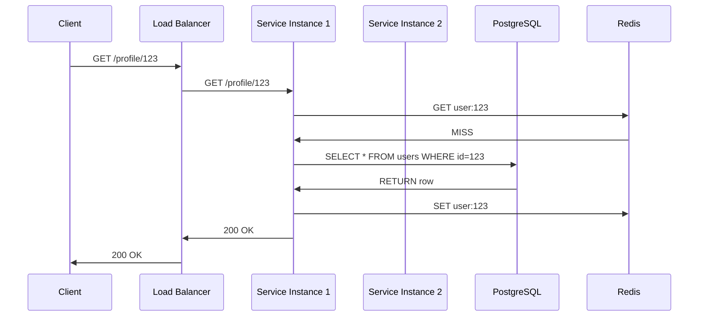
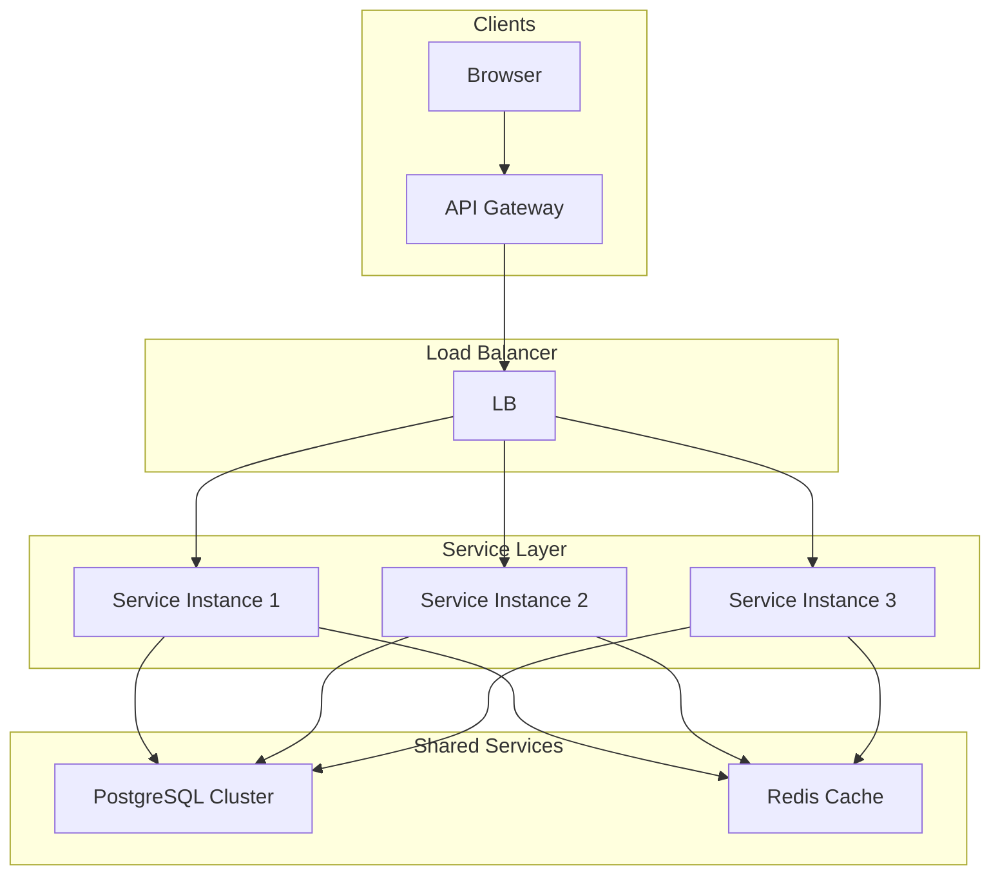

<!-- Generated by Groq via GitHub Actions -->
<!-- Topic ID: T082 -->
<!-- Category: System Design -->
<!-- Generated at UTC: 2026-10-12T07:35:36.608772+00:00 -->

# Horizontal scaling

## 1. What problem does this solve?

| What | Why it matters | Consequence of not using it | Real‑world example |
|------|----------------|-----------------------------|--------------------|
| **Single‑point bottleneck** | One server can only use its CPU, memory, disk, and network. When traffic grows, that server becomes saturated. | Slow responses, timeouts, crashes. | A popular e‑commerce site sees a 50 % drop in conversion during a flash sale. |
| **Fault tolerance** | If the only server dies, the whole service goes down. | 100 % downtime. | A banking API that goes offline during a maintenance window. |
| **Elasticity** | Workload can spike (e.g., a viral post). | Manual re‑provisioning, over‑provisioning, wasted money. | A news site that suddenly receives millions of hits. |
| **Cost‑efficiency** | Scaling vertically (buying a bigger machine) has limits and becomes expensive. | You hit the “no‑more‑CPU” wall. | A startup that can’t afford a 64‑core server. |

Horizontal scaling—adding more machines (or containers) that share the load—addresses all of the above. It lets you **add capacity** by deploying more instances, **isolate failures** to a single node, and **pay for only what you use**.

---

## 2. Mental model

### Analogy: Highway lanes

Imagine traffic on a single lane road. As cars (requests) increase, the lane gets congested. Adding more lanes (instances) lets traffic flow smoothly. If one lane is blocked (node failure), cars can still use the other lanes.

### Engineering model

```
┌───────────────┐
│  Load Balancer│  ← distributes traffic
└───────┬───────┘
        │
┌───────▼───────┐   ┌───────▼───────┐   ┌───────▼───────┐
│  Service A    │   │  Service A    │   │  Service A    │
│  (stateless)  │   │  (stateless)  │   │  (stateless)  │
└───────┬───────┘   └───────┬───────┘   └───────┬───────┘
        │                │                │
┌───────▼───────┐   ┌───────▼───────┐   ┌───────▼───────┐
│  DB Cluster   │   │  DB Cluster   │   │  DB Cluster   │
│  (replicated) │   │  (replicated) │   │  (replicated) │
└───────────────┘   └───────────────┘   └───────────────┘
```

* **Stateless services**: Each instance can handle any request; no per‑user memory.
* **Shared state**: Databases, caches, message queues hold the data.
* **Load balancer**: Routes requests to any healthy instance.

---

## 3. Deep explanation

### Internals

1. **Statelessness** – All request‑handling logic lives in the code; no per‑user session data in RAM.
2. **Load balancer** – Distributes incoming traffic (Round‑Robin, Least‑Connections, etc.).
3. **Health checks** – The balancer queries `/health` endpoints to keep only healthy nodes in rotation.
4. **Shared storage** – Databases (PostgreSQL, MongoDB), caches (Redis), queues (Kafka) are external to the service instances.
5. **Service discovery** – In container orchestrators (K8s, ECS) services register themselves; the load balancer queries the registry.

### Important terminology

| Term | Definition |
|------|------------|
| **Stateless** | No per‑request memory; all state is external. |
| **Sticky session** | Routing a user’s requests to the same instance (often via cookies). |
| **Sharding** | Partitioning data across multiple database nodes. |
| **Replication** | Copying data to multiple nodes for read scalability and fault tolerance. |
| **CAP theorem** | Consistency, Availability, Partition tolerance – you can only guarantee two. |
| **Horizontal Pod Autoscaler (HPA)** | K8s controller that scales pods based on metrics. |

### Trade‑offs

| Decision | Pros | Cons |
|----------|------|------|
| **Stateless vs stateful** | Easy scaling, no sticky sessions. | Requires external session store. |
| **Read replicas** | Offload reads, improve latency. | Replication lag; consistency trade‑off. |
| **Sharding** | Scale writes, reduce contention. | Complex queries across shards; re‑sharding cost. |
| **Sticky sessions** | Simplifies session handling. | Uneven load distribution; single‑point failure. |

### Failure modes

| Mode | What happens | Mitigation |
|------|--------------|------------|
| **Node crash** | Requests to that node fail. | Health checks, graceful shutdown, retries. |
| **Database partition** | Some nodes can’t reach DB. | Multi‑AZ deployment, read replicas, eventual consistency. |
| **Cache miss storm** | All nodes hit DB simultaneously. | Cache warming, rate limiting. |
| **Load balancer failure** | All traffic lost. | Multi‑region LB, failover. |

### Limitations

* **Stateful services** (e.g., in‑memory queues) are hard to scale horizontally.
* **External dependencies** (legacy DBs) may become bottlenecks.
* **Network latency** between instances and shared services can dominate response time.

### Where it fits

* **Microservices** – Each service scales independently.
* **Monoliths** – Can be containerized and scaled, but shared state (e.g., in‑process cache) becomes a problem.
* **Batch jobs** – Scale workers horizontally for throughput.

### Interaction with related concepts

| Concept | Interaction |
|---------|-------------|
| **Caching** | Redis or Memcached reduces DB load; must be shared. |
| **Message queues** | Decouple producers/consumers; allow scaling consumers. |
| **Service mesh** | Adds observability, traffic control, retries. |
| **CI/CD** | Automates deployment of new instances. |

---

## 4. How it works

### Step‑by‑step flow

1. **Client** sends HTTP request to `api.example.com`.
2. **DNS** resolves to the load balancer’s IP.
3. **Load balancer** (e.g., Nginx, AWS ELB) selects a healthy backend instance.
4. **Instance** processes the request, queries PostgreSQL or Redis as needed.
5. **Instance** returns response to the load balancer.
6. **Load balancer** forwards response to the client.



### Mermaid diagram of architecture



---

## 5. Practical implementation

Below is a minimal, runnable example that demonstrates horizontal scaling with Docker Compose, Nginx, and a Node.js/Express service. Sessions are stored in Redis to keep the service stateless.

### 5.1 `Dockerfile`

```dockerfile
# Use official Node runtime
FROM node:20-alpine

# Create app directory
WORKDIR /app

# Install dependencies
COPY package*.json ./
RUN npm ci --omit=dev

# Copy source
COPY . .

# Expose port
EXPOSE 3000

# Start the server
CMD ["node", "src/server.js"]
```

### 5.2 `src/server.js`

```js
const express = require('express');
const session = require('express-session');
const RedisStore = require('connect-redis').default;
const { createClient } = require('redis');

const app = express();
const redisClient = createClient({ url: process.env.REDIS_URL });
redisClient.on('error', err => console.error('Redis error', err));

app.use(express.json());

// Session middleware – keeps the service stateless
app.use(
  session({
    store: new RedisStore({ client: redisClient }),
    secret: process.env.SESSION_SECRET || 'dev-secret',
    resave: false,
    saveUninitialized: false,
    cookie: { secure: false }, // set true in prod with HTTPS
  })
);

// Simple health check
app.get('/health', (_, res) => res.send('ok'));

// Example endpoint that uses session
app.get('/profile', (req, res) => {
  // Simulate a user id stored in session
  if (!req.session.userId) {
    req.session.userId = Math.floor(Math.random() * 1000);
  }
  res.json({ userId: req.session.userId, instance: process.env.INSTANCE_ID });
});

const PORT = process.env.PORT || 3000;
app.listen(PORT, () => {
  console.log(`Service listening on port ${PORT}`);
});
```

### 5.3 `docker-compose.yml`

```yaml
version: "3.9"

services:
  redis:
    image: redis:7-alpine
    ports:
      - "6379:6379"

  # Nginx load balancer
  nginx:
    image: nginx:1.27-alpine
    volumes:
      - ./nginx.conf:/etc/nginx/nginx.conf:ro
    depends_on:
      - api1
      - api2
      - api3
    ports:
      - "80:80"

  # Three identical API instances
  api1:
    build: .
    environment:
      - INSTANCE_ID=1
      - REDIS_URL=redis://redis:6379
    depends_on:
      - redis
    expose:
      - "3000"

  api2:
    build: .
    environment:
      - INSTANCE_ID=2
      - REDIS_URL=redis://redis:6379
    depends_on:
      - redis
    expose:
      - "3000"

  api3:
    build: .
    environment:
      - INSTANCE_ID=3
      - REDIS_URL=redis://redis:6379
    depends_on:
      - redis
    expose:
      - "3000"
```

### 5.4 `nginx.conf`

```nginx
events {}

http {
  upstream api_backend {
    server api1:3000;
    server api2:3000;
    server api3:3000;
  }

  server {
    listen 80;

    location / {
      proxy_pass http://api_backend;
      proxy_set_header Host $host;
      proxy_set_header X-Real-IP $remote_addr;
      proxy_set_header X-Forwarded-For $proxy_add_x_forwarded_for;
    }

    location /health {
      proxy_pass http://api_backend;
    }
  }
}
```

### 5.5 Run it

```bash
docker compose up --build
```

Open `http://localhost/profile` in a browser or use `curl`. Refresh a few times – you’ll see the `instance` field change, proving that requests are distributed across the three containers. Sessions persist because they’re stored in Redis, not in the process memory.

---

## 6. Production considerations

| Concern | What to do |
|---------|------------|
| **Scalability** | Use auto‑scaling (K8s HPA, ECS Service Auto Scaling). Keep services stateless. |
| **Reliability** | Health checks, graceful shutdown, retries, circuit breakers. |
| **Security** | TLS termination at LB, HSTS, secure cookies, IP whitelisting. |
| **Observability** | Centralized logs (ELK), metrics (Prometheus), tracing (OpenTelemetry). |
| **Performance** | Cache frequently read data, use connection pooling, avoid N+1 queries. |
| **Error handling** | Return consistent error payloads, use fallback routes. |
| **Resource usage** | Monitor CPU/memory per pod, set limits/requests. |
| **Operational** | CI/CD pipelines, blue‑green or canary deployments, rollback strategy. |
| **Failure recovery** | Keep a backup of DB, use multi‑AZ deployments, enable read replicas. |
| **Deployment** | Use immutable containers, versioned images, keep secrets in Vault/Secrets Manager. |

---

## 7. Common mistakes

| Mistake | Why it’s bad |
|---------|--------------|
| **Keeping user sessions in process memory** | Scaling out loses session data; users get logged out. |
| **Forgetting sticky sessions when required** | Session‑based auth fails if requests hit different instances. |
| **Hard‑coding ports or hostnames** | Containers get re‑assigned ports; DNS or service discovery fails. |
| **Over‑sharding without a re‑sharding plan** | Data migration becomes impossible; queries across shards are slow. |
| **Ignoring database scaling** | Adding more app instances overloads a single DB node. |
| **Not using health checks** | Load balancer routes traffic to dead nodes, causing 5xx errors. |
| **Using a single Redis instance** | Redis becomes a bottleneck and single point of failure. |
| **Not handling eventual consistency** | Reads may return stale data after a write. |

---

## 8. Senior engineer perspective

### What changes at scale?

* **Design decisions** – Must decide between **stateless** vs **stateful** services, choose the right load balancer (Nginx, HAProxy, AWS ELB), and pick a service discovery mechanism (Consul, K8s DNS).
* **Trade‑offs** – CAP theorem: you can’t have strong consistency, high availability, and partition tolerance simultaneously. Decide which two you need.
* **Bottlenecks** – Often the database or network I/O, not the application code. Profile and instrument early.
* **Failure scenarios** – Network partitions, node failures, database replication lag. Build graceful degradation and fallback paths.
* **Monitoring** – Set up dashboards for request latency, error rates, CPU/memory, DB replication lag, cache hit ratio.
* **Cost/performance** – Compute vs storage vs network. Use spot instances for stateless workers, keep read replicas in cheaper regions.
* **When NOT to use** – If traffic is low (<10 req/s) or the service is tightly coupled and stateful, vertical scaling or a monolith may be simpler.

---

## 9. Interview questions

| Level | Question | Key answer points |
|-------|----------|-------------------|
| Beginner | What is horizontal scaling and why is it preferred over vertical scaling? | Adds more machines; linear cost; no hardware limits; better fault tolerance. |
| Beginner | How does a load balancer help horizontal scaling? | Distributes traffic, health checks, can terminate TLS, supports sticky sessions. |
| Senior | Explain how you would design a horizontally scalable database for a social media app. | Use read replicas for reads, sharding by user ID or geography, eventual consistency, connection pooling, monitoring replication lag. |
| Senior | Discuss trade‑offs between sharding and replication in a horizontally scaled system. | Sharding increases write throughput but adds query complexity; replication improves read scalability but introduces consistency lag; CAP theorem implications. |
| Scenario | After scaling to 5 instances, a user reports that their session data disappears. Diagnose and fix. | Likely session stored in memory; need external store (Redis, DB). Ensure session middleware uses shared store; check sticky sessions if required. |

---

## 10. Hands‑on task

**Task**: Extend the Docker‑Compose example to add a **health‑check endpoint** and a **simple load‑testing script** that sends 100 concurrent requests. Verify that:

1. All instances are healthy (no 5xx).
2. The load balancer distributes requests evenly.
3. Session data persists across requests.

*Hints*: Use `curl -s -o /dev/null -w "%{http_code}\n" http://localhost/profile` in a loop, or write a small Node.js script with `axios` and `Promise.all`. Check the `instance` field to confirm distribution.

---

## 11. Quick revision

- Horizontal scaling = adding more machines, not beefier ones.
- Keep services **stateless**; use external stores for sessions, cache, DB.
- Load balancer routes traffic; use health checks to keep only healthy nodes.
- Sticky sessions are optional; use them only if needed.
- Scale the **database** too: read replicas, sharding, connection pooling.
- CAP theorem: choose consistency vs availability vs partition tolerance.
- Auto‑scaling (K8s HPA, ECS) reacts to CPU/memory/queue depth.
- Monitor latency, error rates, DB lag, cache hit ratio.
- Use TLS termination at the LB; secure cookies.
- Avoid hard‑coded ports; use environment variables or service discovery.
- Test with load‑testing tools (wrk, k6, artillery) before production.

---

## 12. References

- [Node.js – Express](https://expressjs.com/)
- [Docker Compose](https://docs.docker.com/compose/)
- [Nginx – Load Balancing](https://www.nginx.com/resources/glossary/load-balancing/)
- [Kubernetes – Horizontal Pod Autoscaler](https://kubernetes.io/docs/tasks/run-application/horizontal-pod-autoscale/)
- [Redis – Session Store](https://github.com/expressjs/session#redis)
- [CAP Theorem](https://en.wikipedia.org/wiki/CAP_theorem)
- [PostgreSQL – Replication](https://www.postgresql.org/docs/current/warm-standby.html)
- [AWS ELB – Classic Load Balancer](https://docs.aws.amazon.com/elasticloadbalancing/latest/classic/elb-overview.html)
- [OpenTelemetry – Distributed Tracing](https://opentelemetry.io/docs/)
