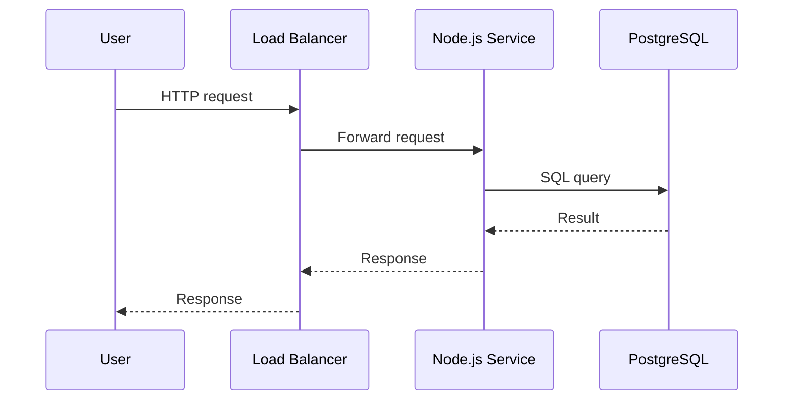

<!-- Generated by Groq via GitHub Actions -->
<!-- Topic ID: T083 -->
<!-- Category: System Design -->
<!-- Generated at UTC: 2026-10-12T21:48:49.297225+00:00 -->

# Vertical scaling

## 1. What problem does this solve?

**Motivation**  
In a backend system you often start with a single server that runs all your services. As traffic grows, that one machine can become a bottleneck: CPU, memory, disk I/O, or network bandwidth limits how many requests you can handle per second. Vertical scaling—“scaling up”—addresses this by adding more resources to the same machine (e.g., a larger CPU, more RAM, faster SSDs, or a higher‑bandwidth NIC).

**What problem exists**  
- **Resource contention**: A single process or container may exhaust its CPU or memory, causing slow responses or crashes.  
- **Throughput limits**: Even with efficient code, a single core can only process so many requests per second.  
- **Latency spikes**: When the machine is overloaded, garbage collection, disk contention, or network queues can cause unpredictable latency.

**Why the problem matters**  
- Users experience slow or failed requests → loss of revenue and trust.  
- Service level agreements (SLAs) may be violated.  
- Operational costs can spike if you need to run multiple instances to compensate.

**What happens if this concept is not used**  
- The system will hit a hard ceiling; adding more instances (horizontal scaling) may not help if the bottleneck is a shared resource (e.g., a single database connection pool or a single Redis instance).  
- You may end up with a “single point of failure” that cannot be mitigated by adding replicas.

**Where this concept appears in real backend systems**  
- A single‑node PostgreSQL cluster with a large connection pool.  
- A Node.js microservice running on a VM with 4 vCPU and 8 GiB RAM.  
- A Redis cache instance that becomes saturated under heavy read/write load.  
- A machine learning inference server that needs more GPU memory to load larger models.

---

## 2. Mental model

**Simple analogy**  
Think of a single server as a single kitchen in a restaurant. If you add more chefs (horizontal scaling) you can serve more customers, but if the stove is the only one available, you’re still limited by how many dishes can be cooked at once. Vertical scaling is like installing a larger, faster stove or adding more burners—each dish can be cooked faster, so the kitchen’s throughput increases without adding more chefs.

**Precise engineering model**  
- **CPU**: More cores or higher clock speed → parallelism and faster single‑threaded work.  
- **Memory**: Larger RAM → larger in‑memory caches, more concurrent connections, less swapping.  
- **Disk**: Faster SSDs or NVMe → lower I/O latency for database or file reads.  
- **Network**: Higher bandwidth NIC → more concurrent connections, less throttling.  
- **Hardware acceleration**: GPUs, FPGAs for ML workloads.

---

## 3. Deep explanation

### Internals
- **Resource allocation**: The OS schedules CPU time, manages memory pages, and handles I/O queues.  
- **Process isolation**: In containers (Docker, Kubernetes), you can limit CPU/memory per container, but the underlying host still shares physical resources.  
- **Hardware limits**: Each CPU has a maximum number of logical cores; memory is limited by the motherboard and BIOS.

### Important terminology
- **Scale‑up / Scale‑out**: Scale‑up = vertical scaling; scale‑out = horizontal scaling.  
- **Bottleneck**: The resource that limits overall throughput.  
- **Capacity planning**: Estimating how many requests a machine can handle given its specs.  
- **Resource contention**: When multiple processes compete for the same resource, leading to performance degradation.

### Trade‑offs
| Aspect | Vertical scaling | Horizontal scaling |
|--------|------------------|--------------------|
| **Complexity** | Low (single instance) | High (distributed state, load balancing) |
| **Consistency** | Simple (single source of truth) | Requires replication, eventual consistency |
| **Cost** | Expensive per unit (high‑end hardware) | Cheaper per node, but more nodes |
| **Failure domain** | Single point of failure | Redundant nodes reduce risk |
| **Elasticity** | Limited (hardware upgrades are slow) | Rapid (add/remove instances) |

### Failure modes
- **Hardware failure**: A single node crash brings down the entire service.  
- **Resource exhaustion**: Out‑of‑memory or CPU starvation leads to crashes or high latency.  
- **Hot spots**: A single database connection pool can become a bottleneck even if the CPU is underutilized.

### Limitations
- **Finite resources**: You can only add so many cores or memory before hitting physical limits.  
- **Diminishing returns**: After a point, adding more CPU may not help if the workload is I/O bound.  
- **Vendor lock‑in**: You’re tied to a specific cloud instance type or on‑prem hardware.

### Where this concept fits in a backend architecture
- **Monolithic services**: Often the first step before refactoring into microservices.  
- **Database servers**: Vertical scaling is common for OLTP workloads where a single node can handle many connections.  
- **Cache layers**: Redis or Memcached instances are often scaled up to hold larger datasets.  
- **ML inference**: GPU‑accelerated servers are scaled up to serve more requests per second.

### Interaction with related concepts
- **Connection pooling**: A larger pool can be maintained on a bigger machine, reducing connection overhead.  
- **Caching**: More RAM allows larger in‑memory caches, reducing database hits.  
- **Load balancing**: Even with vertical scaling, you still need a load balancer to distribute traffic to the single instance (e.g., Nginx or a cloud load balancer).  
- **Auto‑scaling**: Many cloud providers offer vertical auto‑scaling (e.g., AWS EC2 instance type changes) but it’s slower than horizontal scaling.

---

## 4. How it works

1. **Identify the bottleneck**  
   Use metrics (CPU %, memory usage, I/O wait) to find the limiting resource.

2. **Choose the right hardware**  
   Pick an instance type or server with more CPU cores, RAM, or faster disks.

3. **Provision the new machine**  
   Spin up a new VM or upgrade the existing one (cloud provider or on‑prem).

4. **Migrate state**  
   - For stateless services: just redeploy.  
   - For stateful services: migrate databases, caches, or file stores to the new machine (e.g., use `pg_dump`/`pg_restore` for PostgreSQL).

5. **Update load balancer**  
   Point traffic to the new instance or update the instance type in the load balancer config.

6. **Monitor**  
   Verify that the new machine handles the load and that metrics have improved.



---

## 5. Practical implementation

Below is a minimal Node.js/TypeScript example that demonstrates how you might **scale up** a service by increasing its memory and CPU limits in Docker, and how to monitor the resource usage.

```ts
// src/server.ts
import express from 'express';
import { Pool } from 'pg';

const app = express();
const pool = new Pool({
  connectionString: process.env.DATABASE_URL,
  // A larger pool for a bigger machine
  max: 200,
});

app.get('/users', async (req, res) => {
  const client = await pool.connect();
  try {
    const { rows } = await client.query('SELECT * FROM users LIMIT 100');
    res.json(rows);
  } finally {
    client.release();
  }
});

const PORT = process.env.PORT ?? 3000;
app.listen(PORT, () => console.log(`Listening on ${PORT}`));
```

**Dockerfile**

```dockerfile
# Use a lightweight Node image
FROM node:20-alpine

WORKDIR /app
COPY package*.json ./
RUN npm ci --omit=dev
COPY . .

# Expose the port
EXPOSE 3000

# Run the server
CMD ["node", "dist/server.js"]
```

**docker-compose.yml** (for local dev)

```yaml
version: "3.9"
services:
  app:
    build: .
    environment:
      - DATABASE_URL=postgres://user:pass@db:5432/mydb
    ports:
      - "3000:3000"
    deploy:
      resources:
        limits:
          cpus: '2.0'   # Scale‑up: increase CPU
          memory: 4G    # Scale‑up: increase RAM
  db:
    image: postgres:15
    environment:
      POSTGRES_USER: user
      POSTGRES_PASSWORD: pass
      POSTGRES_DB: mydb
    volumes:
      - pgdata:/var/lib/postgresql/data
volumes:
  pgdata:
```

**Observability**  
Add a simple `/metrics` endpoint using `prom-client` to expose CPU, memory, and request latency.

```ts
import client from 'prom-client';
const collectDefaultMetrics = client.collectDefaultMetrics;
collectDefaultMetrics();

app.get('/metrics', async (req, res) => {
  res.set('Content-Type', client.register.contentType);
  res.end(await client.register.metrics());
});
```

Deploy this container on a larger instance (e.g., an AWS `m5.4xlarge` or a local server with 16 vCPU / 64 GiB RAM). The increased resources should reduce request latency and allow more concurrent connections.

---

## 6. Production considerations

| Concern | Vertical scaling notes |
|---------|------------------------|
| **Scalability** | Limited by physical hardware. Plan for future upgrades. |
| **Reliability** | Single point of failure; consider failover or backup instances. |
| **Security** | Harden the host OS; restrict network access. |
| **Observability** | Use metrics (CPU, memory, I/O) and logs. |
| **Performance** | Benchmark before and after scaling; monitor GC pauses. |
| **Error handling** | Handle out‑of‑memory errors gracefully. |
| **Resource usage** | Avoid over‑provisioning; use right‑size instances. |
| **Operational concerns** | Hardware maintenance, patching, and hot‑swapping. |
| **Failure recovery** | Automated snapshots, backup, and quick rebuild scripts. |
| **Deployment** | Rolling upgrades to avoid downtime; use blue/green deployments. |

---

## 7. Common mistakes

| Mistake | Why it’s problematic |
|---------|----------------------|
| **Assuming more RAM always helps** | If the workload is CPU‑bound, adding memory yields little benefit. |
| **Ignoring I/O bottlenecks** | Upgrading CPU but keeping a slow HDD will still limit throughput. |
| **Over‑provisioning a single node** | Increases cost without improving fault tolerance. |
| **Not monitoring resource usage** | You may not notice that the new machine is still saturated. |
| **Skipping connection pool tuning** | A large pool on a small machine can cause OOM. |
| **Treating vertical scaling as a permanent fix** | It’s a short‑term solution; eventually you’ll hit the hardware ceiling. |

---

## 8. Senior engineer perspective

When you scale up at enterprise scale, you must consider:

- **Architecture decisions**  
  - Should the service remain monolithic or be split into microservices?  
  - Is the database a single point of failure?  
  - Do you need a dedicated cache layer or a CDN?

- **Trade‑offs**  
  - Cost vs. reliability: a single powerful VM is expensive and risky.  
  - Performance vs. complexity: adding more CPU may require code changes (e.g., async patterns).

- **Bottlenecks**  
  - Identify whether CPU, memory, disk, or network is the real limiter.  
  - Use profiling tools (e.g., `clinic.js`, `pprof`) to pinpoint hotspots.

- **Failure scenarios**  
  - Hardware failure → automatic failover to a standby instance.  
  - Software crash → graceful shutdown and restart with health checks.

- **Monitoring**  
  - Set up alerts for CPU > 80 %, memory > 90 %, disk I/O > 70 %.  
  - Correlate logs with metrics to diagnose spikes.

- **Cost/performance**  
  - Compute the cost per request before and after scaling.  
  - Consider reserved instances or spot pricing for cost savings.

- **When NOT to use vertical scaling**  
  - Highly distributed workloads (e.g., real‑time analytics).  
  - Services that need high availability and low latency across regions.  
  - When you’re already hitting the maximum hardware limits.

---

## 9. Interview questions

1. **Beginner**: *What is vertical scaling and how does it differ from horizontal scaling?*  
   *Answer*: Vertical scaling means adding more resources (CPU, RAM, disk) to a single machine. Horizontal scaling means adding more machines. Vertical scaling is simpler but has a hard limit; horizontal scaling is more flexible and fault‑tolerant.

2. **Beginner**: *Why might increasing RAM not improve performance for a Node.js service?*  
   *Answer*: If the service is CPU‑bound or I/O‑bound, memory is not the limiting factor. Also, Node.js uses a single thread; adding RAM won’t help if the event loop is blocked.

3. **Senior**: *Describe a scenario where vertical scaling is preferable over horizontal scaling, and explain the trade‑offs.*  
   *Answer*: A legacy monolithic application that cannot be easily split and has a single database that can’t be sharded. Vertical scaling is easier to implement and keeps the codebase simple, but it introduces a single point of failure and limits future growth. Horizontal scaling would require refactoring and more complex state management.

4. **Senior**: *How would you design a monitoring strategy for a vertically scaled service to detect resource bottlenecks early?*  
   *Answer*: Collect CPU, memory, disk I/O, and network metrics at fine granularity. Use alerts on thresholds (e.g., CPU > 80 % for 5 min). Correlate with application logs (e.g., GC pauses). Use APM tools to trace request latency and identify slow queries.

5. **Scenario/Debugging**: *You notice that after upgrading to a larger instance, request latency has not improved. What steps would you take to diagnose the issue?*  
   *Answer*:  
   - Verify that the new instance is actually being used (check load balancer logs).  
   - Profile the application to see if CPU or I/O is still saturated.  
   - Check database connection pool size and query performance.  
   - Look at disk I/O metrics; maybe the database is still on a slow disk.  
   - Inspect GC logs for pauses.  
   - If the bottleneck is elsewhere (e.g., external API), consider horizontal scaling or caching.

---

## 10. Hands‑on task

**Task**: *Upgrade the Node.js service in the repository to use a larger PostgreSQL instance and observe the impact on request latency.*

1. Spin up a new PostgreSQL instance with double the RAM and CPU (e.g., `m5.2xlarge` on AWS RDS).  
2. Update the `DATABASE_URL` in your environment.  
3. Increase the connection pool size in `server.ts` to match the new capacity.  
4. Run a load test (e.g., `wrk` or `hey`) against `/users` for 5 minutes.  
5. Record the average latency before and after the upgrade.  
6. Add a `/metrics` endpoint and use Prometheus/Grafana to visualize CPU, memory, and query latency.  
7. Write a short report explaining whether vertical scaling helped and why.

---

## 11. Quick revision

- Vertical scaling = adding CPU, RAM, disk, or network to a single machine.  
- Bottleneck identification is critical before scaling.  
- CPU‑bound workloads benefit from more cores; memory‑bound from more RAM.  
- I/O bottlenecks require faster disks or SSDs.  
- Horizontal scaling is more fault‑tolerant but more complex.  
- Monitor CPU %, memory %, I/O wait, GC pauses, and request latency.  
- Use connection pooling wisely; too large a pool can exhaust memory.  
- A single point of failure: consider failover or standby instances.  
- Cost per request should be evaluated after scaling.  
- Common pitfalls: over‑provisioning, ignoring I/O, and assuming more RAM solves everything.

---

## 12. References

- [AWS EC2 Instance Types](https://docs.aws.amazon.com/AWSEC2/latest/UserGuide/instance-types.html)  
- [PostgreSQL Connection Pooling](https://www.postgresql.org/docs/current/runtime-config-connection.html)  
- [Node.js Performance Tips](https://nodejs.org/en/docs/guides/optimizing-performance/)  
- [Prometheus Node Exporter](https://prometheus.io/docs/guides/node-exporter/)  
- [Docker Resource Limits](https://docs.docker.com/config/containers/resource_constraints/)  
- [Kubernetes Vertical Pod Autoscaler](https://kubernetes.io/docs/tasks/run-application/vertical-pod-autoscale/)
