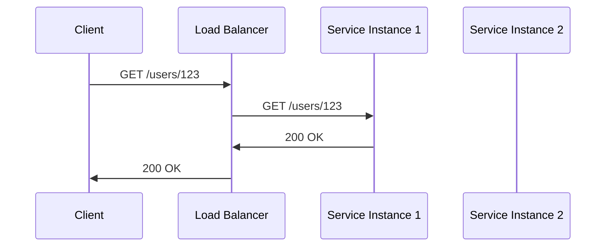

<!-- Generated by Groq via GitHub Actions -->
<!-- Topic ID: T084 -->
<!-- Category: System Design -->
<!-- Generated at UTC: 2026-10-12T21:48:49.297225+00:00 -->

# Load balancing

## 1. What problem does this solve?

**Motivation**  
When a web service receives more traffic than a single server can handle, requests start queuing, latency rises, and the server can crash. Load balancing distributes incoming traffic across multiple backend instances so that no single node becomes a bottleneck.

**What problem exists**  
- **Capacity limits**: A single instance can only process a finite number of requests per second.
- **Fault tolerance**: If one instance fails, the whole service becomes unavailable.
- **Resource utilization**: Idle servers waste compute resources.

**Why the problem matters**  
- Poor user experience (slow or failed requests).
- Revenue loss for paid services.
- Increased operational costs if you over‑provision a single server to handle peak load.

**What happens if this concept is not used**  
- Requests pile up → timeouts, higher error rates.
- Single point of failure → outages.
- Inconsistent performance across users.

**Where this concept appears in real backend systems**  
- Web front‑ends behind an Nginx or HAProxy reverse proxy.
- Microservice clusters behind a Kubernetes Service or Istio ingress.
- API gateways (e.g., Kong, AWS API Gateway) that route to multiple function instances.

---

## 2. Mental model

**Analogy**  
Imagine a busy pizza shop with only one oven. If 100 customers arrive, the oven can only bake a few pizzas at a time, so orders wait. Adding more ovens (servers) lets the shop serve all customers simultaneously. A *load balancer* is like the shop manager who decides which oven each order goes to, ensuring no oven is overworked while others sit idle.

**Precise engineering model**  
- **Clients** send HTTP/HTTPS requests to a *front‑end* address (e.g., `api.example.com`).
- A **load balancer** (hardware or software) receives the request, decides which **backend instance** should handle it, and forwards the request.
- The backend processes the request and returns a response to the load balancer, which then forwards it back to the client.

---

## 3. Deep explanation

### Internals
- **Health checks**: The balancer periodically pings each instance to confirm it’s alive.
- **Session persistence (sticky sessions)**: Some workloads need the same client to hit the same instance (e.g., in‑memory session store).
- **Connection pooling**: The balancer may maintain TCP connections to backends to reduce latency.
- **Protocol support**: HTTP/HTTPS, TCP, UDP, gRPC, WebSocket, etc.

### Important terminology
| Term | Meaning |
|------|---------|
| **Round‑Robin** | Rotate requests evenly across instances. |
| **Least‑Connections** | Send to the instance with the fewest active connections. |
| **Weighted** | Assign different weights to instances (e.g., newer instances get more traffic). |
| **Health check** | Endpoint or probe that verifies instance readiness. |
| **Failover** | Automatic switch to healthy instances when one fails. |
| **Sticky session** | Keep a client’s requests on the same instance. |
| **Target group** | Collection of backend instances behind a balancer. |

### Trade‑offs
| Strategy | Pros | Cons |
|----------|------|------|
| Round‑Robin | Simple, fair | Ignores instance load, can overload a slower node |
| Least‑Connections | Adapts to load | Requires real‑time connection count, more overhead |
| Weighted | Fine‑grained control | Requires careful tuning, can become stale |
| Sticky sessions | Keeps session data local | Reduces elasticity, can cause uneven load |

### Failure modes
- **Unhealthy instance**: If health checks fail, traffic is stopped but may cause a sudden drop in capacity.
- **Network partition**: The balancer may route to an instance that can’t reach a database, leading to errors.
- **DNS caching**: Clients may cache the balancer’s IP and bypass it, breaking routing.

### Limitations
- **Statelessness**: Load balancers work best when backends are stateless; otherwise you need sticky sessions or external session stores.
- **Single point of failure**: The balancer itself can become a bottleneck unless it’s highly available.
- **Latency**: Extra hop adds a few milliseconds; usually negligible but matters for ultra‑low‑latency services.

### Where it fits in a backend architecture
```
┌───────────────────────┐
│  Client (Browser/API) │
└─────────────┬─────────┘
              │
              ▼
┌───────────────────────┐
│   Load Balancer (LB)   │
└───────┬───────┬────────┘
        │       │
        ▼       ▼
┌─────────────┐ ┌─────────────┐
│  Service A  │ │  Service A  │
│  (Node.js)  │ │  (Node.js)  │
└─────────────┘ └─────────────┘
```
The LB sits between the client and the pool of service instances.

### Interaction with related concepts
- **Auto‑scaling**: LB works with scaling groups to add/remove instances.
- **Service discovery**: LB can query a registry (Consul, etcd) for healthy instances.
- **Observability**: Metrics (latency, error rate) are collected per instance and aggregated at the LB.
- **Security**: TLS termination can happen at the LB, offloading encryption from backends.

---

## 4. How it works

1. **Client sends request** to `api.example.com`.
2. **DNS resolves** to the LB’s IP (or LB’s hostname).
3. **LB receives** the request, runs health checks, and selects a target instance.
4. **LB forwards** the request (TCP/HTTP) to the chosen instance.
5. **Instance processes** the request, queries DB/Redis, etc.
6. **Instance returns** response to LB.
7. **LB forwards** response back to the client.



---

## 5. Practical implementation

Below is a minimal Node.js/TypeScript example using **Nginx** as a reverse proxy load balancer.  
The example demonstrates round‑robin balancing across two Express servers.

### 5.1 Backend services

```bash
# services/
# ├─ service1/
# │   └─ index.ts
# └─ service2/
#     └─ index.ts
```

**service1/index.ts**

```ts
import express from 'express';
const app = express();
const PORT = 3001;

app.get('/hello', (req, res) => {
  res.json({ message: 'Hello from Service 1', time: new Date() });
});

app.listen(PORT, () => console.log(`Service 1 listening on ${PORT}`));
```

**service2/index.ts**

```ts
import express from 'express';
const app = express();
const PORT = 3002;

app.get('/hello', (req, res) => {
  res.json({ message: 'Hello from Service 2', time: new Date() });
});

app.listen(PORT, () => console.log(`Service 2 listening on ${PORT}`));
```

Run each service in its own terminal:

```bash
ts-node services/service1/index.ts
ts-node services/service2/index.ts
```

### 5.2 Nginx load balancer

Create `nginx.conf`:

```nginx
events {}

http {
  upstream backend {
    server 127.0.0.1:3001;
    server 127.0.0.1:3002;
  }

  server {
    listen 8080;

    location / {
      proxy_pass http://backend;
      proxy_set_header Host $host;
      proxy_set_header X-Real-IP $remote_addr;
    }
  }
}
```

Run Nginx:

```bash
docker run -d -p 8080:8080 -v $(pwd)/nginx.conf:/etc/nginx/nginx.conf:ro nginx:alpine
```

Now hitting `http://localhost:8080/hello` will round‑robin between Service 1 and Service 2.

### 5.3 Health checks (optional)

Add a `/health` endpoint to each service:

```ts
app.get('/health', (req, res) => res.send('ok'));
```

Configure Nginx to check this endpoint:

```nginx
upstream backend {
  server 127.0.0.1:3001 max_fails=3 fail_timeout=30s;
  server 127.0.0.1:3002 max_fails=3 fail_timeout=30s;
}
```

Nginx will automatically stop routing to a server that fails the health check.

---

## 6. Production considerations

| Concern | How to address it |
|---------|-------------------|
| **Scalability** | Use a cloud LB (AWS ALB, GCP LB) or Kubernetes Service with horizontal pod autoscaling. |
| **Reliability** | Deploy multiple LB instances behind a DNS round‑robin or use a global LB. |
| **Security** | Terminate TLS at the LB, enforce HSTS, use WAF. |
| **Observability** | Enable access logs, export metrics (latency, request count) to Prometheus. |
| **Performance** | Keep LB close to clients (edge), use HTTP/2 or gRPC for multiplexing. |
| **Error handling** | Configure retry policies, circuit breakers in the LB or client. |
| **Resource usage** | Monitor CPU/memory of LB; use lightweight LB (e.g., HAProxy) if resources are tight. |
| **Operational concerns** | Automate health checks, use rolling updates, keep configuration in version control. |
| **Failure recovery** | Use health checks + graceful draining of connections during instance termination. |
| **Deployment** | Use immutable containers, CI/CD pipelines, blue/green or canary deployments. |

---

## 7. Common mistakes

| Mistake | Why it’s problematic |
|---------|----------------------|
| **Using sticky sessions without a shared session store** | Leads to uneven load and data loss if the instance dies. |
| **Ignoring health checks** | Traffic can be routed to dead instances, causing errors. |
| **Hard‑coding backend IPs** | Makes scaling and failover impossible. |
| **Not terminating TLS at the LB** | Increases load on backends and exposes them to the internet. |
| **Over‑using round‑robin on heterogeneous instances** | Slower instances become bottlenecks. |
| **Failing to monitor latency per instance** | Hard to spot a single instance degrading. |
| **Deploying LB as a single point of failure** | One misconfigured LB can bring down the whole service. |

---

## 8. Senior engineer perspective

### Architecture decisions
- **LB placement**: Edge (cloud provider) vs internal (k8s Service) depends on latency and security needs.
- **Protocol choice**: HTTP/2 or gRPC for microservices, TCP for legacy services.
- **Health‑check strategy**: Liveness vs readiness probes; custom application checks.

### Trade‑offs
- **Stateless vs stateful**: Prefer stateless services; if stateful, use sticky sessions or external stores.
- **Cost vs performance**: Cloud LB vs self‑hosted; more instances = higher cost but better resilience.

### Bottlenecks
- **LB CPU/memory**: High request rates can saturate the LB; use hardware LB or scale LB horizontally.
- **Network latency**: Keep LB close to clients; use CDN for static assets.

### Failure scenarios
- **LB overload**: Implement rate limiting or back‑pressure.
- **Backend failure**: Circuit breaker patterns in the client or LB.

### Monitoring
- **Metrics**: Request per second, error rate, latency, backend health status.
- **Tracing**: Distributed tracing (OpenTelemetry) to see which backend handled a request.

### Cost/performance
- **Auto‑scaling**: Scale LB instances based on CPU or request rate.
- **Weighted routing**: Gradually roll out new versions.

### When NOT to use
- **Very small services**: A single instance may suffice; LB adds unnecessary complexity.
- **High‑frequency micro‑tasks**: Use serverless functions with built‑in scaling instead of a dedicated LB.

---

## 9. Interview questions

1. **Beginner**: *What is a load balancer and why do we need it?*  
   *Answer*: It distributes incoming traffic across multiple servers to improve capacity, reliability, and performance.

2. **Beginner**: *Explain the difference between round‑robin and least‑connections load‑balancing algorithms.*  
   *Answer*: Round‑robin cycles requests evenly; least‑connections sends to the instance with the fewest active connections, adapting to current load.

3. **Senior**: *How would you design a load‑balancing strategy for a stateless microservice that serves 10k requests per second with a 99.9% SLA?*  
   *Answer points*: Use a cloud LB with health checks, auto‑scaling, weighted routing, TLS termination, monitoring, and a circuit breaker. Discuss cost vs performance trade‑offs.

4. **Senior**: *Describe how you would detect and mitigate a “slow‑loris” attack in a load‑balanced environment.*  
   *Answer points*: Rate limiting, connection timeouts, use of a WAF, monitoring abnormal connection patterns, scaling the LB.

5. **Scenario/Debugging**: *A client reports intermittent 502 errors from the API. The load balancer logs show that requests are being forwarded to a backend that returns 500. What steps would you take to diagnose and fix the issue?*  
   *Answer points*: Check backend health checks, inspect backend logs, verify database connectivity, look for resource exhaustion, roll back recent changes, add circuit breaker, update LB configuration.

---

## 10. Hands‑on task

**Task**: Add a health‑check endpoint to each Express service and configure Nginx to perform health checks. Then, simulate a backend failure by stopping one service and observe how Nginx stops routing to it.

**Steps**:
1. Add `/health` route returning `200 OK` to both services.
2. Update `nginx.conf` to include `max_fails` and `fail_timeout`.
3. Restart Nginx.
4. Stop `service2` (`Ctrl+C`).
5. Send repeated requests to `http://localhost:8080/hello` and verify that responses come only from Service 1.
6. Restart `service2` and confirm traffic resumes.

---

## 11. Quick revision

- Load balancer sits between clients and backend instances.
- Common algorithms: round‑robin, least‑connections, weighted.
- Health checks keep traffic off unhealthy instances.
- Sticky sessions are needed for stateful data; otherwise keep services stateless.
- TLS termination at the LB offloads encryption.
- Observability: log access, expose metrics, use tracing.
- Failure modes: LB overload, backend failure, network partition.
- Production LB options: cloud ALB, GCP LB, Kubernetes Service, HAProxy.
- Scaling: auto‑scale backends, scale LB horizontally if needed.
- Avoid sticky sessions unless backed by external session store.
- Monitor latency per instance to spot degradation early.

---

## 12. References

- [Nginx Load Balancing](https://nginx.org/en/docs/http/load_balancer.html)
- [HAProxy Load Balancer](https://www.haproxy.org/)
- [AWS Application Load Balancer](https://docs.aws.amazon.com/elasticloadbalancing/latest/application/introduction.html)
- [Kubernetes Service](https://kubernetes.io/docs/concepts/services-networking/service/)
- [OpenTelemetry for Distributed Tracing](https://opentelemetry.io/docs/)
- [Express.js Documentation](https://expressjs.com/)
