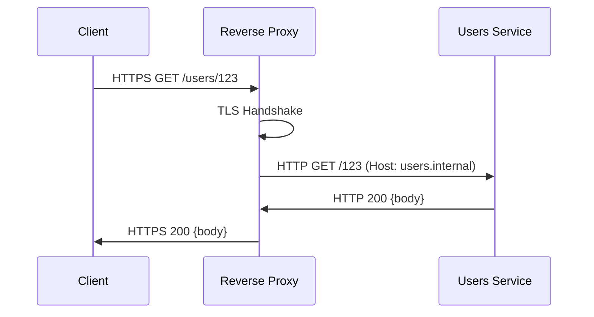

<!-- Generated by Groq via GitHub Actions -->
<!-- Topic ID: T085 -->
<!-- Category: System Design -->
<!-- Generated at UTC: 2026-10-13T07:55:04.379222+00:00 -->

# Reverse proxies

## 1. What problem does this solve?

**Motivation**  
When a client talks to a backend service, the client usually talks to a single endpoint (e.g., `api.example.com`). In reality, that endpoint is often a *gateway* that hides a cluster of servers, handles TLS, performs load balancing, and can add security or caching layers. A reverse proxy is the software that sits in that gateway position.

**What problem exists**

| Problem | Why it matters | Consequence if ignored |
|---------|----------------|------------------------|
| **Single point of failure** | One server can bring down the whole API surface | Downtime, loss of availability |
| **Uneven load** | Some instances get more traffic than others | Hot spots, degraded performance |
| **TLS overhead on every backend** | Each backend must handle encryption/decryption | CPU waste, slower response |
| **Hard to expose internal services** | Backends often run on private networks | Security risk, complex networking |
| **Need for request routing** | Different paths or subdomains need different services | Manual routing logic in each service |
| **Security hardening** | Need WAF, rate limiting, IP filtering | Vulnerable to attacks |

**Where it appears in real backend systems**

* API gateways (e.g., Kong, Tyk, AWS API Gateway)
* Edge servers / CDNs (e.g., Cloudflare, Fastly)
* In‑cluster service meshes (Envoy, Istio)
* Classic load balancers (NGINX, HAProxy, Traefik)
* Web servers that also act as reverse proxies (Apache, NGINX)

---

## 2. Mental model

**Analogy – The Receptionist**  
Think of a corporate office building. Clients arrive at the front desk (the reverse proxy). The receptionist checks the visitor list, forwards the visitor to the correct department, may give a badge (add headers), and can even answer simple questions (rate limiting). The receptionist also ensures that only authorized visitors get inside (TLS termination, authentication).

**Engineering model**  
A reverse proxy is a server that:

1. Listens on a public IP/port (e.g., `443`).
2. Receives an HTTP(S) request from a client.
3. Decides which backend server should handle the request.
4. Forwards the request (possibly rewriting the URL, headers, or body).
5. Receives the backend’s response and streams it back to the client.

It can also terminate TLS, cache responses, enforce security policies, and provide observability hooks.

---

## 3. Deep explanation

### Internals

| Component | Responsibility |
|-----------|----------------|
| **Listener** | Accepts TCP connections, performs TLS handshake if needed. |
| **Router** | Matches request path/host to a backend pool. |
| **Load Balancer** | Chooses a specific instance (round‑robin, least‑conn, etc.). |
| **Proxy** | Forwards the request, handles keep‑alive, header manipulation. |
| **Health Checker** | Periodically probes backends to keep the pool healthy. |
| **Cache** | Stores responses for repeated requests (optional). |
| **Security Layer** | WAF rules, rate limiting, IP filtering. |
| **Observability** | Emits logs, metrics, traces. |

### Important terminology

| Term | Definition |
|------|------------|
| **Upstream** | The backend service(s) the proxy forwards to. |
| **Downstream** | The client that sent the request. |
| **Health check** | Periodic probe to verify backend availability. |
| **Sticky session** | Route all requests from a client to the same backend. |
| **TLS termination** | Proxy ends TLS and forwards plain HTTP to backend. |
| **WAF** | Web Application Firewall – filters malicious traffic. |
| **Rate limiting** | Throttle requests per IP/user. |
| **Connection pooling** | Reuse TCP connections to backends. |
| **WebSocket support** | Upgrade HTTP to WebSocket and proxy frames. |

### Trade‑offs

| Feature | Pros | Cons |
|---------|------|------|
| **TLS termination at proxy** | Offloads CPU from backends, central cert management | Adds a hop, potential privacy concerns |
| **Caching** | Faster responses, lower backend load | Stale data, cache invalidation complexity |
| **Sticky sessions** | Session affinity | Uneven load, harder to scale out |
| **Health checks** | Automatic failover | Extra traffic, false positives |
| **WAF** | Security | Extra latency, false positives |

### Failure modes

| Mode | What happens | Mitigation |
|------|--------------|------------|
| **Proxy crash** | All traffic stops | Redundant proxy instances, health checks |
| **Misconfigured routing** | Requests go to wrong backend | Validation scripts, CI checks |
| **Backend overload** | 502/503 responses | Circuit breakers, graceful degradation |
| **TLS cert expiry** | Clients reject connection | Automated renewal, monitoring |
| **Header injection errors** | Security bypass | Strict header handling, validation |

### Limitations

* Cannot proxy protocols that are not HTTP/HTTPS (unless custom logic).
* Adds latency (one extra hop).
* Requires careful configuration to avoid leaking sensitive headers.
* Scaling the proxy itself can become a bottleneck if not horizontally scalable.

### Where it fits in a backend architecture

```
┌───────────────────────┐
│  Client (Browser/API) │
└────────────┬──────────┘
             │
             ▼
┌───────────────────────┐
│  Reverse Proxy (NGINX│
│  / Envoy / Traefik)   │
└───────┬───────┬───────┘
        │       │
        ▼       ▼
┌───────────────┐  ┌───────────────┐
│  Service A    │  │  Service B    │
│  (FastAPI)    │  │  (Node.js)    │
└───────────────┘  └───────────────┘
```

The reverse proxy sits between the public internet and the internal service mesh, providing a single entry point.

### Interaction with related concepts

* **Load balancer** – Often the reverse proxy doubles as a load balancer.
* **Service mesh** – Envoy can act as both a sidecar and a gateway.
* **API gateway** – Adds authentication, rate limiting, and request transformation.
* **CDN** – Edge reverse proxies cache static assets globally.
* **Observability** – Prometheus metrics, OpenTelemetry traces are emitted by the proxy.

---

## 4. How it works

### Step‑by‑step flow

1. **Client** sends an HTTPS request to `api.example.com`.
2. **TLS handshake** occurs at the reverse proxy; the client’s certificate is verified (if mutual TLS).
3. **Proxy** parses the request, matches the path (`/users/*`) to a backend pool.
4. **Load balancer** selects an instance (e.g., `users-01.internal:8000`).
5. **Proxy** forwards the request, rewriting the `Host` header to `users.internal`.
6. **Backend** processes the request and sends a response.
7. **Proxy** receives the response, optionally caches it, and streams it back to the client.
8. **Client** receives the response over the same TLS session.



---

## 5. Practical implementation

Below is a minimal Node.js reverse proxy using `http-proxy-middleware` that:

* Terminates TLS
* Routes `/api/*` to a FastAPI backend
* Adds an `X-Forwarded-For` header
* Handles WebSocket upgrades

```ts
// proxy.ts
import express from 'express';
import { createProxyMiddleware } from 'http-proxy-middleware';
import https from 'https';
import fs from 'fs';
import path from 'path';

const app = express();

// 1️⃣ TLS termination
const sslOptions = {
  key: fs.readFileSync(path.join(__dirname, 'certs', 'privkey.pem')),
  cert: fs.readFileSync(path.join(__dirname, 'certs', 'fullchain.pem')),
};

// 2️⃣ Proxy middleware
const apiProxy = createProxyMiddleware('/api', {
  target: 'http://localhost:8000', // FastAPI backend
  changeOrigin: true,
  pathRewrite: { '^/api': '' }, // strip /api prefix
  onProxyReq: (proxyReq, req) => {
    // Add X-Forwarded-For header
    const clientIp = req.headers['x-forwarded-for'] || req.socket.remoteAddress;
    proxyReq.setHeader('X-Forwarded-For', clientIp as string);
  },
  ws: true, // support WebSocket
  logLevel: 'debug',
});

// 3️⃣ Mount the proxy
app.use(apiProxy);

// 4️⃣ Start HTTPS server
https.createServer(sslOptions, app).listen(443, () => {
  console.log('Reverse proxy listening on https://localhost');
});
```

### Dockerfile

```dockerfile
# Dockerfile
FROM node:20-alpine

WORKDIR /app
COPY package*.json ./
RUN npm ci
COPY . .

# Expose HTTPS port
EXPOSE 443

CMD ["node", "proxy.ts"]
```

### docker‑compose.yml

```yaml
version: "3.8"
services:
  proxy:
    build: .
    ports:
      - "443:443"
    volumes:
      - ./certs:/app/certs
    depends_on:
      - api
  api:
    image: tiangolo/uvicorn-gunicorn-fastapi:python3.10
    volumes:
      - ./app:/app
    environment:
      - MODULE_NAME=main
      - VARIABLE_NAME=app
    expose:
      - "8000"
```

Run `docker compose up --build` and hit `https://localhost/api/hello`. The proxy will forward to the FastAPI backend.

---

## 6. Production considerations

| Concern | What to do |
|---------|------------|
| **Scalability** | Run multiple proxy instances behind a DNS round‑robin or external load balancer. Use stateless design. |
| **Reliability** | Enable health checks, graceful shutdown, and graceful error responses (502/503). |
| **Security** | - TLS termination with strong ciphers.<br>- HSTS, CSP headers.<br>- WAF rules, rate limiting.<br>- Do not forward sensitive headers unless needed. |
| **Observability** | Emit Prometheus metrics (`upstream_latency`, `request_count`). Log request/response headers. Use OpenTelemetry for tracing. |
| **Performance** | Use connection pooling, keep‑alive, and HTTP/2. Avoid unnecessary header rewrites. |
| **Error handling** | Return friendly error pages, retry logic for transient errors. |
| **Resource usage** | Monitor CPU/memory; proxies can become CPU‑bound on TLS. |
| **Operational concerns** | Automate cert renewal (Let’s Encrypt). Use CI/CD to validate proxy configs. |
| **Failure recovery** | Deploy in multiple AZs, use health checks to remove failed instances. |
| **Deployment** | Prefer immutable containers, use blue/green or canary deployments. |

---

## 7. Common mistakes

| Mistake | Why it’s bad |
|---------|--------------|
| **Not setting `Host` header** | Backend may reject requests or route incorrectly. |
| **Ignoring WebSocket upgrades** | Clients see `426 Upgrade Required` or dropped connections. |
| **Using default timeouts** | Long‑running requests may be killed prematurely. |
| **No health checks** | Traffic goes to dead backends, causing 502/503. |
| **Over‑caching** | Stale data served to users. |
| **Missing TLS termination** | Backend servers waste CPU on TLS. |
| **Not handling `X-Forwarded-For`** | Loss of client IP for logging or rate limiting. |
| **Hardcoding backend URLs** | Difficult to change environment (dev/prod). |
| **No rate limiting** | Open to DoS attacks. |
| **Using a single proxy instance** | Single point of failure. |

---

## 8. Senior engineer perspective

### What changes at scale

* **Architecture** – Move from a single proxy to a *gateway* cluster behind a global load balancer (e.g., AWS ALB). Use a service mesh (Envoy) for intra‑cluster traffic.
* **Design decisions** – Choose between *edge* (public) vs *internal* proxies. Decide on TLS termination location (edge vs backend). Pick a caching strategy (CDN vs local).
* **Trade‑offs** – Balancing latency vs security. For example, terminating TLS at the edge reduces backend load but introduces a new trust boundary.
* **Bottlenecks** – CPU for TLS, memory for connection pools, network egress costs. Use hardware acceleration (AES-NI) or offload to dedicated proxies.
* **Failure scenarios** – Proxy crash, misconfiguration, network partition. Use redundancy, health checks, and circuit breakers.
* **Monitoring** – Collect metrics per backend, latency histograms, error rates. Use distributed tracing to pinpoint where latency is introduced.
* **Cost/performance** – Running multiple proxy instances increases compute cost. Offloading TLS to a CDN can reduce egress costs.
* **When NOT to use** – For a single, low‑traffic service, a simple NGINX instance may suffice. Avoid over‑engineering.

---

## 9. Interview questions

1. **Beginner** – *What is a reverse proxy and how does it differ from a forward proxy?*  
   *Answer:* A reverse proxy sits in front of servers and forwards client requests to them. A forward proxy sits between clients and the internet, masking the client’s identity.

2. **Beginner** – *Why do we often terminate TLS at the reverse proxy?*  
   *Answer:* To offload CPU from backends, centralize certificate management, and simplify backend configuration.

3. **Senior** – *Explain how you would design a reverse proxy system that can handle 10 M requests per second with sub‑50 ms latency.*  
   *Answer:* Use a stateless, horizontally scalable proxy (e.g., Envoy), enable HTTP/2, keep‑alive, connection pooling, load‑balance with least‑conn, deploy in multiple AZs, use a CDN for static assets, monitor with Prometheus, and auto‑scale based on latency metrics.

4. **Senior** – *Describe a scenario where sticky sessions in a reverse proxy could become a bottleneck and how you would mitigate it.*  
   *Answer:* Sticky sessions can cause uneven load if a few clients generate many requests. Mitigation: use session replication, move session state to a distributed store (Redis), or use consistent hashing.

5. **Scenario/Debugging** – *A client receives a 502 error from the reverse proxy, but the backend logs show the request was processed successfully. What could be wrong?*  
   *Answer:* Possible causes: proxy health check marked backend unhealthy, connection pool exhausted, timeout in proxy, TLS handshake failure, or proxy misrouting. Check proxy logs, health check status, and backend metrics.

---

## 10. Hands‑on task

**Task:**  
Create a Docker‑Compose stack that includes:

1. A Node.js reverse proxy (using `http-proxy-middleware`).
2. A FastAPI backend that serves `/hello` and `/ws` (WebSocket echo).
3. A simple React front‑end that calls `/api/hello` and opens a WebSocket to `/api/ws`.

**Requirements**

* The proxy should terminate TLS (use self‑signed certs).
* The proxy must rewrite `/api/*` to the FastAPI backend.
* The React app should display the response from `/api/hello` and echo messages over the WebSocket.
* Verify that the proxy logs the request path and client IP.

**Deliverables**

* `docker-compose.yml`
* `proxy/` folder with `proxy.ts` and Dockerfile
* `backend/` folder with FastAPI `main.py`
* `frontend/` folder with a minimal React app
* README with instructions to run and test

---

## 11. Quick revision

- Reverse proxy sits between clients and backends, forwarding requests.
- Terminates TLS to offload CPU and centralize certs.
- Routes based on host/path, can load‑balance, rewrite URLs, and add headers.
- Health checks keep the backend pool healthy.
- Common features: caching, WAF, rate limiting, WebSocket support.
- Failure modes: misrouting, missing health checks, TLS expiry.
- Production concerns: scalability, reliability, security, observability, performance.
- Senior‑level design: multi‑AZ, service mesh, CDN edge, distributed tracing.
- Typical tech stack: NGINX, Envoy, Traefik, http‑proxy‑middleware, HAProxy.
- Key metrics: request latency, error rate, backend health, throughput.

---

## 12. References

- [NGINX Reverse Proxy Documentation](https://nginx.org/en/docs/http/ngx_http_proxy_module.html)
- [Envoy Proxy Documentation](https://www.envoyproxy.io/docs/envoy/latest/)
- [Traefik Documentation](https://doc.traefik.io/traefik/)
- [http-proxy-middleware GitHub](https://github.com/chimurai/http-proxy-middleware)
- [FastAPI Documentation](https://fastapi.tiangolo.com/)
- [OpenTelemetry for Node.js](https://opentelemetry.io/docs/instrumentation/node/)
- [Prometheus Node Exporter](https://prometheus.io/docs/instrumenting/exporters/)
- [Let’s Encrypt Certbot](https://certbot.eff.org/)
