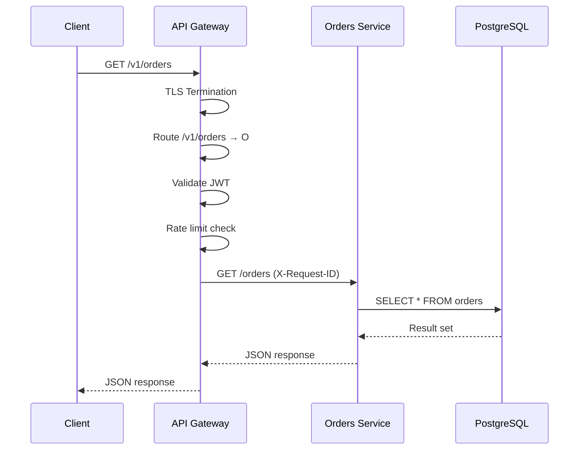

<!-- Generated by Groq via GitHub Actions -->
<!-- Topic ID: T086 -->
<!-- Category: System Design -->
<!-- Generated at UTC: 2026-10-13T07:55:04.379222+00:00 -->

# API gateways

## 1. What problem does this solve?

**Motivation**  
In a modern micro‑service architecture you usually have dozens of services (auth, billing, catalog, recommendation, etc.). Each service exposes its own HTTP/REST or gRPC endpoints. Clients (web, mobile, internal tools) would have to know the address, version, and authentication scheme for every service they need. That leads to:

- **Client complexity** – the front‑end must maintain a list of service URLs and handle cross‑service auth.
- **Security surface** – every service becomes a public endpoint, increasing the attack surface.
- **Versioning chaos** – clients may hit different API versions unintentionally.
- **Observability fragmentation** – logs, metrics, and tracing are spread across services.

**Why it matters**  
If you expose every micro‑service directly, you lose control over traffic routing, rate limiting, authentication, and monitoring. It also makes it hard to evolve services independently without breaking clients.

**What happens if you don’t use an API gateway**  
- Clients must call each service individually → more round‑trips, higher latency.
- Harder to enforce consistent auth and rate limits.
- Harder to add cross‑cutting concerns (caching, circuit breaking) uniformly.
- Poor visibility into overall request flow.

**Real‑world appearance**  
- Netflix uses Zuul/Edge services as API gateways.
- AWS API Gateway + Lambda for serverless backends.
- Kong, Tyk, and Ambassador are popular open‑source gateways.
- Many SaaS products expose a single public endpoint that forwards to internal services.

---

## 2. Mental model

**Analogy**  
Think of an API gateway as a *post office* for your services.  
- **Post office** receives mail (HTTP requests) at a single address.  
- It knows the destination (which micro‑service) and forwards the mail.  
- It can stamp the mail with stamps (authentication tokens), check for spam (rate limits), and keep a log of every letter.

**Engineering model**  
- **Entry point**: a single public URL (e.g., `api.myapp.com`).  
- **Routing layer**: matches request path/verb to a backend service.  
- **Cross‑cutting policies**: auth, rate limiting, caching, transformation.  
- **Health checks & monitoring**: aggregates status of downstream services.  
- **Security**: TLS termination, IP whitelisting, OAuth/JWT validation.

---

## 3. Deep explanation

### Internals
| Layer | Responsibility |
|-------|----------------|
| **Ingress** | TLS termination, load balancing, IP filtering. |
| **Routing** | Path/verb matching, versioning, service discovery. |
| **Policy Engine** | Auth, rate limits, quotas, request/response transformations. |
| **Proxy** | Makes outbound HTTP/gRPC calls, retries, circuit breaking. |
| **Observability** | Distributed tracing, metrics, logs. |
| **Admin API** | Runtime configuration, health checks. |

### Important terminology
- **Route** – mapping from request path+method to a backend service.
- **Upstream** – the actual micro‑service endpoint.
- **Downstream** – the service that receives the forwarded request.
- **Transformation** – modifying request/response payloads (e.g., adding headers, converting JSON to XML).
- **Circuit breaker** – stops traffic to a failing service to prevent cascading failures.
- **Rate limiter** – limits requests per client or per route.
- **API key / JWT** – authentication tokens validated at the gateway.

### Trade‑offs
| Benefit | Drawback |
|---------|----------|
| Centralized auth & rate limiting | Single point of failure if not highly available |
| Simplified client API | Adds latency (extra hop) |
| Easier observability | Requires additional infrastructure |
| Can cache responses | Cache invalidation complexity |

### Failure modes
- **Gateway overload** → request timeouts for all services.  
- **Misconfigured routing** → traffic to wrong service or dead‑end.  
- **Policy mis‑execution** (e.g., wrong rate limit) → legitimate traffic blocked.  
- **TLS termination failure** → clients cannot connect.

### Limitations
- Not a replacement for service‑to‑service communication patterns (e.g., gRPC).  
- Cannot fully replace fine‑grained auth inside services; gateway should enforce coarse policies.  
- Requires careful versioning strategy to avoid breaking clients.

### Where it fits
```
Client
   │
   ▼
API Gateway (Ingress + Routing + Policies)
   │
   ├─> Auth Service
   ├─> Billing Service
   ├─> Catalog Service
   └─> Recommendation Service
```

### Interaction with related concepts
- **Service Mesh**: Mesh handles internal traffic; gateway handles external traffic.  
- **API Management**: Gateway can expose developer portal, analytics.  
- **CI/CD**: Gateway config can be versioned and deployed with services.  
- **Observability**: Gateway emits traces that link to downstream services.

---

## 4. How it works

### Step‑by‑step flow

1. **Client sends HTTPS request** to `https://api.myapp.com/v1/orders`.
2. **Ingress layer** terminates TLS, performs IP filtering, forwards to routing engine.
3. **Routing engine** matches `/v1/orders` → `orders-service:3000`.
4. **Policy engine** validates JWT, applies rate limit (e.g., 100 req/min).
5. **Proxy** forwards request to `orders-service` over HTTP/2, adds `X-Request-ID`.
6. **Orders service** processes request, writes to PostgreSQL, returns JSON.
7. **Proxy** receives response, applies any response transformation (e.g., adds caching headers).
8. **Gateway** sends response back to client, logs the transaction, emits metrics.



---

## 5. Practical implementation

Below is a minimal API gateway built with **Node.js + Express** and **http-proxy-middleware**.  
It demonstrates TLS termination, routing, auth validation, rate limiting, and basic logging.

```ts
// gateway.ts
import express from 'express';
import { createProxyMiddleware } from 'http-proxy-middleware';
import rateLimit from 'express-rate-limit';
import jwt from 'jsonwebtoken';
import morgan from 'morgan';
import fs from 'fs';
import https from 'https';

const app = express();
const PORT = 8443;

// ---------- 1️⃣ Logging ----------
app.use(morgan('combined'));

// ---------- 2️⃣ Rate limiting ----------
const limiter = rateLimit({
  windowMs: 60 * 1000, // 1 minute
  max: 200, // limit each IP to 200 requests per windowMs
  standardHeaders: true,
  legacyHeaders: false,
});
app.use(limiter);

// ---------- 3️⃣ Auth middleware ----------
const JWT_SECRET = process.env.JWT_SECRET ?? 'supersecret';
app.use((req, res, next) => {
  const auth = req.headers.authorization;
  if (!auth) return res.status(401).json({ error: 'Missing token' });

  const token = auth.split(' ')[1];
  try {
    const payload = jwt.verify(token, JWT_SECRET);
    // attach user info to request for downstream services
    (req as any).user = payload;
    next();
  } catch (e) {
    return res.status(401).json({ error: 'Invalid token' });
  }
});

// ---------- 4️⃣ Routing ----------
const routes = [
  {
    path: '/v1/orders',
    target: 'http://orders-service:3000',
    pathRewrite: { '^/v1/orders': '' },
  },
  {
    path: '/v1/users',
    target: 'http://users-service:3000',
    pathRewrite: { '^/v1/users': '' },
  },
];

routes.forEach((route) => {
  app.use(
    route.path,
    createProxyMiddleware({
      target: route.target,
      changeOrigin: true,
      pathRewrite: route.pathRewrite,
      onProxyReq: (proxyReq, req) => {
        // add request ID header
        proxyReq.setHeader('X-Request-ID', req.headers['x-request-id'] ?? '');
      },
      onError: (err, req, res) => {
        console.error('Proxy error:', err);
        res.status(502).json({ error: 'Bad gateway' });
      },
    })
  );
});

// ---------- 5️⃣ TLS termination ----------
const httpsOptions = {
  key: fs.readFileSync('./certs/key.pem'),
  cert: fs.readFileSync('./certs/cert.pem'),
};

https.createServer(httpsOptions, app).listen(PORT, () => {
  console.log(`API Gateway listening on https://localhost:${PORT}`);
});
```

**Notes**

- `express-rate-limit` is a simple in‑memory limiter; for production use Redis or a distributed limiter.  
- JWT validation is done at the gateway; downstream services can trust the `X-User` header.  
- `http-proxy-middleware` handles retries and keep‑alive connections automatically.  
- TLS certificates are loaded from disk; in production use a secrets manager or a cloud load balancer.

---

## 6. Production considerations

| Concern | What to watch for | Mitigation |
|---------|-------------------|------------|
| **Scalability** | Single instance becomes bottleneck | Deploy horizontally behind a load balancer; use stateless design. |
| **Reliability** | Gateway failure blocks all services | Use multiple replicas, health checks, and graceful degradation. |
| **Security** | TLS termination, auth bypass | Enforce TLS everywhere, validate JWTs, use short‑lived tokens, rotate secrets. |
| **Observability** | Missing traces, noisy logs | Emit OpenTelemetry traces, use structured logs, aggregate metrics. |
| **Performance** | Extra hop adds latency | Keep proxy fast, enable HTTP/2, use connection pooling. |
| **Error handling** | Propagate meaningful errors | Map downstream status codes, add retry logic, expose error IDs. |
| **Resource usage** | Memory leaks, CPU spikes | Monitor memory, use graceful shutdown, limit concurrent connections. |
| **Operational concerns** | Configuration drift | Store routing config in a central repo, use CI/CD to deploy. |
| **Failure recovery** | Circuit breaker resets | Implement health checks, use fallback responses. |
| **Deployment** | Zero‑downtime updates | Use canary releases, blue/green deployments. |

---

## 7. Common mistakes

| Mistake | Why it’s bad |
|---------|--------------|
| **Hard‑coding routes** | Leads to configuration drift; services need to be restarted for changes. |
| **Using in‑memory rate limits** | Not shared across instances → inconsistent limits. |
| **Skipping TLS termination** | Exposes internal services to the internet. |
| **Over‑transforming payloads** | Adds latency and complexity; better to keep services simple. |
| **Ignoring idempotency** | Clients retrying may cause duplicate side effects if gateway doesn’t enforce idempotency keys. |
| **Not propagating tracing context** | Breaks distributed tracing; hard to debug. |
| **Using the gateway for business logic** | Violates separation of concerns; makes gateway heavy. |
| **Not handling 5xx from downstream** | Clients see generic errors; no insight into root cause. |

---

## 8. Senior engineer perspective

### At scale
- **Architecture decisions**: Choose between a monolithic gateway (e.g., Kong) vs. a lightweight custom gateway. Consider service mesh for internal traffic and gateway for external.  
- **Trade‑offs**: A full‑featured gateway (Kong, Tyk) offers plugins, but adds operational overhead. A custom gateway gives control but requires more maintenance.  
- **Bottlenecks**: The gateway can become a single point of failure; mitigate with clustering, health checks, and graceful back‑off.  
- **Failure scenarios**: If the gateway crashes, all clients are affected. Implement circuit breakers, graceful degradation, and fallback routes.  
- **Monitoring**: Collect request latency, error rates, upstream health, and resource usage. Use dashboards (Grafana) and alerting (Prometheus).  
- **Cost/performance**: Running a gateway cluster costs compute and networking. Evaluate whether the benefits outweigh the cost versus using cloud API gateways (AWS API Gateway, Azure API Management).  
- **When NOT to use**: For a small monolith or a single service, a gateway adds unnecessary complexity. For internal micro‑services that only talk to each other, a service mesh may be sufficient.

---

## 9. Interview questions

1. **Beginner** – *What is an API gateway and why do we use it?*  
   *Answer*: A single entry point that routes requests to micro‑services, enforces auth, rate limits, and provides observability.

2. **Beginner** – *How does an API gateway differ from a load balancer?*  
   *Answer*: A load balancer distributes traffic across identical instances; an API gateway routes based on path/verb, applies policies, and can transform requests.

3. **Senior** – *Explain how you would design a highly available API gateway for a global SaaS product.*  
   *Answer*: Deploy multiple gateway instances behind a global load balancer (e.g., AWS Global Accelerator), use stateless design, externalize config to a shared store, enable health checks, use distributed rate limiting (Redis), and implement circuit breakers.

4. **Senior** – *What are the main performance trade‑offs when adding an API gateway to a micro‑service architecture?*  
   *Answer*: Added latency due to an extra hop, potential CPU/memory overhead for routing and policy checks, but benefits include reduced client complexity and centralized caching. Mitigate with HTTP/2, connection pooling, and efficient code.

5. **Scenario/Debugging** – *A client reports 502 Bad Gateway errors only during peak traffic. What steps would you take to diagnose and fix the issue?*  
   *Answer*:  
   - Check gateway logs for error details.  
   - Verify upstream service health and response times.  
   - Inspect rate limiter logs for throttling.  
   - Look at resource metrics (CPU, memory).  
   - Ensure connection pooling is enabled.  
   - If the gateway is overloaded, scale horizontally or add caching.  

---

## 10. Hands‑on task

**Goal**: Add a new route to the gateway that forwards `/v1/payments` to a `payments-service` running on port `4000`.  
**Steps**:

1. Spin up a simple Express service on port 4000 that returns a JSON list of payments.  
2. Update `gateway.ts` to add a new route entry for `/v1/payments`.  
3. Add a JWT validation rule that only allows users with the role `payer`.  
4. Write a small test script (Node or curl) that sends a request with a valid JWT and verifies the response.  
5. Deploy the gateway and payments service using Docker Compose.  

**Deliverables**:  
- Updated `gateway.ts`.  
- `payments-service` code.  
- `docker-compose.yml`.  
- Test script or curl command.  

---

## 11. Quick revision

- API gateway = single public entry point for micro‑services.  
- Handles TLS termination, routing, auth, rate limiting, caching, and observability.  
- Common tech: Kong, Tyk, Ambassador, custom Express/Node, Envoy.  
- Key layers: Ingress, Routing, Policy, Proxy, Observability.  
- Failure modes: overload, mis‑routing, policy bugs, TLS issues.  
- Production concerns: scalability, reliability, security, observability, performance.  
- Avoid over‑engineering for small monoliths; use service mesh for internal traffic.  
- Use distributed rate limiting (Redis, etc.) in production.  
- Propagate tracing context (`X-Request-ID`, OpenTelemetry).  
- Monitor latency, error rates, upstream health.  
- Deploy gateway in a highly available cluster behind a global load balancer.

---

## 12. References

- [Express.js](https://expressjs.com/)  
- [http-proxy-middleware](https://github.com/chimurai/http-proxy-middleware)  
- [express-rate-limit](https://github.com/nfriedly/express-rate-limit)  
- [JWT.io](https://jwt.io/)  
- [OpenTelemetry](https://opentelemetry.io/)  
- [Kong API Gateway](https://konghq.com/kong/)  
- [Tyk API Gateway](https://tyk.io/)  
- [Envoy Proxy](https://www.envoyproxy.io/)  
- [AWS API Gateway](https://docs.aws.amazon.com/apigateway/latest/developerguide/welcome.html)  
- [Azure API Management](https://learn.microsoft.com/en-us/azure/api-management/)
