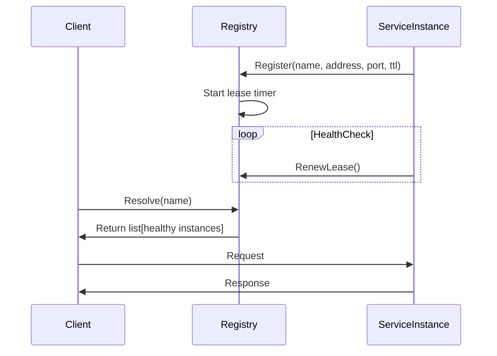

<!-- Generated by Groq via GitHub Actions -->
<!-- Topic ID: T087 -->
<!-- Category: System Design -->
<!-- Generated at UTC: 2026-10-13T19:55:28.917175+00:00 -->

# Service discovery

## 1. What problem does this solve?

**Motivation**  
When a micro‑service architecture grows, services are deployed on many hosts, containers, or cloud instances. Each instance has its own IP address and port, and these addresses can change at any time (autoscaling, rolling updates, failures). Hard‑coding addresses in code or configuration becomes impossible.

**Problem that exists**  
- **Dynamic endpoints**: Service instances come and go.
- **Load balancing**: Distributing traffic evenly across healthy instances.
- **Resilience**: Detecting and avoiding failed instances.
- **Configuration drift**: Keeping all services updated with the latest endpoints.

**Why it matters**  
If a service cannot find its dependencies, requests fail, leading to cascading outages. Manual updates are error‑prone and slow, especially in CI/CD pipelines.

**What happens if it’s not used**  
- Services may point to stale IPs → 502/504 errors.
- Manual re‑deployment of config files → downtime.
- Poor scalability: each new instance requires manual registration.

**Where it appears in real backend systems**  
- Kubernetes `Service` objects (DNS‑based discovery).
- Consul, etcd, ZooKeeper registries.
- Cloud provider load balancers (AWS ALB, GCP LB).
- Service meshes (Istio, Linkerd) that perform discovery internally.

---

## 2. Mental model

**Analogy**  
Think of a city where every shop has a phone number. A customer (your service) wants to call a shop (another service). Instead of remembering every phone number, the customer uses a *directory* (service registry). The directory tells the customer the current phone number, and if a shop moves, the directory updates the number.

**Engineering model**  
- **Registry**: A central store (KV store, DNS, or distributed consensus system) that keeps a list of service instances and their health status.
- **Client**: A library or SDK that queries the registry to resolve a service name to an instance address.
- **Health checks**: Periodic probes that mark instances as healthy/unhealthy.
- **Load balancing**: The client can round‑robin, random, or use more advanced strategies.

---

## 3. Deep explanation

### Internals
- **Key‑value store**: `service-name/instance-id → {address, port, metadata}`.
- **TTL / lease**: Instances register with a lease that expires if not renewed; this auto‑removes dead nodes.
- **Health checks**: Either *passive* (client reports status) or *active* (registry pings the instance).
- **Event notifications**: Clients can subscribe to changes (e.g., via WebSocket, gRPC, or long‑poll).

### Important terminology
| Term | Meaning |
|------|---------|
| **Service** | Logical grouping of instances (e.g., `orders-service`). |
| **Instance** | A running process with a unique ID. |
| **Registry** | Storage of service instances. |
| **Health check** | Probe to determine if an instance is alive. |
| **TTL / lease** | Time‑to‑live for a registration; forces renewal. |
| **Load balancer** | Client‑side or server‑side mechanism to distribute traffic. |

### Trade‑offs
| Approach | Pros | Cons |
|----------|------|------|
| **Central registry** (Consul, etcd) | Simple, consistent view | Single point of failure unless highly available |
| **DNS‑based** (Kubernetes) | Uses native DNS, no extra service | Limited to round‑robin; no health checks |
| **Client‑side discovery** | No extra network hop | Clients must implement logic |
| **Server‑side load balancer** | Offloads balancing | Requires extra component |

### Failure modes
- **Registry outage** → services cannot resolve names.
- **Stale entries** if TTL is too long or health checks fail.
- **Network partitions** causing inconsistent views.
- **Race conditions** during scaling (register before health check).

### Limitations
- **Latency**: Each lookup may add a network hop.
- **Consistency**: In distributed registries, eventual consistency may expose stale data.
- **Security**: Exposing registry endpoints can be a vector for attacks.

### Where it fits
- **Micro‑service communication**: All inter‑service calls go through discovery.
- **Service mesh**: The mesh’s control plane often implements discovery.
- **CI/CD pipelines**: Automated registration during deployment.

### Interaction with related concepts
- **Health checks**: Discovery relies on them for accurate lists.
- **Load balancing**: Discovery feeds the balancer.
- **Configuration management**: Registry can store metadata (e.g., version, region).
- **Observability**: Metrics on registry health and instance counts.

---

## 4. How it works

1. **Instance starts** → registers itself with the registry (provides address, port, metadata, TTL).
2. **Registry stores** the entry and starts a lease timer.
3. **Health check** runs periodically; on success, the instance renews its lease.
4. **Client requests** a service name → queries registry → receives list of healthy instances.
5. **Client selects** an instance (round‑robin, random, etc.) → sends request.
6. **If an instance fails** → health check fails → registry marks it unhealthy → removed from list.
7. **If an instance stops** → lease expires → registry removes it automatically.



---

## 5. Practical implementation

Below is a minimal Node.js service that registers itself with **Consul** and discovers another service (`orders-service`).  
Prerequisites: Consul running locally (`docker run -p 8500:8500 consul`).

```ts
// consul-client.ts
import Consul from 'consul';

export const consul = new Consul({
  host: '127.0.0.1',
  port: 8500,
  promisify: true,
});
```

```ts
// register.ts
import { consul } from './consul-client';
import { v4 as uuidv4 } from 'uuid';

const SERVICE_NAME = 'payment-service';
const SERVICE_ID = `${SERVICE_NAME}-${uuidv4()}`;
const SERVICE_PORT = 3000;

async function register() {
  await consul.agent.service.register({
    id: SERVICE_ID,
    name: SERVICE_NAME,
    address: '127.0.0.1',
    port: SERVICE_PORT,
    check: {
      http: `http://127.0.0.1:${SERVICE_PORT}/health`,
      interval: '10s',
      timeout: '5s',
    },
  });
  console.log(`Registered ${SERVICE_NAME} (${SERVICE_ID})`);
}

register().catch(console.error);
```

```ts
// discover.ts
import { consul } from './consul-client';

async function discover(serviceName: string) {
  const services = await consul.health.service({
    service: serviceName,
    passing: true, // only healthy instances
  });

  // Simple round‑robin
  const instance = services[Math.floor(Math.random() * services.length)];
  const address = instance.Service.Address;
  const port = instance.Service.Port;
  return `http://${address}:${port}`;
}

export { discover };
```

```ts
// server.ts
import express from 'express';
import { discover } from './discover';

const app = express();
const PORT = 3000;

app.get('/health', (_req, res) => res.send('ok'));

app.get('/pay', async (_req, res) => {
  try {
    const ordersUrl = await discover('orders-service');
    // Forward request to orders-service
    const response = await fetch(`${ordersUrl}/orders`);
    const data = await response.json();
    res.json({ payment: 'processed', orders: data });
  } catch (err) {
    console.error(err);
    res.status(502).send('Bad gateway');
  }
});

app.listen(PORT, () => console.log(`Payment service listening on ${PORT}`));
```

**Key lines explained**

- `consul.agent.service.register`: registers the service with a health check.
- `consul.health.service`: queries only healthy instances.
- `passing: true`: filters out unhealthy nodes automatically.

---

## 6. Production considerations

| Concern | What to watch for | Mitigations |
|---------|-------------------|-------------|
| **Scalability** | Registry load grows with number of services. | Use highly available Consul cluster; cache lookups in clients. |
| **Reliability** | Registry outage stops discovery. | Run registry in HA mode; fallback to DNS or static config. |
| **Security** | Registry exposed to network. | TLS, ACLs, restrict IP ranges. |
| **Observability** | Hard to see health check failures. | Expose metrics (`consul_agent_checks`) and logs. |
| **Performance** | Lookup latency adds to request time. | Client‑side caching, short TTLs, local DNS. |
| **Error handling** | Missing service → 502 errors. | Graceful degradation, circuit breakers. |
| **Resource usage** | Registry consumes memory for many keys. | Prune stale entries, set appropriate TTL. |
| **Operational concerns** | Need to monitor registry health. | Alert on high failure rates, low healthy instance counts. |
| **Failure recovery** | Network partitions. | Use consensus protocol (Raft) in Consul; split‑brain detection. |
| **Deployment** | Service must register before handling traffic. | Use init containers or startup scripts that block until registration succeeds. |

---

## 7. Common mistakes

| Mistake | Why it’s problematic |
|---------|----------------------|
| Hard‑coding service URLs in code | Breaks when scaling or moving to another environment. |
| Ignoring TTL/lease renewal | Stale entries remain, causing traffic to dead instances. |
| Not performing health checks | Unhealthy nodes stay in the registry, leading to failures. |
| Using a single registry instance | Creates a single point of failure. |
| Over‑caching discovery results | Clients may use outdated addresses after scaling. |
| Exposing registry without ACLs | Security risk; attackers can add malicious services. |
| Not handling discovery failures | Leads to unhandled exceptions and service crashes. |

---

## 8. Senior engineer perspective

### Design decisions at scale
- **Registry architecture**: Consul or etcd cluster with multiple leaders; use Raft for consistency.
- **Caching strategy**: Client‑side cache with TTL, invalidated on registry events.
- **Health check granularity**: Use both passive (client reports) and active (registry pings) checks.
- **Load balancing**: Prefer server‑side LB (e.g., Envoy) to offload balancing logic.
- **Observability**: Instrument registry metrics, trace service discovery calls.
- **Security**: Enforce mTLS between services and registry; use ACLs to limit write access.
- **Cost/performance**: Balance TTL length (short TTL → more traffic to registry) vs. stale data risk.

### Bottlenecks
- Registry query latency under high load.
- Network partitions causing split‑brain.
- Lease renewal traffic spikes during scaling events.

### Failure scenarios
- Registry leader fails → cluster elects new leader; clients may see temporary unavailability.
- Health check misconfiguration → all instances marked unhealthy → traffic loss.

### When NOT to use
- Small monoliths or single‑service deployments: DNS or static config suffices.
- Stateless functions (e.g., AWS Lambda) where service endpoints are fixed.

---

## 9. Interview questions

1. **Beginner**: *What is service discovery and why is it needed in micro‑services?*  
   *Answer*: It resolves service names to network addresses dynamically, enabling services to find each other without hard‑coded IPs.

2. **Beginner**: *Explain the difference between client‑side and server‑side service discovery.*  
   *Answer*: Client‑side: the client queries the registry and chooses an instance; server‑side: a load balancer or proxy does the routing.

3. **Senior**: *How would you design a highly available service registry for a global system?*  
   *Answer*: Use a replicated cluster (Consul/etcd) with Raft, TLS, ACLs, split‑brain detection, and regional failover. Cache lookups locally and use DNS for fallback.

4. **Senior**: *What are the trade‑offs between using DNS‑based discovery versus a dedicated registry?*  
   *Answer*: DNS is simple and leverages existing infrastructure but lacks health checks and fine‑grained control. Registries provide health checks, metadata, and dynamic updates but add complexity and a potential single point of failure.

5. **Scenario/Debugging**: *Your service can’t find the `orders-service` and returns 502 errors. What steps would you take to debug?*  
   *Answer*:  
   - Check registry health (`consul catalog services`).
   - Verify `orders-service` registration and TTL.
   - Inspect health check status (`consul health checks`).
   - Look at network connectivity (firewalls, VPC).
   - Enable client‑side logging of discovery calls.

---

## 10. Hands‑on task

**Goal**: Build a simple “user‑profile” service that registers itself with Consul and discovers a “notification” service.

1. Spin up Consul (`docker run -p 8500:8500 consul`).
2. Create two Node.js projects (`user-profile` and `notification`).
3. In `notification`, expose `/notify` endpoint and register with Consul.
4. In `user-profile`, expose `/profile` that calls `/notify` via discovery.
5. Run both services, trigger a profile request, and observe discovery logs.
6. Simulate a failure: stop `notification`, observe that `user-profile` stops calling it and logs an error.

Add unit tests for the discovery logic and a simple circuit breaker.

---

## 11. Quick revision

- Service discovery resolves service names to addresses at runtime.
- Registries store instance metadata, TTL, and health status.
- Health checks (active/passive) keep the registry accurate.
- Client‑side vs. server‑side discovery differ in where routing logic lives.
- Consul/etcd use Raft for consistency; DNS is simpler but limited.
- Key trade‑offs: latency, consistency, single‑point failure.
- Production concerns: HA, caching, observability, security.
- Common mistakes: hard‑coding URLs, ignoring TTL, no health checks.
- Senior design: cluster architecture, caching strategy, observability, cost vs. performance.
- Debugging steps: check registry, health checks, network, logs.

---

## 12. References

- Consul Documentation – Service Registration: https://www.consul.io/docs/agent/service-register
- Consul Documentation – Health Checks: https://www.consul.io/docs/agent/checks
- etcd Documentation – Key‑Value Store: https://etcd.io/docs/v3.5/op-guide/
- Kubernetes Service Discovery: https://kubernetes.io/docs/concepts/services-networking/service/
- Istio Service Mesh – Discovery: https://istio.io/latest/docs/concepts/discovery/
- AWS Service Discovery (Cloud Map): https://docs.aws.amazon.com/cloud-map/latest/dg/what-is-cloud-map.html
- Docker Compose with Consul example: https://github.com/hashicorp/consul-docker

---
