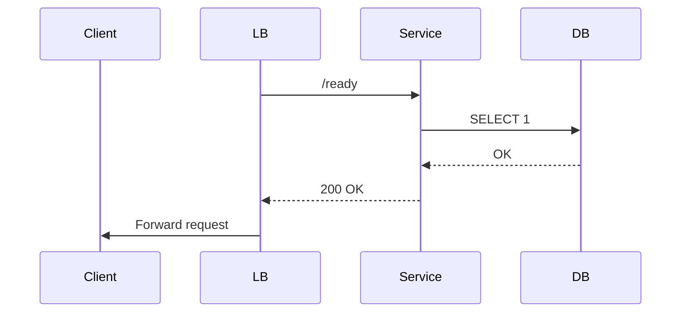

<!-- Generated by Groq via GitHub Actions -->
<!-- Topic ID: T088 -->
<!-- Category: System Design -->
<!-- Generated at UTC: 2026-10-13T19:55:28.917175+00:00 -->

# Health checks

## 1. What problem does this solve?

Health checks are lightweight probes that let a system (or an orchestrator) determine whether a service is **running, reachable, and able to perform its core responsibilities**.  
They are the first line of defense in a distributed architecture.

- **Problem**: In a micro‑service or serverless environment, a process may start, but its dependencies (DB, cache, external API) might be down. Without a health check, traffic will hit a broken service, leading to cascading failures and poor user experience.
- **Why it matters**:  
  - **Availability**: Load balancers and orchestrators can route traffic away from unhealthy instances.  
  - **Observability**: Health checks surface issues early, before they become full outages.  
  - **Automation**: CI/CD pipelines can automatically restart or replace failing containers.  
- **What happens if it’s missing**:  
  - Clients receive 5xx errors or timeouts.  
  - Orchestrators keep sending traffic to dead pods, wasting resources.  
  - Manual debugging becomes harder because the failure surface is opaque.  
- **Real‑world appearance**:  
  - Kubernetes `livenessProbe` / `readinessProbe`.  
  - AWS ELB health checks.  
  - Docker‑compose `healthcheck`.  
  - Cloud‑native monitoring tools (Prometheus `probe_success`).  

## 2. Mental model

**Analogy**: Think of a health check as a *doctor’s quick check‑up* for a server.  
Just as a doctor asks “Are you breathing? Is your heart beating?” a health check asks the service “Can I talk to the DB? Can I serve a request?” If the answer is “no”, the doctor (or orchestrator) will keep the patient (service) out of the clinic (traffic) until they’re ready.

**Engineering model**:  
- **Probe**: An HTTP/HTTPS, TCP, or custom endpoint that returns a simple status.  
- **Evaluator**: The orchestrator or load balancer that calls the probe at a configured interval.  
- **Decision**: If the probe fails, the instance is marked *unhealthy* and traffic is stopped or the instance is restarted.

## 3. Deep explanation

### Internals

| Layer | What it does | Typical implementation |
|-------|--------------|------------------------|
| **Application** | Exposes a `/health` or `/ready` endpoint that checks internal state. | Express/Next.js route, FastAPI endpoint |
| **Dependency checker** | Calls DB, cache, external API, or runs a lightweight query. | `pg` ping, `redis` `PING`, HTTP GET to downstream |
| **Orchestrator** | Periodically invokes the probe. | Kubernetes `livenessProbe`, AWS ELB, custom script |

### Important terminology

- **Liveness**: Is the process alive? (Can it restart if needed?)  
- **Readiness**: Is the service ready to accept traffic?  
- **Self‑healing**: Automatic restart of unhealthy pods.  
- **Grace period**: Time allowed for a service to start before it’s considered unhealthy.

### Trade‑offs

| Trade‑off | Pros | Cons |
|-----------|------|------|
| **Synchronous vs asynchronous checks** | Synchronous checks give instant feedback. | They can block the request thread if dependencies are slow. |
| **Depth of checks** | Deep checks catch subtle failures. | More expensive, can cause false positives. |
| **Frequency** | Frequent checks catch issues early. | Higher load on the service and dependencies. |

### Failure modes

- **False positives**: A transient DB hiccup marks the service unhealthy.  
- **False negatives**: A health endpoint always returns 200 even if the DB is down.  
- **Resource exhaustion**: Health checks that run heavy queries can degrade performance.

### Limitations

- **Not a replacement for proper error handling**: A healthy service can still return errors for specific requests.  
- **Limited visibility**: Health checks only surface the health of the checked components, not the full business logic.

### Where it fits

- **Front‑end load balancer**: Uses health checks to decide routing.  
- **CI/CD**: Deployments wait for readiness before marking a release as live.  
- **Observability stack**: Prometheus scrapes health endpoints for metrics.

### Interaction with related concepts

- **Circuit breakers**: Health checks are passive; circuit breakers actively block traffic after failures.  
- **Graceful shutdown**: A readiness probe can be set to false during shutdown to stop new traffic.  
- **Service discovery**: Health checks inform discovery services (e.g., Consul) about instance status.

## 4. How it works

1. **Service starts** → registers `/health` and `/ready` endpoints.  
2. **Orchestrator** (e.g., Kubernetes) begins polling `/ready` every `X` seconds.  
3. **Endpoint** runs dependency checks:  
   - Ping DB → success?  
   - Ping cache → success?  
   - Optional: run a lightweight query.  
4. **Return** `200 OK` if all checks pass, otherwise `503 Service Unavailable`.  
5. **Orchestrator** marks instance *healthy* or *unhealthy* based on response.  
6. **Traffic** is routed only to healthy instances.  
7. **If unhealthy** → orchestrator may restart the pod or stop routing traffic.



## 5. Practical implementation

### Node.js / Express example

```ts
// src/health.ts
import express from 'express';
import { Pool } from 'pg';
import { createClient } from 'redis';

const app = express();
const dbPool = new Pool({ connectionString: process.env.DATABASE_URL });
const redisClient = createClient({ url: process.env.REDIS_URL });

app.get('/health', async (_req, res) => {
  try {
    // 1. Check DB
    await dbPool.query('SELECT 1');
    // 2. Check Redis
    const redisPing = await redisClient.ping();
    if (redisPing !== 'PONG') throw new Error('Redis ping failed');
    // 3. All good
    res.status(200).json({ status: 'ok' });
  } catch (err) {
    console.error('Health check failed', err);
    res.status(503).json({ status: 'unhealthy', error: err.message });
  }
});

app.get('/ready', async (_req, res) => {
  // Same as /health but can be lighter
  try {
    await dbPool.query('SELECT 1');
    res.status(200).json({ status: 'ready' });
  } catch (err) {
    res.status(503).json({ status: 'not ready', error: err.message });
  }
});

export default app;
```

### Dockerfile snippet

```dockerfile
# Dockerfile
FROM node:20-alpine
WORKDIR /app
COPY package*.json ./
RUN npm ci
COPY . .
EXPOSE 3000
CMD ["node", "dist/index.js"]
```

### Kubernetes probe definition

```yaml
# deployment.yaml
spec:
  template:
    spec:
      containers:
        - name: api
          image: myrepo/api:latest
          ports:
            - containerPort: 3000
          livenessProbe:
            httpGet:
              path: /health
              port: 3000
            initialDelaySeconds: 10
            periodSeconds: 15
          readinessProbe:
            httpGet:
              path: /ready
              port: 3000
            initialDelaySeconds: 5
            periodSeconds: 10
```

## 6. Production considerations

| Concern | How to address |
|---------|----------------|
| **Scalability** | Keep checks lightweight; avoid heavy DB queries. Use connection pools. |
| **Reliability** | Add timeouts (e.g., 200 ms) to avoid hanging probes. |
| **Security** | Expose health endpoints only on internal network or with auth. |
| **Observability** | Emit metrics (`health_check_success_total`) to Prometheus. |
| **Performance** | Cache results if checks are expensive; use async/await. |
| **Error handling** | Return 503 on any failure; log details for debugging. |
| **Resource usage** | Run checks in a separate thread or process if blocking. |
| **Operational** | Use graceful shutdown hooks to set readiness to false before exiting. |
| **Failure recovery** | Combine with Kubernetes `restartPolicy: Always`. |
| **Deployment** | Use blue/green or canary deployments; health checks gate traffic. |

## 7. Common mistakes

| Mistake | Why it’s problematic |
|---------|----------------------|
| **Always returning 200** | Orchestrators think the service is healthy even when DB is down. |
| **Blocking checks** | A slow DB ping can block the entire request thread, causing timeouts. |
| **Missing readiness probe** | Traffic may hit a service that isn’t fully initialized. |
| **Hard‑coding URLs** | Fails in multi‑environment setups; use env vars. |
| **Not handling timeouts** | Probes hang forever, causing false negatives. |
| **Exposing health endpoints publicly** | Security risk; attackers can probe internal state. |

## 8. Senior engineer perspective

When scaling to dozens of services:

- **Architecture decisions**:  
  - Separate *liveness* and *readiness* probes.  
  - Use sidecar containers for complex health logic (e.g., external API checks).  
  - Centralize health logic in a shared library to avoid duplication.  
- **Trade‑offs**:  
  - Deep checks improve reliability but increase latency.  
  - Over‑aggressive probes can cause churn (restarts) and cost.  
- **Bottlenecks**:  
  - A single DB connection pool used by all health checks can become a contention point.  
  - Network latency to external services can dominate probe time.  
- **Failure scenarios**:  
  - *Split brain*: Two replicas think the other is dead; orchestrator may kill both. Mitigate with quorum checks.  
  - *Stale cache*: Health check passes but cache is stale; combine with cache version checks.  
- **Monitoring**:  
  - Track probe latency, success rates, and failure reasons.  
  - Alert on sustained 5xx responses from health endpoints.  
- **Cost/performance**:  
  - Running heavy checks on every probe can spike CPU; schedule heavy checks less frequently.  
  - Use lightweight health checks for high‑traffic services.  
- **When NOT to use**:  
  - For single‑instance, monolithic apps where a load balancer isn’t involved.  
  - For very short‑lived functions (e.g., serverless) where cold starts dominate.

## 9. Interview questions

1. **Beginner**: *What is the difference between a liveness probe and a readiness probe?*  
   *Answer*: Liveness checks if the process is alive; readiness checks if it can accept traffic.  
2. **Beginner**: *Why should a health check be lightweight?*  
   *Answer*: Heavy checks can block the service, cause false negatives, and increase latency.  
3. **Senior**: *How would you design a health check for a service that depends on multiple external APIs with different failure modes?*  
   *Answer*: Use a composite check with timeouts, circuit breakers, and weighted scoring; expose separate endpoints for each dependency if needed.  
4. **Senior**: *Explain how you would handle a scenario where a health check fails intermittently due to network partitions.*  
   *Answer*: Implement retry logic, exponential backoff, and consider marking the service unhealthy only after consecutive failures; use a grace period.  
5. **Scenario/Debugging**: *Your Kubernetes deployment shows all pods as unhealthy, but manual curl to `/health` returns 200. What could be wrong?*  
   *Answer*: Possible causes: probe path mismatch, port misconfiguration, missing `initialDelaySeconds`, or the probe uses a different protocol (TCP vs HTTP). Check logs, probe config, and network policies.

## 10. Hands‑on task

**Task**: Add a `/metrics` endpoint that exposes Prometheus metrics for health check latency and success rate.  
- Use `prom-client` to create counters and histograms.  
- Update the health check to record metrics.  
- Verify by running `curl http://localhost:3000/metrics` and inspecting the output.  
- (Optional) Deploy to a local Docker container and expose the metrics port.

## 11. Quick revision

- Health checks determine if a service can accept traffic.  
- Two main types: liveness (is the process alive?) and readiness (is it ready to serve?).  
- Probes should be lightweight, non‑blocking, and use timeouts.  
- Orchestrators (K8s, ELB) use health checks to route traffic.  
- Expose health endpoints only internally; secure them.  
- Combine health checks with observability (metrics, logs).  
- Separate health logic into reusable modules.  
- Use graceful shutdown to set readiness to false before exit.  
- Monitor probe latency and failure rates; alert on sustained failures.  
- Avoid heavy DB queries in health checks; use simple pings or lightweight queries.  
- Handle transient failures with retries and grace periods.  
- In production, keep liveness and readiness probes distinct.  

## 12. References

- [Kubernetes Probes](https://kubernetes.io/docs/tasks/configure-pod-container/configure-liveness-readiness-startup-probes/)  
- [Prometheus Client for Node.js](https://github.com/siimon/prom-client)  
- [Express Health Check Example](https://expressjs.com/en/advanced/best-practice-security.html#health-check)  
- [FastAPI Health Check](https://fastapi.tiangolo.com/tutorial/health-check/)  
- [AWS ELB Health Checks](https://docs.aws.amazon.com/elasticloadbalancing/latest/classic/elb-health-checks.html)  
- [Docker Healthcheck](https://docs.docker.com/engine/reference/builder/#healthcheck)
