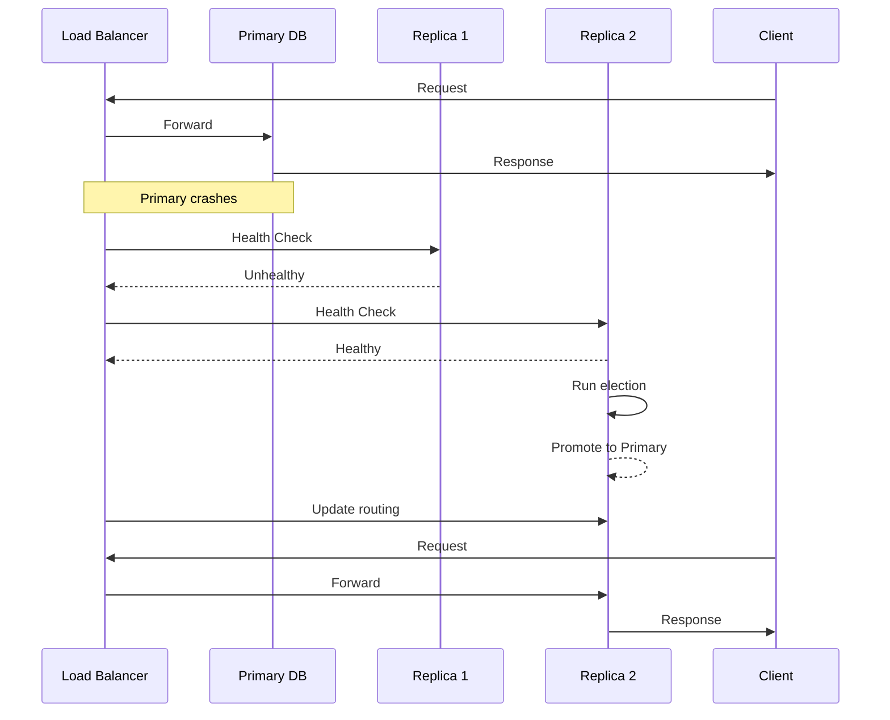

<!-- Generated by Groq via GitHub Actions -->
<!-- Topic ID: T089 -->
<!-- Category: System Design -->
<!-- Generated at UTC: 2026-10-14T06:21:04.718679+00:00 -->

# Failover

## 1. What problem does this solve?

**Motivation**  
In a production backend you rarely have a single point of truth. Services, databases, caches, and message brokers all run on multiple machines or containers. If any of those components goes down, the whole system can become unusable. Failover is the mechanism that detects a failure and automatically switches traffic to a healthy replica, keeping the service available.

**What problem exists**  
- A single instance of a database or cache can crash, become unreachable, or suffer from a hardware fault.
- Network partitions can isolate a node from the rest of the cluster.
- A service may become overloaded and start rejecting requests.

**Why the problem matters**  
- **Availability**: Users expect 99.99 % uptime. A single outage can break that guarantee.
- **Data integrity**: If a primary database fails and no failover occurs, writes may be lost or become inconsistent.
- **Business continuity**: For e‑commerce, finance, or health‑care, downtime can mean lost revenue or safety risks.

**What happens if this concept is not used**  
- The entire application may crash or become unresponsive.
- Users see errors or timeouts.
- Data may be lost or corrupted if the primary node fails without a backup.

**Where this concept appears in real backend systems**  
- Database clusters (PostgreSQL streaming replication, MongoDB replica sets, MySQL Group Replication).
- Cache layers (Redis Sentinel, Amazon ElastiCache Multi‑AZ).
- Message brokers (Kafka controller election, RabbitMQ mirrored queues).
- Web servers behind load balancers (NGINX health checks, AWS ALB).
- Cloud services with built‑in failover (AWS RDS Multi‑AZ, GCP Cloud SQL HA).

---

## 2. Mental model

**Analogy**  
Think of a city’s power grid. The main power plant (primary) supplies electricity. If it goes offline, a backup generator (secondary) kicks in automatically, so residents keep using power. The switch happens without anyone noticing.

**Engineering model**  
- **Primary**: The node that currently serves traffic or holds the master copy of data.
- **Replica/Secondary**: A standby node that stays in sync with the primary.
- **Health check**: A probe that periodically verifies the node is alive and functional.
- **Election**: A deterministic process that decides which replica becomes the new primary when the current one fails.
- **Failover**: The act of redirecting traffic to the new primary and updating any routing or configuration.

---

## 3. Deep explanation

### Internals
- **Replication**: Data is copied from primary to replicas. In PostgreSQL this is streaming replication; in Redis it’s asynchronous replication; in Kafka the controller replicates topic metadata.
- **Heartbeat / Health checks**: Simple TCP/HTTP pings or more sophisticated checks (e.g., query a known key).
- **Leader election**: Algorithms like Raft, Paxos, or simpler “first‑come‑first‑serve” based on timestamps or node IDs.
- **Routing**: Load balancers or DNS failover (e.g., Route 53 health checks) redirect traffic.

### Important terminology
- **Primary / Master**: The node that accepts writes.
- **Replica / Slave**: Nodes that copy data from the primary.
- **Quorum**: Minimum number of nodes that must agree to elect a leader.
- **Split‑brain**: When two replicas think they are primary simultaneously, leading to data divergence.
- **Read‑only replica**: A replica that only serves read traffic.

### Trade‑offs
| Aspect | Pros | Cons |
|--------|------|------|
| **Synchronous replication** | Strong consistency | Higher latency, risk of primary blocking |
| **Asynchronous replication** | Lower latency | Potential data loss on failover |
| **Automatic vs manual failover** | Zero‑downtime | Complexity, risk of mis‑election |
| **Single‑point vs multi‑region** | Simpler | Higher latency for distant users |

### Failure modes
- **Network partition**: A node can be isolated but still think it’s connected.
- **Hardware failure**: Disk crash, memory corruption.
- **Software bug**: Deadlock, memory leak causing unresponsiveness.
- **Mis‑configuration**: Wrong replication slots, missing quorum.

### Limitations
- **Latency**: Replication lag can cause stale reads.
- **Consistency**: In asynchronous setups, writes may be lost if the primary dies before replication.
- **Complexity**: Managing elections, backups, and monitoring adds operational overhead.

### Where this concept fits in a backend architecture
```
┌───────────────────────┐
│  Client / Frontend    │
└────────────┬──────────┘
             │
             ▼
   ┌───────────────────────┐
   │  Load Balancer / LB   │
   └───────┬───────┬───────┘
           │       │
           ▼       ▼
   ┌───────────────┐   ┌───────────────┐
   │  Service A    │   │  Service B    │
   └───────┬───────┘   └───────┬───────┘
           │               │
           ▼               ▼
   ┌───────────────────────┐
   │  Database Cluster     │
   │  (Primary + Replicas) │
   └───────────────────────┘
```
Failover sits between the load balancer and the database cluster, ensuring the LB always points to a healthy primary.

### Interaction with related concepts
- **Load balancing**: LB health checks trigger failover.
- **Caching**: Redis Sentinel can promote a replica to master; clients must reconnect.
- **CI/CD**: Deployment pipelines must preserve replication topology.
- **Observability**: Metrics (replication lag, election time) inform alerting.

---

## 4. How it works

1. **Health check**: Load balancer or monitoring system pings the primary every *N* seconds.
2. **Detection**: If the primary fails to respond or returns an error, the health check marks it unhealthy.
3. **Election**: Replicas run an election algorithm (e.g., Raft) to pick a new primary.
4. **Promotion**: The elected replica promotes itself to primary (writes enabled).
5. **Routing update**: Load balancer updates its routing table to point to the new primary.
6. **Client reconnection**: Clients automatically retry or reconnect to the new primary.
7. **Re‑sync**: The old primary (if it comes back) is demoted to replica and re‑synchronizes.



---

## 5. Practical implementation

Below is a minimal Node.js example using **Redis Sentinel** for cache failover.  
The app connects to Redis via the `ioredis` client, which automatically follows Sentinel.

```ts
// redisClient.ts
import Redis from 'ioredis';

const sentinelNodes = [
  { host: 'sentinel-1.local', port: 26379 },
  { host: 'sentinel-2.local', port: 26379 },
  { host: 'sentinel-3.local', port: 26379 },
];

const redis = new Redis({
  sentinels: sentinelNodes,
  name: 'mymaster',          // name of the master in Sentinel config
  // Optional: retry strategy, timeouts, etc.
});

redis.on('connect', () => console.log('Connected to Redis via Sentinel'));
redis.on('error', (err) => console.error('Redis error:', err));

export default redis;
```

```ts
// server.ts
import express from 'express';
import redis from './redisClient';

const app = express();
const PORT = 3000;

// Simple key/value endpoint
app.get('/cache/:key', async (req, res) => {
  try {
    const value = await redis.get(req.params.key);
    if (value === null) {
      return res.status(404).send('Not found');
    }
    res.send(value);
  } catch (err) {
    console.error(err);
    res.status(500).send('Redis error');
  }
});

app.listen(PORT, () => console.log(`Server listening on ${PORT}`));
```

**How it works**

1. The `ioredis` client connects to the Sentinel cluster.
2. Sentinel monitors the master and replicas; if the master fails, it promotes a replica.
3. The client automatically reconnects to the new master without code changes.

> **Tip**: In production, add `retryStrategy`, `maxRetriesPerRequest`, and proper error handling to avoid silent failures.

---

## 6. Production considerations

| Concern | What to watch for | Mitigation |
|---------|-------------------|------------|
| **Scalability** | Replication lag grows with write volume | Use read replicas for heavy reads; tune replication slots |
| **Reliability** | Split‑brain due to network partition | Enforce quorum, use Raft/Paxos, enable `synchronous_commit` |
| **Security** | Unauthenticated access to replicas | Use TLS, client certificates, and `requirepass` |
| **Observability** | Lack of metrics on failover events | Expose Prometheus metrics (`redis_master_last_io_seconds_ago`) |
| **Performance** | Latency spikes during promotion | Keep promotion fast (e.g., `SENTINEL` commands), pre‑warm connections |
| **Error handling** | Clients retrying to old primary | Use idempotent operations, implement retry backoff |
| **Resource usage** | Extra replicas consume RAM/disk | Size replicas appropriately, monitor memory usage |
| **Operational concerns** | Manual intervention after failover | Automate alerts, run playbooks, use IaC for replica setup |
| **Failure recovery** | Data loss in async replication | Keep a backup strategy, use WAL archiving |
| **Deployment** | Rolling updates may break replication | Use blue/green deployments, keep replicas in sync before promotion |

---

## 7. Common mistakes

| Mistake | Why it’s problematic |
|---------|----------------------|
| **Assuming replication is instant** | Asynchronous replication can lag; reads may return stale data. |
| **Not configuring quorum** | A single node can become primary after a partition, leading to split‑brain. |
| **Hard‑coding primary host** | Fails when the primary changes; no automatic failover. |
| **Ignoring replication lag** | Overlooking lag can cause consistency violations in read‑heavy workloads. |
| **Using a single replica** | No redundancy; failover still fails. |
| **Not monitoring health checks** | Failures go unnoticed until users report errors. |
| **Failing to test failover** | Uncovered bugs in production; no confidence in the system. |

---

## 8. Senior engineer perspective

### Architecture decisions
- **Replication strategy**: Synchronous vs asynchronous based on consistency requirements.
- **Quorum size**: For a 3‑node cluster, a 2‑node quorum prevents split‑brain.
- **Geographic distribution**: Multi‑AZ or multi‑region for disaster recovery vs latency trade‑off.
- **Load balancer choice**: DNS failover vs L7 LB with health checks.

### Trade‑offs
- **Latency vs consistency**: Synchronous replication increases write latency but guarantees no data loss.
- **Cost vs availability**: More replicas mean higher infrastructure cost but higher uptime.

### Bottlenecks
- **Network bandwidth**: Replication traffic can saturate links.
- **Disk I/O**: Writing WALs to disk on the primary can become a bottleneck.
- **Election latency**: Slow elections delay failover.

### Failure scenarios
- **Network partition**: Use `synchronous_commit=remote_write` to mitigate.
- **Replica overload**: Monitor CPU/memory; scale replicas horizontally.

### Monitoring
- **Replication lag** (`pg_stat_replication` in PostgreSQL).
- **Sentinel metrics** (`redis_master_last_io_seconds_ago`).
- **Health check logs** from load balancers.

### Cost/performance considerations
- **Read replicas** reduce load on primary but add replication cost.
- **Multi‑region** increases latency but improves disaster recovery.

### When NOT to use the approach
- **Stateless services**: No need for database failover.
- **Low‑traffic apps**: A single instance may suffice; cost of replicas outweighs benefit.
- **Highly mutable data with strict consistency**: Consider synchronous replication or a different consistency model.

---

## 9. Interview questions

1. **Beginner**: *What is a replica in a database cluster?*  
   *Answer*: A copy of the primary that stays in sync and can serve reads or become primary if the original fails.

2. **Beginner**: *Why do we need health checks in a load balancer?*  
   *Answer*: To detect unhealthy backends and stop sending traffic to them, ensuring high availability.

3. **Senior**: *Explain the difference between synchronous and asynchronous replication and when you would choose each.*  
   *Answer*: Synchronous waits for replicas to acknowledge writes before committing, guaranteeing no data loss but higher latency. Asynchronous writes immediately commit on the primary, with replication lag; chosen when low latency is critical and occasional data loss is acceptable.

4. **Senior**: *Describe how you would prevent split‑brain in a PostgreSQL streaming replication setup.*  
   *Answer*: Use a quorum of replicas, enable `synchronous_commit`, configure `synchronous_standby_names`, and use `pg_auto_failover` or `Patroni` to enforce a single primary.

5. **Scenario/Debugging**: *Your application reports “write failed” after a network partition. The primary is back online but clients still see errors. What steps would you take to diagnose and fix the issue?*  
   *Answer*:  
   - Check replication status (`pg_stat_replication`) to see if the replica caught up.  
   - Verify that the load balancer has updated its routing to the new primary.  
   - Look at client logs for stale connections or retry logic failures.  
   - Ensure that the primary’s WAL is replayed correctly on the replica.  
   - If using Redis Sentinel, confirm that the sentinel elected the correct master and clients reconnected.

---

## 10. Hands‑on task

**Task**: Add automatic failover to a local Redis setup using Sentinel.

1. Spin up three Redis containers: one master, two replicas.  
2. Configure Sentinel on each replica to monitor the master.  
3. Write a Node.js script that connects via `ioredis` and sets a key.  
4. Simulate a master failure (stop the master container).  
5. Verify that the script automatically reconnects to the promoted replica and can still set/get keys.

*Hints*: Use Docker Compose for orchestration; expose Sentinel ports; set `name: mymaster` in Sentinel config.

---

## 11. Quick revision

- Failover switches traffic from a failed primary to a healthy replica.
- Replication keeps replicas in sync; asynchronous = lower latency, possible data loss.
- Health checks (TCP/HTTP) trigger failover.
- Leader election (Raft/Paxos) selects new primary.
- Split‑brain occurs if quorum is not enforced.
- Load balancers must update routing on failover.
- Monitoring replication lag is essential.
- Security: TLS, auth, and proper ACLs on replicas.
- Testing failover in staging prevents production surprises.
- Synchronous replication guarantees consistency but adds latency.
- Use `ioredis` or `pg` with Sentinel/replication support for automatic failover.

---

## 12. References

- [ioredis Sentinel documentation](https://github.com/luin/ioredis#sentinel)
- [PostgreSQL Streaming Replication](https://www.postgresql.org/docs/current/warm-standby.html)
- [Redis Sentinel](https://redis.io/docs/management/sentinel/)
- [Kafka Controller Election](https://kafka.apache.org/documentation/#controller)
- [AWS RDS Multi‑AZ](https://docs.aws.amazon.com/AmazonRDS/latest/UserGuide/Concepts.MultiAZ.html)
- [Prometheus Redis Exporter](https://github.com/oliver006/redis_exporter)
- [Patroni](https://patroni.readthedocs.io/en/latest/) – PostgreSQL HA
- [pg_auto_failover](https://github.com/pgauto/pg_auto_failover) – PostgreSQL failover tool

---
