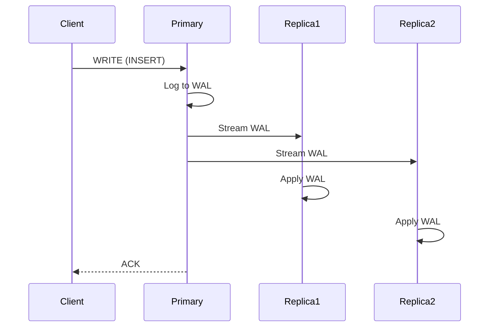

<!-- Generated by Groq via GitHub Actions -->
<!-- Topic ID: T090 -->
<!-- Category: System Design -->
<!-- Generated at UTC: 2026-10-14T06:21:04.718679+00:00 -->

# Replication

## 1. What problem does this solve?

Replication is the process of copying data from one database instance (the **primary** or **leader**) to one or more other instances (the **replicas** or **followers**).  
It solves several real‑world problems:

| Problem | Why it matters | Consequence if not solved | Where it appears |
|---------|----------------|---------------------------|------------------|
| **High availability** | A single node can fail or be taken down for maintenance. | Service outage, lost traffic. | PostgreSQL streaming replication, MongoDB replica sets, Redis master‑replica. |
| **Read scalability** | A single node can become a bottleneck for read traffic. | Slow responses, throttling. | Read‑scale in e‑commerce sites, analytics dashboards. |
| **Disaster recovery** | Data loss in the event of catastrophic failure. | Permanent data loss, regulatory non‑compliance. | Cross‑region replication for compliance. |
| **Load balancing** | Evenly distribute traffic across servers. | Hot spots, uneven resource usage. | CDN edge caching, multi‑region deployments. |
| **Data locality** | Keep data close to users for low latency. | High round‑trip times. | Geo‑replicated databases for global apps. |

Without replication, a backend would be a single point of failure, would struggle to serve many concurrent reads, and would be vulnerable to data loss.

---

## 2. Mental model

### Analogy  
Imagine a library that wants to keep a copy of every book in several branches. The **main branch** receives all new books and updates. Every time a new book arrives, the main branch sends a copy to each other branch. Readers can go to any branch to read a book, but only the main branch can add or edit books. If the main branch closes, the other branches still hold the books, but no new books can be added until the main branch is back online.

### Engineering model  
- **Primary → Replicas**: The primary accepts writes and streams changes to replicas.  
- **Synchronous vs Asynchronous**:  
  - *Synchronous*: The primary waits for replicas to acknowledge before confirming the write. Guarantees no data loss but adds latency.  
  - *Asynchronous*: The primary writes locally and pushes changes later. Faster but may lose recent changes if the primary fails.  
- **Read/Write Splitting**: Writes go to the primary; reads can go to any replica (or the primary for strong consistency).  
- **Quorum**: Some systems require a majority of replicas to agree before a write is considered committed (e.g., Raft, Paxos).  

---

## 3. Deep explanation

### Internals
- **Write‑Ahead Log (WAL)**: The primary records every change in a log. Replicas replay the WAL to stay in sync.  
- **Log Shipping / Streaming**: The WAL is shipped over the network to replicas.  
- **Replication Slots (PostgreSQL)**: Prevent the primary from discarding WAL segments that replicas haven’t consumed yet.  
- **Snapshot / Initial Sync**: Replicas initially copy the entire database (or a snapshot) before applying WAL changes.  

### Important terminology
| Term | Meaning |
|------|---------|
| **Leader / Primary** | Node that accepts writes. |
| **Follower / Replica** | Node that applies changes from the leader. |
| **Replication Lag** | Time or number of WAL entries the replica is behind the leader. |
| **Synchronous Commit** | Write is considered committed only after replicas acknowledge. |
| **Asynchronous Commit** | Write is committed immediately; replicas may lag. |
| **Quorum** | Minimum number of nodes that must agree for a decision. |
| **Failover** | Automatic or manual promotion of a replica to become the new primary. |
| **Read‑Replica** | Replica that serves read traffic. |

### Trade‑offs
| Factor | Synchronous | Asynchronous |
|--------|-------------|--------------|
| Latency | Higher | Lower |
| Consistency | Strong | Eventual |
| Throughput | Lower | Higher |
| Complexity | Higher (needs coordination) | Lower |
| Data loss risk | None | Possible (up to replication lag) |

### Failure modes
- **Network partition**: Replicas may become isolated; leader may keep accepting writes, leading to split brain if not handled.  
- **Replica crash**: Replica may fall behind; if it recovers, it must catch up.  
- **Write conflicts**: In multi‑master setups, concurrent writes can conflict; requires conflict resolution.  
- **Replication lag**: If lag grows too large, reads from replicas may be stale.  

### Limitations
- **Not all data types**: Binary large objects (BLOBs) may be expensive to replicate.  
- **Cross‑region latency**: Replicating over long distances introduces lag.  
- **Schema changes**: Some systems require careful coordination to avoid breaking replicas.  

### Where it fits
- **Database layer**: Replication is usually a feature of the DBMS.  
- **Application layer**: Code must route writes to the primary and reads to replicas.  
- **Infrastructure**: Networking, monitoring, and failover automation are essential.  

### Interaction with related concepts
- **Caching**: Replicas can be combined with read caches (Redis) for ultra‑fast reads.  
- **Sharding**: Replication can be applied per shard.  
- **Event sourcing**: The WAL can be treated as an event stream.  
- **CI/CD**: Automated deployment of new replicas and failover scripts.  

---

## 4. How it works

1. **Client writes** → sends `INSERT/UPDATE/DELETE` to the primary.  
2. **Primary logs** → writes the change to its WAL.  
3. **Primary acknowledges** → returns success to client (sync or async).  
4. **Primary streams** → pushes WAL entries to each replica over a persistent connection.  
5. **Replica receives** → appends WAL entry to its local log.  
6. **Replica applies** → replays the change to its local data store.  
7. **Replica acknowledges** (if synchronous).  



---

## 5. Practical implementation

Below is a minimal Node.js/TypeScript example that:

1. Sets up a PostgreSQL primary and a replica.  
2. Uses `pg` to write to the primary.  
3. Reads from the replica for read‑scaling.  

> **Prerequisites**  
> - PostgreSQL 13+ with streaming replication enabled.  
> - Two PostgreSQL instances (`primary` and `replica`).  
> - Node.js 18+.

### 5.1. PostgreSQL configuration (simplified)

```ini
# primary/postgresql.conf
wal_level = replica
max_wal_senders = 5
wal_keep_size = 64MB
hot_standby = on

# replica/postgresql.conf
hot_standby = on
```

```ini
# primary/pg_hba.conf
host replication replicator  replica_ip/32 md5
```

```sql
-- On primary
CREATE ROLE replicator WITH REPLICATION LOGIN PASSWORD 'replica_pass';
```

```sql
-- On replica
SELECT pg_create_physical_replication_slot('replica_slot');
```

### 5.2. Node.js code

```ts
// src/db.ts
import { Pool } from 'pg';
import dotenv from 'dotenv';

dotenv.config();

/**
 * Primary pool – accepts writes.
 */
export const primaryPool = new Pool({
  host: process.env.PRIMARY_HOST,
  port: Number(process.env.PRIMARY_PORT),
  user: process.env.DB_USER,
  password: process.env.DB_PASS,
  database: process.env.DB_NAME,
});

/**
 * Replica pool – used for reads.
 */
export const replicaPool = new Pool({
  host: process.env.REPLICA_HOST,
  port: Number(process.env.REPLICA_PORT),
  user: process.env.DB_USER,
  password: process.env.DB_PASS,
  database: process.env.DB_NAME,
});
```

```ts
// src/app.ts
import express from 'express';
import { primaryPool, replicaPool } from './db';

const app = express();
app.use(express.json());

/**
 * Write endpoint – goes to primary.
 */
app.post('/users', async (req, res) => {
  const { name, email } = req.body;
  try {
    const result = await primaryPool.query(
      'INSERT INTO users(name, email) VALUES($1, $2) RETURNING id',
      [name, email]
    );
    res.status(201).json({ id: result.rows[0].id });
  } catch (err) {
    console.error(err);
    res.status(500).json({ error: 'write failed' });
  }
});

/**
 * Read endpoint – reads from replica.
 */
app.get('/users/:id', async (req, res) => {
  const { id } = req.params;
  try {
    const result = await replicaPool.query(
      'SELECT id, name, email FROM users WHERE id = $1',
      [id]
    );
    if (!result.rows.length) return res.status(404).json({ error: 'not found' });
    res.json(result.rows[0]);
  } catch (err) {
    console.error(err);
    res.status(500).json({ error: 'read failed' });
  }
});

app.listen(3000, () => console.log('Server listening on :3000'));
```

> **Key points**  
> - Writes always hit the primary.  
> - Reads are routed to the replica to offload the primary.  
> - If the replica lags, reads may return stale data; monitor lag.

### 5.3. Monitoring replication lag

```ts
// src/lag.ts
import { replicaPool } from './db';

export async function getReplicationLag() {
  const res = await replicaPool.query(`
    SELECT pg_last_wal_receive_lsn() AS lsn,
           pg_last_wal_replay_lsn() AS replay_lsn,
           pg_wal_lsn_diff(pg_last_wal_receive_lsn(), pg_last_wal_replay_lsn()) AS lag_bytes
  `);
  return res.rows[0];
}
```

You can expose this via a `/health` endpoint or push to Prometheus.

---

## 6. Production considerations

| Concern | What to do |
|---------|------------|
| **Scalability** | Add more replicas; use read‑scaling proxies (PgBouncer, HAProxy). |
| **Reliability** | Use synchronous replication for critical writes; monitor lag; automate failover (Patroni, Stolon). |
| **Security** | Encrypt replication traffic (SSL/TLS); use dedicated replication roles. |
| **Observability** | Expose metrics: `pg_replication_lag`, `wal_sender_status`, `pg_stat_replication`. |
| **Performance** | Tune `max_wal_senders`, `wal_keep_size`; use `async_commit` for high throughput. |
| **Error handling** | Retry writes on transient replication errors; fallback to primary if replica is down. |
| **Resource usage** | Replicas consume CPU, memory, disk I/O; monitor disk space for WAL. |
| **Operational concerns** | Backup strategy: take base backups from primary; ensure replicas are part of backup chain. |
| **Failure recovery** | Automate promotion of a replica on primary failure; use `pg_rewind` to sync new primary. |
| **Deployment** | Use container orchestration (K8s) with StatefulSets; keep config in ConfigMaps; use secrets for passwords. |

---

## 7. Common mistakes

| Mistake | Why it’s problematic |
|---------|----------------------|
| **Assuming replication is instant** | Replication lag can be seconds to minutes; reads may be stale. |
| **Ignoring replication lag** | No alerting → silent data staleness. |
| **Writing to replicas** | Replicas are read‑only; writes will fail or be ignored. |
| **Using synchronous replication without understanding cost** | Adds latency to every write; can throttle throughput. |
| **Not handling failover** | Manual promotion leads to downtime. |
| **Using replication for write scaling** | Replicas cannot accept writes; you’ll hit errors. |
| **Misconfiguring WAL retention** | Replicas may lose WAL segments before catching up. |
| **Overlooking security** | Unencrypted replication exposes data in transit. |

---

## 8. Senior engineer perspective

### Architecture decisions
- **Replication model**: choose between *primary‑replica* (PostgreSQL, Redis) or *multi‑master* (Cassandra, MongoDB).  
- **Consistency level**: decide between *strong* (synchronous) or *eventual* (asynchronous).  
- **Read routing**: use a load balancer, client‑side routing, or a proxy that understands replica status.  
- **Failover strategy**: manual vs automated (Patroni, Stolon, AWS RDS).  
- **Cross‑region**: weigh latency vs data freshness; consider *geo‑replication* with read‑only replicas in each region.  

### Trade‑offs & bottlenecks
- **Write latency vs read throughput**: synchronous replication hurts writes; asynchronous boosts throughput but risks data loss.  
- **Network bandwidth**: high replication traffic can saturate links, especially in cross‑region setups.  
- **Disk I/O**: replicas must replay WAL; heavy workloads can become I/O bound.  

### Monitoring & alerting
- **Lag metrics**: alert if lag > threshold.  
- **Health checks**: ensure replicas are online and not in recovery mode.  
- **Replication slot usage**: avoid slot exhaustion.  

### Cost/performance
- **Compute**: replicas consume CPU/memory; scale based on read load.  
- **Storage**: WAL retention increases disk usage.  
- **Network**: cross‑region replication can be expensive.  

### When NOT to use replication
- **Small, single‑tenant services**: a single node may suffice.  
- **Write‑heavy workloads** where latency is critical and replication lag unacceptable.  
- **Immutable data**: if data never changes, replication overhead is unnecessary.  

---

## 9. Interview questions

1. **Beginner**: *What is the difference between a primary and a replica in a database replication setup?*  
   **Answer**: The primary accepts writes and streams changes; replicas apply those changes and serve reads (or are read‑only).  

2. **Beginner**: *What is replication lag and why does it matter?*  
   **Answer**: Replication lag is the delay between a write on the primary and its appearance on a replica. It matters because reads from replicas may return stale data.  

3. **Senior**: *Explain how you would design a read‑scaling strategy for a PostgreSQL database that needs to handle 10k RPS reads and 1k RPS writes.*  
   **Answer**: Use one primary for writes, multiple replicas for reads. Route writes to primary; use a load balancer or client‑side routing to distribute reads across replicas. Consider asynchronous replication for low write latency, monitor lag, and use connection pooling.  

4. **Senior**: *Describe the failure scenarios in a multi‑master replication system and how you would mitigate them.*  
   **Answer**: Network partitions can cause split‑brain; use consensus protocols (Raft, Paxos) to elect a leader. Resolve write conflicts via last‑write‑wins or application‑level merging. Use conflict resolution logs and ensure idempotent writes.  

5. **Scenario/Debugging**: *A replica is reporting a replication lag of 30 minutes. What steps would you take to diagnose and fix the issue?*  
   **Answer**:  
   - Check network connectivity and bandwidth between primary and replica.  
   - Inspect `pg_stat_replication` for sender status, `pg_last_wal_receive_lsn()` vs `pg_last_wal_replay_lsn()`.  
   - Verify WAL retention (`wal_keep_size`) and ensure slots are not exhausted.  
   - Look for disk I/O bottlenecks on the replica.  
   - If the replica is stuck in recovery, consider restarting or using `pg_rewind`.  
   - Ensure the replica’s clock is synchronized (NTP).  

---

## 10. Hands‑on task

**Goal**: Implement read‑write splitting in a Node.js app using PostgreSQL replication.

1. Spin up a Docker Compose stack with a primary and a replica PostgreSQL instance.  
2. Create a `users` table and seed some data.  
3. Add two Express routes:  
   - `POST /users` writes to the primary.  
   - `GET /users/:id` reads from the replica.  
4. Add a `/health` endpoint that reports replication lag.  
5. Run the app, perform writes, then read from the replica.  
6. Simulate a lag by pausing the replica’s WAL receiver (`pg_ctl stop -m immediate` on the replica) and observe the lag metric.  
7. Restore the replica and verify it catches up.

**Deliverables**:  
- `docker-compose.yml`  
- `src/` with TypeScript code  
- README explaining how to run and test

---

## 11. Quick revision

- Replication copies data from a primary to one or more replicas.  
- **Synchronous**: waits for replicas → strong consistency, higher latency.  
- **Asynchronous**: no wait → lower latency, possible data loss.  
- Replication lag is the delay between primary and replica.  
- Use read‑replicas to offload read traffic; writes go to primary.  
- Monitor `pg_stat_replication`, `pg_last_wal_receive_lsn`, `pg_last_wal_replay_lsn`.  
- Failover: promote a replica; use tools like Patroni or Stolon.  
- Security: encrypt replication traffic; use dedicated replication roles.  
- Common mistakes: writing to replicas, ignoring lag, misconfiguring WAL retention.  
- In production: scale replicas, automate failover, monitor lag, secure connections.  

---

## 12. References

- PostgreSQL Replication: https://www.postgresql.org/docs/current/warm-standby.html  
- PostgreSQL Streaming Replication: https://www.postgresql.org/docs/current/replication.html  
- MongoDB Replica Sets: https://docs.mongodb.com/manual/core/replica-set/  
- Redis Replication: https://redis.io/docs/manual/replication/  
- Kafka Replication: https://kafka.apache.org/documentation/#replication  
- Patroni: https://patroni.readthedocs.io/en/latest/  
- Stolon: https://github.com/sorintlab/stolon  
- AWS RDS Multi‑AZ: https://docs.aws.amazon.com/AmazonRDS/latest/UserGuide/Concepts.MultiAZ.html  

---
