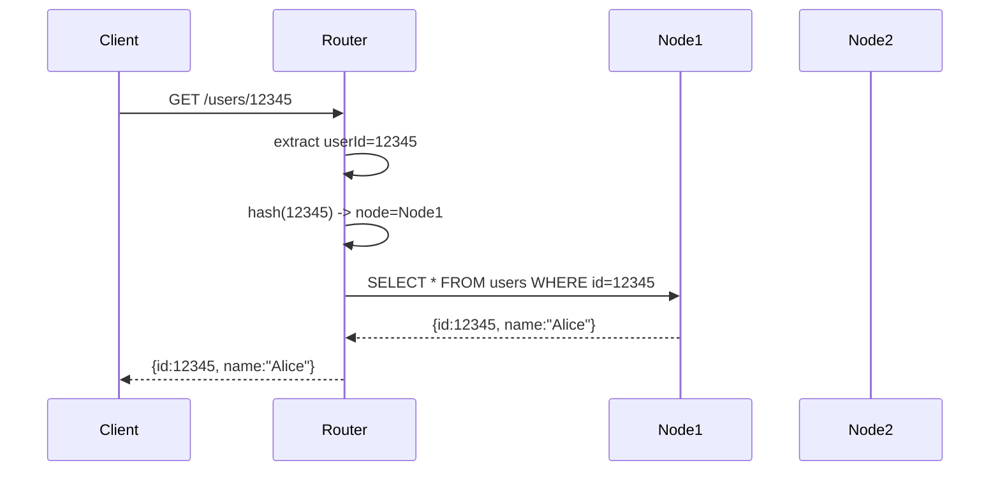

<!-- Generated by Groq via GitHub Actions -->
<!-- Topic ID: T091 -->
<!-- Category: System Design -->
<!-- Generated at UTC: 2026-10-14T18:06:50.689596+00:00 -->

# Partitioning

## 1. What problem does this solve?

**Motivation**  
When a backend grows, a single database instance or a single table can become a bottleneck. Queries that scan large tables, write bursts, or high concurrency can overwhelm CPU, memory, or I/O, leading to slow responses or outages.

**What problem exists**  
- **Scalability limits**: A single node can only handle so many reads/writes per second.
- **Hot spots**: Certain keys or ranges receive disproportionate traffic, causing contention.
- **Maintenance pain**: Large tables are hard to backup, restore, or migrate.

**Why the problem matters**  
- Users experience latency spikes or timeouts.
- Operational costs rise as you need bigger hardware or more replicas.
- Data consistency and availability can suffer if the system is not partitioned correctly.

**What happens if this concept is not used**  
- A monolithic table may become a single point of failure.
- Scaling horizontally becomes impossible; you’re stuck with vertical scaling.
- Long-running queries can lock the entire table, blocking other operations.

**Where this concept appears in real backend systems**  
- Sharding a user table across multiple PostgreSQL instances.
- Partitioning a Kafka topic by key to parallelize consumer processing.
- Using Redis Cluster to distribute keyspace across nodes.
- Splitting a log table by month to keep query windows small.

---

## 2. Mental model

**Analogy**  
Think of a library that stores all books in one massive shelf. If you want a specific book, you have to scan the whole shelf. If many people try to borrow the same book at once, the shelf becomes a bottleneck. Partitioning is like dividing the library into sections (fiction, non-fiction, science) and putting each section on a different shelf. Now you can locate books faster and multiple people can borrow books from different sections simultaneously.

**Precise engineering model**  
Partitioning (also called sharding or splitting) divides a dataset into smaller, independent pieces called *partitions* or *shards*. Each partition is stored on a separate physical or logical resource (database instance, disk, node). The system routes a request to the correct partition based on a *partition key* (e.g., user ID, timestamp, hash). The goal is to keep each partition small enough to be fast, while the overall system can scale horizontally.

---

## 3. Deep explanation

### Internals
- **Partition key**: deterministic value that maps a record to a partition (e.g., `user_id % 10`).
- **Routing layer**: middleware or client library that decides which node to query.
- **Metadata store**: keeps mapping of keys → nodes; may be embedded (e.g., in PostgreSQL’s `pg_shard` extension) or external (e.g., Consul, ZooKeeper).

### Important terminology
| Term | Meaning |
|------|---------|
| **Shard** | A contiguous or hashed slice of the keyspace stored on a node. |
| **Consistent hashing** | A hashing scheme that minimizes data movement when nodes are added/removed. |
| **Range partitioning** | Keys are split by ranges (e.g., `0–9999`, `10000–19999`). |
| **Hash partitioning** | Keys are hashed to evenly distribute across shards. |
| **Hot spot** | A partition that receives a disproportionate amount of traffic. |
| **Rebalancing** | Moving data between partitions to maintain balance. |

### Trade‑offs
| Aspect | Hash | Range |
|--------|------|-------|
| **Uniformity** | Very good (unless key distribution is skewed). | Depends on data distribution. |
| **Range queries** | Hard (need to query many shards). | Easy (single shard). |
| **Rebalancing cost** | Low (only a few keys move). | High (large data movement). |
| **Implementation complexity** | Simple. | Requires careful planning. |

### Failure modes
- **Routing failure**: If the routing layer is down, queries cannot reach shards.
- **Data inconsistency**: If a write is sent to the wrong shard, data loss or duplication occurs.
- **Hot spot**: A single shard becomes overloaded, causing latency spikes.
- **Rebalancing lag**: During rebalancing, some reads may hit stale data.

### Limitations
- **Cross‑partition joins** are expensive or impossible in many systems.
- **Atomicity** across shards is hard; you need distributed transactions or eventual consistency.
- **Operational overhead**: More nodes, more backups, more monitoring.

### Where it fits in a backend architecture
- **Data layer**: Partitioned databases or key‑value stores.
- **Service layer**: Microservices that know how to route to the correct shard.
- **Cache layer**: Redis Cluster or Memcached sharding.
- **Message queue**: Kafka topic partitioning for parallel consumer groups.

### Interaction with related concepts
- **Replication**: Each shard can be replicated for HA; replication + partitioning gives both scalability and availability.
- **Caching**: Cache keys often mirror partition keys to hit the same shard.
- **CQRS**: Read models can be partitioned separately from write models.
- **Event sourcing**: Event streams can be partitioned by aggregate ID.

---

## 4. How it works

1. **Define a partition key** (e.g., `userId`).
2. **Choose a partitioning strategy** (hash or range).
3. **Set up metadata** mapping keys to nodes.
4. **Client or middleware** receives a request, extracts the key, looks up the node.
5. **Route the request** to the appropriate node.
6. **Node processes** the query/write locally.
7. **Return the result** to the client.



---

## 5. Practical implementation

Below is a minimal Node.js example that demonstrates hash‑based sharding for a PostgreSQL cluster.  
We’ll use `pg` for PostgreSQL connections and a simple in‑memory routing table.

```ts
// shardRouter.ts
import { Pool } from 'pg';

type Shard = {
  id: string;
  pool: Pool;
};

const shards: Shard[] = [
  {
    id: 'shard-0',
    pool: new Pool({
      connectionString: process.env.SHARD_0_URL,
    }),
  },
  {
    id: 'shard-1',
    pool: new Pool({
      connectionString: process.env.SHARD_1_URL,
    }),
  },
];

// Simple hash function: userId % number_of_shards
function getShard(userId: number): Shard {
  const index = userId % shards.length;
  return shards[index];
}

export async function getUser(userId: number) {
  const shard = getShard(userId);
  const res = await shard.pool.query(
    'SELECT id, name, email FROM users WHERE id = $1',
    [userId]
  );
  return res.rows[0];
}

export async function createUser(user: { id: number; name: string; email: string }) {
  const shard = getShard(user.id);
  await shard.pool.query(
    'INSERT INTO users (id, name, email) VALUES ($1, $2, $3)',
    [user.id, user.name, user.email]
  );
}
```

**Key points**

- `getShard` uses a deterministic hash (`userId % shards.length`) to pick a shard.
- Each shard has its own `Pool` instance; connections are isolated.
- All CRUD functions route to the correct shard automatically.

**Running the example**

1. Spin up two PostgreSQL containers (or use two databases) and expose them on `SHARD_0_URL` and `SHARD_1_URL`.
2. Create the `users` table on both shards:

```sql
CREATE TABLE users (
  id BIGINT PRIMARY KEY,
  name TEXT NOT NULL,
  email TEXT NOT NULL
);
```

3. Run the Node.js script and call `createUser` / `getUser`.

---

## 6. Production considerations

| Concern | How to address it |
|---------|-------------------|
| **Scalability** | Add more shards; use consistent hashing to minimize data movement. |
| **Reliability** | Replicate each shard (e.g., PostgreSQL streaming replication). Use a health‑check endpoint per shard. |
| **Security** | Encrypt connections (TLS). Use IAM roles or secrets manager for credentials. |
| **Observability** | Instrument routing latency, shard hit rates, and error rates. Use Prometheus + Grafana. |
| **Performance** | Cache hot keys in Redis Cluster. Tune connection pools per shard. |
| **Error handling** | Retry on transient network errors. Fallback to a secondary shard if primary is down. |
| **Resource usage** | Monitor CPU/memory per shard. Avoid over‑provisioning. |
| **Operational concerns** | Automate shard rebalancing (e.g., using `pg_shard`). Keep a versioned migration strategy. |
| **Failure recovery** | Use point‑in‑time recovery per shard. Keep a global backup strategy. |
| **Deployment** | Deploy shards in separate availability zones. Use blue‑green or canary releases for routing changes. |

---

## 7. Common mistakes

| Mistake | Why it’s problematic |
|---------|----------------------|
| **Using a poor hash function** | Leads to uneven distribution and hot spots. |
| **Ignoring replication** | A single shard failure brings down data for that keyspace. |
| **Hard‑coding shard count** | Makes scaling difficult; adding shards requires data migration. |
| **Not handling cross‑shard joins** | Leads to complex, slow queries or data duplication. |
| **Over‑partitioning small tables** | Adds unnecessary overhead; each shard adds latency. |
| **Not monitoring routing latency** | Misses early signs of hot spots or routing failures. |
| **Skipping consistent hashing** | Causes massive data movement when nodes change. |
| **Treating shards as independent services** | Breaks transactional guarantees; you need distributed transactions or eventual consistency. |

---

## 8. Senior engineer perspective

### What changes at scale?
- **Routing becomes a critical service**: It must be highly available and low‑latency.
- **Metadata management**: Use a distributed config store (Consul, etcd) to keep shard maps.
- **Rebalancing strategy**: Implement incremental data migration to avoid downtime.
- **Monitoring**: Need fine‑grained metrics per shard, alerting on skew.
- **Cost**: More shards mean more infrastructure; balance cost vs. performance.

### Design decisions
- **Hash vs. range**: For write‑heavy workloads with unpredictable keys, hash is safer. For time‑series data, range (by timestamp) is better.
- **Consistent hashing**: Minimizes data movement but adds complexity; use libraries like `hashring`.
- **Replication factor**: 2 or 3 replicas per shard for HA; consider synchronous vs. asynchronous replication.
- **Cross‑shard transactions**: Use Saga pattern or two‑phase commit if needed; otherwise, design for eventual consistency.
- **Data locality**: Keep related data in the same shard to avoid cross‑shard joins.

### Bottlenecks & failure scenarios
- **Routing layer**: Single point of failure; mitigate with clustering.
- **Shard hot spots**: Mitigate by adding more shards or rebalancing.
- **Network partitions**: Use quorum reads/writes or read replicas.

### Monitoring & cost
- **Metrics**: Query latency, shard CPU, disk I/O, replication lag.
- **Cost**: Each shard adds a DB instance; consider serverless or autoscaling options.

### When NOT to use
- **Small datasets**: A single database is simpler.
- **Strict ACID across all data**: Partitioning complicates transactions.
- **Simple read‑heavy workloads**: A read replica cluster may suffice.

---

## 9. Interview questions

1. **Beginner**: *What is a shard and why do we use it?*  
   **Answer**: A shard is a subset of a database’s data stored on a separate node. We use shards to distribute load, improve performance, and scale horizontally.

2. **Beginner**: *Explain the difference between hash partitioning and range partitioning.*  
   **Answer**: Hash partitioning distributes rows based on a hash of the key, giving uniform distribution but making range queries expensive. Range partitioning groups rows by key ranges, enabling efficient range queries but can create hot spots if data is skewed.

3. **Senior**: *How would you design a routing layer that can handle dynamic addition and removal of shards without data loss?*  
   **Answer**: Use consistent hashing with virtual nodes to minimize data movement. Store the shard map in a distributed config store. On node change, only a small fraction of keys need to be re‑routed. Ensure the routing layer is stateless or uses a replicated state machine.

4. **Senior**: *Describe a scenario where cross‑shard joins become a problem and how you would mitigate it.*  
   **Answer**: If you need to join users and orders that live on different shards, you must query multiple shards and merge results, which is expensive. Mitigation: co‑locate related data in the same shard, use denormalization, or materialize join results in a separate read model.

5. **Scenario/Debugging**: *You notice that queries to user IDs in the 1000–1999 range are slower than others. What could be happening and how would you investigate?*  
   **Answer**: Likely a hot spot: the shard handling that key range is overloaded. Investigate by checking shard metrics (CPU, I/O), routing logs to confirm the key range maps to a single shard, and look for uneven data distribution. Mitigate by adding more shards or rebalancing the keyspace.

---

## 10. Hands‑on task

**Task**: Implement a simple key‑value store with hash‑based sharding in Node.js.

1. Spin up two Redis instances (or two PostgreSQL tables).
2. Create a `shardRouter.ts` that routes `GET`/`SET` requests to the correct instance based on the key hash.
3. Expose an HTTP API (`/kv/:key`) that uses the router.
4. Measure latency for keys that map to the same shard vs. different shards.
5. Add a third shard and observe how routing changes.

*Deliverable*: A GitHub repo with the code, a README explaining how to run, and a short report on latency observations.

---

## 11. Quick revision

- Partitioning splits data into smaller, independent units (shards).
- **Hash partitioning** → uniform distribution, bad for range queries.
- **Range partitioning** → efficient ranges, risk of hot spots.
- **Consistent hashing** minimizes data movement during scaling.
- Routing layer must be highly available and low‑latency.
- Replication per shard gives HA; cross‑shard transactions are hard.
- Monitor shard metrics, routing latency, and replication lag.
- Avoid partitioning small tables; use it when data or traffic grows.
- Rebalancing is expensive for range partitions; hash partitions are cheaper.
- Common pitfalls: poor hash, hard‑coded shard count, ignoring replication.

---

## 12. References

- PostgreSQL Sharding: https://www.postgresql.org/docs/current/pg_shard.html  
- Redis Cluster: https://redis.io/docs/manual/scaling/cluster/  
- Kafka Partitioning: https://kafka.apache.org/documentation/#partitions  
- Consistent Hashing: https://en.wikipedia.org/wiki/Consistent_hashing  
- Node.js `pg` library: https://node-postgres.com/  
- Prometheus Node Exporter: https://prometheus.io/docs/instrumenting/node_exporter/  
- Distributed Transactions (Saga): https://martinfowler.com/eaaDev/Saga.html  

---
