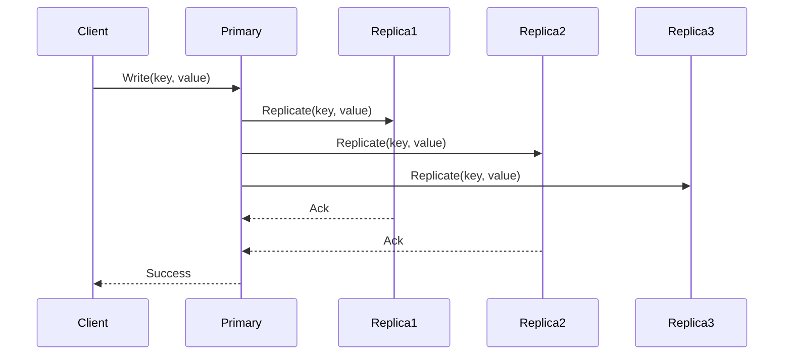

<!-- Generated by Groq via GitHub Actions -->
<!-- Topic ID: T093 -->
<!-- Category: System Design -->
<!-- Generated at UTC: 2026-10-15T06:03:36.655970+00:00 -->

# CAP Theorem

## 1. What problem does this solve?

When building distributed systems (e.g., a micro‑service that stores user sessions across many nodes), you often need to decide how the system behaves when network partitions or node failures occur. The CAP theorem tells you that **you can’t simultaneously guarantee all three of the following**:

| Property | What it means |
|----------|---------------|
| **Consistency (C)** | Every read sees the most recent write (or an error). |
| **Availability (A)** | Every request receives a response, even if it’s stale. |
| **Partition Tolerance (P)** | The system continues to operate despite arbitrary network partitions. |

### Why it matters
- **User experience**: A stale read may show wrong data; a missing response may break a feature.
- **Reliability**: In a partitioned network, you must decide whether to keep the system up or to refuse writes/reads.
- **Business impact**: For financial services, consistency is critical; for social media, availability may be prioritized.

### Consequences of ignoring CAP
- **Unpredictable behavior**: Clients may see inconsistent data or timeouts.
- **Hidden bugs**: Without a clear trade‑off, developers may unknowingly rely on a property that the system doesn’t guarantee.
- **Scalability issues**: Choosing the wrong balance can lead to bottlenecks or excessive latency.

### Real‑world appearance
- **Databases**: PostgreSQL (C+P), Cassandra (A+P), MongoDB (configurable).
- **Caching**: Redis (C+P), Memcached (A+P).
- **Messaging**: Kafka (A+P, eventual consistency), RabbitMQ (C+P).
- **Distributed file systems**: HDFS (C+P), Ceph (A+P).

---

## 2. Mental model

### Analogy: The “Library” system
Imagine a library that has many copies of a book spread across cities.  
- **Consistency**: Every visitor sees the same latest edition.  
- **Availability**: The library is always open; you can always ask for a book.  
- **Partition Tolerance**: Even if a road is blocked (network partition), the library still functions.

You can’t have all three at once. If a road is blocked, you either:
- Keep the library open but give out old copies (A+P, lose C), or
- Stop serving books until the road is cleared (C+P, lose A).

### Engineering model
Think of a distributed key‑value store as a set of replicas. When a write arrives, the system must decide:
1. How many replicas must acknowledge the write? (Consistency)
2. Should the client get a response even if some replicas are unreachable? (Availability)
3. How to handle network splits? (Partition Tolerance)

---

## 3. Deep explanation

### Internals
- **Replication**: Data is copied across nodes. Replication factor `N` determines how many copies exist.
- **Quorum**: A subset of replicas (`W` for writes, `R` for reads) that must agree to satisfy a request.
- **Consensus protocols**: Raft, Paxos, etc., enforce consistency by ensuring a majority of nodes agree on state changes.

### Important terminology
- **Strong consistency**: Reads always see the latest write (linearizable).
- **Eventual consistency**: Reads may see stale data but will converge over time.
- **Read/write quorum**: `R + W > N` guarantees that read and write quorums overlap, ensuring consistency.

### Trade‑offs
| Trade‑off | Impact |
|-----------|--------|
| **C vs A** | Strong consistency often forces writes to wait for multiple replicas, increasing latency. |
| **A vs P** | Keeping the system available during a partition may mean serving stale data. |
| **C vs P** | Achieving consistency in a partitioned network requires coordination, which can stall the system. |

### Failure modes
- **Network partition**: Nodes cannot communicate; the system must choose between consistency and availability.
- **Node failure**: Replica loss reduces quorum size; may need to elect a new leader.
- **Write conflicts**: Concurrent writes to the same key can lead to divergent states if not resolved.

### Limitations
- CAP is a *theorem*, not a design pattern. It describes what is impossible, not how to achieve a particular balance.
- It assumes *asynchronous* communication; synchronous systems can circumvent some trade‑offs but at the cost of latency.

### Where it fits in backend architecture
- **Database layer**: CAP influences replication strategy and consistency guarantees.
- **Cache layer**: Determines whether to use read‑through or write‑through caching.
- **API gateway**: May expose different consistency levels to clients.

### Interaction with related concepts
- **Event sourcing**: Provides eventual consistency by replaying events.
- **CQRS**: Separates read and write models, allowing different CAP balances for each.
- **Micro‑services**: Each service may choose its own CAP trade‑off; inter‑service communication must respect these differences.

---

## 4. How it works

### Step‑by‑step flow for a write in a quorum‑based system

1. **Client sends write** to any node (primary or replica).
2. **Node forwards** the write to all replicas (or a subset).
3. **Replicas acknowledge** after persisting the write.
4. **Primary waits** for `W` acknowledgments (write quorum).
5. **Primary replies** to client once quorum is reached.
6. **Read requests** go to any node; the node reads from local storage.
7. If `R + W > N`, the read will see the latest write because at least one replica in the read quorum has the latest data.



---

## 5. Practical implementation

Below is a minimal **Node.js** example using **Redis** (a popular in‑memory store) to illustrate a **quorum‑based write** with `ioredis` cluster mode. Redis Cluster can be configured for **strong consistency** (by setting `cluster-require-full-coverage` to `yes` and using `write` quorum) or **high availability** (by allowing writes to any node).

```ts
// redis-quorum.ts
import Redis from 'ioredis';

// Connect to a Redis Cluster
const cluster = new Redis.Cluster([
  { host: '127.0.0.1', port: 7000 },
  { host: '127.0.0.1', port: 7001 },
  { host: '127.0.0.1', port: 7002 },
]);

/**
 * Write a key/value pair with a write quorum.
 * @param key The key to write.
 * @param value The value to store.
 * @param quorum The minimum number of replicas that must ack.
 */
async function writeWithQuorum(key: string, value: string, quorum: number) {
  // Use MULTI/EXEC to ensure atomicity across replicas
  const pipeline = cluster.pipeline();
  pipeline.set(key, value);
  const results = await pipeline.exec();

  // Count successful writes
  const successCount = results.filter(([err]) => !err).length;

  if (successCount < quorum) {
    throw new Error(`Quorum not reached: ${successCount}/${quorum}`);
  }
  console.log(`Write succeeded on ${successCount} replicas`);
}

// Example usage
(async () => {
  try {
    await writeWithQuorum('user:123', '{"name":"Alice"}', 2);
  } catch (e) {
    console.error(e);
  } finally {
    cluster.disconnect();
  }
})();
```

**Key points**

- `pipeline.exec()` sends the command to all replicas in the cluster.
- We count acknowledgments; if fewer than the quorum, we treat it as a failure.
- In a real system, you’d handle retries, back‑off, and possibly switch to a different consistency mode.

---

## 6. Production considerations

| Concern | What to watch for |
|---------|-------------------|
| **Scalability** | Increasing `N` (replicas) improves fault tolerance but raises write latency. |
| **Reliability** | Use health checks and automatic failover; monitor quorum status. |
| **Security** | Encrypt inter‑node traffic; restrict write access to trusted nodes. |
| **Observability** | Track `R`, `W`, and `N` metrics; log partition events. |
| **Performance** | Tune `write` quorum to balance latency vs. consistency; consider read‑through caching. |
| **Error handling** | Gracefully degrade to eventual consistency when quorum is unreachable. |
| **Resource usage** | Replication consumes CPU, memory, and network bandwidth. |
| **Operational concerns** | Plan for rolling upgrades; ensure all nodes run the same protocol version. |
| **Failure recovery** | Implement automated leader election (Raft/Paxos) or use managed services. |
| **Deployment** | Use container orchestration (K8s) with anti‑affinity to avoid single‑point failures. |

---

## 7. Common mistakes

| Mistake | Why it’s problematic |
|---------|----------------------|
| **Assuming CAP is a “choice”** | It’s a constraint; you can’t pick all three. |
| **Using strong consistency in a partition‑prone network** | Leads to frequent timeouts and poor availability. |
| **Ignoring quorum size** | Reads may return stale data if `R + W <= N`. |
| **Treating eventual consistency as “good enough” for all data** | Sensitive data (e.g., payments) still needs strong consistency. |
| **Over‑replicating without considering cost** | Extra replicas increase latency and resource usage. |
| **Not monitoring partition events** | Hidden failures can go unnoticed until a major outage. |

---

## 8. Senior engineer perspective

### Architecture decisions
- **Choose the right database**: PostgreSQL for ACID, Cassandra for high write throughput.
- **Design for failure**: Use a *primary‑secondary* pattern with automatic failover.
- **Separate read/write workloads**: CQRS can allow reads to use a highly available, eventually consistent store.

### Trade‑offs at scale
- **Write latency vs. availability**: In a global CDN, you might accept eventual consistency for user profiles but enforce strong consistency for billing.
- **Network costs**: Cross‑region replication increases bandwidth; evaluate cost vs. consistency needs.

### Bottlenecks
- **Leader bottleneck**: All writes go through the leader; scale by sharding or using multi‑leader protocols.
- **Network partitions**: Frequent splits can cause the system to fall back to low‑consistency mode.

### Failure scenarios
- **Leader crash**: Requires rapid election; use Raft for deterministic leader selection.
- **Network partition**: Detect via heartbeats; switch to “read‑only” mode if quorum lost.

### Monitoring
- **Quorum health**: `quorum_status` metrics.
- **Latency histograms**: Separate read/write latency.
- **Partition detection**: Log network errors, use distributed tracing.

### Cost/performance
- **Replication factor**: Higher `N` increases cost; balance with required fault tolerance.
- **Read replicas**: Offload reads to cheaper nodes; trade off consistency.

### When NOT to use
- **Simple monoliths**: CAP is overkill; a single database suffices.
- **Real‑time gaming**: Often prioritize availability and low latency over strict consistency.
- **Static content**: Eventual consistency is fine; focus on CDN caching.

---

## 9. Interview questions

1. **Beginner**: *What are the three properties of the CAP theorem?*  
   **Answer**: Consistency, Availability, Partition Tolerance.

2. **Beginner**: *Why can’t a distributed system guarantee all three CAP properties simultaneously?*  
   **Answer**: Because a network partition forces a choice between consistency and availability; you can’t satisfy both when nodes can’t communicate.

3. **Senior**: *Explain how quorum reads and writes (`R + W > N`) guarantee consistency in a replicated key‑value store.*  
   **Answer**: A write must be acknowledged by at least `W` replicas. A read must contact at least `R` replicas. If `R + W > N`, the read quorum overlaps with the write quorum, ensuring the read sees the latest write.

4. **Senior**: *Describe a scenario where a system might deliberately sacrifice consistency for availability. What are the implications?*  
   **Answer**: A social media feed that can serve stale posts during a partition to keep the service responsive. Implications: users may see outdated content; eventual consistency must be handled on the client side.

5. **Scenario/Debugging**: *You have a Redis cluster with `N=3`. A client reports that reads are returning stale data after a network partition. What could be happening, and how would you fix it?*  
   **Answer**: Likely the cluster is configured with `R=1`, `W=1` (high availability). After a partition, the read may hit a replica that didn’t receive the latest write. Fix by increasing `R` or `W` to enforce quorum, or switch to a strong consistency mode (e.g., `cluster-require-full-coverage: yes`).

---

## 10. Hands‑on task

**Task**: Build a simple **Node.js** service that writes user profiles to a **Redis Cluster** with a configurable quorum. Then, simulate a network partition by stopping one node and observe how read consistency changes.

**Steps**

1. Spin up a 3‑node Redis Cluster (use Docker Compose).
2. Implement the `writeWithQuorum` and `readWithQuorum` functions as shown above.
3. Write a profile, then read it back with `R=2`.
4. Stop one Redis node to create a partition.
5. Attempt to write again with the same quorum; observe failure.
6. Reduce quorum to `W=1` and retry; observe increased availability but potential staleness.

**Goal**: Understand how quorum settings affect consistency and availability in practice.

---

## 11. Quick revision

- CAP theorem: Consistency, Availability, Partition Tolerance – you can only guarantee two.
- **Strong consistency** → linearizable reads; often requires majority quorum.
- **Eventual consistency** → reads may be stale; high availability.
- **Quorum**: `R + W > N` ensures read/write overlap.
- **Partition** forces a trade‑off: either lose consistency or availability.
- **Replication factor** (`N`) and **quorum sizes** (`R`, `W`) are tunable knobs.
- **Consensus protocols** (Raft, Paxos) enforce consistency in partitions.
- **Real systems**: PostgreSQL (C+P), Cassandra (A+P), Redis (configurable).
- **Monitoring**: Track quorum health, latency, partition events.
- **Common mistake**: Assuming CAP is a simple “pick one” choice.
- **Senior perspective**: Balance cost, latency, and business requirements; design for failure.

---

## 12. References

- [CAP Theorem – Wikipedia](https://en.wikipedia.org/wiki/CAP_theorem)
- [Redis Cluster Architecture](https://redis.io/docs/manual/scaling/)
- [Raft Consensus Algorithm](https://raft.github.io/)
- [Paxos Algorithm](https://www.microsoft.com/en-us/research/publication/paxos/)
- [PostgreSQL Replication](https://www.postgresql.org/docs/current/warm-standby.html)
- [Cassandra Consistency Levels](https://cassandra.apache.org/doc/latest/cassandra/consistency.html)
- [MongoDB Consistency](https://www.mongodb.com/docs/manual/core/read-concern/)
- [ioredis documentation](https://github.com/luin/ioredis)
