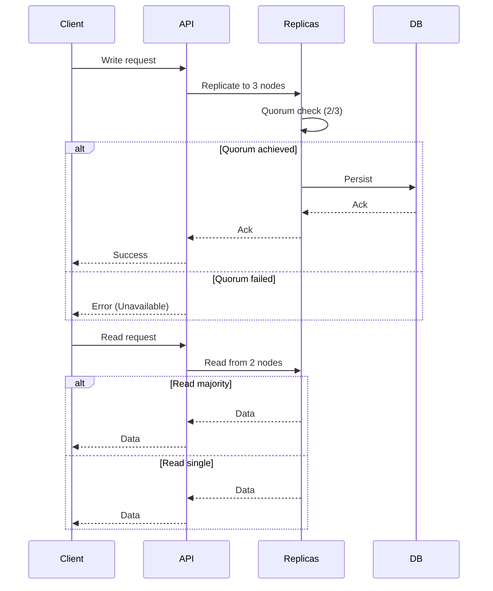

<!-- Generated by Groq via GitHub Actions -->
<!-- Topic ID: T094 -->
<!-- Category: System Design -->
<!-- Generated at UTC: 2026-10-15T06:03:36.655970+00:00 -->

# PACELC

## 1. What problem does this solve?

In a distributed system, data is spread across multiple nodes. When a network partition occurs (some nodes become unreachable), the system must decide how to behave.  
The **PACELC** rule formalizes the trade‑offs that arise **both** during a partition and during normal operation.

- **Problem**: How to balance *consistency*, *availability*, *partition tolerance*, *latency*, and *consistency* when the network is healthy.
- **Why it matters**: A wrong balance can lead to stale reads, lost writes, or service outages—critical for user‑facing APIs, financial systems, or real‑time analytics.
- **Consequences of ignoring PACELC**:  
  - *Too much consistency*: users see stale data or experience high latency.  
  - *Too much availability*: data diverges and later requires costly reconciliation.  
  - *Ignoring latency*: users get frustrated, and the system may be throttled by clients.
- **Real‑world appearance**:  
  - **Cassandra** (AP + L): favors availability and low latency, sacrificing consistency.  
  - **PostgreSQL with synchronous replication** (CP + C): favors consistency and partition tolerance, sacrificing availability.  
  - **MongoDB** with read/write concerns (P + A + C + L): configurable trade‑offs per operation.

## 2. Mental model

**Analogy – The Restaurant Order System**

| Situation | Decision | Result |
|-----------|----------|--------|
| **Partition** (kitchen and front‑desk split) | *Serve* (availability) or *Wait* (consistency) | If you serve, the customer gets food quickly but may be wrong; if you wait, the kitchen syncs first, delaying service. |
| **Normal** | *Fast* (low latency) or *Check* (consistency) | A quick order is great, but if you double‑check inventory you add latency. |

**Engineering model**

- **Partition (P)**: Network split.
- **Availability (A)**: Service continues to respond.
- **Consistency (C)**: All nodes see the same data.
- **Latency (L)**: Time to complete a request.
- **Elasticity (E)**: When no partition, you still choose between *Latency* and *Consistency*.

PACELC says:  
> **During a partition**: choose between **P** + **A** vs. **P** + **C**.  
> **During normal operation**: choose between **E** + **L** vs. **E** + **C**.

## 3. Deep explanation

### Internals

1. **Replication**: Data is copied across nodes.  
2. **Quorum**: A majority of replicas must agree for a write to succeed.  
3. **Read/Write concerns**: Clients specify how many replicas must respond.  
4. **Conflict resolution**: When replicas diverge, a strategy (last‑write‑wins, vector clocks, CRDTs) resolves differences.

### Important terminology

| Term | Meaning |
|------|---------|
| **Quorum** | Minimum number of replicas that must acknowledge a read/write. |
| **Read/Write Concern** | Client‑supplied level of consistency. |
| **Eventual Consistency** | All replicas converge over time. |
| **Strong Consistency** | All reads see the latest write. |
| **CAP Theorem** | Partition + Availability + Consistency – PACELC extends this by adding Latency and Elasticity. |

### Trade‑offs

| Trade‑off | Impact |
|-----------|--------|
| **A vs. C** | Availability → higher uptime, possible stale reads. Consistency → data correctness, possible downtime. |
| **L vs. C** | Low latency → faster responses, weaker consistency. Strong consistency → higher latency due to coordination. |
| **E (elasticity)** | Allows dynamic scaling; can shift between L and C based on load. |

### Failure modes

- **Split‑brain**: Two partitions both think they are primary → data divergence.  
- **Write‑skew**: Concurrent writes on different nodes lead to inconsistent state.  
- **Read‑after‑write anomalies**: Client reads stale data immediately after a write.

### Limitations

- PACELC is a *model*, not a prescription. Real systems use hybrid strategies (e.g., MongoDB’s read/write concerns).  
- It assumes *binary* choices; many systems offer *graded* consistency (e.g., read‑majority).  
- It does not cover *durability* or *security* trade‑offs.

### Where it fits

- **Data layer**: Replication protocols, sharding, and consistency settings.  
- **API layer**: Choosing read/write concerns per endpoint.  
- **Infrastructure**: Network design, load balancers, and failover mechanisms.

### Interaction with related concepts

- **Event sourcing**: Guarantees eventual consistency via event logs.  
- **CQRS**: Separates read/write models, often tuning each side differently.  
- **Cache invalidation**: Affects consistency vs. latency trade‑offs.  
- **Microservices**: Each service may adopt its own PACELC balance.

## 4. How it works



- **During partition**: If two replicas are unreachable, the system may still respond (A) or refuse (C).  
- **During normal operation**: Reads can be served from a single replica (low L) or from a majority (higher C).

## 5. Practical implementation

Below is a minimal Node.js example using **Redis Cluster** for eventual consistency and **PostgreSQL** for strong consistency. The API exposes two endpoints: one that favors availability/latency, another that enforces consistency.

```ts
// src/server.ts
import express from 'express';
import { createClient } from 'redis';
import { Pool } from 'pg';

const app = express();
app.use(express.json());

// Redis cluster client (eventual consistency)
const redis = createClient({ url: 'redis://localhost:7000' });
redis.on('error', err => console.error('Redis error', err));

// PostgreSQL client (strong consistency)
const pgPool = new Pool({
  connectionString: process.env.DATABASE_URL,
});

// ---------- 1️⃣ Availability + Low Latency ----------
app.post('/cache', async (req, res) => {
  const { key, value } = req.body;
  try {
    // Fire‑and‑forget write to Redis
    redis.set(key, value);
    // Also persist to Postgres asynchronously
    pgPool.query('INSERT INTO kv(key, value) VALUES($1,$2) ON CONFLICT(key) DO UPDATE SET value=$2', [key, value]);
    res.status(202).send({ status: 'queued' });
  } catch (e) {
    res.status(500).send({ error: e.message });
  }
});

app.get('/cache/:key', async (req, res) => {
  const key = req.params.key;
  try {
    // Read from Redis first (low latency)
    const cached = await redis.get(key);
    if (cached !== null) return res.send({ value: cached, source: 'redis' });

    // Fallback to Postgres (strong consistency)
    const { rows } = await pgPool.query('SELECT value FROM kv WHERE key=$1', [key]);
    if (rows.length) return res.send({ value: rows[0].value, source: 'postgres' });

    res.status(404).send({ error: 'Not found' });
  } catch (e) {
    res.status(500).send({ error: e.message });
  }
});

// ---------- 2️⃣ Consistency + Partition Tolerance ----------
app.post('/kv', async (req, res) => {
  const { key, value } = req.body;
  try {
    // Wait for Postgres commit (strong consistency)
    await pgPool.query('INSERT INTO kv(key, value) VALUES($1,$2) ON CONFLICT(key) DO UPDATE SET value=$2', [key, value]);

    // Replicate to Redis synchronously
    await redis.set(key, value);

    res.send({ status: 'ok' });
  } catch (e) {
    res.status(500).send({ error: e.message });
  }
});

app.get('/kv/:key', async (req, res) => {
  const key = req.params.key;
  try {
    const { rows } = await pgPool.query('SELECT value FROM kv WHERE key=$1', [key]);
    if (!rows.length) return res.status(404).send({ error: 'Not found' });

    // Ensure Redis is up‑to‑date
    await redis.set(key, rows[0].value);

    res.send({ value: rows[0].value });
  } catch (e) {
    res.status(500).send({ error: e.message });
  }
});

app.listen(3000, () => console.log('Server listening on :3000'));
```

**Key points**

- `/cache` endpoint: **A + L** – writes are queued, reads are fast.  
- `/kv` endpoint: **C + P** – writes wait for PostgreSQL, reads are strongly consistent.  
- The same data is stored in both stores; the choice of endpoint dictates the PACELC trade‑off.

## 6. Production considerations

| Concern | How PACELC affects it | Mitigation |
|---------|-----------------------|------------|
| **Scalability** | Eventual consistency can scale horizontally; strong consistency may bottleneck at the primary. | Use read replicas, sharding, and async replication for high‑write workloads. |
| **Reliability** | Partition tolerance is inherent; but choosing A over C can lead to data loss. | Implement conflict resolution (CRDTs), periodic reconciliation, and audit logs. |
| **Security** | Strong consistency may expose sensitive data to more nodes. | Encrypt data at rest and in transit; limit read/write concerns to privileged services. |
| **Observability** | Latency vs. consistency trade‑offs can hide performance regressions. | Instrument read/write paths, track quorum failures, and expose metrics per endpoint. |
| **Performance** | Low‑latency reads may return stale data. | Cache invalidation strategies, TTLs, and version checks. |
| **Error handling** | Partition‑related errors can be misinterpreted as service outages. | Distinguish `503 Service Unavailable` (partition) from `500 Internal Server Error`. |
| **Resource usage** | Replication consumes network and storage. | Use efficient serialization, compress data, and prune old replicas. |
| **Operational concerns** | Managing multiple consistency levels increases complexity. | Centralize configuration (e.g., via a feature flag system). |
| **Failure recovery** | Divergent replicas need reconciliation. | Periodic background jobs that merge changes using vector clocks. |
| **Deployment** | Rolling updates may temporarily break quorum. | Deploy with blue/green or canary strategies; ensure enough replicas remain online. |

## 7. Common mistakes

| Mistake | Why it’s problematic |
|---------|----------------------|
| **Assuming “eventual consistency” is always safe** | Some domains (finance, inventory) require immediate consistency; stale reads can cause double‑spending or stockouts. |
| **Using a single read/write concern for all endpoints** | One size fits all leads to either wasted latency or unnecessary risk. |
| **Ignoring network partitions in testing** | Unit tests rarely simulate partitions; real deployments may see split‑brain scenarios. |
| **Over‑optimizing for latency at the cost of consistency** | Users may see contradictory data, leading to trust erosion. |
| **Not monitoring quorum failures** | Silent failures can accumulate, making later debugging hard. |
| **Assuming Redis cluster guarantees strong consistency** | Redis is eventually consistent; using it as a primary store without safeguards is risky. |
| **Treating “availability” as “always up”** | Availability includes graceful degradation; a system that always returns 200 but with stale data is not truly available. |

## 8. Senior engineer perspective

### Architecture decisions

- **Choose a primary store** (PostgreSQL, Cassandra, etc.) based on consistency needs.  
- **Add a cache layer** (Redis, Memcached) for low‑latency reads.  
- **Define per‑endpoint consistency**: e.g., `/orders` uses strong consistency; `/feed` uses eventual.  
- **Implement conflict resolution**: CRDTs for counters, vector clocks for documents.

### Trade‑offs

- **Cost vs. consistency**: Strong consistency requires more replicas, higher latency, and more network traffic.  
- **Operational complexity**: Multiple consistency levels mean more configuration and monitoring.  
- **Latency budgets**: For real‑time dashboards, you may accept eventual consistency; for payment APIs, you cannot.

### Bottlenecks

- **Primary node**: All writes must reach it; becomes a choke point.  
- **Quorum calculation**: With many replicas, quorum checks can become expensive.  
- **Network**: Partition detection and reconnection can delay writes.

### Failure scenarios

- **Split‑brain**: Mitigate with anti‑entropy protocols and read/write concerns that enforce majority.  
- **Replica lag**: Detect with metrics; trigger alerts if lag exceeds threshold.  
- **Node failure**: Ensure automatic failover and re‑replication.

### Monitoring

- **Quorum success rate** per operation.  
- **Read/write latency** split by consistency level.  
- **Replica lag** (time difference between primary and followers).  
- **Partition detection** (e.g., via heartbeat failures).

### Cost/performance

- **More replicas** → higher storage and network costs but better availability.  
- **Strong consistency** → higher CPU and I/O due to coordination.  
- **Caching** → reduces load on primary but adds memory cost.

### When NOT to use

- **Simple CRUD services** where eventual consistency is acceptable and you want minimal latency.  
- **Highly regulated domains** (HIPAA, PCI) that require strict audit trails and strong consistency.  
- **Systems with very low write volume** where the overhead of strong consistency outweighs benefits.

## 9. Interview questions

1. **Beginner**: *What does the “C” in PACELC stand for, and why is it important during a network partition?*  
   *Answer*: Consistency – ensures all nodes see the same data; important to avoid divergent states.

2. **Beginner**: *Explain the difference between “A” and “C” in the PACELC model.*  
   *Answer*: Availability (system continues to serve requests) vs. Consistency (all replicas agree on data).

3. **Senior**: *How would you design a distributed key‑value store that prioritizes low latency during normal operation but guarantees strong consistency during partitions?*  
   *Answer*: Use a primary‑secondary model with synchronous replication for writes, asynchronous for reads; employ quorum reads/writes; fallback to read‑majority when latency is critical.

4. **Senior**: *Describe a scenario where choosing “L” over “C” during normal operation could lead to a catastrophic failure.*  
   *Answer*: In a banking system, reading stale balance after a transfer can cause overdraft or double‑spending.

5. **Scenario/Debugging**: *You notice that after a network partition, some users see outdated data for a few minutes. What steps would you take to diagnose and fix the issue?*  
   *Answer*:  
   - Check quorum logs for failed writes.  
   - Verify replication lag metrics.  
   - Inspect conflict resolution logic (e.g., last‑write‑wins).  
   - Ensure anti‑entropy jobs are running.  
   - Consider tightening read/write concerns or adding a reconciliation service.

## 10. Hands‑on task

**Task**: Extend the `/cache` endpoint to support a *read‑majority* mode that reads from at least 2 Redis replicas before returning data.  
- Add a query parameter `?consistency=majority`.  
- If the majority cannot be reached within 200 ms, return a `503 Service Unavailable`.  
- Log the latency and success/failure of the majority read.

**Hints**:  
- Use `ioredis` cluster client’s `nodes('master')` to get replica addresses.  
- Use `Promise.allSettled` to wait for responses.  
- Measure time with `process.hrtime()`.

## 11. Quick revision

- PACELC extends CAP: **P**artition + **A**vailability + **C**onsistency; **E**lasticity + **L**atency + **C**onsistency.  
- **During partition**: choose **A** (available) or **C** (consistent).  
- **During normal operation**: choose **L** (low latency) or **C** (strong consistency).  
- **Read/write concerns** (quorum) control the trade‑off.  
- **Eventual consistency** → fast, but may return stale data.  
- **Strong consistency** → safe, but higher latency and possible downtime.  
- **Conflict resolution**: CRDTs, vector clocks, last‑write‑wins.  
- **Monitoring**: quorum success rate, replica lag, latency per consistency level.  
- **Common pitfalls**: assuming eventual consistency is always fine; ignoring partition testing.  
- **Senior‑level**: design per‑endpoint consistency, balance cost vs. safety, implement reconciliation.

## 12. References

- [CAP Theorem – Wikipedia](https://en.wikipedia.org/wiki/CAP_theorem)  
- [PACELC – Wikipedia](https://en.wikipedia.org/wiki/PACELC)  
- [Redis Cluster – Official Docs](https://redis.io/docs/manual/scaling/)  
- [PostgreSQL Replication – Official Docs](https://www.postgresql.org/docs/current/warm-standby.html)  
- [ioredis – GitHub](https://github.com/luin/ioredis)  
- [CRDTs – Wikipedia](https://en.wikipedia.org/wiki/Conflict-free_replicated_data_type)  
- [Kafka – Official Docs](https://kafka.apache.org/documentation/)  

---
