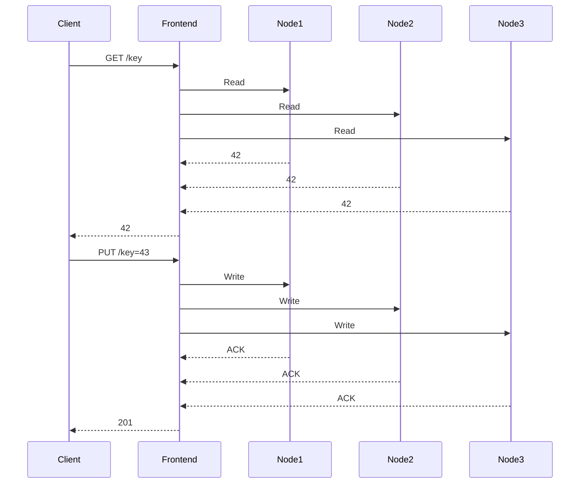

<!-- Generated by Groq via GitHub Actions -->
<!-- Topic ID: T095 -->
<!-- Category: System Design -->
<!-- Generated at UTC: 2026-10-15T17:50:46.089681+00:00 -->

# Consistency vs Availability

## 1. What problem does this solve?

When a backend system is distributed across multiple nodes (databases, caches, micro‑services), a client request may hit any node. The system must decide whether to:

1. **Return the most up‑to‑date data** (strong consistency) – even if that means waiting for all replicas to agree or rejecting the request if a node is down.
2. **Serve a response quickly** (high availability) – even if the data may be stale or partially updated.

**Why it matters**

- **User experience**: A shopping cart that shows the wrong price or a bank transfer that appears twice can erode trust.
- **Business logic**: Some operations (e.g., inventory deduction) must be atomic to avoid overselling.
- **Regulatory compliance**: Financial systems often require strict audit trails and data integrity.

**What happens if we ignore it**

- **Inconsistent reads**: A user may see stale data, leading to double‑spend or race conditions.
- **Unavailability**: If we insist on strong consistency, a single node failure can bring the whole service down.
- **Data corruption**: Without proper coordination, concurrent writes may overwrite each other.

**Real‑world appearances**

- **E‑commerce**: Stock counts, order status.
- **Banking**: Account balances, transaction logs.
- **Social media**: Feed ordering, likes count.
- **Cache layers**: Redis with `SETNX` vs `SET` with `NX` flags.
- **Databases**: PostgreSQL’s `READ COMMITTED` vs `SERIALIZABLE`, MongoDB’s write concerns.

---

## 2. Mental model

### Analogy: The Library

Imagine a library with **multiple copies** of the same book.  
- **Strong consistency**: Every time someone checks out a book, the librarian updates *all* copies immediately. If a copy is missing, the librarian waits until it’s back before letting anyone borrow.  
- **High availability**: The librarian lets people borrow from any copy, even if some copies are still being updated. If a copy is temporarily unavailable, the librarian still serves the request from another copy.

The trade‑off is clear: **Speed vs. Accuracy**.

### Engineering model

- **Consistency**: Guarantees that all replicas see the same data after an operation completes.  
- **Availability**: Guarantees that every request receives a response (success or failure) in a timely manner.  
- **CAP Theorem**: In a distributed system, you can only guarantee two of the three properties (Consistency, Availability, Partition tolerance).  
- **Eventual consistency**: A relaxed consistency model where replicas converge over time, trading immediate accuracy for higher availability.

---

## 3. Deep explanation

### Internals

- **Replication**: Data is copied across nodes. Replication can be synchronous (wait for all nodes) or asynchronous (send updates in the background).
- **Quorum**: A majority of nodes must agree on a read/write. Example: Raft, Paxos.
- **Write concerns**: In MongoDB, `w: "majority"` ensures the write is acknowledged by a majority of nodes.
- **Read preferences**: In MongoDB, `primary`, `secondary`, `nearest`, etc.

### Important terminology

| Term | Meaning |
|------|---------|
| **Strong consistency** | All reads see the most recent write. |
| **Weak consistency** | Reads may see stale data. |
| **Eventual consistency** | All replicas converge eventually. |
| **Quorum** | Minimum number of nodes that must agree. |
| **Write concern** | Guarantees about durability. |
| **Read preference** | Which replica to read from. |
| **Partition tolerance** | System continues to operate despite network splits. |

### Trade‑offs

| Property | Cost | Benefit |
|----------|------|---------|
| **Consistency** | Higher latency, lower availability | Accurate data |
| **Availability** | Potential stale reads, risk of conflicts | Fast responses |
| **Partition tolerance** | Must choose between consistency and availability | System resilience |

### Failure modes

- **Network partition**: Some nodes cannot reach others.  
- **Node crash**: A replica becomes unavailable.  
- **Write conflict**: Two clients write simultaneously to the same key.

### Limitations

- **No perfect solution**: CAP theorem forces a choice.  
- **Latency**: Synchronous replication adds round‑trip delays.  
- **Complexity**: Implementing quorum protocols is non‑trivial.

### Where it fits in a backend architecture

- **Data layer**: Databases, caches, message queues.  
- **Service layer**: Micro‑services that coordinate writes.  
- **API gateway**: May enforce read/write consistency policies.

### Interaction with related concepts

- **Idempotency**: Ensures repeated requests don’t cause duplicate writes.  
- **Event sourcing**: Stores events, can provide eventual consistency.  
- **CQRS**: Separate read/write models; read side can be eventually consistent.  
- **Distributed transactions**: Two‑phase commit for strong consistency across services.

---

## 4. How it works

### Example: Distributed key‑value store with quorum



**Step‑by‑step flow**

1. **Client** sends a request to the **frontend**.  
2. Frontend forwards the request to **N** replicas.  
3. For a **write**:  
   - Frontend waits for **quorum** (e.g., majority) of ACKs.  
   - If quorum is achieved, the write is considered committed.  
   - If not, the frontend returns an error or retries.  
4. For a **read**:  
   - Frontend may read from a single replica or perform a **read‑quorum**.  
   - If the read‑quorum is not satisfied, it may return stale data or retry.  
5. Frontend returns the result to the client.

---

## 5. Practical implementation

Below is a **Node.js** example using **Redis** with **quorum** logic for writes and reads.  
We’ll use `ioredis` for cluster support.

```ts
// consistency.ts
import Redis from 'ioredis';

const cluster = new Redis.Cluster([
  { host: '127.0.0.1', port: 7000 },
  { host: '127.0.0.1', port: 7001 },
  { host: '127.0.0.1', port: 7002 },
]);

// Helper to wait for majority ACKs
async function writeWithQuorum(key: string, value: string, quorum: number = 2) {
  const promises = cluster.nodes('master').map((node) =>
    node.set(key, value).then(() => true).catch(() => false)
  );
  const results = await Promise.all(promises);
  const successCount = results.filter(Boolean).length;
  if (successCount < quorum) {
    throw new Error('Quorum not reached');
  }
  return true;
}

async function readWithQuorum(key: string, quorum: number = 2) {
  const promises = cluster.nodes('master').map((node) =>
    node.get(key).then((val) => val).catch(() => null)
  );
  const results = await Promise.all(promises);
  // Simple majority voting: pick the most common value
  const counts: Record<string, number> = {};
  results.forEach((v) => {
    if (v !== null) counts[v] = (counts[v] || 0) + 1;
  });
  const sorted = Object.entries(counts).sort((a, b) => b[1] - a[1]);
  if (sorted.length === 0 || sorted[0][1] < quorum) {
    throw new Error('Read quorum not reached');
  }
  return sorted[0][0];
}

// Usage
(async () => {
  try {
    await writeWithQuorum('user:123:balance', '1000');
    const balance = await readWithQuorum('user:123:balance');
    console.log('Balance:', balance);
  } catch (e) {
    console.error('Operation failed:', e.message);
  } finally {
    cluster.disconnect();
  }
})();
```

**Key points**

- `writeWithQuorum` waits for at least `quorum` successful writes.  
- `readWithQuorum` collects values from all replicas and picks the majority.  
- If quorum isn’t reached, the operation fails, forcing the caller to retry or fallback.

---

## 6. Production considerations

| Concern | How to address |
|---------|----------------|
| **Scalability** | Use sharding; keep quorum small relative to cluster size. |
| **Reliability** | Replicate data across zones; use health checks; auto‑reconnect. |
| **Security** | Encrypt traffic (TLS); use ACLs; authenticate clients. |
| **Observability** | Log quorum successes/failures; expose metrics (`quorum_success`, `quorum_failure`). |
| **Performance** | Cache read‑quorum results; tune replication lag; use async writes. |
| **Error handling** | Return clear error codes (`503` for quorum failure); implement exponential backoff. |
| **Resource usage** | Avoid over‑replicating; monitor memory/CPU on each node. |
| **Operational concerns** | Automate node provisioning; monitor network partitions. |
| **Failure recovery** | Use leader election (Raft) to elect a new master; replay logs. |
| **Deployment** | Blue/green deployments; canary releases to test quorum behavior. |

---

## 7. Common mistakes

| Mistake | Why it’s problematic |
|---------|----------------------|
| **Assuming eventual consistency is “good enough”** | Some business logic (e.g., inventory) requires strong consistency. |
| **Using a single node for writes** | Creates a bottleneck and single point of failure. |
| **Ignoring network partitions** | Can lead to split‑brain scenarios where two nodes think they’re primary. |
| **Hard‑coding quorum size** | Doesn’t adapt to node failures; may cause unnecessary errors. |
| **Not handling write conflicts** | Leads to lost updates or data corruption. |
| **Over‑using synchronous replication** | Increases latency and reduces throughput. |
| **Not monitoring replication lag** | Stale reads may go unnoticed until a bug surfaces. |
| **Treating cache as primary** | Cache invalidation bugs can propagate stale data. |

---

## 8. Senior engineer perspective

### What changes at scale?

- **Architecture decisions**:  
  - Choose a consensus protocol (Raft, Paxos) for critical data.  
  - Separate read and write clusters (CQRS).  
  - Use a *primary‑secondary* pattern with read‑replicas for high read throughput.  
- **Trade‑offs**:  
  - Accept *eventual consistency* for non‑critical reads to boost performance.  
  - Use *write‑through* caching for hot keys.  
- **Bottlenecks**:  
  - Leader node can become a choke point.  
  - Network latency between data centers.  
- **Failure scenarios**:  
  - Partition between zones → fallback to read‑only mode.  
  - Leader crash → automatic failover.  
- **Monitoring**:  
  - Track `replication_lag_seconds`, `quorum_success_rate`.  
  - Alert on high read/write latency.  
- **Cost/performance**:  
  - More replicas increase storage costs.  
  - Strong consistency can reduce throughput.  
- **When NOT to use**:  
  - For simple key‑value stores where eventual consistency is acceptable.  
  - For low‑write, high‑read workloads where a single node suffices.

---

## 9. Interview questions

1. **Beginner**: *What is the CAP theorem and how does it relate to consistency and availability?*  
   *Answer*: CAP states that a distributed system can guarantee at most two of Consistency, Availability, and Partition tolerance. In practice, we often sacrifice consistency for availability during network partitions.

2. **Beginner**: *Explain eventual consistency with an example.*  
   *Answer*: In a replicated database, a write is accepted on one node and propagated asynchronously. Until all nodes receive the update, a read from another node may return stale data. Eventually, all replicas converge to the same value.

3. **Senior**: *Describe how you would design a distributed order‑processing system that guarantees no double‑spending while maintaining high availability.*  
   *Answer*: Use a primary‑secondary pattern with a consensus protocol for critical writes (e.g., Raft). Implement idempotent order creation, use a transaction log, and apply optimistic locking or a distributed lock to prevent double‑spending. Reads can be served from replicas with a read‑quorum.

4. **Senior**: *What are the trade‑offs of using a write‑concern of “majority” in MongoDB versus “acknowledged”?*  
   *Answer*: “Majority” ensures durability and consistency across a majority of nodes but increases write latency and reduces availability during partitions. “Acknowledged” is faster but may lose data if a majority of nodes fail.

5. **Scenario/Debugging**: *A micro‑service reads from a Redis cluster and occasionally returns stale data. What could be causing this and how would you investigate?*  
   *Answer*: Possible causes: network partition, delayed replication, or read‑quorum not enforced. Investigate by checking Redis cluster health, replication lag metrics, and ensuring the client uses a read‑quorum or `READONLY` mode. Add logging of read responses and compare replica values.

---

## 10. Hands‑on task

**Task**: Implement a simple “inventory” service that:

1. Stores product stock counts in a PostgreSQL database.  
2. Exposes a REST API (`GET /stock/:id`, `POST /stock/:id/decrement`) using FastAPI.  
3. Uses a Redis cache for reads with a **read‑quorum** of 2 out of 3 replicas.  
4. Ensures that a decrement operation is **strongly consistent**: it must acquire a distributed lock (e.g., Redlock) before updating the database.

**Steps**

1. Spin up a local PostgreSQL and Redis cluster (3 nodes).  
2. Create a `products` table with `id` and `stock`.  
3. Write the FastAPI endpoints.  
4. Implement the Redis read‑quorum logic.  
5. Implement the Redlock lock for decrement.  
6. Write a test script that simulates concurrent decrements and verifies no negative stock.

---

## 11. Quick revision

- **CAP theorem**: Consistency + Availability = Partition tolerance.  
- **Strong consistency**: All reads see the latest write.  
- **Eventual consistency**: Replicas converge over time.  
- **Quorum**: Majority of nodes must agree on a read/write.  
- **Write concern**: Guarantees about durability (MongoDB).  
- **Read preference**: Which replica to read from.  
- **Redlock**: Distributed lock algorithm for Redis.  
- **Read‑quorum**: Collect values from multiple replicas and pick the majority.  
- **Write‑quorum**: Wait for a majority of ACKs before confirming.  
- **Partition tolerance**: System continues to operate despite network splits.  
- **Trade‑off**: Strong consistency → higher latency; high availability → stale reads.  
- **Monitoring**: Track replication lag, quorum success rate, and latency.  
- **Failure recovery**: Leader election, automatic failover, and retry logic.  

---

## 12. References

- [CAP Theorem – Wikipedia](https://en.wikipedia.org/wiki/CAP_theorem)  
- [Redis Cluster – Official Docs](https://redis.io/docs/manual/scaling/)  
- [ioredis – GitHub](https://github.com/luin/ioredis)  
- [MongoDB Write Concerns – Docs](https://docs.mongodb.com/manual/reference/write-concern/)  
- [Redlock – Redis Distributed Lock](https://redis.io/docs/reference/patterns/distributed-locks/)  
- [FastAPI Docs](https://fastapi.tiangolo.com/)  
- [PostgreSQL Concurrency Control](https://www.postgresql.org/docs/current/mvcc.html)  

---
