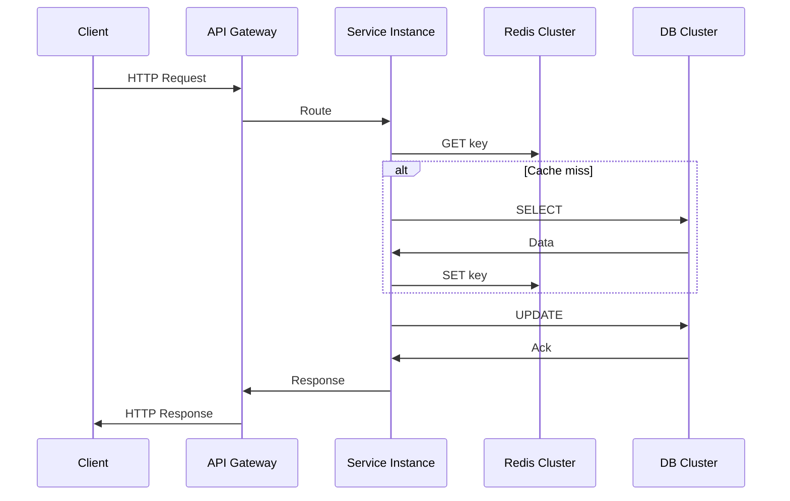

<!-- Generated by Groq via GitHub Actions -->
<!-- Topic ID: T096 -->
<!-- Category: System Design -->
<!-- Generated at UTC: 2026-10-15T17:50:46.089681+00:00 -->

# Distributed systems

## 1. What problem does this solve?

**Motivation**  
In a single‑box application, all state lives in one process. When traffic grows, that process becomes a bottleneck: CPU, memory, disk, or network limits. A distributed system splits the workload across many machines, allowing you to scale horizontally, isolate failures, and provide higher availability.

**What problem exists?**  
- *Scalability limits*: A single server can only handle so many requests before latency spikes.  
- *Single point of failure*: If the server crashes, the whole service goes down.  
- *Data locality*: Users in different regions want low‑latency access to data that lives close to them.  
- *Resource constraints*: Some workloads (e.g., heavy analytics) need specialized hardware that a single server cannot provide.

**Why the problem matters**  
- **Business impact**: Slow or unavailable services hurt user experience and revenue.  
- **Operational cost**: A single server that must be over‑provisioned to handle peak load is expensive.  
- **Reliability**: Modern SaaS products expect 99.99 % uptime; a single point of failure makes that impossible.

**What happens if this concept is not used?**  
- The application will hit capacity limits quickly.  
- A crash or network partition will bring the whole service down.  
- Users will experience high latency or outages.

**Where this concept appears in real backend systems**  
- **Microservice architectures**: Each service runs on its own set of nodes.  
- **Event‑driven pipelines**: Kafka or RabbitMQ distribute events across workers.  
- **Distributed caches**: Redis Cluster or Memcached sharding.  
- **Database sharding**: PostgreSQL sharding or MongoDB replica sets.  
- **Global CDN**: Edge nodes cache content closer to users.

---

## 2. Mental model

### Simple analogy  
Think of a **post office network**.  
- **Mail (requests)** is sent from a customer to a local post office.  
- The post office **routes** the mail to the correct destination post office (service).  
- If a post office is closed (node failure), the mail is rerouted through another office (failover).  
- The network can **scale** by adding more post offices (nodes) and **balance** the load automatically.

### Precise engineering model  
A distributed system is a collection of independent processes (nodes) that cooperate to provide a single logical service. They communicate over a network, coordinate state, and handle failures gracefully. Key properties:

| Property | Description |
|----------|-------------|
| **Scalability** | Horizontal addition of nodes increases capacity. |
| **Fault tolerance** | The system continues to operate despite node failures. |
| **Consistency** | Guarantees about data state across nodes. |
| **Latency** | Time for a request to travel across nodes. |
| **Throughput** | Number of requests processed per second. |

---

## 3. Deep explanation

### Internals
- **Nodes**: Independent processes, often containerized (Docker, Kubernetes).  
- **Communication**: Synchronous RPC (gRPC, HTTP/REST) or asynchronous messaging (Kafka, RabbitMQ).  
- **Coordination**: Consensus protocols (Paxos, Raft) for leader election, configuration, and state replication.  
- **Data distribution**: Sharding (hash‑based, range‑based) or replication (primary‑secondary).  
- **Service discovery**: DNS, Consul, etcd, or cloud provider APIs.  

### Important terminology
- **Node**: A single instance of a service.  
- **Cluster**: A set of nodes providing a single logical service.  
- **Leader / Follower**: In replicated systems, the leader handles writes; followers replicate.  
- **Partition**: A subset of data or a network segment.  
- **Consistency model**: Strong, eventual, causal, etc.  
- **Idempotency**: Repeating an operation yields the same result.  

### Trade‑offs
| Trade‑off | Strong consistency | Eventual consistency |
|-----------|--------------------|----------------------|
| Latency | Higher (requires coordination) | Lower (no coordination) |
| Availability | Lower (must wait for quorum) | Higher (can serve stale data) |
| Complexity | Higher (implement consensus) | Lower (simple replication) |

### Failure modes
- **Network partition**: Nodes cannot reach each other.  
- **Node crash**: Process dies or becomes unresponsive.  
- **Data corruption**: Disk or memory errors.  
- **Clock skew**: Time differences affect ordering.  

### Limitations
- **CAP theorem**: You can only guarantee two of Consistency, Availability, Partition tolerance.  
- **Operational complexity**: Monitoring, debugging, and deploying many nodes is hard.  
- **Latency**: Cross‑region communication adds round‑trip time.  

### Where this concept fits in a backend architecture
- **API Gateway** → **Microservice** → **Distributed cache** → **Database cluster**.  
- **Event bus** (Kafka) → **Worker services** → **Data lake**.  

### Interaction with related backend concepts
- **Caching**: Distributed cache reduces load on databases.  
- **Message queues**: Decouple producers and consumers.  
- **Service meshes**: Provide observability and traffic control.  
- **Database sharding**: Distribute data across nodes.  

---

## 4. How it works

### Step‑by‑step flow (request to a distributed service)

1. **Client** sends an HTTP request to the API gateway.  
2. **API gateway** routes the request to an available service instance (load balancer).  
3. **Service instance** may need to read/write data.  
4. If the data is in a **distributed cache**, the service queries Redis Cluster.  
5. If the data is not cached, the service queries the **database cluster** (PostgreSQL sharded).  
6. For writes, the service may acquire a **distributed lock** (Redlock) to prevent concurrent updates.  
7. The service writes to the primary node; followers replicate asynchronously.  
8. The service returns the response to the gateway, which forwards it to the client.  



---

## 5. Practical implementation

Below is a minimal **distributed lock** using the Redlock algorithm with `ioredis`.  
It protects a critical section (e.g., updating a shared counter) across multiple Node.js instances.

```ts
// lock.ts
import Redis from 'ioredis';
import { v4 as uuidv4 } from 'uuid';

const redis = new Redis(); // connects to localhost:6379

/**
 * Acquire a distributed lock using Redlock.
 * @param key Lock key
 * @param ttl Time‑to‑live in ms
 * @returns unique lock identifier or null if failed
 */
export async function acquireLock(key: string, ttl = 2000): Promise<string | null> {
  const id = uuidv4(); // unique identifier for this lock holder
  const result = await redis.set(key, id, 'NX', 'PX', ttl);
  return result === 'OK' ? id : null;
}

/**
 * Release the lock only if we own it.
 */
export async function releaseLock(key: string, id: string): Promise<boolean> {
  const script = `
    if redis.call("GET", KEYS[1]) == ARGV[1]
    then
      return redis.call("DEL", KEYS[1])
    else
      return 0
    end
  `;
  const res = await redis.eval(script, 1, key, id);
  return res === 1;
}

/**
 * Example critical section protected by the lock.
 */
export async function incrementCounter(): Promise<void> {
  const lockKey = 'counter_lock';
  const lockId = await acquireLock(lockKey, 3000);
  if (!lockId) {
    throw new Error('Could not acquire lock');
  }

  try {
    // Critical section
    const counter = await redis.get('counter');
    const newVal = (parseInt(counter ?? '0', 10) + 1).toString();
    await redis.set('counter', newVal);
    console.log(`Counter updated to ${newVal}`);
  } finally {
    await releaseLock(lockKey, lockId);
  }
}
```

**Running the example**

```bash
# Start Redis (Docker)
docker run -p 6379:6379 redis:7

# Install deps
npm install ioredis uuid

# Run the script
node lock.ts
```

The script can be executed concurrently from multiple processes; only one will succeed in updating the counter at a time.

---

## 6. Production considerations

| Concern | How to address it |
|---------|-------------------|
| **Scalability** | Use Kubernetes or ECS to autoscale nodes; partition data (sharding) or use a managed cluster (Amazon RDS, Cloud Spanner). |
| **Reliability** | Deploy replicas, use leader election, enable health checks, and implement graceful shutdown. |
| **Security** | Encrypt traffic (TLS), use IAM roles, enable Redis AUTH, and restrict network access with VPCs. |
| **Observability** | Instrument with OpenTelemetry, expose Prometheus metrics, log structured JSON, and set up alerts. |
| **Performance** | Cache hot data, batch writes, use connection pooling, and tune Redis eviction policies. |
| **Error handling** | Make all RPC calls idempotent; implement retries with exponential backoff; use circuit breakers. |
| **Resource usage** | Monitor CPU/memory; use autoscaling; avoid memory leaks in Node.js. |
| **Operational concerns** | Automate deployments with CI/CD; use blue/green or canary releases; maintain backup/restore plans. |
| **Failure recovery** | Implement graceful degradation (fallback to local cache), use backup replicas, and have a disaster‑recovery plan. |
| **Deployment considerations** | Use immutable containers, keep environment variables separate, and version your API. |

---

## 7. Common mistakes

| Mistake | Why it’s problematic |
|---------|----------------------|
| **Assuming a single node is enough** | Misses horizontal scaling and fault tolerance. |
| **Ignoring idempotency** | Re‑executing a request can corrupt data or create duplicates. |
| **Using synchronous blocking calls** | Blocks the event loop, reducing throughput. |
| **Over‑sharding without monitoring** | Creates hotspots and uneven load. |
| **Not handling partial failures** | A single node crash can bring down the whole system if no fallback. |
| **Hard‑coding connection strings** | Makes it hard to rotate credentials or move to a different environment. |
| **Skipping health checks** | Load balancers may route traffic to unhealthy nodes. |
| **Under‑estimating network latency** | Leads to timeouts and poor user experience. |

---

## 8. Senior engineer perspective

### What changes at scale?
- **Design decisions**: Choose between strong vs eventual consistency based on business requirements.  
- **Trade‑offs**: Accept higher latency for stronger guarantees, or use a hybrid approach (e.g., read‑through cache).  
- **Bottlenecks**: Identify single‑point services (e.g., a central auth service) and add redundancy.  
- **Failure scenarios**: Model network partitions, data center outages, and cascading failures.  
- **Monitoring**: Set up distributed tracing (Jaeger), metrics dashboards, and alerting for latency, error rates, and resource usage.  
- **Cost/performance**: Evaluate whether a managed service (e.g., Amazon ElastiCache) or self‑hosted cluster offers better ROI.  
- **When NOT to use**: If the workload is small, a monolith may be simpler; if data is highly relational and requires ACID, a single database may suffice.

---

## 9. Interview questions

1. **Beginner**: *What is a distributed system and why do we need it?*  
   *Answer points*: Horizontal scaling, fault tolerance, high availability, data locality.

2. **Beginner**: *Explain the CAP theorem in your own words.*  
   *Answer points*: Consistency, Availability, Partition tolerance; you can only guarantee two.

3. **Senior**: *How would you design a distributed cache that guarantees strong consistency for write‑heavy workloads?*  
   *Answer points*: Use a primary‑secondary replication model, lock on writes, use a consensus protocol, consider eventual consistency trade‑offs.

4. **Senior**: *Describe how you would detect and recover from a network partition in a microservice architecture.*  
   *Answer points*: Health checks, circuit breakers, graceful degradation, fallback services, data reconciliation.

5. **Scenario/Debugging**: *You notice that a distributed counter is occasionally off by one after a deployment. What steps would you take to debug and fix the issue?*  
   *Answer points*: Check idempotency, inspect lock acquisition, verify clock skew, review logs for race conditions, add retries, ensure proper release of locks.

---

## 10. Hands‑on task

**Implement a distributed rate limiter**  
Create a Node.js service that exposes an HTTP endpoint `/request`.  
- Use Redis to store a sliding window counter per client IP.  
- The limiter should allow 5 requests per minute.  
- If the limit is exceeded, respond with HTTP 429.  
- Deploy the service in Docker Compose with two replicas and test that the limiter works across replicas.

**Hints**  
- Use `ioredis` and Lua scripts for atomic increments.  
- Use Docker Compose to spin up two containers and a Redis container.  
- Write a simple test script that sends 10 requests from the same IP and verifies the 429 response.

---

## 11. Quick revision

- Distributed systems split workload across nodes for scalability and fault tolerance.  
- CAP theorem: Consistency, Availability, Partition tolerance – only two can be guaranteed simultaneously.  
- Consensus protocols (Raft, Paxos) enable leader election and state replication.  
- Redlock is a distributed lock algorithm using Redis.  
- Idempotency is essential for safe retries.  
- Health checks and circuit breakers prevent cascading failures.  
- Observability (metrics, logs, traces) is critical for debugging distributed systems.  
- Scaling horizontally requires sharding or replication; monitor for hotspots.  
- Security: encrypt traffic, use IAM, restrict network access.  
- Deployment: use immutable containers, blue/green or canary releases.

---

## 12. References

- [Redis Redlock algorithm](https://redis.io/docs/reference/patterns/distributed-locks/)  
- [ioredis documentation](https://github.com/luin/ioredis)  
- [OpenTelemetry for Node.js](https://opentelemetry.io/docs/instrumentation/node/)  
- [Kubernetes documentation – Deployments](https://kubernetes.io/docs/concepts/workloads/controllers/deployment/)  
- [CAP theorem](https://en.wikipedia.org/wiki/CAP_theorem)  
- [Raft consensus algorithm](https://raft.github.io/)  
- [Node.js cluster module](https://nodejs.org/api/cluster.html)  
- [Docker Compose](https://docs.docker.com/compose/)  

---
