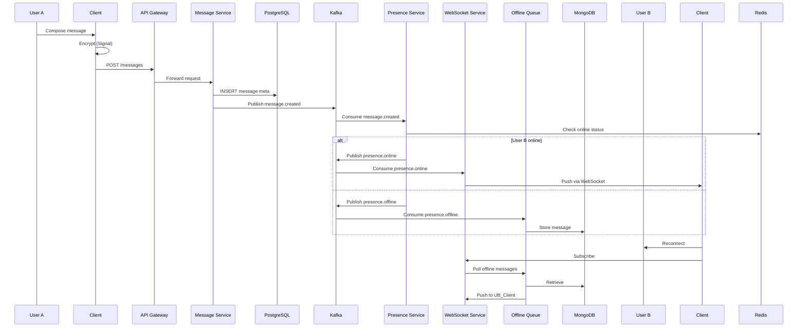

<!-- Generated by Groq via GitHub Actions -->
<!-- Topic ID: T097 -->
<!-- Category: System Design -->
<!-- Generated at UTC: 2026-10-16T06:00:28.500683+00:00 -->

# High‑level design of WhatsApp

## 1. What problem does this solve?

WhatsApp is a global instant‑messaging platform that must deliver messages, media, and presence information to millions of users with low latency, high reliability, and end‑to‑end security.  
The core problem is **how to build a distributed, real‑time, fault‑tolerant system that scales to billions of messages per day while keeping data private and ensuring a smooth user experience**.

- **Why it matters**  
  - Users expect instant delivery; delays erode trust.  
  - Data breaches would expose sensitive conversations.  
  - The service must survive node failures, network partitions, and traffic spikes.

- **Consequences of ignoring the problem**  
  - Message loss or duplication → user frustration.  
  - Poor scalability → outages during peak times.  
  - Weak security → legal penalties and brand damage.

- **Real‑world appearance**  
  - Messaging apps (Telegram, Signal, Slack).  
  - IoT telemetry pipelines.  
  - Real‑time collaboration tools (Google Docs, Figma).

## 2. Mental model

### Analogy: The Postal Service

| WhatsApp component | Postal analogy |
|--------------------|----------------|
| **Client app** | Mailbox |
| **API gateway** | Post office |
| **Message broker** | Sorting center |
| **Message store** | Archive vault |
| **Presence service** | Delivery status tracker |
| **Media service** | Package courier |
| **Encryption** | Sealed envelope |

Just as a postal system must route, store, and deliver mail reliably, WhatsApp routes, stores, and delivers messages while preserving privacy.

### Engineering model

1. **Client → API Gateway** (HTTPS/WebSocket)  
2. **API Gateway → Message Broker** (Kafka)  
3. **Broker → Microservices** (Message, Presence, Media)  
4. **Microservices → Datastores** (PostgreSQL, MongoDB, Redis)  
5. **Microservices → Clients** (WebSocket, Push)  

## 3. Deep explanation

### Internals

| Layer | Responsibility | Typical Tech |
|-------|----------------|--------------|
| **Client** | UI, local caching, encryption | React Native, Swift, Kotlin |
| **API Gateway** | Authentication, rate‑limit, routing | Nginx, Envoy, Express |
| **Transport** | Real‑time push | WebSocket, MQTT, XMPP |
| **Message Broker** | Decoupling, replay, ordering | Kafka, Pulsar |
| **Services** | Business logic | Node.js, Python, Go |
| **Datastores** | Persistence | PostgreSQL (users), MongoDB (messages), Redis (presence) |
| **Media Service** | Storage, transcoding | S3, CloudFront, FFmpeg |
| **Encryption** | End‑to‑end | Signal Protocol |

### Important terminology

- **End‑to‑End Encryption (E2EE)** – only sender/receiver can read the payload.  
- **At‑least‑once delivery** – message may be delivered multiple times but never lost.  
- **Offline message queue** – store messages until the recipient is online.  
- **Presence** – online/offline status, typing indicators.  
- **Sharding** – partitioning data across nodes.  
- **Consistent hashing** – balanced distribution of shards.

### Trade‑offs

| Decision | Pros | Cons |
|----------|------|------|
| **Kafka vs. RabbitMQ** | High throughput, replay, partitioning | Higher operational complexity |
| **MongoDB vs. PostgreSQL for messages** | Flexible schema, large blobs | Strong consistency harder |
| **Redis for presence** | Fast reads/writes | Memory cost, persistence risk |
| **WebSocket vs. long‑polling** | Low latency | Requires keep‑alive, scaling WebSocket servers |

### Failure modes

- **Broker outage** → message loss if not replicated.  
- **Database partition** → stale reads, write failures.  
- **Encryption key loss** → data unrecoverable.  
- **Push notification failure** → missed offline messages.

### Limitations

- **E2EE** prevents server‑side content filtering.  
- **Media size limits** require CDN and transcoding.  
- **Global latency**: users in remote regions may experience higher RTT.

### Where it fits

The design sits at the core of a **microservice architecture**: each service is independently deployable, scales horizontally, and communicates via a broker. It interacts with authentication, billing, analytics, and compliance services.

## 4. How it works

### Step‑by‑step flow

1. **User A** composes a message.  
2. Client encrypts payload with Signal Protocol → `ciphertext`.  
3. Client sends `POST /messages` to **API Gateway** (HTTPS).  
4. Gateway authenticates JWT, rate‑limits, forwards to **Message Service**.  
5. Message Service writes metadata to **PostgreSQL** (sender, receiver, timestamp).  
6. Service publishes event `message.created` to **Kafka**.  
7. **Presence Service** consumes event, checks if User B is online via **Redis**.  
8. If online → Kafka → **WebSocket Service** → pushes to User B’s socket.  
9. If offline → Kafka → **Offline Queue Service** → stores in **MongoDB**.  
10. When User B reconnects → WebSocket Service pulls from MongoDB, sends via WebSocket.  
11. Media attachments are uploaded to **Media Service** → stored in S3 → URL returned to client.  
12. All services log to **ELK** stack for observability.

### Mermaid diagram



## 5. Practical implementation

Below is a minimal **Node.js/TypeScript** example that shows:

- An Express API to receive a message.  
- Publishing to Kafka.  
- A WebSocket server that consumes the Kafka topic and pushes to connected clients.  
- Redis for presence.

> **Prerequisites**: Docker Compose with Kafka, Redis, and PostgreSQL.

### 5.1 `docker-compose.yml`

```yaml
version: '3.8'
services:
  zookeeper:
    image: confluentinc/cp-zookeeper:7.5.0
    environment:
      ZOOKEEPER_CLIENT_PORT: 2181
  kafka:
    image: confluentinc/cp-kafka:7.5.0
    depends_on: [zookeeper]
    environment:
      KAFKA_BROKER_ID: 1
      KAFKA_ZOOKEEPER_CONNECT: zookeeper:2181
      KAFKA_ADVERTISED_LISTENERS: PLAINTEXT://kafka:9092
      KAFKA_OFFSETS_TOPIC_REPLICATION_FACTOR: 1
  redis:
    image: redis:7
  postgres:
    image: postgres:15
    environment:
      POSTGRES_USER: whatsapp
      POSTGRES_PASSWORD: whatsapp
      POSTGRES_DB: whatsapp
```

### 5.2 `src/server.ts`

```ts
import express from 'express';
import { Kafka } from 'kafkajs';
import { Server } from 'ws';
import { createClient } from 'redis';
import { Pool } from 'pg';

const app = express();
app.use(express.json());

// PostgreSQL pool
const pool = new Pool({
  user: 'whatsapp',
  host: 'postgres',
  database: 'whatsapp',
  password: 'whatsapp',
  port: 5432,
});

// Redis client for presence
const redis = createClient();
redis.on('error', err => console.error('Redis error', err));
await redis.connect();

// Kafka producer
const kafka = new Kafka({ brokers: ['kafka:9092'] });
const producer = kafka.producer();
await producer.connect();

// WebSocket server
const wss = new Server({ port: 8080 });
const clients = new Map<string, WebSocket>(); // userId -> ws

wss.on('connection', ws => {
  // Expect first message to be userId
  ws.once('message', async msg => {
    const { userId } = JSON.parse(msg.toString());
    clients.set(userId, ws);
    await redis.set(`presence:${userId}`, 'online', { EX: 60 });
    console.log(`User ${userId} connected`);
  });

  ws.on('close', async () => {
    // Find userId by ws
    for (const [uid, socket] of clients.entries()) {
      if (socket === ws) {
        clients.delete(uid);
        await redis.del(`presence:${uid}`);
        console.log(`User ${uid} disconnected`);
        break;
      }
    }
  });
});

// Kafka consumer for message delivery
const consumer = kafka.consumer({ groupId: 'ws-group' });
await consumer.connect();
await consumer.subscribe({ topic: 'messages', fromBeginning: false });

consumer.run({
  eachMessage: async ({ topic, partition, message }) => {
    const payload = JSON.parse(message.value!.toString());
    const { to, from, text } = payload;
    const ws = clients.get(to);
    if (ws) {
      ws.send(JSON.stringify({ from, text }));
      console.log(`Delivered to ${to}`);
    } else {
      console.log(`User ${to} offline, message queued`);
      // In production, push to offline queue
    }
  },
});

// API endpoint
app.post('/messages', async (req, res) => {
  const { from, to, text } = req.body;
  // Persist metadata
  await pool.query(
    'INSERT INTO messages (sender, receiver, body, ts) VALUES ($1,$2,$3,now())',
    [from, to, text]
  );
  // Publish to Kafka
  await producer.send({
    topic: 'messages',
    messages: [{ value: JSON.stringify({ from, to, text }) }],
  });
  res.status(202).send({ status: 'queued' });
});

app.listen(3000, () => console.log('API listening on 3000'));
```

**Key lines**

- `producer.send` → decouples API from delivery.  
- `clients` map → naive in‑memory presence; replace with Redis in prod.  
- `consumer.run` → pushes to WebSocket if online, otherwise would enqueue.

> **Run**: `docker compose up` then `ts-node src/server.ts`.

## 6. Production considerations

| Concern | What to do | Why |
|---------|------------|-----|
| **Scalability** | Horizontal scaling of API, WebSocket, Kafka brokers, Redis cluster, and media CDN. | Handles millions of concurrent users. |
| **Reliability** | Kafka replication, PostgreSQL streaming replication, Redis Sentinel, S3 versioning. | Guarantees data durability. |
| **Security** | TLS everywhere, JWT auth, Signal Protocol for E2EE, audit logs, DDoS protection. | Protects user data and privacy. |
| **Observability** | Distributed tracing (OpenTelemetry), metrics (Prometheus), logs (ELK). | Detects bottlenecks, latency spikes. |
| **Performance** | Connection pooling, batch writes, async I/O, CDN for media. | Low latency, high throughput. |
| **Error handling** | Idempotent writes, retry with backoff, dead‑letter queues. | Prevents message loss or duplication. |
| **Resource usage** | Cache hot data in Redis, purge old media, use object storage lifecycle. | Cost control. |
| **Operational concerns** | CI/CD pipelines, blue‑green deployments, canary releases, automated backups. | Smooth releases, minimal downtime. |
| **Failure recovery** | Circuit breakers, graceful degradation, fallback to SMS for critical alerts. | Keeps service usable during partial outages. |
| **Deployment** | Kubernetes with Helm charts, autoscaling, namespace isolation. | Manage complexity at scale. |

## 7. Common mistakes

| Mistake | Why it’s bad |
|---------|--------------|
| **Storing encrypted payloads in DB without key rotation** | Keys become stale → data unrecoverable. |
| **Using a single monolithic DB for all services** | Hot spots, hard to scale, single point of failure. |
| **Ignoring offline message persistence** | Users miss messages when they reconnect. |
| **Over‑using WebSocket for all traffic** | High memory per connection; not suitable for mobile. |
| **No idempotency on message send** | Duplicate messages on retry. |
| **Hard‑coding topic names** | Hard to evolve schema, risk of typos. |
| **Not monitoring push notification delivery** | Users think messages are lost. |
| **Using insecure random salts for E2EE** | Weak encryption, susceptible to attacks. |

## 8. Senior engineer perspective

### Architecture decisions

- **Microservices vs. Monolith** – microservices give independent scaling but add operational overhead.  
- **Kafka vs. Redis Streams** – Kafka offers durability and replay; Redis Streams is lighter but less durable.  
- **PostgreSQL vs. NoSQL for messages** – PostgreSQL ensures ACID; NoSQL offers schema flexibility.  
- **Edge CDN for media** – reduces latency, offloads origin servers.  
- **Push vs. WebSocket** – Push for mobile, WebSocket for desktop/web.

### Trade‑offs

- **Latency vs. Reliability** – WebSocket gives instant delivery but requires keep‑alive; push notifications have higher latency but work offline.  
- **Cost vs. Performance** – CDN + object storage reduces load on origin but adds cost.  
- **Complexity vs. Flexibility** – Kafka cluster is complex but supports replay; simpler queues trade durability.

### Bottlenecks

- **Kafka broker throughput** – need enough partitions.  
- **Redis memory** – presence data can grow; use eviction policies.  
- **Media transcoding** – CPU‑heavy; offload to worker pool.  
- **Database write amplification** – batch inserts to reduce lock contention.

### Failure scenarios

- **Kafka partition loss** – enable replication factor ≥ 3.  
- **Redis cluster split‑brain** – use Sentinel or Cluster mode.  
- **Media CDN outage** – fallback to origin S3.  
- **Key compromise** – implement forward secrecy, key rotation.

### Monitoring

- **Latency histograms** for API, Kafka, WebSocket.  
- **Throughput counters** per topic.  
- **Presence churn** metrics.  
- **Error rates** for message delivery.  
- **Resource utilization** (CPU, memory, network).

### When NOT to use this approach

- **Small‑scale internal chat** – a monolith with SQLite may suffice.  
- **Low‑traffic IoT telemetry** – a simple MQTT broker could be cheaper.  
- **Highly regulated data** – may need on‑premises storage, not cloud CDN.

## 9. Interview questions

1. **Beginner**: *What is end‑to‑end encryption and why is it important for messaging apps?*  
   *Answer*: Encrypts payloads so only sender/receiver can read; protects privacy, prevents server‑side snooping.

2. **Beginner**: *How does WhatsApp handle messages sent to a user who is currently offline?*  
   *Answer*: Stores the message in an offline queue (e.g., Kafka + MongoDB) and delivers when the user reconnects.

3. **Senior**: *Design a message delivery system that guarantees at‑least‑once delivery at scale. What components and patterns would you use?*  
   *Answer*: Kafka for durable queue, idempotent consumer logic, deduplication store, retry with backoff, dead‑letter queue.

4. **Senior**: *Explain how you would scale media storage for a global user base while keeping costs reasonable.*  
   *Answer*: Use S3 with lifecycle policies, CDN edge caching, multipart upload, compression, and regional buckets.

5. **Scenario/Debugging**: *A user reports that after reinstalling the app, they do not receive any missed messages. What could be wrong?*  
   *Answer*:  
   - Missing device key registration → E2EE keys not synced.  
   - Offline queue not purged → duplicate keys.  
   - Push notification token not updated → no delivery.  
   - API key revoked → authentication failure.  
   - Presence service mis‑reported online status → message not queued.

## 10. Hands‑on task

**Implement a simple presence service**:

1. Extend the WebSocket server to broadcast presence changes (`online`, `offline`, `typing`).  
2. Store presence in Redis with TTL.  
3. Create an HTTP endpoint `/presence/:userId` that returns the current status.  
4. Write a small test script that simulates two clients connecting, sending a typing event, and disconnecting.  
5. Verify that the presence endpoint reflects the correct state.

## 11. Quick revision

- WhatsApp is a **distributed, real‑time** system built on **microservices**.  
- **End‑to‑end encryption** (Signal Protocol) protects payloads; server never sees plaintext.  
- **Kafka** decouples API from delivery, provides replay and ordering.  
- **Redis** is used for fast presence lookups; TTL ensures stale data expires.  
- **WebSocket** delivers instant messages; **push** handles offline users.  
- **Offline queue** (MongoDB) stores messages until the recipient reconnects.  
- **Media** lives in S3 + CDN; transcoded on upload.  
- **Scalability** achieved via partitioning, sharding, and autoscaling.  
- **Reliability** via replication, idempotency, dead‑letter queues.  
- **Observability**: tracing, metrics, logs.  
- **Common pitfalls**: ignoring key rotation, single DB, no offline handling, duplicate messages.  
- **Senior decisions**: Kafka vs. Redis Streams, CDN vs. direct S3, microservice boundaries, cost vs. performance trade‑offs.

## 12. References

- [WhatsApp Business API](https://developers.facebook.com/docs/whatsapp)  
- [Signal Protocol](https://signal.org/docs/)  
- [Kafka Documentation](https://kafka.apache.org/documentation/)  
- [Redis Documentation](https://redis.io/documentation)  
- [Node.js Express](https://expressjs.com/)  
- [TypeScript Handbook](https://www.typescriptlang.org/docs/)  
- [WebSocket RFC 6455](https://datatracker.ietf.org/doc/html/rfc6455)  
- [OpenTelemetry](https://opentelemetry.io/docs/)  
- [Prometheus](https://prometheus.io/docs/introduction/overview/)  
- [ELK Stack](https://www.elastic.co/what-is/elk-stack)
