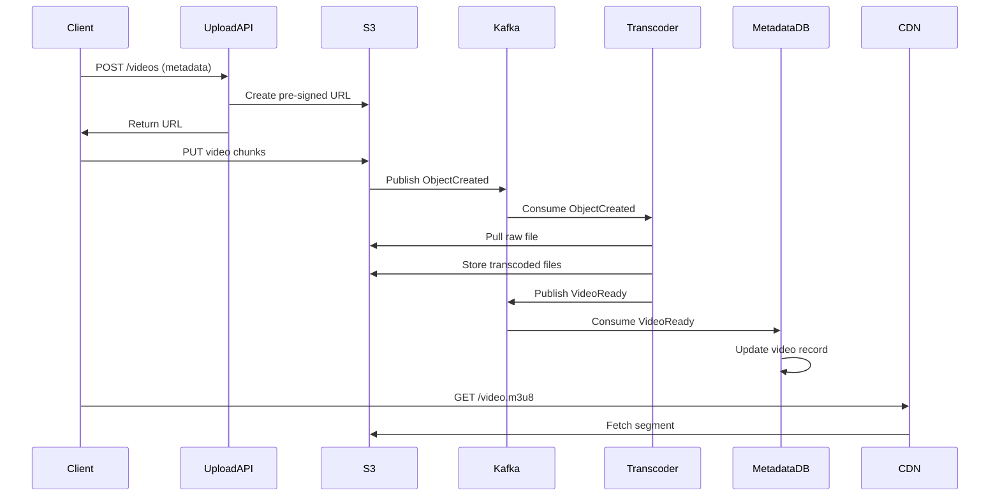

<!-- Generated by Groq via GitHub Actions -->
<!-- Topic ID: T098 -->
<!-- Category: System Design -->
<!-- Generated at UTC: 2026-10-16T06:00:28.500683+00:00 -->

# High‑level design of YouTube

## 1. What problem does this solve?

**Motivation**  
People want to watch, upload, and share videos at scale.  
A platform like YouTube must:

1. **Store** billions of videos and metadata.
2. **Serve** them to millions of concurrent viewers with low latency.
3. **Scale** horizontally as traffic grows.
4. **Guarantee** availability, consistency, and security.

**What problem exists**  
- *Massive data volume*: Video files are large (GBs), metadata is millions of rows.
- *High read/write ratio*: Users upload (writes) and watch (reads) at vastly different rates.
- *Global distribution*: Users worldwide need fast access.
- *Real‑time features*: Live streaming, comments, likes, recommendations.

**Why the problem matters**  
- Poor design leads to slow page loads, buffering, or outages.
- Inability to scale results in lost revenue and user churn.
- Security lapses can expose user data or copyrighted content.

**What happens if this concept is not used**  
- A monolithic architecture would choke under traffic spikes.
- Lack of caching would cause repeated expensive DB reads.
- No CDN would mean high latency for distant users.

**Where this concept appears in real backend systems**  
- Video streaming services (Netflix, Vimeo).
- Content delivery networks (CloudFront, Akamai).
- Large‑scale e‑commerce sites (Amazon, eBay).

---

## 2. Mental model

**Analogy**  
Think of YouTube as a *global library*:

- **Books** → Video files stored on a vast shelf (object storage).
- **Catalog** → Metadata (title, tags, thumbnails) in a searchable index.
- **Librarians** → Microservices that handle uploads, transcoding, recommendation.
- **Readers** → End‑users streaming videos via a CDN.
- **Library branches** → Edge servers (CDNs) that cache popular books near readers.

**Engineering model**  
- **Storage layer**: Object store (S3, GCS) + CDN.
- **Metadata layer**: Relational DB (PostgreSQL) + NoSQL (MongoDB) for flexible tags.
- **Processing layer**: Transcoding jobs, AI‑based recommendation, moderation.
- **API layer**: REST/GraphQL endpoints for upload, fetch, search.
- **Cache layer**: Redis for hot queries (popular videos, user sessions).
- **Message queue**: Kafka for async tasks (transcoding, analytics).

---

## 3. Deep explanation

### Internals

| Layer | Responsibility | Typical Tech |
|-------|----------------|--------------|
| **Upload API** | Accepts multipart uploads, stores raw file, triggers transcoding | Node.js + Express, FastAPI |
| **Transcoding Service** | Converts raw video to multiple bitrates | FFmpeg, Kubernetes jobs |
| **Storage** | Durable, scalable object store | AWS S3, GCS |
| **CDN** | Edge caching, HTTP/2, HLS/DASH streaming | CloudFront, Akamai |
| **Metadata DB** | Structured data (users, videos, playlists) | PostgreSQL |
| **Search Index** | Full‑text search, tags | Elasticsearch |
| **Recommendation Engine** | AI/ML for personalized feeds | Python + TensorFlow |
| **Cache** | Hot data, session, thumbnails | Redis |
| **Analytics** | Event collection, real‑time metrics | Kafka + ClickHouse |
| **Auth/Identity** | OAuth, JWT | Keycloak, Auth0 |

### Important terminology

- **Object storage**: Scalable, immutable storage for large files.
- **CDN (Content Delivery Network)**: Edge servers that cache content close to users.
- **Transcoding**: Converting video to multiple resolutions/bitrates.
- **HLS/DASH**: Adaptive streaming protocols.
- **Message queue**: Decouples producers and consumers for async processing.
- **Event sourcing**: Persisting state changes as events.
- **CQRS**: Separate read/write models.

### Trade‑offs

| Decision | Pros | Cons |
|----------|------|------|
| **S3 + CloudFront** | Low cost, global reach | Slightly higher latency for first request |
| **PostgreSQL + MongoDB** | Strong ACID + flexible schema | Complexity, data duplication |
| **Kafka for events** | High throughput, fault‑tolerant | Operational overhead |
| **Serverless vs. VMs** | Auto‑scale, pay‑per‑use | Cold start latency, vendor lock‑in |

### Failure modes

- **Object store outage** → Video unavailable. Mitigation: multi‑region replication.
- **Transcoding failure** → Video never becomes viewable. Mitigation: retry, circuit breaker.
- **Cache miss storm** → DB overload. Mitigation: rate limiting, cache warming.
- **CDN misconfiguration** → Stale content. Mitigation: versioned URLs, cache‑control headers.

### Limitations

- **Cold start** for serverless functions can hurt upload latency.
- **Large file uploads** are expensive in bandwidth; need resumable uploads.
- **Real‑time analytics** require careful buffering to avoid overload.

### Where this concept fits

- The **high‑level design** is the outermost layer; each sub‑system is a microservice or set of services.
- It interacts with **security** (OAuth, signed URLs), **observability** (logs, metrics), and **data governance** (GDPR, retention).

### Interaction with related backend concepts

- **API Gateway** routes requests to upload/search services.
- **Service Mesh** (Istio) manages inter‑service traffic, retries, and observability.
- **Database sharding** for metadata to handle millions of rows.
- **Feature flags** to roll out new recommendation algorithms.

---

## 4. How it works

### Step‑by‑step flow for uploading a video

1. **Client** initiates multipart upload → **Upload API** receives metadata.
2. **Upload API** creates an S3 pre‑signed URL and returns it.
3. **Client** streams video chunks to S3 via the URL.
4. **S3** emits an `ObjectCreated` event to **Kafka**.
5. **Transcoding Service** consumes the event, pulls the raw file, runs FFmpeg, stores transcoded files back to S3.
6. **Transcoding Service** publishes `VideoReady` event to **Kafka**.
7. **Metadata Service** consumes `VideoReady`, updates PostgreSQL with video URLs, thumbnails.
8. **CDN** automatically caches the new video when requested.
9. **Client** fetches video via CDN URL (HLS/DASH).



---

## 5. Practical implementation

Below is a minimal **upload API** in TypeScript/Node.js using Express and AWS SDK.

```ts
// src/upload.ts
import express from 'express';
import { S3Client, CreateMultipartUploadCommand, UploadPartCommand, CompleteMultipartUploadCommand } from '@aws-sdk/client-s3';
import { v4 as uuidv4 } from 'uuid';

const app = express();
app.use(express.json());

const s3 = new S3Client({ region: 'us-east-1' });
const BUCKET = 'youtube-raw-videos';

app.post('/videos', async (req, res) => {
  const { title, description, userId } = req.body;
  const objectKey = `uploads/${uuidv4()}.mp4`;

  // 1. Create multipart upload
  const createCmd = new CreateMultipartUploadCommand({
    Bucket: BUCKET,
    Key: objectKey,
    ContentType: 'video/mp4',
  });
  const { UploadId } = await s3.send(createCmd);

  // 2. Return upload info to client
  res.json({
    uploadId: UploadId,
    objectKey,
    presignedUrl: `https://s3.amazonaws.com/${BUCKET}/${objectKey}?uploadId=${UploadId}`,
  });
});

// Endpoint to complete upload (client calls after all parts)
app.post('/videos/complete', async (req, res) => {
  const { uploadId, objectKey, parts } = req.body; // parts: [{PartNumber, ETag}]
  const completeCmd = new CompleteMultipartUploadCommand({
    Bucket: BUCKET,
    Key: objectKey,
    UploadId: uploadId,
    MultipartUpload: { Parts: parts },
  });
  await s3.send(completeCmd);

  // 3. Publish event to Kafka (pseudo)
  // await kafkaProducer.send({ topic: 'video-uploads', messages: [{ value: JSON.stringify({ objectKey }) }] });

  res.json({ status: 'completed' });
});

app.listen(3000, () => console.log('Upload API listening on :3000'));
```

**Key lines**

- `CreateMultipartUploadCommand` → initiates a resumable upload.
- `UploadId` and `objectKey` are sent back to the client for streaming.
- After upload, we would publish an event to Kafka (omitted for brevity).

**Transcoding stub (Python)**

```python
# transcoder.py
import boto3
import subprocess
import os

s3 = boto3.client('s3')
BUCKET = 'youtube-raw-videos'
OUT_BUCKET = 'youtube-transcoded'

def transcode(event):
    key = event['objectKey']
    local_path = f'/tmp/{key.split("/")[-1]}'
    s3.download_file(BUCKET, key, local_path)

    # Simple FFmpeg command: create 720p and 480p
    for res in ['720p', '480p']:
        out_file = f'/tmp/{res}_{key.split("/")[-1]}'
        subprocess.run(['ffmpeg', '-i', local_path, '-vf', f'scale=-2:{res}', out_file])
        s3.upload_file(out_file, OUT_BUCKET, f'transcoded/{res}/{key.split("/")[-1]}')

    # Publish VideoReady event (pseudo)
    # kafka_producer.send(topic='video-ready', value={'objectKey': key})
```

---

## 6. Production considerations

| Concern | What to do |
|---------|------------|
| **Scalability** | Use auto‑scaling groups for API, transcoding workers. Partition S3 buckets by region. |
| **Reliability** | Multi‑AZ S3 replication, retry logic, circuit breakers. |
| **Security** | Signed URLs for uploads, HTTPS everywhere, IAM roles, encryption at rest. |
| **Observability** | Structured logs (JSON), OpenTelemetry traces, Prometheus metrics. |
| **Performance** | CDN edge caching, HLS/DASH adaptive bitrate, keep‑alive connections. |
| **Error handling** | Idempotent upload completion, graceful degradation if transcoding fails. |
| **Resource usage** | Spot instances for transcoding, serverless for low‑traffic APIs. |
| **Operational concerns** | CI/CD pipelines, blue/green deployments, canary releases. |
| **Failure recovery** | Event replay from Kafka, backup S3 copies, disaster‑recovery plan. |
| **Deployment** | Docker containers, Kubernetes, Helm charts, Terraform for infra. |

---

## 7. Common mistakes

| Mistake | Why it hurts |
|---------|--------------|
| **Storing videos in PostgreSQL blobs** | DB becomes huge, slow queries, hard to scale. |
| **No CDN** | High latency for global users, increased origin load. |
| **Blocking uploads** | Long request times, client timeouts. |
| **Ignoring resumable uploads** | Users lose progress on flaky networks. |
| **Hard‑coding URLs** | Breaks when CDN or storage changes. |
| **No retry logic** | One failure kills the whole pipeline. |
| **Over‑caching** | Stale data, cache stampede on cache miss. |

---

## 8. Senior engineer perspective

### Architecture decisions

- **Microservice vs. Monolith**: At scale, split into upload, transcoding, metadata, recommendation.
- **Event‑driven**: Kafka for decoupling, enabling eventual consistency.
- **Multi‑region**: S3 replication + regional CDNs for latency.
- **Observability stack**: OpenTelemetry + Jaeger + Grafana.

### Trade‑offs

- **Consistency vs. Availability**: Use eventual consistency for video availability; strong consistency for user data.
- **Cost vs. Performance**: Spot instances for transcoding vs. on‑demand for reliability.
- **Simplicity vs. Flexibility**: Single DB vs. polyglot persistence.

### Bottlenecks

- **Transcoding throughput**: GPU vs. CPU, queue backpressure.
- **CDN cache hit ratio**: Popularity skew, cache invalidation.
- **Database write amplification**: High write load for uploads.

### Failure scenarios

- **Transcoding queue backlog** → increased latency. Mitigate with auto‑scaling workers.
- **S3 outage** → fallback to secondary bucket, serve degraded quality.
- **Kafka partition failure** → replay from backup logs.

### Monitoring

- **Latency metrics** per service.
- **Queue depth** for Kafka topics.
- **Cache hit/miss ratios**.
- **Error rates** (HTTP 5xx, transcoding failures).

### Cost/performance

- **CDN**: Pay per GB served; optimize by compressing assets.
- **Transcoding**: GPU instances are expensive; batch jobs reduce cost.
- **Storage**: Use lifecycle policies to move older videos to cheaper tiers.

### When NOT to use this approach

- **Small‑scale hobby site**: Overkill; a single server with S3 + simple CDN may suffice.
- **Short‑lived content**: If videos are deleted quickly, simpler storage may be cheaper.

---

## 9. Interview questions

| Level | Question | Answer Points |
|-------|----------|---------------|
| Beginner | What is a CDN and why do we use it for video streaming? | Edge caching, lower latency, reduced origin load, global reach. |
| Beginner | Explain resumable uploads and why they are important. | Allows clients to resume after network failure, reduces bandwidth waste, improves UX. |
| Senior | How would you design the transcoding pipeline to handle 10k concurrent uploads? | Use message queue, worker pool, auto‑scaling, GPU instances, job prioritization, retry/backoff. |
| Senior | Discuss trade‑offs between using a single relational DB vs. a polyglot approach for metadata. | ACID vs. flexibility, scaling, complexity, data duplication. |
| Scenario | A user reports that their video buffers after 5 minutes. What steps would you take to debug? | Check CDN cache hit, origin latency, transcoding bitrate, network logs, client device bandwidth, HLS segment size. |

---

## 10. Hands‑on task

**Task**: Implement a *pre‑signed URL generator* for resumable uploads and a *mock transcoding worker* that listens to a local Kafka topic and logs the received event.

1. Create a new Node.js project (`npm init`).
2. Add `express`, `@aws-sdk/client-s3`, `kafkajs`.
3. Implement `/videos` endpoint that returns a pre‑signed URL.
4. Spin up a local Kafka broker (e.g., using Docker Compose).
5. Write a worker script that consumes `video-uploads` topic and logs the `objectKey`.
6. Test by uploading a small file via `curl` or Postman and verifying the worker logs.

---

## 11. Quick revision

- YouTube is a **distributed system**: storage, CDN, metadata, processing, analytics.
- **Object storage** + **CDN** = scalable, low‑latency video delivery.
- **Event‑driven architecture** decouples uploads → transcoding → metadata.
- **Resumable uploads** protect against flaky networks.
- **Adaptive streaming** (HLS/DASH) tailors bitrate to client bandwidth.
- **Caching** (Redis, CDN) is critical for read‑heavy workloads.
- **Observability**: logs, metrics, traces across services.
- **Security**: signed URLs, HTTPS, IAM, encryption.
- **Scalability**: auto‑scaling workers, sharded DB, multi‑region.
- **Common pitfalls**: storing blobs in DB, no CDN, blocking uploads, no retries.

---

## 12. References

- [AWS S3 Documentation](https://docs.aws.amazon.com/AmazonS3/latest/userguide/Welcome.html)
- [AWS CloudFront Documentation](https://docs.aws.amazon.com/AmazonCloudFront/latest/DeveloperGuide/Introduction.html)
- [FFmpeg Documentation](https://ffmpeg.org/documentation.html)
- [Kafka Documentation](https://kafka.apache.org/documentation/)
- [OpenTelemetry](https://opentelemetry.io/docs/)
- [FastAPI Documentation](https://fastapi.tiangolo.com/)
- [Elasticsearch Documentation](https://www.elastic.co/guide/en/elasticsearch/reference/current/index.html)
- [Redis Documentation](https://redis.io/documentation)
- [Node.js AWS SDK v3](https://docs.aws.amazon.com/AWSJavaScriptSDK/v3/latest/index.html)
