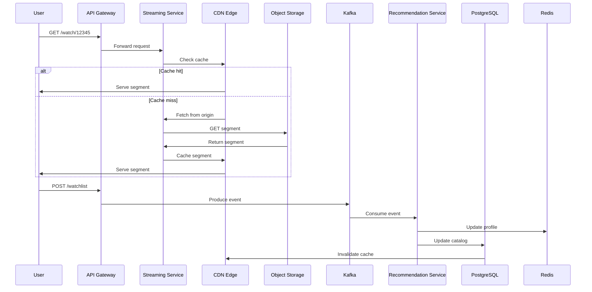

<!-- Generated by Groq via GitHub Actions -->
<!-- Topic ID: T099 -->
<!-- Category: System Design -->
<!-- Generated at UTC: 2026-10-16T17:36:35.430576+00:00 -->

# High‑Level Design of Netflix

## 1. What problem does this solve?

**Motivation**  
A streaming platform like Netflix must deliver video content to millions of users worldwide with minimal latency, high reliability, and personalized experiences. The core problem is *how to serve large amounts of media, scale to global traffic, and keep the system responsive and cost‑effective*.

**What problem exists**

- **Massive data volume** – hundreds of terabytes of video, metadata, logs, and user interactions.
- **Global distribution** – users in every continent, each with different network conditions.
- **Dynamic content** – new titles added daily, recommendations changing in real time.
- **High availability** – downtime costs revenue and brand trust.
- **Personalization** – recommendations, ads, and UI must adapt to each user.

**Why the problem matters**

- **User experience**: buffering or missing content leads to churn.
- **Revenue**: subscription fees are the primary income; any service degradation can reduce subscriptions.
- **Cost**: inefficient architecture can balloon cloud spend.

**What happens if this concept is not used**

Without a well‑architected system, the service would:

- Fail to scale under load spikes (e.g., new releases).
- Experience high latency or outages.
- Be unable to serve content globally.
- Lack personalization, hurting engagement.

**Where this concept appears in real backend systems**

- **CDNs** (e.g., Akamai, CloudFront) for edge caching.
- **Microservice architectures** for decoupling features.
- **Event‑driven pipelines** (Kafka, Kinesis) for real‑time analytics.
- **Recommendation engines** (Spark, TensorFlow) for personalization.
- **Distributed databases** (Cassandra, DynamoDB) for high write throughput.

---

## 2. Mental model

**Simple analogy**  
Think of Netflix as a *global library network*:

- **Books** = video files.
- **Central library** = master storage (object store).
- **Branch libraries** = CDN edge nodes.
- **Librarians** = microservices (catalog, recommendation, billing).
- **Readers** = users watching on devices.
- **Catalog system** = search & recommendation engine.
- **Book delivery** = adaptive streaming (HLS/DASH).

Just as a library network copies popular books to branches to reduce travel time, Netflix copies popular videos to edge caches to reduce latency.

**Precise engineering model**

```
User → API Gateway → Auth Service
          ↓
      Catalog Service
          ↓
      Recommendation Service
          ↓
      Streaming Service
          ↓
      CDN Edge (Cache)
          ↓
      Video Storage (S3/Glacier)
```

- **API Gateway** routes requests and handles rate limiting.
- **Auth Service** validates tokens.
- **Catalog** stores metadata in PostgreSQL.
- **Recommendation** consumes user events from Kafka, updates models in Redis.
- **Streaming** serves HLS segments from CDN; if cache miss, fetches from S3.
- **CDN** caches segments at the edge; invalidates on new releases.

---

## 3. Deep explanation

### Internals

| Layer | Responsibility | Typical Tech |
|-------|----------------|--------------|
| **Client** | UI, playback | React, Swift, Kotlin |
| **API Gateway** | Routing, auth, rate limiting | Express, Kong, NGINX |
| **Auth Service** | Token issuance & validation | JWT, OAuth2 |
| **Catalog Service** | Metadata CRUD | PostgreSQL, ElasticSearch |
| **Recommendation Service** | Real‑time scoring | Kafka, Redis, TensorFlow |
| **Streaming Service** | Segment delivery | HLS/DASH, CDN |
| **Storage** | Durable video storage | S3, Glacier |
| **CDN** | Edge caching | CloudFront, Akamai |
| **Analytics** | Event ingestion | Kafka, Flink |
| **Monitoring** | Metrics, logs | Prometheus, Grafana, ELK |

### Important terminology

- **Microservice** – independently deployable unit.
- **Event‑driven** – services react to events via message queues.
- **CDN** – Content Delivery Network, edge cache.
- **Adaptive streaming** – HLS/DASH segments at multiple bitrates.
- **Cache invalidation** – removing stale data from CDN.
- **Back‑pressure** – handling overload by slowing producers.

### Trade‑offs

| Decision | Pros | Cons |
|----------|------|------|
| **Monolith vs Microservices** | Simpler deployment | Harder to scale individual parts |
| **SQL vs NoSQL** | Strong consistency | Limited horizontal scaling |
| **Cache at CDN vs Origin** | Low latency | Cache invalidation complexity |
| **Real‑time vs Batch recommendations** | Freshness | Higher compute cost |

### Failure modes

- **Cache miss storm**: sudden surge of requests to origin after cache invalidation.
- **Auth token revocation lag**: revoked tokens still accepted until cache expires.
- **Event backlog**: Kafka lag causing recommendation delay.
- **CDN outage**: edge nodes down → fallback to origin, higher latency.

### Limitations

- **Cold start**: new microservices take time to spin up.
- **Data consistency**: eventual consistency in distributed caches can lead to stale recommendations.
- **Cost**: CDN bandwidth and storage can dominate spend.

### Where this concept fits in a backend architecture

High‑level design is the *blueprint* that defines services, data flows, and infrastructure. It sits above the *implementation* layer (code, databases) and below the *operations* layer (CI/CD, monitoring). It informs decisions about:

- Service boundaries
- Data partitioning
- API contracts
- Deployment topology

### Interaction with related backend concepts

- **Observability**: metrics from each service feed into a central dashboard.
- **Security**: JWT validation at gateway; TLS everywhere.
- **Scalability**: horizontal scaling of services, auto‑scaling of CDN.
- **Reliability**: circuit breakers, retries, graceful degradation.

---

## 4. How it works

### Step‑by‑step flow

1. **User request**: `GET /watch/12345` from a web client.
2. **API Gateway** receives request, authenticates JWT, forwards to **Streaming Service**.
3. **Streaming Service** checks CDN cache for segment `12345/segment_01.ts`.
4. If **cache hit**: CDN serves segment directly.
5. If **cache miss**: CDN fetches from **Origin** (S3) via Streaming Service.
6. **Streaming Service** streams HLS playlist to client.
7. **Client** requests next segment; steps 3‑6 repeat.
8. **User interaction** (e.g., click “Add to Watchlist”) triggers event to **Kafka**.
9. **Recommendation Service** consumes event, updates user profile in Redis.
10. **Catalog Service** updates metadata in PostgreSQL; triggers CDN invalidation.

### Mermaid diagram



---

## 5. Practical implementation

Below is a minimal **Node.js** example that demonstrates:

- API Gateway with Express
- Auth middleware
- Streaming endpoint that proxies to S3
- Redis cache for metadata
- Kafka producer for user events

> **Prerequisites**: Docker, Docker‑Compose, Node 18, Redis, Kafka, MinIO (S3 compatible)

### `docker-compose.yml`

```yaml
version: "3.8"
services:
  redis:
    image: redis:7
    ports:
      - "6379:6379"

  kafka:
    image: bitnami/kafka:3
    environment:
      KAFKA_BROKER_ID: 1
      KAFKA_ZOOKEEPER_CONNECT: zookeeper:2181
      KAFKA_ADVERTISED_LISTENERS: PLAINTEXT://kafka:9092
    depends_on:
      - zookeeper
    ports:
      - "9092:9092"

  zookeeper:
    image: bitnami/zookeeper:3
    environment:
      ALLOW_ANONYMOUS_LOGIN: "yes"
    ports:
      - "2181:2181"

  minio:
    image: minio/minio
    command: server /data
    environment:
      MINIO_ROOT_USER: minio
      MINIO_ROOT_PASSWORD: minio123
    ports:
      - "9000:9000"
```

### `src/index.ts`

```ts
import express from 'express';
import jwt from 'jsonwebtoken';
import { createClient } from 'redis';
import { Kafka } from 'kafkajs';
import fetch from 'node-fetch';
import { S3Client, GetObjectCommand } from '@aws-sdk/client-s3';

const app = express();
app.use(express.json());

// ---------- Config ----------
const JWT_SECRET = 'supersecret';
const REDIS_URL = 'redis://localhost:6379';
const KAFKA_BROKER = 'kafka:9092';
const S3_ENDPOINT = 'http://minio:9000';
const S3_BUCKET = 'videos';

// ---------- Clients ----------
const redis = createClient({ url: REDIS_URL });
redis.on('error', console.error);

const kafka = new Kafka({ brokers: [KAFKA_BROKER] });
const producer = kafka.producer();

const s3 = new S3Client({
  endpoint: S3_ENDPOINT,
  region: 'us-east-1',
  credentials: { accessKeyId: 'minio', secretAccessKey: 'minio123' },
});

// ---------- Middleware ----------
function auth(req: express.Request, res: express.Response, next: express.NextFunction) {
  const auth = req.headers.authorization;
  if (!auth) return res.status(401).send('Missing token');
  const token = auth.split(' ')[1];
  try {
    const payload = jwt.verify(token, JWT_SECRET);
    (req as any).user = payload;
    next();
  } catch {
    res.status(401).send('Invalid token');
  }
}

// ---------- Routes ----------
app.get('/watch/:id', auth, async (req, res) => {
  const videoId = req.params.id;
  const segment = 'segment_01.ts'; // For demo, always same

  // 1. Check CDN cache (here we just proxy to S3)
  const key = `${videoId}/${segment}`;
  try {
    const cmd = new GetObjectCommand({ Bucket: S3_BUCKET, Key: key });
    const data = await s3.send(cmd);
    // Stream to client
    res.setHeader('Content-Type', 'video/mp2t');
    data.Body.pipe(res);
  } catch (e) {
    res.status(404).send('Segment not found');
  }
});

app.post('/watchlist', auth, async (req, res) => {
  const { videoId } = req.body;
  const userId = (req as any).user.sub;

  // 2. Persist to Redis (demo only)
  await redis.hSet(`watchlist:${userId}`, videoId, Date.now());

  // 3. Produce event to Kafka
  await producer.connect();
  await producer.send({
    topic: 'user-events',
    messages: [{ value: JSON.stringify({ userId, videoId, action: 'add' }) }],
  });
  await producer.disconnect();

  res.send({ status: 'ok' });
});

app.listen(3000, () => console.log('API Gateway listening on 3000'));
```

**Explanation of key lines**

- `auth` middleware validates JWT and attaches user payload.
- `/watch/:id` streams a video segment from S3; in production this would hit a CDN.
- `/watchlist` updates Redis and publishes an event to Kafka for downstream services.

> **Run**: `docker compose up` then `npm run dev` (after `npm i`).

---

## 6. Production considerations

| Concern | What to do | Why |
|---------|------------|-----|
| **Scalability** | Horizontal scaling of services, auto‑scaling groups, CDN edge nodes | Handle traffic spikes, global load |
| **Reliability** | Circuit breakers, retries, graceful degradation, multi‑AZ deployments | Avoid single points of failure |
| **Security** | TLS everywhere, JWT revocation, rate limiting, DDoS protection | Protect user data, prevent abuse |
| **Observability** | Distributed tracing (OpenTelemetry), metrics (Prometheus), logs (ELK) | Detect issues fast |
| **Performance** | Edge caching, adaptive bitrate, CDN pre‑fetching | Reduce latency, bandwidth |
| **Error handling** | Idempotent operations, dead‑letter queues, alerting | Ensure data consistency |
| **Resource usage** | Spot instances for batch jobs, cache eviction policies | Cost optimization |
| **Operational concerns** | CI/CD pipelines, blue/green deployments, canary releases | Minimize downtime |
| **Failure recovery** | Backup of S3 objects, Kafka replication, disaster recovery plan | Data durability |
| **Deployment** | Containerized services, Kubernetes or ECS, Helm charts | Consistent environments |

---

## 7. Common mistakes

| Mistake | Why it’s bad |
|---------|--------------|
| **Hard‑coding secrets** | Exposes credentials, violates principle of least privilege |
| **Ignoring cache invalidation** | Users see stale content, recommendation drift |
| **Over‑optimistic caching** | Cache data that changes frequently → stale recommendations |
| **Single‑point auth service** | Bottleneck, single failure |
| **No retry/back‑off** | Transient network failures cause cascading errors |
| **Not monitoring Kafka lag** | Recommendation engine stalls, user experience suffers |
| **Using SQL for high‑write workloads** | Bottleneck, poor horizontal scaling |
| **Skipping rate limiting** | API abuse leads to resource exhaustion |

---

## 8. Senior engineer perspective

### What changes at scale

- **Service granularity**: split monolith into dozens of microservices (catalog, recommendation, billing, analytics).
- **Data partitioning**: sharding user data across PostgreSQL clusters, using read replicas.
- **Event sourcing**: store all user actions in Kafka for audit and replay.
- **CDN orchestration**: programmatic cache invalidation via APIs, edge compute for personalization.
- **Observability stack**: distributed tracing across services, anomaly detection on metrics.

### Design decisions

| Decision | Trade‑offs | Bottlenecks | Monitoring |
|----------|------------|-------------|------------|
| **Use Kafka vs. RabbitMQ** | Kafka scales better for high throughput | Kafka cluster maintenance | Kafka lag, topic health |
| **Cache in Redis vs. Memcached** | Redis supports persistence, Lua scripts | Redis memory limits | Memory usage, eviction |
| **CDN edge vs. origin** | Edge reduces latency | Edge cache invalidation complexity | Cache hit ratio |
| **SQL vs. NoSQL for catalog** | Strong consistency vs. horizontal scaling | SQL write lock contention | Query latency |
| **Batch vs. real‑time recommendations** | Batch reduces compute cost | Real‑time freshness | Model training time |

### Bottlenecks

- **CDN cache miss storms** after new release.
- **Kafka partition skew** leading to uneven consumer load.
- **Database connection pool exhaustion** under heavy write traffic.

### Monitoring

- **Latency** per service endpoint.
- **Cache hit/miss ratios**.
- **Kafka consumer lag**.
- **S3 read/write throughput**.
- **CDN error rates**.

### When NOT to use this approach

- **Small startup** with < 10k users: monolith + single CDN may suffice.
- **Low‑latency gaming**: CDN caching may introduce unacceptable latency; use edge compute.
- **Highly regulated data**: need stricter data residency; may require custom storage.

---

## 9. Interview questions

1. **Beginner**: *What is a CDN and why is it important for a streaming service?*  
   *Answer*: A CDN caches content at edge locations to reduce latency and bandwidth costs; it ensures users get fast, reliable streams.

2. **Beginner**: *Explain the difference between a monolith and microservices.*  
   *Answer*: A monolith bundles all functionality into one deployable unit; microservices split functionality into independently deployable services, improving scalability and fault isolation.

3. **Senior**: *How would you design a recommendation engine that can scale to millions of users while keeping latency low?*  
   *Answer*: Use event streaming (Kafka) to capture user interactions, process them in real time with stream processors (Kafka Streams, Flink), store user embeddings in Redis for fast lookup, and batch‑train models offline on GPU clusters.

4. **Senior**: *Describe how you would handle cache invalidation after a new video release.*  
   *Answer*: Publish an event to a “content‑update” topic; all CDN edge nodes subscribe and purge relevant keys; optionally use versioned URLs to avoid stale cache.

5. **Scenario/Debugging**: *A user reports buffering after a new episode release. What steps would you take to diagnose and fix the issue?*  
   *Answer*:  
   - Check CDN cache hit ratio for the episode.  
   - Inspect S3 read latency and throughput.  
   - Verify Kafka consumer lag for the ingestion pipeline.  
   - Look at streaming service logs for errors.  
   - If cache miss storm, trigger pre‑fetch or increase edge capacity.  
   - Roll back to previous version if necessary.

---

## 10. Hands‑on task

**Task**: Implement a *watchlist* microservice that:

1. Exposes `POST /watchlist` to add a video.
2. Stores the watchlist in Redis.
3. Publishes an event to Kafka.
4. Provides `GET /watchlist` to retrieve the list.

**Steps**

- Fork the repository.
- Add a new folder `watchlist-service`.
- Implement the API using Express, Redis, and Kafka (use the code skeleton above).
- Write unit tests for the endpoints.
- Deploy locally with Docker Compose and verify end‑to‑end flow.

---

## 11. Quick revision

- Netflix is a *global library network* of microservices, CDNs, and event pipelines.
- **CDN** reduces latency by caching media at edge nodes.
- **API Gateway** handles auth, routing, and rate limiting.
- **Auth Service** issues JWTs; validate at gateway.
- **Catalog Service** stores metadata in PostgreSQL; searchable via ElasticSearch.
- **Recommendation Service** consumes Kafka events, updates Redis, and serves real‑time scores.
- **Streaming Service** serves HLS/DASH segments from S3 via CDN.
- **Kafka** is the backbone for real‑time event ingestion.
- **Redis** is used for fast lookups (watchlist, recommendations).
- **Observability**: Prometheus metrics, Grafana dashboards, distributed tracing.
- **Failure modes**: cache miss storms, Kafka lag, CDN outages.
- **Scalability**: horizontal scaling, auto‑scaling groups, multi‑AZ.
- **Security**: TLS, JWT, rate limiting, DDoS protection.
- **Common mistakes**: hard‑coding secrets, ignoring cache invalidation, over‑optimistic caching.

---

## 12. References

- [Netflix Open Source](https://netflix.github.io/)
- [AWS S3 SDK for JavaScript](https://docs.aws.amazon.com/AWSJavaScriptSDK/v3/latest/clients/client-s3/)
- [KafkaJS](https://kafka.js.org/)
- [Redis Node.js Client](https://github.com/redis/node-redis)
- [OpenTelemetry for Node.js](https://opentelemetry.io/docs/instrumentation/node/)
- [Prometheus Node Exporter](https://prometheus.io/docs/introduction/first_steps/)
- [ElasticSearch Documentation](https://www.elastic.co/guide/en/elasticsearch/reference/current/index.html)
- [Netflix OSS: Hystrix](https://github.com/Netflix/Hystrix) (circuit breaker)
