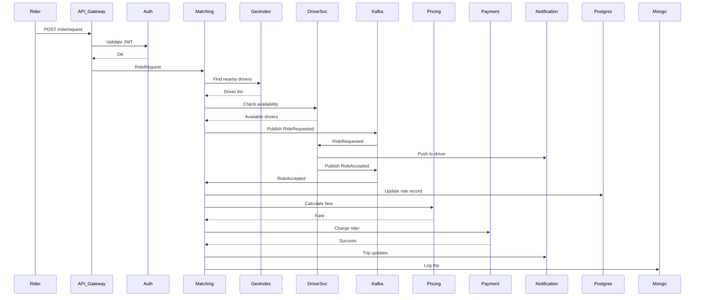

<!-- Generated by Groq via GitHub Actions -->
<!-- Topic ID: T100 -->
<!-- Category: System Design -->
<!-- Generated at UTC: 2026-10-16T17:36:35.430576+00:00 -->

# High‑Level Design of Uber

## 1. What problem does this solve?

**Motivation**  
A ride‑hailing app must connect riders with nearby drivers in real time, calculate fares, handle payments, and provide a reliable, scalable experience for millions of users worldwide. The core problem is *matching* and *coordination* across many distributed services while keeping latency low and ensuring correctness.

**What problem exists**

- **Dynamic resource allocation**: Drivers come online/offline, riders request rides, and the system must decide who gets which ride.
- **Geospatial queries**: Find drivers within a radius of a rider’s location.
- **Real‑time updates**: Riders and drivers need live status (ETA, driver location, surge pricing).
- **High availability**: The service must keep running even if parts fail.
- **Security & compliance**: Payments, personal data, and location data must be protected.

**Why the problem matters**

- Poor matching leads to long wait times → user churn.
- Latency spikes break the “real‑time” feel → lost trust.
- Data breaches or payment failures can be catastrophic.

**What happens if this concept is not used**

- Without a well‑designed architecture, the system would become a monolith, hard to scale, hard to test, and fragile under load.

**Where this concept appears in real backend systems**

- Food delivery (DoorDash, Postmates)
- Logistics (FedEx, UPS)
- Shared‑economy platforms (Airbnb, Lyft)

---

## 2. Mental model

**Analogy**  
Think of the system as a *traffic control center* for a city’s taxis. The center receives requests from passengers, knows where every taxi is, and dispatches the nearest one. It also calculates fares, processes payments, and keeps a record of every trip.

**Engineering model**  
- **Front‑end**: Mobile/web clients send ride requests.
- **API Gateway**: Routes traffic to micro‑services.
- **Service Mesh**: Handles inter‑service communication, retries, and circuit breaking.
- **Event Bus**: Publishes events (driver online, ride accepted).
- **Geospatial Index**: Quickly finds nearby drivers.
- **Matching Engine**: Decides which driver gets a request.
- **Payment Service**: Charges riders, pays drivers.
- **Notification Service**: Sends SMS/Push updates.

---

## 3. Deep explanation

### Internals

| Component | Responsibility |
|-----------|----------------|
| **API Gateway** | Auth, rate limiting, request routing. |
| **Auth Service** | JWT issuance, OAuth, user profile. |
| **Driver Service** | Driver status, location updates, availability. |
| **Rider Service** | Ride requests, history, preferences. |
| **Matching Service** | Uses geospatial index + driver pool to assign rides. |
| **Geospatial Index** | PostGIS or Redis‑GEO for radius queries. |
| **Pricing Service** | Calculates fare, surge multiplier. |
| **Payment Service** | Stripe/PayPal integration, driver payouts. |
| **Notification Service** | Push, SMS, email. |
| **Event Bus** | Kafka or NATS for async communication. |
| **Database** | PostgreSQL for relational data, MongoDB for flexible logs. |
| **Cache** | Redis for hot data (driver locations, surge zones). |

### Important terminology

- **Micro‑service**: Small, independently deployable unit.
- **Event‑driven**: Services react to events rather than polling.
- **CQRS**: Separate read/write models for scalability.
- **Geohashing**: Encoding lat/long into a string for range queries.
- **Circuit breaker**: Prevents cascading failures.
- **Rate limiting**: Throttles requests per user/IP.

### Trade‑offs

| Decision | Pros | Cons |
|----------|------|------|
| **Monolith vs Micro‑services** | Simpler deployment, fewer network hops. | Hard to scale, single point of failure. |
| **SQL vs NoSQL** | Strong consistency, ACID. | Slower writes under high load. |
| **Synchronous API vs Event‑driven** | Immediate response. | Tight coupling, harder to recover. |
| **Redis GEO vs PostGIS** | Low latency, in‑memory. | Memory cost, less powerful queries. |

### Failure modes

- **Driver churn**: Driver goes offline mid‑trip → need failover.
- **Location drift**: GPS inaccuracies → wrong driver assignment.
- **Payment failure**: Card declined → cancel ride or retry.
- **Event loss**: Kafka partition failure → lost state.

### Limitations

- **Cold starts**: Serverless functions can be slow.
- **Data consistency**: Distributed writes may lead to stale reads.
- **Geospatial precision**: 1 km radius may be too coarse for city traffic.

### Where this concept fits in a backend architecture

It sits at the core of the *service layer*, orchestrating data from persistence, caching, and external APIs. It is the glue that turns user intent into a completed trip.

### Interaction with related backend concepts

- **Load balancing**: Distributes API traffic across instances.
- **Service discovery**: Enables dynamic routing.
- **Observability**: Tracing (OpenTelemetry) across services.
- **Security**: OAuth2, TLS, secrets management.

---

## 4. How it works

### Step‑by‑step flow

1. Rider opens the app and requests a ride.  
2. Request hits **API Gateway** → validated by **Auth Service**.  
3. **API Gateway** forwards to **Matching Service**.  
4. **Matching Service** queries **Geospatial Index** (Redis GEO) for nearby drivers.  
5. For each candidate driver, **Matching Service** checks availability in **Driver Service**.  
6. The closest available driver is selected; an event `RideRequested` is published to **Kafka**.  
7. **Driver Service** consumes the event, sends a push notification.  
8. Driver accepts → `RideAccepted` event published.  
9. **Matching Service** finalizes assignment, updates **PostgreSQL**.  
10. **Pricing Service** calculates fare, publishes `FareCalculated`.  
11. **Payment Service** charges rider, pays driver.  
12. **Notification Service** sends trip start/end updates.  
13. Trip data is logged to **MongoDB** for analytics.



---

## 5. Practical implementation

Below is a minimal **Node.js / TypeScript** example of the **Matching Service** using Redis GEO and Kafka.

```ts
// src/matching.ts
import { createClient } from 'redis';
import { Kafka } from 'kafkajs';
import { v4 as uuidv4 } from 'uuid';

const redis = createClient(); // default localhost:6379
const kafka = new Kafka({ clientId: 'matching', brokers: ['localhost:9092'] });
const producer = kafka.producer();
const consumer = kafka.consumer({ groupId: 'matching' });

await redis.connect();
await producer.connect();
await consumer.connect();

interface RideRequest {
  riderId: string;
  lat: number;
  lon: number;
  requestId: string;
}

async function findNearestDriver(lat: number, lon: number, radiusKm = 5): Promise<string | null> {
  // Redis GEO radius query (in kilometers)
  const drivers = await redis.georadius(
    'drivers:location',
    lon,
    lat,
    radiusKm,
    'km',
    'WITHDIST',
    'COUNT',
    5,
    'ASC'
  );

  // Simple availability check (in production use a dedicated service)
  for (const [driverId] of drivers) {
    const status = await redis.get(`driver:${driverId}:status`);
    if (status === 'available') return driverId;
  }
  return null;
}

async function handleRideRequest(req: RideRequest) {
  const driverId = await findNearestDriver(req.lat, req.lon);
  if (!driverId) {
    throw new Error('No drivers available');
  }

  // Persist assignment
  await redis.set(`ride:${req.requestId}:driver`, driverId);

  // Publish event
  await producer.send({
    topic: 'ride-events',
    messages: [
      {
        key: req.requestId,
        value: JSON.stringify({
          type: 'RideRequested',
          requestId: req.requestId,
          riderId: req.riderId,
          driverId,
        }),
      },
    ],
  });

  return { driverId };
}

// Example usage
(async () => {
  const ride: RideRequest = {
    riderId: 'user-123',
    lat: 37.7749,
    lon: -122.4194,
    requestId: uuidv4(),
  };
  const result = await handleRideRequest(ride);
  console.log('Assigned driver:', result.driverId);
})();
```

**Key lines explained**

- `georadius` uses Redis GEO to find drivers within a radius.
- `redis.get('driver:${driverId}:status')` checks if the driver is online.
- Kafka event `RideRequested` allows other services (driver, notification) to react asynchronously.

---

## 6. Production considerations

| Concern | How to address |
|---------|----------------|
| **Scalability** | Horizontal scaling of services, Redis clustering, Kafka partitions. |
| **Reliability** | Circuit breakers, retries, graceful degradation, health checks. |
| **Security** | TLS everywhere, JWT auth, secrets in Vault, rate limiting. |
| **Observability** | Distributed tracing (OpenTelemetry), metrics (Prometheus), logs (ELK). |
| **Performance** | Cache hot data (driver locations), batch DB writes, async processing. |
| **Error handling** | Idempotent operations, dead‑letter queues, alerting. |
| **Resource usage** | Autoscaling rules, spot instances for cost savings. |
| **Operational concerns** | CI/CD pipelines, blue/green deployments, canary releases. |
| **Failure recovery** | Replay Kafka events, state snapshots, manual intervention scripts. |
| **Deployment** | Docker + Kubernetes, Helm charts, managed services (EKS, GKE). |

---

## 7. Common mistakes

| Mistake | Why it’s problematic |
|---------|----------------------|
| **Hard‑coding driver radius** | Fails under traffic spikes; leads to no driver found. |
| **Using a single Redis instance** | Single point of failure; memory limits. |
| **Synchronous payment before driver acceptance** | Charges rider unnecessarily. |
| **No idempotency on ride requests** | Duplicate assignments if client retries. |
| **Ignoring latency of geospatial queries** | Causes slow responses; users see high wait times. |
| **Storing all data in one DB** | Hotspot contention; hard to scale reads/writes. |

---

## 8. Senior engineer perspective

### What changes at scale

- **Event‑driven architecture** becomes essential to decouple services.
- **CQRS**: Separate read models for rider history vs. live trip status.
- **Geospatial indexing**: Use PostGIS with sharding or a dedicated geospatial service.
- **Observability**: Instrument every micro‑service; use distributed tracing to pinpoint latency.
- **Cost optimization**: Spot instances, autoscaling, serverless for low‑traffic services.

### Design decisions

| Decision | Trade‑offs |
|----------|------------|
| **Kafka vs. NATS** | Kafka offers durability and replay; NATS is lighter but less durable. |
| **Redis GEO vs. PostGIS** | Redis GEO is faster but limited; PostGIS supports complex queries. |
| **Monolithic vs. Micro‑services** | Micro‑services increase operational overhead but enable independent scaling. |
| **Serverless vs. VMs** | Serverless reduces ops but introduces cold‑start latency. |

### Bottlenecks

- **Driver location updates**: Too frequent updates overload Redis.
- **Payment processing**: External API latency can stall ride completion.
- **Geospatial queries**: Large radius queries can be slow if not indexed.

### Monitoring

- **Latency dashboards** per service.
- **Event lag** in Kafka.
- **Cache hit/miss** rates.
- **Error rates** (HTTP 5xx, payment failures).

### Cost/performance

- Use **spot instances** for non‑critical services.
- Cache **surge pricing zones** to avoid repeated calculations.
- Batch **trip logs** to MongoDB to reduce write load.

### When NOT to use this approach

- Small startups with < 10k users: a simpler monolith may be cheaper.
- Non‑real‑time services (e.g., static content delivery) don’t need geospatial matching.

---

## 9. Interview questions

| Level | Question | Answer points |
|-------|----------|---------------|
| Beginner | What is a micro‑service? | Small, focused, independently deployable; communicates over network. |
| Beginner | How would you find the nearest driver? | Use geospatial index (Redis GEO, PostGIS), radius query, filter by availability. |
| Senior | Explain how you would design the matching algorithm to handle surge pricing. | Compute surge multiplier per zone, apply to fare, broadcast to drivers, lock driver during surge. |
| Senior | How do you ensure idempotency in ride requests? | Use unique request IDs, check idempotency key in cache/DB, return same result on retry. |
| Scenario | A rider requests a ride but no drivers are found. What steps would you take to debug? | Check driver status cache, verify Redis GEO data, inspect Kafka consumer lag, confirm driver service health. |

---

## 10. Hands‑on task

**Implement a “driver availability” micro‑service**

1. Create a Node.js service exposing:
   - `POST /driver/:id/online` – marks driver online, stores location in Redis GEO.
   - `POST /driver/:id/offline` – marks driver offline.
   - `GET /driver/:id/status` – returns current status.
2. Add a Kafka consumer that listens to `RideAccepted` events and updates the driver’s status to `busy`.
3. Write a simple test script that simulates a driver coming online, a rider requesting a ride, and the driver accepting it.

*Deliverables*: Dockerfile, `docker-compose.yml` with Redis and Kafka, TypeScript source, and a README with run instructions.

---

## 11. Quick revision

- Uber is a **ride‑hailing platform** that matches riders to drivers in real time.
- Core components: API Gateway, Auth, Matching, Geospatial Index, Driver/Rider services, Pricing, Payment, Notification, Event Bus.
- **Redis GEO** for fast radius queries; **Kafka** for async events.
- **Idempotency**: Use unique request IDs to avoid duplicate assignments.
- **Observability**: Tracing, metrics, logs; monitor event lag and cache hit rates.
- **Scalability**: Horizontal scaling, sharding, autoscaling; use serverless for low‑traffic services.
- **Security**: TLS, JWT, secrets vault, rate limiting.
- **Common pitfalls**: Hard‑coded radius, single Redis instance, no idempotency, synchronous payment before acceptance.

---

## 12. References

- [Redis GEO Commands](https://redis.io/commands/georadius/)
- [Kafka Documentation](https://kafka.apache.org/documentation/)
- [OpenTelemetry for Node.js](https://opentelemetry.io/docs/instrumentation/node/)
- [PostGIS Documentation](https://postgis.net/documentation/)
- [Stripe API Reference](https://stripe.com/docs/api)
- [AWS ECS vs. EKS vs. Lambda](https://aws.amazon.com/ecs/)
- [Uber Engineering Blog – Matching Algorithms](https://eng.uber.com/matching-algorithms/)
- [Google Cloud Spanner – Geospatial](https://cloud.google.com/spanner/docs/geospatial)
