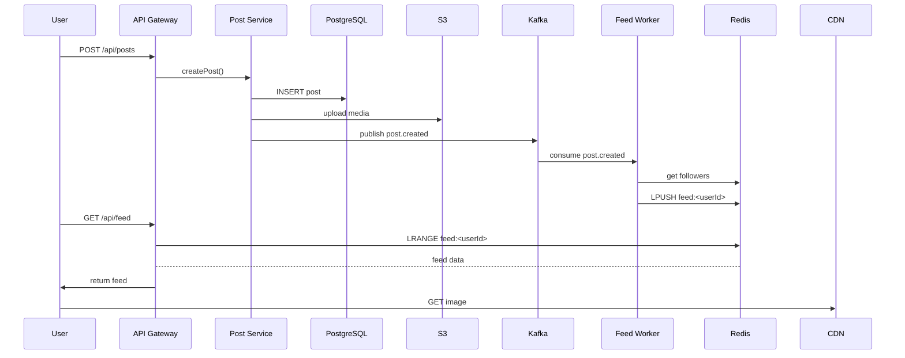

<!-- Generated by Groq via GitHub Actions -->
<!-- Topic ID: T101 -->
<!-- Category: System Design -->
<!-- Generated at UTC: 2026-10-17T05:47:22.118627+00:00 -->

# High‑level design of Instagram

## 1. What problem does this solve?

| What | Why it matters | Consequence of not using it | Real‑world appearance |
|------|----------------|-----------------------------|------------------------|
| **Personalized photo/video feed** | Keeps users engaged, drives daily active users (DAU) and revenue | Users see stale or irrelevant content → churn | Twitter, Facebook, LinkedIn |
| **Massive write & read traffic** | Millions of posts per day, billions of feed reads | Database bottlenecks, high latency | Instagram, TikTok |
| **Low latency, high availability** | Mobile users expect instant loading | Poor UX, lost revenue | Instagram, Snapchat |
| **Scalable media storage** | Images/videos are large; need efficient delivery | Storage cost blow‑up, slow downloads | Instagram, YouTube |
| **Real‑time updates** | Users want to see new posts instantly | Outdated feeds, lost engagement | Instagram, Twitter |

The core problem is: **How do you deliver a highly personalized, low‑latency feed to millions of users while keeping writes fast, reads fast, and the system cost‑effective?**

## 2. Mental model

### Analogy  
Imagine a **library** that serves millions of readers.  
- **Books** are the posts.  
- **Librarians** (background workers) pre‑arrange books on shelves (user feeds) so readers can grab them instantly.  
- **Catalog** (Redis cache) tells readers where to find the next book.  
- If a new book arrives, the librarian updates the catalog and shelves for all interested readers.

### Engineering model  
1. **Write path** – User uploads → store in DB → publish event.  
2. **Background workers** – Consume events → update follower feeds.  
3. **Read path** – User requests feed → read from cache or DB.  
4. **Media delivery** – Images/videos served via CDN.  

## 3. Deep explanation

### Internals
- **Post storage**: PostgreSQL for metadata (author, timestamp, tags) + S3/Blob for media.  
- **Follower graph**: Redis sorted sets or a graph DB (Neo4j) for quick follower lookup.  
- **Feed storage**: Redis lists or a dedicated feed table (PostgreSQL) per user.  
- **Event bus**: Kafka or AWS Kinesis for decoupling writes from feed updates.  
- **Background workers**: Node.js/TypeScript services that consume Kafka topics and write to feeds.  
- **CDN**: CloudFront/Cloudflare for media.

### Important terminology
- **Timeline / Feed** – Ordered list of posts for a user.  
- **Follower graph** – Directed graph of who follows whom.  
- **Pre‑computed feed** – Feed built ahead of time vs on‑request.  
- **Event sourcing** – Persisting every change as an event.  
- **Cache‑aside** – Cache read/write pattern.  
- **Sharding / Partitioning** – Splitting data across nodes.  

### Trade‑offs
| Approach | Pros | Cons |
|----------|------|------|
| **On‑request feed generation** | Simpler, no background jobs | High latency, DB load |
| **Pre‑computed feed** | Low read latency | Write amplification, stale data |
| **Single queue** | Simpler | Bottleneck, single point of failure |
| **Multiple queues per partition** | Parallelism | Complexity, ordering issues |

### Failure modes
- **Cache miss** → DB hit → latency spike.  
- **Kafka partition loss** → missing feed updates.  
- **Follower graph inconsistency** → wrong feed.  
- **Media CDN outage** → broken images.

### Limitations
- **Cold start**: New users have empty feeds until first post.  
- **Data skew**: Popular users generate many updates → hot spots.  
- **Eventual consistency**: Feed may lag behind real time.

### Where it fits
- **Microservice**: `post-service`, `feed-service`, `media-service`.  
- **Data layer**: PostgreSQL + Redis.  
- **Message bus**: Kafka.  
- **CDN**: Front‑end static asset delivery.

### Interaction with related concepts
- **Authentication** → JWT, OAuth.  
- **Search** → ElasticSearch for hashtag queries.  
- **Recommendation** → ML model that scores posts.  
- **Rate limiting** → Redis counters.

## 4. How it works

### Step‑by‑step flow

1. **User uploads a post**  
   - POST `/api/posts` → store metadata in PostgreSQL, media in S3.  
   - Publish `post.created` event to Kafka.  

2. **Background worker consumes event**  
   - Reads follower list from Redis.  
   - For each follower, pushes post ID to their feed list in Redis.  

3. **User requests feed**  
   - GET `/api/feed` → read from Redis list.  
   - If cache miss, fallback to PostgreSQL query.  

4. **Media request**  
   - Client fetches image URL from S3 via signed URL or CDN.  



## 5. Practical implementation

### 5.1 Post creation endpoint (Node.js + Express)

```ts
// src/routes/posts.ts
import express from 'express';
import { pool } from '../db';
import { uploadToS3 } from '../utils/s3';
import { publishEvent } from '../utils/kafka';

const router = express.Router();

router.post('/', async (req, res) => {
  const { userId, caption } = req.body;
  const file = req.file; // assume multer middleware

  // 1. Store media
  const mediaUrl = await uploadToS3(file);

  // 2. Persist metadata
  const result = await pool.query(
    `INSERT INTO posts (user_id, caption, media_url, created_at)
     VALUES ($1, $2, $3, NOW())
     RETURNING id`,
    [userId, caption, mediaUrl]
  );
  const postId = result.rows[0].id;

  // 3. Publish event
  await publishEvent('post.created', { postId, userId });

  res.status(201).json({ postId, mediaUrl });
});

export default router;
```

### 5.2 Feed worker (Node.js + Kafka + Redis)

```ts
// src/workers/feedWorker.ts
import { Kafka } from 'kafkajs';
import { client as redisClient } from '../redis';
import { pool } from '../db';

const kafka = new Kafka({ brokers: ['kafka:9092'] });
const consumer = kafka.consumer({ groupId: 'feed-workers' });

async function run() {
  await consumer.connect();
  await consumer.subscribe({ topic: 'post.created', fromBeginning: false });

  await consumer.run({
    eachMessage: async ({ message }) => {
      const { postId, userId } = JSON.parse(message.value!.toString());

      // 1. Get followers
      const followers = await redisClient.smembers(`followers:${userId}`);

      // 2. Push post to each follower's feed
      const pipeline = redisClient.pipeline();
      followers.forEach((followerId) => {
        pipeline.lpush(`feed:${followerId}`, postId);
        pipeline.ltrim(`feed:${followerId}`, 0, 199); // keep last 200 posts
      });
      await pipeline.exec();
    },
  });
}

run().catch(console.error);
```

### 5.3 Feed read endpoint

```ts
// src/routes/feed.ts
import express from 'express';
import { client as redisClient } from '../redis';

const router = express.Router();

router.get('/', async (req, res) => {
  const userId = req.user.id; // from auth middleware
  const postIds = await redisClient.lrange(`feed:${userId}`, 0, -1);

  // If cache miss, fallback to DB
  if (!postIds.length) {
    const result = await pool.query(
      `SELECT * FROM posts WHERE user_id = $1 ORDER BY created_at DESC LIMIT 200`,
      [userId]
    );
    return res.json(result.rows);
  }

  // Fetch post details (could batch via Redis or DB)
  const posts = await Promise.all(
    postIds.map((id) => pool.query('SELECT * FROM posts WHERE id = $1', [id]))
  );
  res.json(posts.map((r) => r.rows[0]));
});

export default router;
```

## 6. Production considerations

| Concern | How to address |
|---------|----------------|
| **Scalability** | Horizontal scaling of API, worker, Redis cluster, Kafka partitions. Use CDN for media. |
| **Reliability** | Replicated PostgreSQL, Redis Sentinel, Kafka replication. Circuit breakers, retries. |
| **Security** | JWT auth, HTTPS, S3 signed URLs, rate limiting, input validation. |
| **Observability** | Prometheus metrics (feed latency, cache hit ratio), Loki/ELK logs, OpenTelemetry tracing. |
| **Performance** | Cache‑aside for feeds, batch DB reads, async media uploads, CDN edge caching. |
| **Error handling** | Graceful degradation: if Redis down, fallback to DB; if Kafka down, queue in memory with retry. |
| **Resource usage** | Monitor memory in Redis (LRU eviction), disk I/O for PostgreSQL, network for media. |
| **Operational concerns** | Backup strategy for DB, Redis persistence (RDB/AOF), Kafka topic retention. |
| **Failure recovery** | Dead‑letter queue for failed events, manual replay of Kafka offsets. |
| **Deployment** | Docker Compose for dev, Kubernetes for prod, canary releases for workers. |

## 7. Common mistakes

| Mistake | Why it hurts |
|---------|--------------|
| **Generating feed on request** | DB query per request → high latency, DB overload. |
| **Storing feeds in a single Redis key per user** | Hot key, memory blow‑up for popular users. |
| **Ignoring cache invalidation** | Stale posts, inconsistent user experience. |
| **Using a single Kafka topic for all events** | Bottleneck, hard to scale. |
| **No idempotency in workers** | Duplicate posts in feeds if worker restarts. |
| **Hard‑coding feed size** | Memory waste for inactive users, missing content for active users. |
| **Not sharding follower graph** | Single Redis instance becomes a bottleneck. |
| **Uploading media directly to client** | Exposes S3 credentials, no validation. |

## 8. Senior engineer perspective

### Design decisions at scale
- **Pre‑compute vs on‑demand**: For millions of users, pre‑compute is essential; otherwise latency unacceptable.  
- **Partitioning strategy**: Shard feeds by user ID hash; follower graph by user ID.  
- **Data model**: Use a hybrid of relational (posts) and NoSQL (followers, feeds).  
- **Event sourcing**: Persist every post creation event; allows replay for debugging.  
- **CDN integration**: Offload media bandwidth, reduce origin load.  
- **Feature flags**: Roll out new feed algorithms gradually.  

### Bottlenecks
- **Write amplification**: One post → many feed updates. Mitigate with batching, rate limiting.  
- **Hot spots**: Popular users generate many updates; use partitioned queues.  
- **Storage**: Media can dominate cost; use compression, tiered storage.  

### Failure scenarios
- **Kafka partition loss** → missing updates → stale feeds. Use replication factor ≥ 3.  
- **Redis cluster failure** → feed cache loss → fallback to DB.  
- **S3 outage** → media unavailable; use multi‑region replication.  

### Monitoring
- **Feed latency** (p50, p95).  
- **Cache hit ratio**.  
- **Kafka lag**.  
- **Follower graph consistency** (hash checks).  

### Cost/performance
- **Redis memory**: expensive; use eviction policies, compress feed entries.  
- **CDN**: pay per GB; balance between edge cache and origin hits.  
- **Kafka**: cluster size vs throughput.  

### When NOT to use this approach
- **Very small user base**: On‑request feed may suffice.  
- **Low write volume**: Pre‑computing unnecessary overhead.  
- **Strict consistency required**: Pre‑computed feeds are eventually consistent.

## 9. Interview questions

| Level | Question | Key answer points |
|-------|----------|-------------------|
| Beginner | What is a “feed” in a social media app? | Ordered list of posts, personalized, usually limited to recent items. |
| Beginner | Why do we use Redis for feeds instead of PostgreSQL? | Faster read/write, in‑memory, supports list operations, lower latency. |
| Senior | How would you design the follower graph for 1 billion users? | Use Redis sorted sets, sharding by user ID, consider graph DB, handle data skew. |
| Senior | Explain the trade‑off between pre‑computed feeds and on‑request feed generation. | Latency vs write amplification, consistency, complexity. |
| Scenario | A user reports that their feed is missing posts from a friend they just followed. What could be wrong and how would you debug it? | Check follower graph update, Kafka consumer lag, feed cache update, idempotency, eventual consistency. |

## 10. Hands‑on task

**Build a minimal feed service**

1. **Set up a PostgreSQL container** with a `posts` table.  
2. **Create a Redis container** for caching feeds.  
3. **Implement an Express API** with two endpoints: `POST /posts` and `GET /feed`.  
4. **Add a Kafka producer** that publishes `post.created` events.  
5. **Write a simple worker** that consumes the event and updates Redis feeds.  
6. **Test**: create a user, post a photo, follow another user, verify the feed updates.  

Optional: add a Docker Compose file to orchestrate the stack.

## 11. Quick revision

- Instagram’s core problem: deliver personalized, low‑latency feeds to millions.  
- **Write path**: API → DB + S3 → Kafka event.  
- **Background workers**: consume events → update follower feeds in Redis.  
- **Read path**: API reads from Redis; fallback to PostgreSQL.  
- **Media**: stored in S3, served via CDN.  
- **Key data stores**: PostgreSQL (metadata), Redis (feeds & follower graph), Kafka (event bus).  
- **Trade‑offs**: pre‑compute vs on‑request, consistency vs latency, single vs multiple queues.  
- **Failure modes**: cache miss, Kafka lag, follower graph inconsistency.  
- **Production concerns**: sharding, replication, monitoring, cost control.  
- **Common mistakes**: on‑request feeds, single Redis key, no idempotency.  
- **Senior focus**: partitioning, event sourcing, CDN, feature flags, cost‑performance balance.  

## 12. References

- PostgreSQL documentation: https://www.postgresql.org/docs/  
- Redis documentation: https://redis.io/docs/  
- Kafka documentation: https://kafka.apache.org/documentation/  
- Node.js Express docs: https://expressjs.com/  
- AWS S3 SDK for JavaScript: https://docs.aws.amazon.com/AWSJavaScriptSDK/latest/AWS/S3.html  
- Next.js API routes: https://nextjs.org/docs/api-routes/introduction  
- OpenTelemetry for Node.js: https://opentelemetry.io/docs/instrumentation/js/  
- Prometheus Node.js client: https://github.com/siimon/prom-client  
- Docker Compose: https://docs.docker.com/compose/  

---
