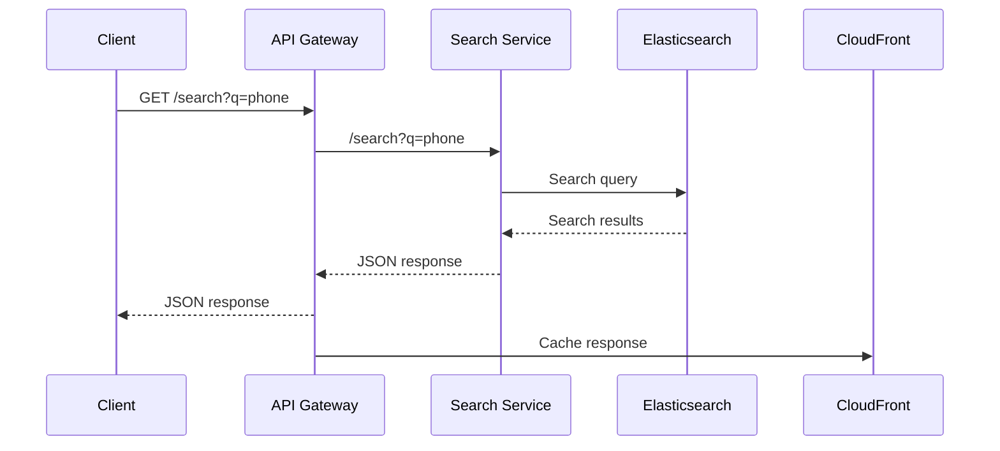
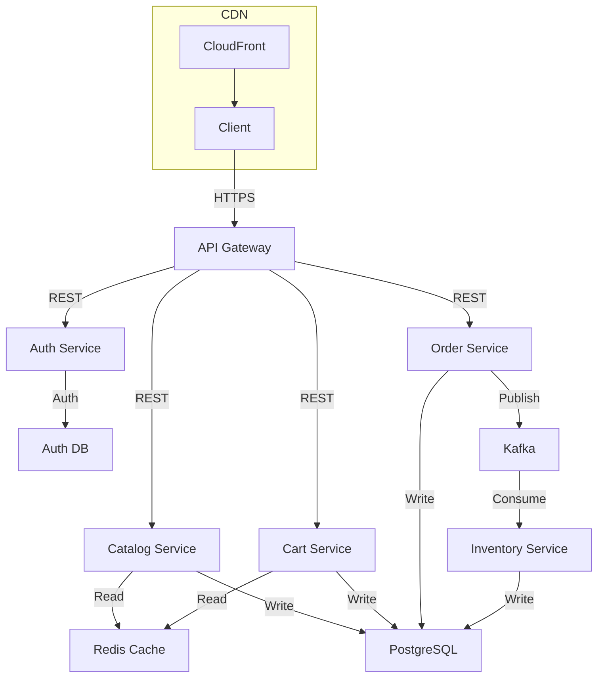

<!-- Generated by Groq via GitHub Actions -->
<!-- Topic ID: T102 -->
<!-- Category: System Design -->
<!-- Generated at UTC: 2026-10-17T05:47:22.118627+00:00 -->

# High‑level design of Amazon

## 1. What problem does this solve?

**Motivation**  
Amazon is a global e‑commerce platform that must serve millions of users, process thousands of orders per second, and keep product data up‑to‑date across thousands of warehouses. The core problem is *how to build a distributed, highly available, and scalable system that can handle massive traffic while keeping latency low and data consistent.*

**What problem exists**

- **Massive traffic spikes** (e.g., Black Friday, Prime Day) that can overwhelm a single server.
- **Geographically distributed users** that need low‑latency responses.
- **Large, dynamic catalog** that changes frequently (price, inventory, reviews).
- **Complex business logic** (recommendations, pricing, fraud detection).
- **High reliability**: users expect 99.99 % uptime.

**Why the problem matters**

- Poor scalability leads to slow page loads, cart abandonment, and lost revenue.
- Single points of failure cause outages that damage brand reputation.
- Inconsistent data can result in overselling or incorrect pricing.

**What happens if this concept is not used**

- Monolithic architecture → hard to scale, difficult to deploy, single point of failure.
- No caching → database overload, high latency.
- No sharding or partitioning → hot spots, slow queries.

**Where this concept appears in real backend systems**

- **Amazon**: uses a microservices architecture, global CDN (CloudFront), sharded databases, and a mix of relational and NoSQL stores.
- **Other e‑commerce**: Shopify, eBay, Alibaba.
- **Large SaaS**: Netflix, Spotify, Uber.

---

## 2. Mental model

**Simple analogy**  
Think of Amazon as a *global city*:

| City component | System component |
|----------------|------------------|
| **Roads & traffic lights** | Load balancers & API gateways |
| **Warehouses** | Distributed databases & caches |
| **Postal service** | Message queues (Kafka, SQS) |
| **City council** | Service discovery & configuration |
| **Public transport** | CDN (CloudFront, Akamai) |
| **Police & fire department** | Monitoring, alerting, auto‑scaling |

Just as a city needs roads to move people, warehouses to store goods, and a traffic system to avoid jams, Amazon needs load balancers, databases, and monitoring to keep traffic flowing smoothly.

**Precise engineering model**  
- **Microservices**: each business capability (catalog, cart, order, payment) runs in its own process.
- **Event‑driven communication**: services publish/subscribe to events (order created, inventory updated).
- **Data partitioning**: sharding by customer ID or product ID.
- **Caching**: Redis or Memcached for hot data.
- **Global CDN**: edge locations cache static assets and API responses.
- **Observability stack**: metrics (Prometheus), logs (ELK), tracing (OpenTelemetry).

---

## 3. Deep explanation

### Internals

1. **API Gateway / Edge Layer**  
   - Receives HTTP/HTTPS requests, performs authentication, rate‑limiting, and routing.
   - Example: Amazon API Gateway, NGINX, or a custom Node.js gateway.

2. **Service Mesh / Service Discovery**  
   - Keeps track of service instances, health checks, and traffic routing.
   - Example: Consul, Eureka, or Kubernetes Service.

3. **Microservices**  
   - Stateless, horizontally scalable.  
   - Communicate via REST, gRPC, or message queues.

4. **Databases**  
   - **Relational** (PostgreSQL, MySQL) for transactional data (orders, payments).  
   - **NoSQL** (DynamoDB, MongoDB) for flexible schemas (product catalog).  
   - **Search** (Elasticsearch) for product search.

5. **Caching Layer**  
   - Redis for session data, product price cache, recommendation cache.

6. **Message Bus**  
   - Kafka or Amazon SQS for asynchronous events (inventory updates, recommendation triggers).

7. **CDN**  
   - CloudFront caches static assets and API responses at edge locations.

8. **Observability**  
   - Metrics (Prometheus), logs (ELK), distributed tracing (OpenTelemetry).

### Important terminology

| Term | Definition |
|------|------------|
| **Sharding** | Partitioning data across multiple nodes. |
| **Replication** | Copying data to multiple nodes for redundancy. |
| **CQRS** | Command Query Responsibility Segregation – separate read/write models. |
| **Event Sourcing** | Persisting state changes as events. |
| **Circuit Breaker** | Prevents cascading failures by short‑circuiting failing services. |
| **Bulkhead** | Isolating resources to prevent one failure from affecting others. |

### Trade‑offs

| Decision | Pros | Cons |
|----------|------|------|
| **Monolith vs Microservices** | Simpler deployment, easier transactions | Hard to scale, single point of failure |
| **SQL vs NoSQL** | Strong ACID guarantees | Limited scalability for large catalogs |
| **Cache vs Direct DB** | Low latency | Stale data risk |
| **Synchronous vs Asynchronous** | Immediate consistency | Higher latency, complexity |

### Failure modes

- **Network partition** → services cannot reach each other → fallback to cached data or degraded mode.
- **Hot spot** → one shard overloaded → auto‑sharding or read replicas.
- **Cache stampede** → many requests hit DB simultaneously → use cache‑aside with locking.
- **Message backlog** → Kafka lag → increase consumer throughput or add partitions.

### Limitations

- **Eventual consistency** in distributed caches can lead to stale reads.
- **Complexity** of managing many services, CI/CD pipelines, and observability.
- **Cost** of global infrastructure (CDN, multi‑region databases).

### Where this concept fits in a backend architecture

- **Front‑end** → API Gateway → Microservices → Databases / Caches → CDN.  
- **Back‑office** → Admin UI → Microservices → Databases.  
- **Analytics** → Data lake, batch jobs, real‑time streams.

### Interaction with related concepts

- **Load Balancing** ↔ API Gateway.  
- **Caching** ↔ CDN & Redis.  
- **Database Sharding** ↔ Microservices.  
- **Observability** ↔ Service Mesh.

---

## 4. How it works

### Request flow for a product search

1. **Client** sends `/search?q=phone` to API Gateway.  
2. API Gateway authenticates, rate‑limits, and forwards to **Search Service**.  
3. Search Service queries **Elasticsearch** cluster.  
4. Elasticsearch returns results → Search Service formats response.  
5. API Gateway returns JSON to client.  
6. CDN caches the response for subsequent identical requests.



### Architecture diagram



---

## 5. Practical implementation

Below is a minimal **Search Service** in TypeScript/Node.js that:

- Exposes a `/search` endpoint.
- Queries an Elasticsearch cluster.
- Caches results in Redis.
- Uses `axios` for HTTP requests.

```ts
// src/searchService.ts
import express from 'express';
import axios from 'axios';
import Redis from 'ioredis';

const app = express();
const redis = new Redis(); // defaults to localhost:6379

const ES_ENDPOINT = 'http://localhost:9200/products/_search';
const CACHE_TTL = 60; // seconds

app.get('/search', async (req, res) => {
  const query = req.query.q?.toString() ?? '';
  if (!query) return res.status(400).json({ error: 'Missing query' });

  const cacheKey = `search:${query}`;
  // 1️⃣ Try cache first
  const cached = await redis.get(cacheKey);
  if (cached) {
    return res.json(JSON.parse(cached));
  }

  try {
    // 2️⃣ Query Elasticsearch
    const esRes = await axios.post(
      ES_ENDPOINT,
      { query: { match: { title: query } } }
    );

    const hits = esRes.data.hits.hits.map((h: any) => h._source);

    // 3️⃣ Store in cache
    await redis.set(cacheKey, JSON.stringify(hits), 'EX', CACHE_TTL);

    res.json(hits);
  } catch (err) {
    console.error('Search error', err);
    res.status(500).json({ error: 'Search failed' });
  }
});

app.listen(3000, () => console.log('Search Service listening on 3000'));
```

**Running the example**

1. Start Elasticsearch locally (Docker):  
   ```bash
   docker run -p 9200:9200 -e "discovery.type=single-node" docker.elastic.co/elasticsearch/elasticsearch:7.17.0
   ```
2. Start Redis:  
   ```bash
   docker run -p 6379:6379 redis
   ```
3. Seed data (optional).  
4. Run the service:  
   ```bash
   ts-node src/searchService.ts
   ```

**Why this is realistic**

- Uses real components (Elasticsearch, Redis).
- Demonstrates caching, error handling, and simple routing.
- Can be extended to a full microservice architecture.

---

## 6. Production considerations

| Concern | How Amazon addresses it | What to watch for |
|---------|--------------------------|-------------------|
| **Scalability** | Auto‑scaling groups, Kubernetes, serverless functions | Cold starts, scaling lag |
| **Reliability** | Multi‑AZ deployments, health checks, circuit breakers | Split brain, data loss |
| **Security** | IAM roles, TLS, secrets manager, WAF | Misconfigured permissions, injection attacks |
| **Observability** | Distributed tracing, metrics, log aggregation | Alert fatigue, missing metrics |
| **Performance** | CDN edge caching, query optimization, connection pooling | Cache invalidation, query latency |
| **Error handling** | Retries with exponential backoff, dead‑letter queues | Infinite retry loops |
| **Resource usage** | Right‑size instances, spot instances, container limits | Over‑provisioning, under‑provisioning |
| **Operational concerns** | CI/CD pipelines, blue/green deployments | Deployment rollbacks, canary failures |
| **Failure recovery** | Automated failover, data replication | Data consistency, eventual consistency windows |
| **Deployment** | Immutable infrastructure, Terraform, GitOps | Drift, configuration mismatches |

---

## 7. Common mistakes

| Mistake | Why it’s problematic |
|---------|----------------------|
| **Hard‑coding DB URLs** | Breaks in CI/CD, leaks secrets |
| **No cache invalidation** | Stale data, customer confusion |
| **Single‑region deployment** | Latency spikes, single point of failure |
| **Ignoring idempotency** | Duplicate orders, inventory errors |
| **Over‑optimistic locking** | Lost updates, race conditions |
| **No graceful degradation** | Full outage when a single service fails |
| **Blocking I/O in Node.js** | Thread pool exhaustion, slow requests |
| **Not monitoring retries** | Hidden failures, silent degradation |

---

## 8. Senior engineer perspective

### What changes at scale?

- **Service boundaries** become tighter; each microservice owns its data and contracts.
- **Data consistency** is managed via eventual consistency and compensating transactions.
- **Observability** is a first‑class citizen; metrics, logs, and traces are mandatory.
- **Cost optimization**: spot instances, auto‑scaling, and serverless functions reduce spend.
- **Security**: fine‑grained IAM, secrets rotation, and network segmentation.

### Design decisions a senior engineer would consider

| Decision | Trade‑offs | Bottlenecks | Monitoring |
|----------|------------|-------------|------------|
| **Use of serverless vs containers** | Lower ops vs cold starts | Cold start latency | CloudWatch metrics |
| **Sharding strategy** | Horizontal scalability vs complexity | Hot shard | Shard health metrics |
| **Cache strategy** | Speed vs staleness | Cache stampede | Cache hit ratio |
| **Event sourcing** | Audit trail vs complexity | Event replay latency | Event backlog |
| **Database choice** | ACID vs scalability | Write amplification | Query latency |
| **API gateway vs sidecar** | Centralized auth vs distributed | Single point of failure | Request latency |

### When NOT to use this approach

- **Low traffic sites**: monolith may be simpler.
- **Short‑lived projects**: microservices overhead may outweigh benefits.
- **Highly regulated data**: strict consistency may require monolith or tightly coupled services.

---

## 9. Interview questions

| Level | Question | Key answer points |
|-------|----------|-------------------|
| Beginner | What is a CDN and why is it useful for an e‑commerce site? | Edge caching, lower latency, offloads origin servers, global reach. |
| Beginner | How does caching improve performance in a distributed system? | Reduces DB load, speeds up reads, improves scalability, but introduces staleness risk. |
| Senior | Explain how you would design a sharded product catalog for millions of items. | Partition key selection (hash, range), replication, read replicas, routing logic, handling hot spots. |
| Senior | Discuss trade‑offs between using a relational database vs a NoSQL store for order data. | ACID vs scalability, join complexity, schema evolution, consistency guarantees. |
| Scenario | A user reports that their order shows as “processing” for hours. What steps would you take to debug this? | Check order service logs, message queue lag, database write latency, circuit breaker status, trace the request path, verify downstream services (payment, inventory). |

---

## 10. Hands‑on task

**Build a simple “Product Service”**

1. Create a Node.js microservice with Express.  
2. Use PostgreSQL (via `pg`) to store products (id, name, price, inventory).  
3. Add a Redis cache layer for product reads.  
4. Expose `/products/:id` and `/products` endpoints.  
5. Implement graceful degradation: if DB is down, serve from cache.  
6. Write a Dockerfile and docker‑compose file to run the service, Redis, and PostgreSQL.  
7. Add basic Prometheus metrics (`/metrics`) and OpenTelemetry tracing.

**Deliverables**

- `src/` folder with TypeScript code.  
- `Dockerfile` and `docker-compose.yml`.  
- README with run instructions.  
- Unit tests for cache hit/miss logic.

---

## 11. Quick revision

- Amazon solves *massive, global, highly available e‑commerce* via microservices, sharding, caching, CDN, and observability.  
- **API Gateway** → **Microservices** → **Databases / Caches** → **CDN**.  
- **Caching**: Redis + CDN; **Event‑driven**: Kafka/SQS.  
- **Observability**: Prometheus, Grafana, OpenTelemetry.  
- **Failure modes**: network partitions, cache stampedes, hot shards.  
- **Trade‑offs**: consistency vs scalability, monolith vs microservices.  
- **Senior concerns**: cost, security, monitoring, graceful degradation.  
- **Common mistakes**: hard‑coded secrets, no cache invalidation, single‑region deployment.  
- **Interview focus**: CDN benefits, caching, sharding, DB trade‑offs, debugging steps.

---

## 12. References

- [Amazon Web Services Architecture Center](https://aws.amazon.com/architecture/)
- [Elasticsearch Documentation](https://www.elastic.co/guide/en/elasticsearch/reference/current/index.html)
- [Redis Documentation](https://redis.io/documentation)
- [Node.js Express Guide](https://expressjs.com/)
- [Prometheus Documentation](https://prometheus.io/docs/introduction/overview/)
- [OpenTelemetry Specification](https://opentelemetry.io/docs/)
- [AWS S3, DynamoDB, RDS, CloudFront Docs](https://docs.aws.amazon.com/)
