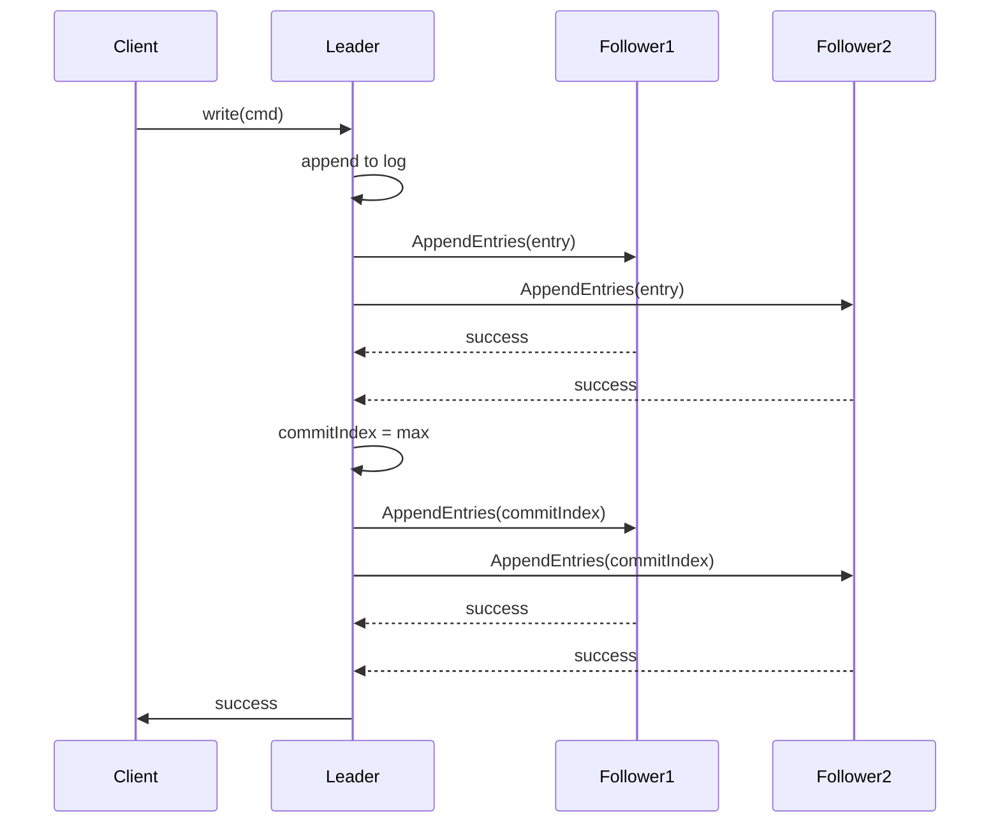

<!-- Generated by Groq via GitHub Actions -->
<!-- Topic ID: T103 -->
<!-- Category: Distributed Systems -->
<!-- Generated at UTC: 2026-10-17T16:34:29.470645+00:00 -->

# Distributed consensus

## 1. What problem does this solve?

Distributed systems often run on multiple machines that can fail independently.  
When several nodes must agree on a shared state (e.g., a counter, a configuration, a list of tasks), the system needs a **consensus** algorithm to:

- **Guarantee consistency**: every correct node sees the same data.
- **Handle failures**: if a node crashes or a network partition occurs, the system can still make progress.
- **Prevent split‑brain**: avoid two nodes simultaneously acting as leaders and diverging state.

**Why it matters**

- **Data integrity**: Without consensus, two replicas could diverge, leading to lost updates or corrupted data.
- **Reliability**: A system that can recover from node failures without manual intervention is more robust.
- **Operational simplicity**: Developers can reason about a single source of truth rather than reconciling conflicting replicas.

**What happens if it isn’t used**

- In a naive replication scheme, a crash could leave the cluster in an inconsistent state.
- Read‑heavy workloads might return stale data.
- Manual intervention would be required to resolve conflicts, increasing MTTR.

**Real‑world appearance**

- **etcd** (used by Kubernetes for cluster state)
- **Consul** (service discovery & configuration)
- **Apache Kafka** (log replication via Raft in newer versions)
- **CockroachDB** (uses Raft for distributed transactions)
- **Redis Cluster** (uses a simplified consensus for slot allocation)

---

## 2. Mental model

### Analogy: The “Meeting Time” game

Imagine a group of friends trying to pick a meeting time.  
Each friend proposes a time, and they vote.  
The friend with the majority becomes the *leader* who announces the final time.  
If the leader disappears, the group starts a new voting round.

**Key take‑aways**

- **Leader election**: who decides?
- **Voting**: everyone must agree on the same choice.
- **Failover**: if the leader fails, a new leader is elected.

### Engineering model: Raft

Raft is a consensus algorithm that formalises the above process:

1. **Leader election** – nodes elect a leader for a *term*.
2. **Log replication** – the leader appends commands to a log and replicates them to followers.
3. **Safety** – once a log entry is committed, all future leaders will contain it.
4. **Log compaction** – snapshots keep the log size manageable.

---

## 3. Deep explanation

### Internals

| Component | Role |
|-----------|------|
| **Leader** | Accepts client requests, appends to log, replicates to followers. |
| **Follower** | Passively receives log entries, applies them to state machine. |
| **Candidate** | Initiates election by requesting votes. |
| **Term** | Logical clock incremented on each election. |
| **Log entry** | Command + metadata (term, index). |
| **Commit index** | Highest log index known to be committed. |
| **Snapshot** | Compact representation of state at a point in time. |

### Important terminology

- **Election timeout** – random interval after which a follower becomes a candidate if it hasn’t heard from a leader.
- **Heartbeat** – periodic empty RPCs from leader to keep followers alive.
- **Log consistency rule** – a follower’s log must match the leader’s up to the commit index.
- **Safety** – no two leaders can commit conflicting entries for the same index.

### Trade‑offs

| Aspect | Raft | Paxos |
|--------|------|-------|
| **Understandability** | High | Low |
| **Performance** | Single leader bottleneck | Multi‑leader possible |
| **Fault tolerance** | 2f+1 nodes for f failures | Same |
| **Implementation complexity** | Moderate | High |

### Failure modes

- **Network partition** – split‑brain if two leaders form; Raft prevents this by requiring majority.
- **Leader crash** – followers elect a new leader; log replication resumes.
- **Disk failure** – persistent log ensures recovery; snapshots mitigate log size.
- **Clock skew** – Raft uses logical terms, not physical clocks.

### Limitations

- **Linear scalability** – single leader can become a bottleneck for writes.
- **High latency** – each write requires majority acknowledgment.
- **Complexity of log compaction** – snapshots must be coordinated.

### Where it fits in a backend architecture

- **Configuration store** (etcd, Consul)
- **Distributed lock service** (Redis RedLock, etcd locks)
- **Stateful microservice cluster** (e.g., a replicated counter)
- **Message broker** (Kafka’s Raft‑based log replication)

### Interaction with related concepts

- **Replication** – Raft is a specific replication protocol.
- **Event sourcing** – Raft logs can be treated as an event store.
- **CAP theorem** – Raft prioritises consistency and partition tolerance (CP).
- **Service discovery** – Consul uses Raft to maintain service registry.

---

## 4. How it works

### Step‑by‑step flow of a Raft write

1. **Client → Leader**: client sends command (e.g., `SET key=value`).
2. **Leader → Log**: leader appends entry to its local log, assigns index & current term.
3. **Leader → Followers**: leader sends `AppendEntries` RPCs with new entries.
4. **Followers → Log**: each follower appends entries, replies success/failure.
5. **Leader → Commit**: once a majority acknowledges, leader updates `commitIndex`.
6. **Leader → Followers**: leader sends `AppendEntries` with `commitIndex`.
7. **Followers → State Machine**: each follower applies committed entries to its state machine.
8. **Leader → Client**: leader acknowledges success.

### Mermaid diagram



---

## 5. Practical implementation

Below is a minimal **leader election** using **Redis** (SETNX + TTL).  
It demonstrates the core idea of distributed consensus: a single leader is elected and others follow.

```ts
// leaderElection.ts
import { createClient } from 'redis';
import { setTimeout } from 'timers/promises';

const REDIS_URL = process.env.REDIS_URL ?? 'redis://localhost:6379';
const ELECTION_KEY = 'cluster:leader';
const NODE_ID = process.env.NODE_ID ?? `node-${process.pid}`;
const HEARTBEAT_TTL_MS = 3000; // 3 seconds

const client = createClient({ url: REDIS_URL });
await client.connect();

/**
 * Try to become leader by acquiring a lock.
 * If successful, start heartbeating.
 */
async function tryElectLeader() {
  const ok = await client.set(ELECTION_KEY, NODE_ID, {
    NX: true,
    PX: HEARTBEAT_TTL_MS,
  });

  if (ok) {
    console.log(`[${NODE_ID}] Elected as LEADER`);
    await heartbeater();
  } else {
    console.log(`[${NODE_ID}] Not the leader`);
  }
}

/**
 * Periodically refresh the lock to keep leadership.
 */
async function heartbeater() {
  while (true) {
    const current = await client.get(ELECTION_KEY);
    if (current !== NODE_ID) {
      console.log(`[${NODE_ID}] Lost leadership`);
      break;
    }
    await client.pexpire(ELECTION_KEY, HEARTBEAT_TTL_MS);
    await setTimeout(HEARTBEAT_TTL_MS / 2);
  }
  // Try to re‑elect after losing leadership
  await tryElectLeader();
}

await tryElectLeader();
```

**How it works**

1. `SET key value NX PX ttl` atomically sets the key only if it does not exist and sets a TTL.
2. The node that succeeds becomes the leader.
3. The leader refreshes the TTL (`PEXPIRE`) before it expires.
4. If the leader crashes or loses network connectivity, the key expires and another node can acquire it.

> **Note**: This is a *simplified* leader election. Real Raft implementations use log replication, terms, and safety checks. For production, use a proven library (e.g., `node-raft`, `etcd3`, or `consul`).

---

## 6. Production considerations

| Concern | What to watch for | Mitigation |
|---------|-------------------|------------|
| **Scalability** | Leader becomes bottleneck for writes. | Shard data, use multi‑leader or partitioned logs. |
| **Reliability** | Network partitions, node churn. | Use heartbeats, exponential backoff, monitor election latency. |
| **Security** | Unauthorized nodes can claim leadership. | Authenticate Redis connections, use TLS, restrict ACLs. |
| **Observability** | Hard to debug log replication lag. | Expose metrics: `raft_term`, `raft_commit_index`, `raft_leader_election_time`. |
| **Performance** | Log replication overhead. | Batch entries, compress logs, use SSDs. |
| **Error handling** | Partial failures during replication. | Retry logic, idempotent commands, conflict resolution. |
| **Resource usage** | Disk space for logs. | Log compaction, snapshots, retention policies. |
| **Operational concerns** | Rolling upgrades. | Maintain backward compatibility, graceful leader transfer. |
| **Failure recovery** | Leader crash during commit. | Ensure majority of followers have the entry before committing. |
| **Deployment** | Consistent configuration across nodes. | Use configuration management (Ansible, Terraform) and versioned manifests. |

---

## 7. Common mistakes

| Mistake | Why it’s problematic |
|---------|----------------------|
| **Using “eventual consistency” for critical data** | Data can diverge for long periods, leading to stale reads. |
| **Ignoring log compaction** | Log grows indefinitely, consuming disk and slowing replication. |
| **Hard‑coding election timeouts** | Fixed timeouts can cause split‑brain if all nodes time out simultaneously. |
| **Not handling network partitions** | Nodes may think they are leaders simultaneously. |
| **Using a single shared lock without TTL** | If a leader crashes, the lock never releases, blocking the cluster. |
| **Assuming leader can handle all writes** | Overloads the leader, causing high latency. |
| **Not persisting the log** | Data lost on crash; state cannot be recovered. |

---

## 8. Senior engineer perspective

### What changes at scale?

- **Sharding**: Split data into independent Raft clusters to avoid a single leader bottleneck.
- **Multi‑leader**: Some systems (e.g., CockroachDB) use Raft in a multi‑leader mode for higher write throughput.
- **Network topology**: Place replicas in multiple availability zones; consider WAN latency.
- **Monitoring**: Track `raft_leader_election_rate`, `raft_log_replication_lag`, `raft_disk_usage`.
- **Cost**: Storage for logs and snapshots can be significant; use SSDs or tiered storage.

### Design decisions

- **Algorithm choice**: Raft vs Paxos vs CRDTs. Raft is easier to reason about but single‑leader; CRDTs allow concurrent writes but trade consistency for availability.
- **Replication factor**: 3 nodes gives 1 fault tolerance; 5 nodes gives 2.
- **Snapshot frequency**: Balance between recovery time and disk usage.
- **Client routing**: Route writes to leader, reads to followers with read‑your‑own‑writes guarantees.

### Bottlenecks & failure scenarios

- **Leader I/O**: Disk write latency can throttle all writes.
- **Log replication lag**: Followers falling behind can cause high read latency if reads are served from followers.
- **Split‑brain**: Misconfigured election timeouts can lead to two leaders.

### When NOT to use

- **Read‑heavy, low‑latency workloads** where eventual consistency is acceptable.
- **Very small clusters** (≤3 nodes) where a simpler replication scheme suffices.
- **Stateless services** that don’t need a shared state.

---

## 9. Interview questions

1. **Beginner**: *What is the purpose of a leader in Raft?*  
   *Answer*: The leader accepts client requests, appends commands to its log, and replicates them to followers. It ensures a single source of truth and coordinates log consistency.

2. **Beginner**: *Why does Raft use a majority of nodes for committing an entry?*  
   *Answer*: A majority guarantees that any two committed entries overlap on at least one node, ensuring safety and preventing conflicting commits.

3. **Senior**: *Explain how Raft guarantees safety even when a leader crashes after appending an entry but before it is committed.*  
   *Answer*: The entry is only considered committed once a majority of nodes have stored it. If the leader crashes before this, the entry is not committed and will be discarded when a new leader is elected.

4. **Senior**: *How would you design a Raft cluster to handle high write throughput without sacrificing consistency?*  
   *Answer*: Use sharding (multiple Raft clusters), multi‑leader replication, or hybrid approaches (e.g., Raft for critical data, CRDTs for high‑volume counters). Also consider batching, log compaction, and SSDs.

5. **Scenario/Debugging**: *You notice that after a leader failure, the cluster takes 30 s to elect a new leader. What could be causing this delay and how would you investigate?*  
   *Answer*: Possible causes: very long election timeouts, network latency, high CPU load, or misconfigured heartbeat intervals. Investigate by checking `raft_election_timeout` metrics, network traces, and node logs. Adjust timeouts or add more nodes to reduce election time.

---

## 10. Hands‑on task

**Goal**: Build a simple distributed counter that uses Redis‑based leader election and log replication.

1. **Setup**: Spin up a Redis instance (Docker) and run 3 Node.js processes (`node counter.js --node 1`, `--node 2`, `--node 3`).
2. **Leader election**: Use the `leaderElection.ts` code above to elect a leader.
3. **Log replication**: When the leader receives a `INCR` command from a client, append the increment to a Redis list (`counter:log`). Followers should watch the list (e.g., `BLPOP`) and apply increments to their local in‑memory counter.
4. **Snapshot**: Every 10 increments, the leader writes the current counter value to a Redis key (`counter:state`) and clears the log.
5. **Testing**: Simulate a leader crash by killing the leader process. Verify that a new leader is elected and the counter continues to increment correctly.

**Deliverables**

- `leaderElection.ts`
- `counter.js` (handles client requests, replication, snapshot)
- README with instructions to run and test.

---

## 11. Quick revision

- Distributed consensus ensures all nodes agree on shared state.
- Raft: leader election, log replication, safety, log compaction.
- Leader must be elected by majority; followers replicate logs.
- Safety: no two leaders can commit conflicting entries.
- Failure modes: network partition, leader crash, log inconsistency.
- Production concerns: scalability, reliability, security, observability, performance.
- Common mistakes: ignoring compaction, hard‑coded timeouts, no TTL on locks.
- Senior perspective: shard clusters, monitor replication lag, consider multi‑leader.
- Interview points: leader role, majority commit, safety on crash, scaling strategies, debugging election delays.

---

## 12. References

- [Raft: In Search of an Understandable Consensus Algorithm](https://raft.github.io/raft.pdf)
- [etcd Consensus Algorithm](https://etcd.io/docs/v3.5/dev-guide/consensus/)
- [Consul Raft Implementation](https://www.consul.io/docs/guides/raft)
- [Redis SETNX & TTL for Leader Election](https://redis.io/docs/manual/persistence/replication/#leader-election)
- [Node.js Redis Client](https://github.com/redis/node-redis)
- [Kubernetes etcd Architecture](https://kubernetes.io/docs/tasks/administer-cluster/configure-upgrade-etcd/)
- [CockroachDB Raft](https://www.cockroachlabs.com/docs/stable/raft.html)
