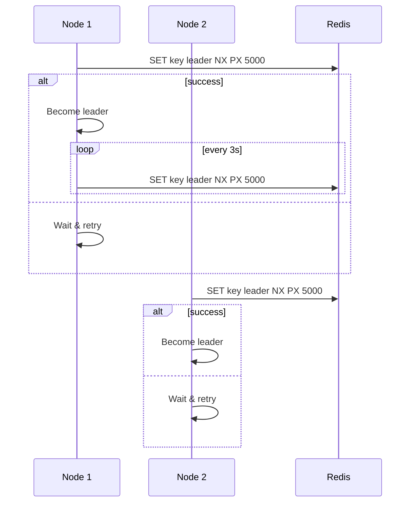

<!-- Generated by Groq via GitHub Actions -->
<!-- Topic ID: T104 -->
<!-- Category: Distributed Systems -->
<!-- Generated at UTC: 2026-10-17T16:34:29.470645+00:00 -->

# Leader election

## 1. What problem does this solve?

**Motivation**  
In a distributed system you often have many identical service instances that can perform the same work.  
When a task must be performed *once* (e.g., a cron job, a cleanup routine, a background worker that updates a shared cache), you need a way to decide which instance actually does it.  
Leader election is the mechanism that elects one node (the *leader*) to take on that responsibility while the others remain idle or perform complementary work.

**What problem exists**  
- Multiple instances may try to run the same job → duplicated work, race conditions, inconsistent state.  
- No single point of coordination → no guarantee that exactly one instance will act.  

**Why the problem matters**  
- Data corruption or stale data if two nodes write conflicting updates.  
- Wasted resources (CPU, network, database locks).  
- Hard-to-diagnose bugs in production when jobs run twice or not at all.  

**What happens if this concept is not used**  
- Duplicate job execution → double‑deletion, double‑payment, etc.  
- Inconsistent cache or queue state.  
- Hard to scale because you cannot safely add more instances.  

**Where this concept appears in real backend systems**  
- Cron‑like background jobs in microservices (e.g., a single instance runs a nightly batch).  
- Distributed cache refreshers (only one node should refresh a shared cache).  
- Leader‑based consensus protocols (ZooKeeper, etcd, Raft).  
- Distributed locks for database migrations or schema changes.  

---

## 2. Mental model

**Analogy – The “Mayor” of a town**  
Imagine a town where every house has a resident who can decide to host a community event.  
If every resident hosts an event at the same time, the town becomes chaotic.  
Instead, the town elects a *mayor* who schedules the event.  
All other residents listen to the mayor’s schedule and do not host their own events.

**Engineering model**  
- **Nodes** = service instances.  
- **Election** = a deterministic process that selects one node as the *leader*.  
- **Heartbeat / lease** = the leader periodically proves it is alive; if it stops, others can step in.  
- **Failover** = when the leader dies or loses connectivity, a new leader is elected.  

---

## 3. Deep explanation

### Internals
- **Distributed lock**: A lock that can be acquired by only one node at a time.  
- **Lease**: The lock is valid only for a limited period; the holder must renew it.  
- **Election algorithm**:  
  - *Simple*: try to acquire a lock; if success → leader.  
  - *Complex*: use consensus (Raft, Paxos) to agree on a leader.  

### Important terminology
| Term | Meaning |
|------|---------|
| **Leader** | Node that holds the lock/lease and performs the exclusive task. |
| **Follower** | Other nodes that watch the leader and can become leader if it fails. |
| **Lease** | Time‑bounded ownership of the leader role. |
| **Heartbeat** | Periodic renewal of the lease. |
| **Timeout** | If a follower does not receive a heartbeat within this window, it assumes the leader is dead. |
| **Consensus** | Agreement among nodes on a single value (leader identity). |

### Trade‑offs
| Approach | Pros | Cons |
|----------|------|------|
| **Redis lock (Redlock)** | Simple, fast, works over HTTP/Redis cluster. | Requires clock sync, can be broken if Redis fails. |
| **ZooKeeper / etcd** | Strong consistency, built‑in leader election primitives. | Adds operational overhead, higher latency. |
| **Raft** | Fault‑tolerant, deterministic leader election. | Complex to implement; usually used via libraries. |

### Failure modes
- **Network partition**: Two partitions each elect a leader → split‑brain.  
- **Clock drift**: Lease expiration mis‑calculated.  
- **Lock loss**: Redis node crashes → lock lost, but follower may still think it’s leader.  
- **Stale heartbeats**: If heartbeats are delayed, followers may prematurely elect a new leader.  

### Limitations
- **Single point of failure**: The lock store (Redis, ZooKeeper) can become a bottleneck.  
- **Latency**: Each leader election round requires network round‑trips.  
- **Complexity**: Implementing a robust algorithm (e.g., Redlock) correctly is non‑trivial.  

### Where this concept fits in a backend architecture
- **Background job workers**: A cluster of workers that must run a scheduled task only once.  
- **Cache invalidation**: Only one node should refresh a shared cache.  
- **Database migrations**: Only one node should run a migration script.  

### Interaction with related concepts
- **Distributed locks**: Leader election is a specialized lock.  
- **Health checks**: Heartbeats are essentially health checks for the leader role.  
- **Service discovery**: Nodes need to know each other’s addresses to participate.  
- **Retry logic**: Followers should retry acquiring the lock after a back‑off period.  

---

## 4. How it works

1. **Node starts** → registers itself in the cluster (e.g., via DNS or service registry).  
2. **Attempt to acquire lock** → send a `SET key value NX PX lease` command to Redis.  
3. **If lock acquired** → node becomes leader, starts performing the exclusive task.  
4. **Leader sends heartbeats** → renews the lock before it expires.  
5. **If leader fails** → lock expires, followers detect missing heartbeats.  
6. **Followers retry lock acquisition** → first to succeed becomes new leader.  
7. **Repeat** → continuous cycle of leadership and failover.



---

## 5. Practical implementation

Below is a minimal, production‑ready leader election using **Redis** and **Redlock** in TypeScript/Node.js.

```ts
// leader.ts
import { createClient, RedisClientType } from 'redis';
import { randomUUID } from 'crypto';

const REDIS_URL = process.env.REDIS_URL ?? 'redis://localhost:6379';
const LEASE_KEY = 'my-service:leader';
const LEASE_TTL_MS = 5000;          // 5 s
const HEARTBEAT_INTERVAL_MS = 3000; // 3 s

const client: RedisClientType = createClient({ url: REDIS_URL });
client.on('error', (err) => console.error('Redis client error', err));

async function tryAcquireLeader(): Promise<boolean> {
  const id = randomUUID(); // unique value for this node
  // NX = only set if not exists, PX = expire in ms
  const result = await client.set(LEASE_KEY, id, {
    NX: true,
    PX: LEASE_TTL_MS,
  });
  return result === 'OK';
}

async function renewLease(): Promise<boolean> {
  // Use Lua script to atomically check value and extend TTL
  const script = `
    if redis.call("get", KEYS[1]) == ARGV[1] then
      return redis.call("pexpire", KEYS[1], ARGV[2])
    else
      return 0
    end
  `;
  const res = await client.eval(script, {
    keys: [LEASE_KEY],
    arguments: [client.getClientId(), LEASE_TTL_MS.toString()],
  });
  return res === 1;
}

async function runLeaderTask() {
  console.log('I am the leader! Running exclusive job...');
  // TODO: put your real job logic here
}

async function main() {
  await client.connect();

  let isLeader = false;

  // Initial election attempt
  isLeader = await tryAcquireLeader();
  if (isLeader) {
    console.log('Acquired leadership');
    runLeaderTask();
  } else {
    console.log('Not the leader, waiting for heartbeats');
  }

  // Periodic heartbeat / renewal
  setInterval(async () => {
    if (isLeader) {
      const ok = await renewLease();
      if (!ok) {
        console.warn('Failed to renew lease, stepping down');
        isLeader = false;
      }
    } else {
      // Try to become leader if we see the lease has expired
      const exists = await client.exists(LEASE_KEY);
      if (!exists) {
        isLeader = await tryAcquireLeader();
        if (isLeader) {
          console.log('Stepped up as new leader');
          runLeaderTask();
        }
      }
    }
  }, HEARTBEAT_INTERVAL_MS);
}

main().catch((err) => {
  console.error(err);
  process.exit(1);
});
```

### Key points
- **Atomicity**: The Lua script guarantees that only the current leader can renew its lease.  
- **Lease expiration**: If the leader crashes, the key automatically expires after `LEASE_TTL_MS`.  
- **Back‑off**: In a real system you’d add exponential back‑off when retrying to avoid thundering herd.  
- **Health check**: Expose `/health` that returns `200` only if the node is the leader (optional).  

---

## 6. Production considerations

| Concern | What to watch for | Mitigation |
|---------|-------------------|------------|
| **Scalability** | High contention on the lock key can become a bottleneck. | Use a dedicated Redis cluster for coordination; keep the key simple. |
| **Reliability** | Redis outage → all nodes lose leadership. | Run Redis in HA mode (sentinel or cluster) and have a fallback (e.g., local lock). |
| **Security** | Unauthorized nodes could acquire the lock. | Use Redis ACLs, TLS, and a shared secret for the lock value. |
| **Observability** | Hard to see who is leader. | Log leadership changes; expose metrics (`leader_elected_total`, `leader_heartbeat_failures`). |
| **Performance** | Heartbeat latency adds overhead. | Tune `LEASE_TTL_MS` and `HEARTBEAT_INTERVAL_MS` to balance failover speed vs. load. |
| **Error handling** | Renewal failures may be transient. | Retry with back‑off; if still failing, step down. |
| **Resource usage** | Redis memory for the key is negligible, but network traffic matters. | Keep the key small; use pipelining if many nodes. |
| **Operational concerns** | Need to monitor Redis health. | Use Redis monitoring tools (Redis‑Insight, Prometheus exporters). |
| **Failure recovery** | Split‑brain if network partition persists. | Use a consensus system (etcd, ZooKeeper) if strict consistency is required. |
| **Deployment** | All nodes must share the same Redis endpoint. | Use environment variables or a service discovery system. |

---

## 7. Common mistakes

| Mistake | Why it’s bad |
|---------|--------------|
| **Using a simple `SETNX` without TTL** | Lock never expires → deadlock if leader crashes. |
| **Hard‑coding the lock key** | If multiple services share the same key, they will block each other. |
| **Ignoring clock drift** | Lease expiration may be mis‑calculated if nodes have unsynced clocks. |
| **No back‑off on retries** | Thundering herd: many nodes hammer Redis at once. |
| **Not checking lock ownership on renewal** | A follower could mistakenly renew another node’s lease. |
| **Using a single Redis instance** | Single point of failure; no high availability. |
| **Not handling Redis errors** | Unhandled promise rejections crash the process. |
| **Assuming leader will always be available** | Fails to handle network partitions gracefully. |

---

## 8. Senior engineer perspective

### What changes at scale
- **Multiple clusters**: You may need separate leader elections per region or per tenant.  
- **High availability**: Use a dedicated coordination cluster (Redis Sentinel, etcd).  
- **Observability**: Centralized metrics dashboards; alert on `leader_election_failures`.  
- **Cost**: Running a HA Redis cluster or ZooKeeper ensemble increases operational cost.  

### Design decisions
- **Algorithm choice**:  
  - *Redlock* for simplicity and speed.  
  - *Raft* (etcd) for strong consistency when split‑brain must be avoided.  
- **Lease duration**: Shorter TTL → faster failover but higher traffic.  
- **Back‑off strategy**: Exponential back‑off reduces load during contention.  
- **Fail‑over strategy**: Immediate vs. graceful shutdown of the old leader.  
- **Monitoring**: Metrics on `leader_elected`, `leader_heartbeat_failures`, `lock_acquisition_latency`.  
- **Security**: TLS for Redis, ACLs, and secrets rotation.  

### Bottlenecks & failure scenarios
- **Lock store bottleneck**: If many services use the same Redis cluster, the lock key becomes a hotspot.  
- **Network partition**: Two partitions may each elect a leader → split‑brain. Mitigate with quorum or consensus.  
- **Clock skew**: Use NTP or PTP; consider using Redis’s `TIME` command for relative timing.  

### When NOT to use
- **Stateless tasks**: If the job can safely run concurrently, skip leader election.  
- **Highly dynamic workloads**: If the leader changes too often, the overhead outweighs benefits.  
- **Single‑node deployments**: Leader election adds unnecessary complexity.  

---

## 9. Interview questions

| Level | Question | Answer points |
|-------|----------|---------------|
| Beginner | What is leader election in distributed systems? | Mechanism to choose one node to perform exclusive tasks; prevents duplicate work. |
| Beginner | Why do we need a lease in a leader election algorithm? | Ensures the lock is temporary; if the leader dies, the lock expires so others can take over. |
| Senior | Compare Redlock and etcd for leader election. | Redlock: simple, fast, but weaker guarantees; etcd: strong consistency, higher latency, more operational overhead. |
| Senior | How would you design a leader election system that scales to thousands of nodes across multiple regions? | Use a dedicated coordination cluster, sharded lock keys, quorum-based consensus, careful TTL tuning, and robust monitoring. |
| Scenario | Your system uses Redis for leader election. After a network partition, two nodes think they are leaders and both run a cleanup job, corrupting data. How would you debug and fix this? | Check Redis cluster health, verify TTL and heartbeat intervals, add a quorum check or switch to a consensus algorithm, add idempotent job logic, and implement a split‑brain detection mechanism. |

---

## 10. Hands‑on task

**Task**: Implement a *distributed cache refresher* that only one instance refreshes a shared Redis cache every 10 minutes.

1. Fork the repository or create a new Node.js project.  
2. Add the leader election code from section 5.  
3. When a node becomes leader, schedule a job that writes a timestamp to `cache:refresh` key.  
4. All nodes (leaders and followers) should read the timestamp and log “Cache refreshed by <leader-id>”.  
5. Run three instances locally (different ports) and observe that only one writes the timestamp every 10 minutes.  

**Hints**  
- Use Docker Compose to run three Node.js containers and a Redis container.  
- Expose a `/status` endpoint that shows whether the node is leader.  

---

## 11. Quick revision

- Leader election chooses one node to perform exclusive tasks.  
- Uses a distributed lock + lease (TTL).  
- Redis `SET NX PX` + Lua script for atomic renewal.  
- Heartbeat interval < lease TTL for failover.  
- Failure modes: split‑brain, clock drift, lock loss.  
- Production concerns: HA lock store, observability, back‑off, security.  
- Common mistakes: no TTL, no ownership check, no back‑off.  
- Senior decisions: algorithm choice, lease tuning, monitoring, cost.  
- Interview key points: purpose, lease, Redlock vs. etcd, scaling, debugging split‑brain.  

---

## 12. References

- [Redis Redlock algorithm](https://redis.io/docs/reference/patterns/distributed-locks/)  
- [Redis SET command options](https://redis.io/commands/set/)  
- [etcd documentation – Leader election](https://etcd.io/docs/v3.5/op-guide/leader-election/)  
- [ZooKeeper – Leader election](https://zookeeper.apache.org/doc/current/zookeeperOver.html#sc_leader_election)  
- [Raft consensus algorithm](https://raft.github.io/)  
- [Node.js Redis client (node‑redis)](https://github.com/redis/node-redis)  
- [Prometheus Redis exporter](https://github.com/oliver006/redis_exporter)  

---
