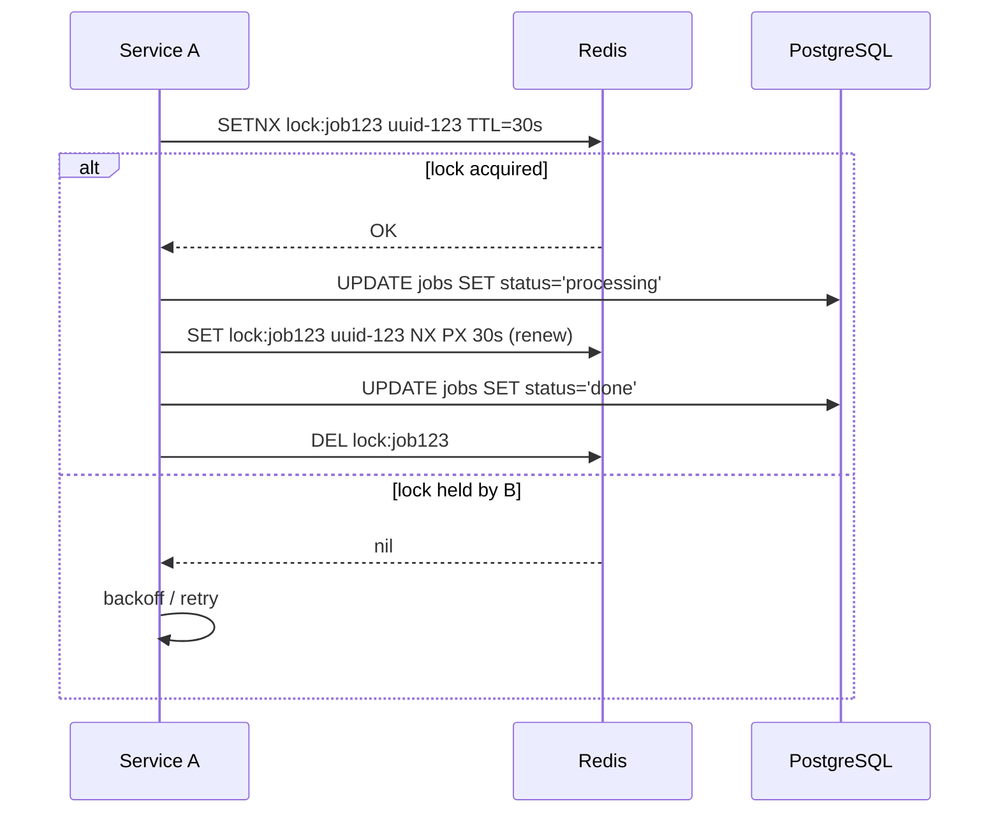

<!-- Generated by Groq via GitHub Actions -->
<!-- Topic ID: T105 -->
<!-- Category: Distributed Systems -->
<!-- Generated at UTC: 2026-10-18T06:10:32.339917+00:00 -->

# Distributed locks

## 1. What problem does this solve?

**Motivation**  
In a distributed system, many processes or services may try to modify the same resource (a row in a database, a file, a cache entry, etc.) at the same time. Without coordination, these concurrent writes can corrupt data, produce race conditions, or leave the system in an inconsistent state.

**What problem exists**  
- Multiple workers can process the same job or update the same record simultaneously.  
- A background job that should run only once per day could be triggered by several instances.  
- A cache invalidation routine could be executed concurrently, causing duplicate work or stale data.

**Why the problem matters**  
- Data integrity violations (e.g., double‑charging a user).  
- Wasted compute resources (duplicate work).  
- Hard‑to‑debug bugs that appear intermittently.  
- Poor user experience (e.g., duplicate orders).

**What happens if this concept is not used**  
- Inconsistent data states.  
- Race‑condition bugs that are hard to reproduce.  
- Increased load on downstream services (duplicate API calls, database writes).  
- Potential security issues (e.g., privilege escalation via concurrent token revocation).

**Where this concept appears in real backend systems**  
- Job queues (e.g., Bull, Sidekiq) that need to ensure a job runs only once.  
- Cache invalidation or refresh logic that must be single‑threaded.  
- Rate‑limited APIs that enforce per‑user or per‑resource limits.  
- Leader election in microservice clusters.  
- Distributed transactions where a lock is needed before committing.

---

## 2. Mental model

### Simple analogy  
Imagine a library with a single copy of a popular book. If two patrons try to check it out at the same time, the library uses a **lock**: the first patron takes the book, the second waits until the first returns it. The lock guarantees that only one patron has the book at any moment.

### Precise engineering model  
A distributed lock is a coordination primitive that guarantees **mutual exclusion** across multiple nodes. It is typically implemented by a shared store (Redis, Zookeeper, etc.) that all participants can read/write. The lock is represented by a key/value pair; acquiring the lock means atomically creating the key with an expiration. Releasing the lock means deleting the key. If a node crashes before releasing, the expiration ensures the lock eventually frees.

---

## 3. Deep explanation

| Topic | Explanation |
|-------|-------------|
| **Internals** | Most distributed lock implementations rely on an atomic “set if not exists” operation (`SETNX` in Redis, `INSERT … ON CONFLICT DO NOTHING` in Postgres, `create` in Zookeeper). The lock value usually contains a unique identifier (UUID) and an expiration timestamp. |
| **Important terminology** | *Mutual exclusion*, *reentrancy*, *deadlock*, *lock contention*, *lease*, *watchdog*, *recovery*, *leader election*. |
| **Trade‑offs** | <ul><li>**Latency**: acquiring a lock requires a round‑trip to the lock store.</li><li>**Availability**: if the lock store is down, no one can acquire locks.</li><li>**Consistency**: some algorithms (e.g., Redlock) provide stronger guarantees at the cost of higher latency.</li></ul> |
| **Failure modes** | <ul><li>Node crashes while holding a lock → lock never released (solved by expiration).</li><li>Clock skew → expiration mis‑calculated.</li><li>Network partition → split‑brain: two nodes think they hold the lock.</li></ul> |
| **Limitations** | Distributed locks are not a silver bullet for distributed transactions. They only serialize access to a single resource; they do not provide atomicity across multiple resources. |
| **Where it fits** | Often used in background job processing, cache refresh, rate limiting, leader election, and any scenario where a single instance must perform a critical section. |
| **Interaction with related concepts** | *Idempotency* (ensure work can be retried safely), *retry logic* (backoff on lock contention), *observability* (metrics on lock acquisition time), *security* (prevent lock hijacking by validating the lock owner). |

---

## 4. How it works

1. **Attempt to acquire**: Service A sends an atomic `SETNX key value` to Redis with a TTL.  
2. **Success**: Redis creates the key; Service A now owns the lock.  
3. **Failure**: Key already exists; Service A waits or retries after a backoff.  
4. **Perform critical section**: Service A updates the database, processes a job, etc.  
5. **Renew (optional)**: If the critical section may exceed the TTL, Service A periodically refreshes the key (`SET key value NX PX newTTL`).  
6. **Release**: After finishing, Service A deletes the key only if the value matches its own UUID (to avoid deleting someone else’s lock).  
7. **Expiration**: If Service A crashes or forgets to delete, the key automatically expires, freeing the lock for others.



---

## 5. Practical implementation

### TypeScript/Node.js example using Redis (`ioredis`)

```ts
// lock.ts
import Redis from 'ioredis';
import { v4 as uuidv4 } from 'uuid';

const redis = new Redis(); // default localhost:6379

/**
 * Acquire a distributed lock.
 * @param key The lock key (e.g., 'job:123')
 * @param ttl  Time‑to‑live in ms
 * @returns lockId if acquired, null otherwise
 */
export async function acquireLock(key: string, ttl: number): Promise<string | null> {
  const lockId = uuidv4(); // unique owner id
  // SET key lockId NX PX ttl
  const result = await redis.set(key, lockId, 'NX', 'PX', ttl);
  return result === 'OK' ? lockId : null;
}

/**
 * Release the lock only if we own it.
 */
export async function releaseLock(key: string, lockId: string): Promise<boolean> {
  // Lua script ensures atomic check & delete
  const script = `
    if redis.call("get", KEYS[1]) == ARGV[1]
    then
      return redis.call("del", KEYS[1])
    else
      return 0
    end
  `;
  const result = await redis.eval(script, 1, key, lockId);
  return result === 1;
}

/**
 * Example: process a job only once
 */
export async function processJob(jobId: string) {
  const lockKey = `job:${jobId}`;
  const ttl = 30_000; // 30s

  const lockId = await acquireLock(lockKey, ttl);
  if (!lockId) {
    console.log(`Job ${jobId} is already being processed`);
    return;
  }

  try {
    console.log(`Acquired lock for job ${jobId}`);
    // ----- critical section -----
    // e.g., update DB, call external API
    await new Promise(r => setTimeout(r, 2000)); // simulate work
    // ----------------------------
  } finally {
    const released = await releaseLock(lockKey, lockId);
    console.log(`Lock ${released ? 'released' : 'not released'} for job ${jobId}`);
  }
}
```

**Key points**

- `SET NX PX` guarantees atomic creation with expiration.  
- The Lua script in `releaseLock` prevents accidental deletion of another process’s lock.  
- Use a UUID to identify the lock owner.  
- Consider a *watchdog* that periodically extends the TTL if the job may run longer than the initial TTL.

---

## 6. Production considerations

| Concern | What to watch for |
|---------|-------------------|
| **Scalability** | Redis cluster or sharded Redis to avoid a single point of contention. |
| **Reliability** | Use a highly‑available Redis deployment (sentinel, cluster). |
| **Security** | Restrict Redis access to internal network; use ACLs. |
| **Observability** | Metrics: lock acquisition rate, contention time, TTL expirations, failed releases. |
| **Performance** | Keep TTL short; avoid long critical sections. |
| **Error handling** | Retry with exponential backoff; log failures. |
| **Resource usage** | Each lock key consumes memory; purge expired keys. |
| **Operational concerns** | Monitor Redis memory, eviction policy, network latency. |
| **Failure recovery** | Expiration frees locks; consider a *watchdog* to extend TTL if needed. |
| **Deployment** | Separate lock store from application DB to avoid single‑point failure. |

---

## 7. Common mistakes

| Mistake | Why it’s problematic |
|---------|----------------------|
| **Using a shared key without a unique value** | Another process could delete the lock thinking it owns it. |
| **Omitting TTL** | A crash can leave a lock forever, blocking all work. |
| **Assuming lock acquisition is instant** | High contention can lead to long waits; need backoff. |
| **Not handling clock skew** | Expiration may be too short or too long if clocks differ. |
| **Using a single Redis instance** | Bottleneck and single point of failure. |
| **Releasing lock without checking ownership** | Risk of deleting someone else’s lock. |
| **Ignoring failure modes** | Network partitions can cause split‑brain. |
| **Treating lock as a transaction** | It only serializes one resource; other resources may still conflict. |

---

## 8. Senior engineer perspective

When scaling distributed locks:

- **Architecture decisions**  
  - Choose a lock store that matches your latency and availability needs (Redis cluster vs. Zookeeper).  
  - Decide whether to use a single lock per resource or a hierarchical lock scheme.  
  - Consider *Redlock* if you need cross‑node safety, but weigh the added complexity.

- **Trade‑offs**  
  - Stronger consistency (e.g., Redlock) → higher latency, more network hops.  
  - Simpler single‑node Redis → lower latency but risk of single point of failure.

- **Bottlenecks**  
  - Lock contention can serialize otherwise parallel work.  
  - Expiration timers can cause “thundering herd” if many locks expire simultaneously.

- **Failure scenarios**  
  - Network partition → two nodes may both think they hold the lock.  
  - Clock drift → mis‑calculated TTLs.

- **Monitoring**  
  - Track lock acquisition latency, contention counts, expiration events.  
  - Alert on high contention or frequent lock failures.

- **Cost/performance**  
  - Redis memory cost grows with number of active locks.  
  - Using a dedicated Redis cluster adds operational overhead.

- **When NOT to use**  
  - If the critical section is very short and idempotent, you might skip locks and rely on database constraints.  
  - For multi‑resource transactions, consider a proper distributed transaction protocol (e.g., two‑phase commit).

---

## 9. Interview questions

1. **Beginner** – *What is a distributed lock and why do we need it?*  
   *Answer:* A mechanism that ensures only one process across multiple nodes can perform a critical section at a time, preventing race conditions and data corruption.

2. **Beginner** – *How does Redis implement a simple lock?*  
   *Answer:* Using `SET key value NX PX ttl` to atomically set a key only if it does not exist, with a TTL to avoid deadlocks.

3. **Senior** – *Explain the Redlock algorithm and its pros/cons.*  
   *Answer:* Redlock uses five independent Redis instances, acquires the lock on each, and requires majority success. Pros: higher safety across partitions; cons: higher latency, complexity, still not 100% safe under network partitions.

4. **Senior** – *How would you design a lock system that scales to thousands of concurrent jobs without becoming a bottleneck?*  
   *Answer:* Use sharded Redis clusters, keep TTLs short, implement backoff and retry, monitor contention, consider per‑resource locks instead of a global lock, and possibly use a lock manager service.

5. **Scenario/Debugging** – *Your application crashes while holding a lock. After restart, no other workers can acquire the lock for hours. What could be happening and how would you fix it?*  
   *Answer:* Likely the lock key was set without TTL or the TTL was too long. The key never expired, blocking others. Fix: always set TTL, use a watchdog to extend if needed, and ensure the release script checks ownership.

---

## 10. Hands‑on task

**Task:**  
Implement a *rate‑limited job runner* that ensures only one instance of a job with the same `jobId` runs at a time, using the distributed lock implementation from section 5.  

**Steps:**

1. Create a Node.js project with `ioredis` and `express`.  
2. Expose an endpoint `/run/:jobId`.  
3. When the endpoint is hit, attempt to acquire a lock `job:<jobId>` with a 10 s TTL.  
4. If lock acquired, simulate work (e.g., `await new Promise(r=>setTimeout(r,5000))`).  
5. Release the lock.  
6. Log lock acquisition attempts, contention, and completion.  
7. Run two instances of the server (different ports) and hit the same job concurrently to observe lock behavior.

---

## 11. Quick revision

- Distributed lock = mutual exclusion across nodes.  
- Acquire via atomic `SETNX` (Redis) or `INSERT … ON CONFLICT DO NOTHING` (Postgres).  
- Use a unique owner ID and TTL to avoid deadlocks.  
- Release with a Lua script that checks ownership.  
- Watchdog: periodically extend TTL if work may exceed initial TTL.  
- Redlock: five Redis nodes, majority success, stronger safety.  
- Common pitfalls: missing TTL, no ownership check, single Redis instance.  
- Production: monitor contention, use cluster, secure access, separate lock store.  
- When to skip locks: idempotent operations, database constraints, single‑node workloads.

---

## 12. References

- Redis `SET` command: https://redis.io/commands/set  
- Redis `SETNX` command: https://redis.io/commands/setnx  
- Redlock algorithm: https://redis.io/topics/distlock  
- PostgreSQL advisory locks: https://www.postgresql.org/docs/current/explicit-locking.html#ADVISORY-LOCKS  
- ioredis documentation: https://github.com/luin/ioredis  
- Node.js `uuid` package: https://www.npmjs.com/package/uuid  
- Distributed systems fundamentals (MIT 6.824): https://pdos.csail.mit.edu/6.824/  

---
