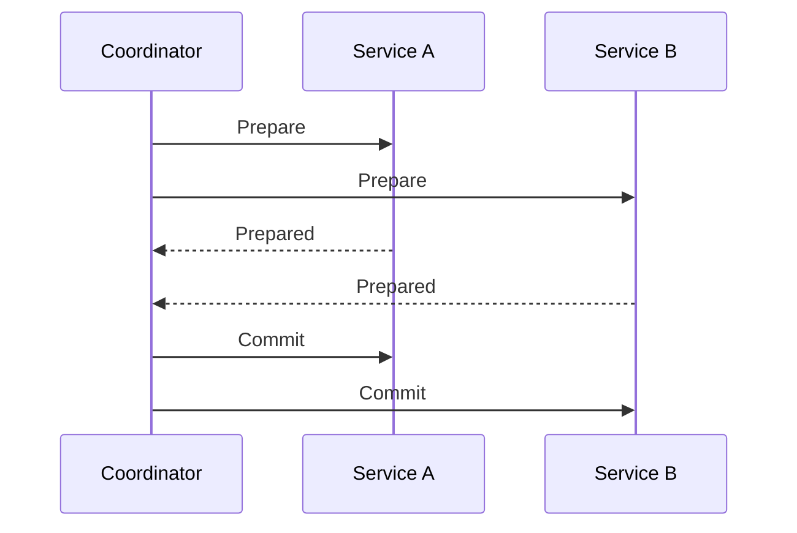
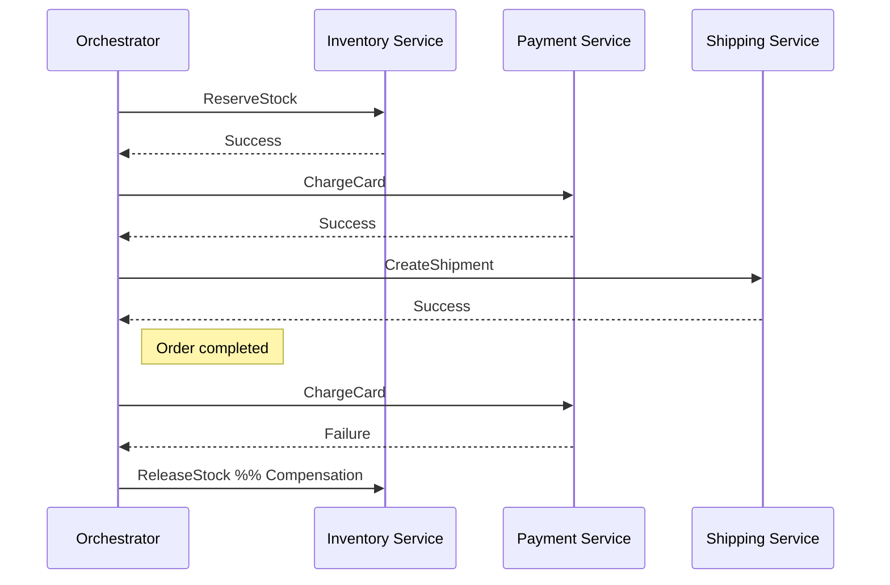

<!-- Generated by Groq via GitHub Actions -->
<!-- Topic ID: T106 -->
<!-- Category: Distributed Systems -->
<!-- Generated at UTC: 2026-10-18T06:10:32.339917+00:00 -->

# Distributed transactions

## 1. What problem does this solve?

When a business operation touches multiple independent data stores or services (e.g., an order service, inventory service, payment gateway, and shipping service), we need to guarantee that **all** parts either succeed together or fail together.  
Without a distributed transaction mechanism:

- **Inconsistency**: One service commits while another rolls back, leaving stale or orphaned data.
- **Business errors**: A customer may be charged but not receive the product, or inventory may be deducted without a payment.
- **Hard to debug**: Inconsistent state is difficult to trace across services.

In real backends, this problem appears in:

- E‑commerce checkout flows
- Banking transfers across accounts in different regions
- Multi‑service orchestration in SaaS platforms
- Microservice architectures where each service owns its own database

## 2. Mental model

### Analogy – The “Three‑Way Handshake”

Imagine a group of friends deciding to go out together.  
1. **Proposal**: One friend suggests a plan.  
2. **Commit**: All friends agree (send “yes”).  
3. **Finalize**: Everyone confirms they’re ready (send “ready”).  

If any friend says “no” at any step, the whole plan is aborted.  
This is similar to a **two‑phase commit (2PC)**: a *prepare* phase where all participants agree, followed by a *commit* phase where the decision is finalized.

### Engineering model

In distributed systems, a **coordinator** (or *orchestrator*) sends a *prepare* request to all participants.  
- If every participant replies *prepared*, the coordinator sends *commit*.  
- If any participant replies *abort* or times out, the coordinator sends *abort* to all.

Because the coordinator must wait for all participants, 2PC is **blocking** and can suffer from long‑running locks.  
Modern microservices often use the **Saga** pattern instead, which breaks the transaction into a series of independent steps with compensating actions.

## 3. Deep explanation

| Concept | What it is | Why it matters | Trade‑offs |
|---------|------------|----------------|------------|
| **Two‑Phase Commit (2PC)** | Coordinator‑driven commit across multiple participants. | Guarantees atomicity across databases. | Blocking, requires durable logs, high latency, single point of failure. |
| **Three‑Phase Commit (3PC)** | Adds a *pre‑commit* phase to reduce blocking. | Less blocking, but still complex and rarely used. | Requires non‑fault‑tolerant network, still a single coordinator. |
| **Saga** | Orchestrated or choreographed series of local transactions with compensations. | Avoids locks, scales horizontally, tolerant to failures. | No true atomicity; eventual consistency; requires careful design of compensations. |
| **Compensation** | Undoing a previously committed step. | Enables rollback without locking. | Must be idempotent and reliable; can be costly. |
| **Idempotency** | Ensuring repeated execution has the same effect. | Critical for retries and network glitches. | Adds complexity to business logic. |

### Failure modes

- **Coordinator crash**: In 2PC, participants may be left in a *prepared* state, leading to deadlocks.  
- **Participant crash**: If a participant fails after preparing, it must recover and inform the coordinator.  
- **Network partition**: Can cause timeouts and ambiguous states.  
- **Compensation failure**: In a Saga, if a compensating action fails, the system may end up partially rolled back.

### Limitations

- 2PC/3PC are **not** suitable for high‑throughput, low‑latency microservices.  
- Sagas provide **eventual consistency** but not strict ACID guarantees.  
- Designing compensations can be non‑trivial, especially for external systems (e.g., payment gateways).

### Where it fits

Distributed transactions sit at the intersection of:

- **Database layer** (ACID vs. BASE)
- **Service orchestration** (Saga orchestrator vs. choreography)
- **Messaging** (Kafka, RabbitMQ, Redis Streams)
- **Observability** (distributed tracing, logs)

They are often implemented as a separate **transaction manager** service or embedded in the application logic.

## 4. How it works

### Two‑Phase Commit (simplified)



### Saga Orchestration (simplified)



## 5. Practical implementation

Below is a **Saga orchestrator** written in TypeScript/Node.js using **Redis Streams** for messaging.  
It coordinates an order flow across an inventory service and a payment service.

```ts
// saga-orchestrator.ts
import { createClient } from 'redis';
import axios from 'axios';

const redis = createClient();
await redis.connect();

const ORDER_STREAM = 'orders';
const INVENTORY_STREAM = 'inventory';
const PAYMENT_STREAM = 'payment';

interface Order {
  id: string;
  productId: string;
  quantity: number;
  userId: string;
  status: 'pending' | 'completed' | 'failed';
}

// Helper to publish a message to a stream
async function publish(stream: string, message: any) {
  await redis.xAdd(stream, '*', message);
}

// Orchestrator logic
async function handleOrder(order: Order) {
  try {
    // 1️⃣ Reserve stock
    await publish(INVENTORY_STREAM, { orderId: order.id, action: 'reserve', ...order });

    // 2️⃣ Charge payment
    await publish(PAYMENT_STREAM, { orderId: order.id, action: 'charge', ...order });

    // 3️⃣ Mark order completed
    order.status = 'completed';
    await publish(ORDER_STREAM, { orderId: order.id, status: order.status });
    console.log(`Order ${order.id} completed`);
  } catch (err) {
    // 4️⃣ Compensation path
    await publish(INVENTORY_STREAM, { orderId: order.id, action: 'release', ...order });
    order.status = 'failed';
    await publish(ORDER_STREAM, { orderId: order.id, status: order.status });
    console.error(`Order ${order.id} failed:`, err);
  }
}

// Example usage
const newOrder: Order = {
  id: 'ord_123',
  productId: 'prod_456',
  quantity: 2,
  userId: 'user_789',
  status: 'pending',
};

handleOrder(newOrder);
```

### Inventory Service (simplified)

```ts
// inventory-service.ts
import { createClient } from 'redis';
const redis = createClient();
await redis.connect();

const INVENTORY_STREAM = 'inventory';

redis.xReadGroup('inventory-group', 'consumer-1', { [INVENTORY_STREAM]: '>' }, async (messages) => {
  for (const msg of messages) {
    const { orderId, action, productId, quantity } = msg.message;
    if (action === 'reserve') {
      // Reserve logic (e.g., decrement stock)
      console.log(`Reserving ${quantity} of ${productId} for order ${orderId}`);
      // On success, publish to next step
      await redis.xAdd('payment', '*', { orderId, action: 'ready' });
    } else if (action === 'release') {
      // Release logic
      console.log(`Releasing stock for order ${orderId}`);
    }
  }
});
```

### Payment Service (simplified)

```ts
// payment-service.ts
import { createClient } from 'redis';
import axios from 'axios';
const redis = createClient();
await redis.connect();

const PAYMENT_STREAM = 'payment';

redis.xReadGroup('payment-group', 'consumer-1', { [PAYMENT_STREAM]: '>' }, async (messages) => {
  for (const msg of messages) {
    const { orderId, action } = msg.message;
    if (action === 'ready') {
      // Charge card via external API
      try {
        await axios.post('https://payment-gateway.example.com/charge', { orderId });
        console.log(`Charged order ${orderId}`);
        // Notify orchestrator of success
        await redis.xAdd('orders', '*', { orderId, status: 'completed' });
      } catch (e) {
        console.error(`Payment failed for order ${orderId}`);
        // Notify orchestrator of failure
        await redis.xAdd('orders', '*', { orderId, status: 'failed' });
      }
    }
  }
});
```

> **Note**: In a real system you would add idempotency keys, retries, and proper error handling. The example is intentionally minimal to illustrate the flow.

## 6. Production considerations

| Concern | How to address it |
|---------|-------------------|
| **Scalability** | Use stateless orchestrator workers; scale Redis Streams horizontally; partition streams by order ID. |
| **Reliability** | Persist state in a durable store (e.g., PostgreSQL) or use Redis with persistence. Implement retries with exponential backoff. |
| **Security** | Encrypt messages in transit (TLS), authenticate services with mTLS or API keys. Validate payloads. |
| **Observability** | Emit structured logs per step; use OpenTelemetry traces across services; monitor stream lag. |
| **Performance** | Keep message payloads small; batch operations where possible; use async/await to avoid blocking. |
| **Error handling** | Distinguish between transient and permanent failures; use dead‑letter queues for unprocessable messages. |
| **Resource usage** | Monitor Redis memory; set eviction policies; use separate Redis instances per environment. |
| **Operational concerns** | Provide health checks; enable graceful shutdown; monitor coordinator heartbeats. |
| **Failure recovery** | Implement compensating actions; keep a retry counter; use a “compensation” stream for manual intervention. |
| **Deployment** | Containerize each service; use Kubernetes with readiness/liveness probes; separate namespaces for dev/test/prod. |

## 7. Common mistakes

| Mistake | Why it’s problematic |
|---------|----------------------|
| **Using 2PC in microservices** | Causes blocking, high latency, and single point of failure. |
| **Skipping idempotency** | Re‑executing steps leads to duplicate charges or double inventory reservations. |
| **Not handling compensation failures** | Leaves the system in a partially rolled back state. |
| **Tight coupling of services** | Hard to evolve independently; violates bounded context. |
| **Ignoring network partitions** | Can cause indefinite waiting or inconsistent states. |
| **Over‑simplifying the orchestrator** | Missing retry logic or state persistence leads to data loss. |
| **Using a single message broker for all services** | Bottleneck; one broker failure brings down all services. |
| **Not monitoring stream lag** | Hidden backpressure can cause timeouts and failures. |

## 8. Senior engineer perspective

### What changes at scale?

- **Architecture**: Adopt a *Saga orchestrator* cluster with leader election; use a dedicated message broker per domain.  
- **Trade‑offs**: Accept eventual consistency for higher throughput; avoid 2PC unless you own all databases.  
- **Bottlenecks**: Coordinator throughput, message broker latency, and compensating action cost.  
- **Failure scenarios**: Network partitions, broker outages, or compensating action failures.  
- **Monitoring**: Distributed tracing (e.g., Jaeger), stream lag dashboards, SLA metrics per step.  
- **Cost/performance**: Running multiple orchestrator replicas, message broker clusters, and persistent storage.  
- **When NOT to use**: For simple, single‑database transactions; for real‑time, low‑latency operations where eventual consistency is unacceptable.

### Design decisions

- **Orchestrator vs. Choreography**: Orchestrator gives central control but adds a single point of failure; choreography is more resilient but harder to reason about.  
- **Compensation strategy**: Prefer idempotent, side‑effect‑free compensations; use domain events to trigger them.  
- **State persistence**: Store saga state in a durable store to survive orchestrator restarts.  
- **Idempotency keys**: Generate per step to avoid duplicate processing.  
- **Timeouts**: Set per‑step timeouts to avoid indefinite waiting.  
- **Testing**: Use chaos engineering to simulate failures in each step.

## 9. Interview questions

1. **Beginner**: *What is a distributed transaction and why is it needed?*  
   - *Answer*: A distributed transaction ensures atomicity across multiple services/databases. It’s needed when a business operation spans several independent systems.

2. **Beginner**: *Explain the difference between 2PC and a Saga.*  
   - *Answer*: 2PC is a coordinator‑driven commit that locks all participants until a decision is made. A Saga breaks the transaction into steps with compensating actions, avoiding locks and allowing horizontal scaling.

3. **Senior**: *How would you design a Saga orchestrator for an e‑commerce checkout that involves inventory, payment, and shipping services?*  
   - *Answer points*: Use a message broker (Kafka/Redis Streams), maintain saga state in a durable store, implement idempotent steps, define compensations, handle retries, monitor stream lag, and ensure eventual consistency.

4. **Senior**: *What are the main failure modes of 2PC and how can they be mitigated?*  
   - *Answer points*: Coordinator crash → participants left in prepared state; participant crash → coordinator waits; network partition → ambiguous state. Mitigations: use durable logs, timeouts, leader election, and fallback to compensations.

5. **Scenario/Debugging**: *During a high‑traffic period, the order service starts returning “order failed” errors even though the inventory and payment services are healthy. What could be happening and how would you investigate?*  
   - *Answer points*: Possible stream lag or broker overload; orchestrator backpressure; missing idempotency leading to duplicate failures; check Redis stream lag, orchestrator logs, message queue metrics, and network latency. Fix by scaling orchestrator, adding more consumer instances, or increasing broker throughput.

## 10. Hands‑on task

**Implement a simple Saga orchestrator for a “book‑purchase” flow**:

1. Create three services: `book-service`, `payment-service`, and `order-service`.  
2. Use Redis Streams to coordinate the flow.  
3. Each service should expose an HTTP endpoint to trigger its step.  
4. The orchestrator should:
   - Reserve a book (decrement stock).
   - Charge the user (simulate with a delay).
   - Create an order record (store in a JSON file or in-memory map).
5. Add a compensation step that releases the book if payment fails.  
6. Write unit tests that simulate a payment failure and verify the book stock is restored.

**Goal**: Demonstrate understanding of message‑driven orchestration, idempotency, and compensation.

## 11. Quick revision

- Distributed transactions guarantee atomicity across services.  
- 2PC: prepare → commit; blocking, single coordinator.  
- 3PC: adds pre‑commit; reduces blocking but still fragile.  
- Saga: orchestrated or choreographed steps with compensations; eventual consistency.  
- Idempotency is essential for retries.  
- Failure modes: coordinator crash, participant crash, network partition.  
- Production concerns: scalability, reliability, observability, security, cost.  
- Common mistakes: using 2PC in microservices, skipping idempotency, ignoring compensation failures.  
- Senior decisions: orchestrator vs. choreography, state persistence, monitoring, cost trade‑offs.

## 12. References

- [Two‑Phase Commit (2PC) – Wikipedia](https://en.wikipedia.org/wiki/Two-phase_commit_protocol)  
- [Saga Pattern – Microsoft Docs](https://learn.microsoft.com/en-us/azure/architecture/patterns/saga)  
- [Redis Streams – Official Documentation](https://redis.io/docs/manual/streams/)  
- [TypeORM – Transactions](https://typeorm.io/#/transactions)  
- [OpenTelemetry – Distributed Tracing](https://opentelemetry.io/docs/)  
- [Kafka – Distributed Commit Protocol](https://kafka.apache.org/documentation/#commitlog)  

---
