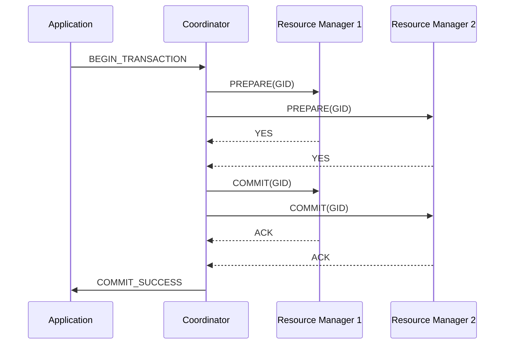

<!-- Generated by Groq via GitHub Actions -->
<!-- Topic ID: T107 -->
<!-- Category: Distributed Systems -->
<!-- Generated at UTC: 2026-10-18T16:42:44.657170+00:00 -->

# Two‑phase commit

## 1. What problem does this solve?

When a business operation touches **multiple independent data stores** (e.g., a PostgreSQL order table and a Redis inventory cache), we want the whole operation to either **succeed completely or fail completely**.  
Without a coordination protocol, each store could commit its part while the others fail, leaving the system in an inconsistent state.

**Why it matters**

* **Data integrity** – an order must not be created if inventory cannot be reserved.
* **Auditability** – downstream services rely on a consistent view of data.
* **Regulatory compliance** – financial systems cannot allow partial updates.

**What happens if it’s not used**

* Partial commits → orphaned records, duplicated inventory, broken business rules.
* Manual rollbacks become error‑prone and hard to automate.
* Auditing and debugging become difficult because the system state is ambiguous.

**Real‑world usage**

* Banking systems that update multiple ledgers atomically.
* E‑commerce platforms that write to a relational DB and a search index.
* Distributed microservices that need strong consistency for a single transaction.

---

## 2. Mental model

### Analogy – The “Two‑step handshake”

Imagine two friends, Alice and Bob, want to exchange gifts.  
Alice says, “I’ll give you my gift if you give me yours.”  
Bob replies, “I’ll give you mine if you give me yours.”  
They both agree to exchange **simultaneously**; if one backs out, neither gets a gift.

### Engineering model – Two‑phase commit (2PC)

1. **Prepare phase** – each participant (resource manager) is asked to *prepare* to commit.  
   It checks local constraints, locks rows, writes a “prepared” log entry, and replies *YES* or *NO*.
2. **Commit phase** – if **all** participants answered *YES*, the coordinator tells everyone to *COMMIT*.  
   If **any** answered *NO*, the coordinator tells everyone to *ABORT*.

The coordinator guarantees that either **all** resources commit or **none** do, preserving atomicity across the distributed system.

---

## 3. Deep explanation

### Internals

| Component | Role |
|-----------|------|
| **Coordinator** | Orchestrates the transaction, collects votes, decides commit/abort. |
| **Resource Manager (RM)** | Each database or service that participates. Handles local transaction, writes to a log, and locks resources. |
| **Log / Write‑Ahead Log (WAL)** | RMs persist a *prepared* state before voting *YES* to survive crashes. |

**Protocol steps**

1. **Begin** – Coordinator starts a global transaction ID (GID).  
2. **Prepare** – Coordinator sends `PREPARE(GID)` to each RM.  
   *RM* checks constraints, locks, writes `PREPARED(GID)` to its log, replies `YES`.  
3. **Decision** – Coordinator collects votes.  
   *If all YES → COMMIT*; *else → ABORT*.  
4. **Commit/Abort** – Coordinator sends `COMMIT(GID)` or `ABORT(GID)` to each RM.  
   *RM* finalizes (writes commit record or rolls back) and releases locks.  
5. **Completion** – Coordinator acknowledges completion to the application.

### Important terminology

* **Two‑phase** – the protocol has two distinct phases: *prepare* and *commit/abort*.
* **Vote** – RM’s response (`YES` or `NO`) to the prepare request.
* **Coordinator** – the process that decides the outcome.
* **Resource Manager** – a database or service that can participate in a distributed transaction.
* **Prepared state** – a durable log entry indicating the RM is ready to commit.

### Trade‑offs

| Aspect | Benefit | Drawback |
|--------|---------|----------|
| **Strong consistency** | Guarantees atomicity across resources. | Requires locking and coordination, leading to latency. |
| **Durability** | RMs persist prepared state, survive crashes. | Log growth, potential for long recovery times. |
| **Simplicity** | Well‑defined protocol. | Not suitable for high‑throughput, latency‑sensitive services. |
| **Scalability** | Works across any number of RMs. | Coordinator becomes a bottleneck; failure of coordinator stalls all transactions. |

### Failure modes

| Failure | Impact | Recovery |
|---------|--------|----------|
| RM crashes after `YES` | RM may be stuck in *prepared* state. | On restart, RM reads log, asks coordinator for decision. |
| Coordinator crashes | RMs may be stuck waiting for decision. | RMs can retry or use a timeout to abort. |
| Network partition | Some RMs may not receive decision. | RMs can time out and abort; eventual consistency restored. |

### Limitations

* **Blocking** – RMs hold locks until commit/abort, blocking other transactions.
* **Coordinator bottleneck** – single point of failure and throughput limit.
* **Not suited for microservices** – modern architectures favor eventual consistency (Saga pattern).
* **Complexity in heterogeneous systems** – each RM must implement 2PC support.

### Where it fits in a backend architecture

* **Monolithic legacy systems** – often built around a single database; 2PC is rarely needed.
* **Hybrid systems** – a PostgreSQL order table plus a Redis cache; 2PC can keep them in sync.
* **Distributed databases** – some NoSQL stores expose 2PC APIs for cross‑node consistency.

### Interaction with related concepts

* **Sagas** – alternative to 2PC for long‑running, eventually consistent workflows.
* **Idempotency keys** – useful for retrying 2PC steps safely.
* **Distributed logging / tracing** – essential to debug 2PC failures.
* **Circuit breakers** – protect the coordinator from cascading failures.

---

## 4. How it works



**Step‑by‑step flow**

1. **Application** starts a global transaction and sends `BEGIN_TRANSACTION` to the coordinator.
2. **Coordinator** generates a unique GID and sends `PREPARE(GID)` to each RM.
3. Each **RM**:
   * Checks local constraints.
   * Locks necessary rows.
   * Writes a `PREPARED(GID)` entry to its log.
   * Responds `YES` (or `NO` if it cannot proceed).
4. **Coordinator** collects votes:
   * If all `YES` → sends `COMMIT(GID)` to all RMs.
   * If any `NO` → sends `ABORT(GID)` to all RMs.
5. Each **RM** finalizes:
   * On `COMMIT`, writes a `COMMITTED(GID)` entry, releases locks.
   * On `ABORT`, rolls back changes, releases locks.
6. **Coordinator** acknowledges completion to the application.

---

## 5. Practical implementation

Below is a minimal Node.js/TypeScript example that demonstrates a 2PC coordinator coordinating a PostgreSQL database and a Redis cache.  
The example uses `pg` for PostgreSQL and `ioredis` for Redis.

```ts
// twoPhase.ts
import { Client as PgClient } from 'pg';
import Redis from 'ioredis';
import { v4 as uuidv4 } from 'uuid';

interface RM {
  prepare(gid: string): Promise<boolean>;
  commit(gid: string): Promise<void>;
  abort(gid: string): Promise<void>;
}

class PostgresRM implements RM {
  private client: PgClient;
  constructor(client: PgClient) { this.client = client; }

  async prepare(gid: string): Promise<boolean> {
    // 1. Start local transaction
    await this.client.query('BEGIN');
    // 2. Perform business logic (e.g., insert order)
    await this.client.query(
      'INSERT INTO orders (id, gid, status) VALUES ($1, $2, $3)',
      [uuidv4(), gid, 'PREPARED']
    );
    // 3. Log prepared state
    await this.client.query(
      'INSERT INTO tx_log (gid, state) VALUES ($1, $2)',
      [gid, 'PREPARED']
    );
    // 4. Lock rows (implicit with transaction)
    return true; // vote YES
  }

  async commit(gid: string): Promise<void> {
    await this.client.query(
      'UPDATE orders SET status = $1 WHERE gid = $2',
      ['COMMITTED', gid]
    );
    await this.client.query(
      'UPDATE tx_log SET state = $1 WHERE gid = $2',
      ['COMMITTED', gid]
    );
    await this.client.query('COMMIT');
  }

  async abort(gid: string): Promise<void> {
    await this.client.query('ROLLBACK');
    await this.client.query(
      'DELETE FROM tx_log WHERE gid = $1',
      [gid]
    );
  }
}

class RedisRM implements RM {
  private redis: Redis.Redis;
  constructor(redis: Redis.Redis) { this.redis = redis; }

  async prepare(gid: string): Promise<boolean> {
    // 1. Reserve inventory in a transaction
    const tx = this.redis.multi();
    tx.set(`inventory:${gid}`, 'RESERVED', 'NX', 'EX', 60);
    const results = await tx.exec();
    // 2. Log prepared state
    await this.redis.set(`tx:${gid}:state`, 'PREPARED');
    return results?.[0]?.ok ?? false; // vote YES if key set
  }

  async commit(gid: string): Promise<void> {
    await this.redis.set(`tx:${gid}:state`, 'COMMITTED');
    // In a real system, we would also decrement inventory permanently
  }

  async abort(gid: string): Promise<void> {
    await this.redis.del(`inventory:${gid}`);
    await this.redis.del(`tx:${gid}:state`);
  }
}

class TwoPhaseCoordinator {
  private rms: RM[];

  constructor(rms: RM[]) { this.rms = rms; }

  async runTransaction(): Promise<void> {
    const gid = uuidv4();
    // Prepare phase
    const votes = await Promise.all(this.rms.map(rm => rm.prepare(gid)));
    const allYes = votes.every(v => v);
    // Decision
    if (allYes) {
      await Promise.all(this.rms.map(rm => rm.commit(gid)));
      console.log('Transaction committed');
    } else {
      await Promise.all(this.rms.map(rm => rm.abort(gid)));
      console.log('Transaction aborted');
    }
  }
}

// Usage
(async () => {
  const pg = new PgClient({ connectionString: process.env.DATABASE_URL });
  await pg.connect();
  const redis = new Redis(process.env.REDIS_URL);

  const coordinator = new TwoPhaseCoordinator([
    new PostgresRM(pg),
    new RedisRM(redis),
  ]);

  await coordinator.runTransaction();

  await pg.end();
  redis.disconnect();
})();
```

**Key points**

* Each RM writes a *prepared* state before voting `YES`.  
* The coordinator collects votes and decides.  
* On `COMMIT`, each RM finalizes changes; on `ABORT`, it rolls back.  
* The example is intentionally simple; real systems need robust error handling, timeouts, and recovery logic.

---

## 6. Production considerations

| Concern | What to watch for | Mitigation |
|---------|-------------------|------------|
| **Scalability** | Coordinator becomes a bottleneck. | Use sharding, multiple coordinators per tenant, or switch to Saga for high throughput. |
| **Reliability** | Coordinator crash stalls all transactions. | Persist coordinator state; implement leader election (e.g., using ZooKeeper or etcd). |
| **Security** | Sensitive data in logs. | Encrypt logs, restrict access, use role‑based permissions. |
| **Observability** | Hard to trace distributed commits. | Add correlation IDs, emit events to a tracing system (OpenTelemetry). |
| **Performance** | Locks held for the whole transaction. | Keep transactions short, use optimistic locking where possible. |
| **Error handling** | Partial failures during commit. | Idempotent commit/abort operations, retry logic. |
| **Resource usage** | Log growth, lock contention. | Archive old logs, tune lock timeouts. |
| **Operational concerns** | Need for manual intervention on stuck transactions. | Build a monitoring dashboard, alert on long‑running prepared states. |
| **Failure recovery** | RMs in *prepared* state after crash. | On restart, RMs read log, query coordinator for decision, or abort after timeout. |
| **Deployment** | Consistent versions across services. | Use semantic versioning, automated rollback on coordinator failure. |

---

## 7. Common mistakes

| Mistake | Why it’s bad |
|---------|--------------|
| **Using 2PC for long‑running business flows** | Locks are held for minutes, blocking other work and hurting throughput. |
| **Ignoring coordinator failure** | A single crash stalls all transactions; no fallback path. |
| **Not persisting prepared state** | RMs lose their vote on crash, leading to orphaned locks. |
| **Assuming all RMs support 2PC** | Some databases (e.g., MongoDB) do not expose 2PC; using them breaks the protocol. |
| **Hard‑coding GID format** | Collisions or lack of uniqueness can cause data corruption. |
| **Not handling network partitions** | RMs may wait indefinitely; need timeouts and abort logic. |
| **Over‑locking** | Locking entire tables instead of specific rows leads to contention. |
| **Skipping idempotency** | Retrying a commit can double‑apply changes if not idempotent. |

---

## 8. Senior engineer perspective

### What changes at scale?

* **Coordinator design** – must be highly available (leader election), horizontally scalable, and able to handle thousands of concurrent transactions.
* **Resource manager integration** – each service must expose a lightweight 2PC API; otherwise, you risk coupling or performance penalties.
* **Monitoring** – need to surface metrics: number of prepared transactions, abort rates, lock wait times, coordinator latency.
* **Cost** – holding locks and persisting logs increases storage and CPU usage; evaluate whether the consistency guarantees outweigh the operational cost.

### Design decisions

| Decision | Trade‑off |
|----------|-----------|
| **Single vs. multiple coordinators** | Single coordinator simplifies logic but limits throughput; multiple coordinators require sharding logic. |
| **Synchronous vs. asynchronous commit** | Synchronous ensures consistency but increases latency; asynchronous (e.g., Saga) reduces latency but sacrifices strong consistency. |
| **Log retention policy** | Long retention aids recovery but consumes storage; short retention reduces cost but may hinder crash recovery. |
| **Timeout strategy** | Short timeouts reduce lock hold time but risk aborting legitimate commits; long timeouts increase resource usage. |
| **Use of distributed consensus** | Adding Raft/ZooKeeper for coordinator election adds complexity but improves reliability. |

### When NOT to use 2PC

* Microservice architectures favor eventual consistency; use Saga or compensating actions instead.
* High‑throughput, low‑latency services (e.g., real‑time analytics) where blocking locks are unacceptable.
* When the business can tolerate partial failures or can implement domain‑specific consistency guarantees.

---

## 9. Interview questions

1. **Beginner** – *What is the purpose of the “prepare” phase in two‑phase commit?*  
   *Answer:* It lets each resource manager check local constraints, lock resources, and persist a prepared state before any commit is made, ensuring that all participants are ready to commit.

2. **Beginner** – *Why is a coordinator necessary in 2PC?*  
   *Answer:* The coordinator collects votes from all participants, decides whether to commit or abort, and ensures that all participants reach the same final state, maintaining atomicity across resources.

3. **Senior** – *Describe a scenario where 2PC could become a bottleneck and how you would mitigate it.*  
   *Answer:* If many long‑running transactions hold locks, the coordinator becomes a bottleneck. Mitigation includes sharding transactions across multiple coordinators, using optimistic locking, or switching to a Saga pattern for long‑running workflows.

4. **Senior** – *Explain how you would recover from a coordinator crash when some resource managers are in the prepared state.*  
   *Answer:* RMs persist their prepared state. On restart, they read the log, query the new coordinator for the decision (or use a timeout to abort). The new coordinator can read the logs of all RMs to reconstruct the global state and decide commit/abort.

5. **Scenario/Debugging** – *During a 2PC run, one RM returns `YES` but never receives the `COMMIT` message, and the transaction remains stuck. What could be the cause and how would you investigate?*  
   *Answer:* Possible causes: network partition, RM crash after voting, or coordinator crash. Investigate by checking RM logs for the prepared state, verifying network connectivity, and ensuring the coordinator’s decision log is persisted. Use tracing to see where the flow stopped.

---

## 10. Hands‑on task

**Task:**  
Extend the provided `twoPhase.ts` example to add a **timeout** for the prepare phase. If any RM does not reply within 5 seconds, the coordinator should abort the transaction automatically.

**Steps**

1. Modify the `runTransaction` method to use `Promise.race` with a timeout promise for each `prepare`.
2. Log which RM timed out.
3. Ensure that the abort logic still runs correctly.
4. Write a unit test (using Jest) that simulates a slow RM and verifies that the transaction is aborted.

---

## 11. Quick revision

* 2PC guarantees atomicity across multiple resources by coordinating a **prepare** and **commit/abort** phase.
* The **coordinator** collects votes; all `YES` → commit, any `NO` → abort.
* RMs persist a *prepared* state to survive crashes.
* Locking during the transaction blocks other work; keep transactions short.
* Coordinator is a single point of failure; use leader election or sharding.
* 2PC is heavy; consider Sagas for high‑throughput, eventually consistent systems.
* Failure modes: RM crash, coordinator crash, network partition; each requires recovery logic.
* Production concerns: scalability, observability, security, performance, and operational tooling.
* Common mistakes: ignoring coordinator failure, using 2PC for long flows, not persisting prepared state.
* Senior engineers weigh consistency vs. latency, cost vs. reliability, and decide when 2PC is appropriate.

---

## 12. References

* [Two‑Phase Commit – Wikipedia](https://en.wikipedia.org/wiki/Two-phase_commit)
* [PostgreSQL Transaction Logging](https://www.postgresql.org/docs/current/logical-replication.html)
* [ioredis – Redis client for Node.js](https://github.com/luin/ioredis)
* [OpenTelemetry – Distributed Tracing](https://opentelemetry.io/docs/)
* [ZooKeeper – Leader Election](https://zookeeper.apache.org/doc/r3.5.0/zookeeperOver.html#_leader_election)
* [Saga Pattern – Microservices](https://microservices.io/patterns/data/saga.html)
