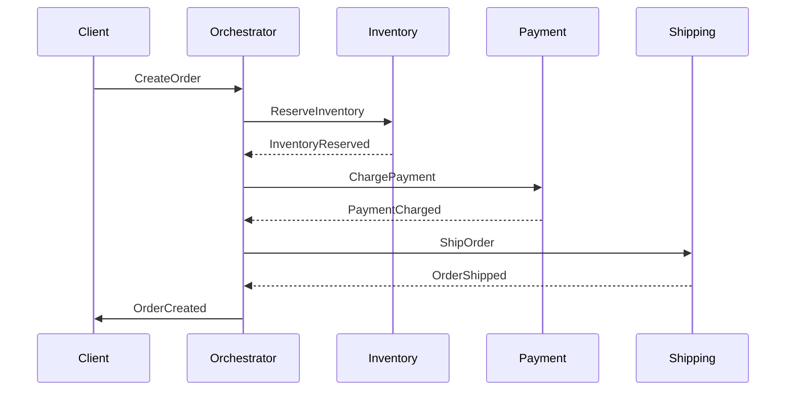

<!-- Generated by Groq via GitHub Actions -->
<!-- Topic ID: T108 -->
<!-- Category: Distributed Systems -->
<!-- Generated at UTC: 2026-10-18T16:42:44.657170+00:00 -->

# Saga pattern

## 1. What problem does this solve?

**Motivation**  
In a distributed system, a single business transaction often touches many micro‑services or databases. Traditional ACID transactions guarantee atomicity only within a single database. When a transaction spans multiple services, you need a way to keep the system consistent even if one part fails.

**What problem exists**  
- *Partial failures*: Service A succeeds, Service B fails → data becomes inconsistent.  
- *Long‑running processes*: Some steps (e.g., external payment gateway, inventory reservation) take minutes or hours.  
- *No global lock*: You cannot lock all resources across services for the whole duration.

**Why the problem matters**  
- Users see stale or duplicated data.  
- In e‑commerce, a failed payment after inventory is reserved leads to lost stock.  
- Regulatory compliance may require audit trails of every step.

**What happens if this concept is not used**  
- You might resort to compensating actions manually, leading to brittle code.  
- You may need to use a distributed transaction protocol (e.g., two‑phase commit) that is hard to scale and can block resources.

**Where this concept appears in real backend systems**  
- Order processing pipelines (reserve inventory → charge payment → ship).  
- Travel booking (flight, hotel, car).  
- Micro‑service orchestrations in event‑driven architectures (Kafka, NATS).  
- Payment gateways that need to roll back when downstream services fail.

---

## 2. Mental model

**Simple analogy**  
Think of a *saga* like a multi‑step recipe that you can “undo” if something goes wrong.  
- *Step 1*: Add flour.  
- *Step 2*: Add eggs.  
- *Step 3*: Bake.  
If you discover a missing ingredient after baking, you can’t un‑bake the cake, so you must *compensate* by discarding the cake and starting over.  

**Engineering model**  
A saga is a *sequence of local transactions* (each service performs its own atomic operation) coordinated by a *saga orchestrator* or *choreography*. If any step fails, the orchestrator triggers *compensating actions* that undo the previous steps in reverse order.

---

## 3. Deep explanation

### Internals
- **Saga orchestrator**: Central coordinator that knows the workflow, tracks progress, and triggers compensations.  
- **Local transactions**: Each service performs its own ACID transaction and publishes an event (e.g., `InventoryReserved`).  
- **Compensation**: For every action, there is a defined reverse operation (e.g., `InventoryReleased`).  
- **Event bus**: Kafka, RabbitMQ, or HTTP callbacks carry status updates.

### Important terminology
- **Saga**: The entire workflow.  
- **Step**: A local transaction.  
- **Compensation**: The reverse operation.  
- **Orchestrated saga**: Central coordinator.  
- **Choreographed saga**: Each service reacts to events; no central coordinator.

### Trade‑offs
| Aspect | Orchestrated | Choreographed |
|--------|--------------|---------------|
| **Control** | Centralized, easier to reason | Decentralized, more flexible |
| **Complexity** | One service handles state | Each service handles its own state |
| **Scalability** | Bottleneck at orchestrator | Scales with services |
| **Failure handling** | Orchestrator can retry | Each service must handle retries |

### Failure modes
- **Deadlock**: Orchestrator waits for a step that never completes.  
- **Compensation failure**: Undo action fails; system may be left partially rolled back.  
- **Event loss**: If an event is lost, compensations may never trigger.

### Limitations
- **No true atomicity**: You cannot guarantee all-or-nothing in a single instant.  
- **Latency**: Each step waits for the previous one, adding round‑trip delays.  
- **Complex compensation logic**: Some actions are hard to undo (e.g., sending an email).

### Where this concept fits
- **Backend architecture**: Part of the *transactional* layer, often implemented as a separate saga service or integrated into existing orchestrators (e.g., Temporal, Cadence).  
- **Related concepts**: Event sourcing, CQRS, compensating transactions, distributed locks.

### Interaction with related backend concepts
- **Event sourcing**: Saga events can be stored as part of the event log.  
- **CQRS**: Read models can be updated after each saga step.  
- **Retry policies**: Needed for both steps and compensations.  
- **Circuit breakers**: Protect the orchestrator from cascading failures.

---

## 4. How it works

1. **Client** sends a request to start the saga (e.g., `CreateOrder`).  
2. **Saga orchestrator** creates a saga instance, assigns a unique ID, and stores its state.  
3. **Step 1**: Orchestrator sends a command to Service A (`ReserveInventory`).  
4. **Service A** performs its local transaction, publishes `InventoryReserved` event.  
5. **Orchestrator** receives the event, updates saga state, and triggers **Step 2** (`ChargePayment`).  
6. **Service B** processes payment, publishes `PaymentCharged`.  
7. **Orchestrator** receives the event, updates state, and triggers **Step 3** (`ShipOrder`).  
8. **Service C** ships the order, publishes `OrderShipped`.  
9. **Orchestrator** marks saga as *completed*.  
10. If any step fails, orchestrator triggers compensations in reverse order (e.g., `ReleaseInventory`, `RefundPayment`).  



---

## 5. Practical implementation

Below is a minimal **Node.js / TypeScript** orchestrator using **Kafka** for events and **Redis** for saga state persistence.

### 5.1. Project structure

```
src/
  orchestrator.ts
  saga.ts
  services/
    inventory.ts
    payment.ts
    shipping.ts
  kafka.ts
  redis.ts
```

### 5.2. `kafka.ts`

```ts
import { Kafka, Producer, Consumer } from 'kafkajs';

const kafka = new Kafka({ clientId: 'saga-orchestrator', brokers: ['localhost:9092'] });

export const producer: Producer = kafka.producer();
export const consumer: Consumer = kafka.consumer({ groupId: 'saga-orchestrator' });

export async function initKafka() {
  await producer.connect();
  await consumer.connect();
}
```

### 5.3. `redis.ts`

```ts
import { createClient } from 'redis';

export const redis = createClient();

export async function initRedis() {
  await redis.connect();
}
```

### 5.4. `saga.ts`

```ts
export type SagaStep = {
  name: string;
  command: string;          // e.g., 'ReserveInventory'
  event: string;            // e.g., 'InventoryReserved'
  compensation: string;     // e.g., 'ReleaseInventory'
};

export type SagaDefinition = {
  id: string;
  steps: SagaStep[];
};

export class Saga {
  constructor(public definition: SagaDefinition) {}

  async start() {
    // Persist initial state
    await redis.set(`saga:${this.definition.id}`, JSON.stringify({ step: 0, status: 'running' }));
    // Kick off first step
    await orchestrateStep(this.definition, 0);
  }
}
```

### 5.5. `orchestrator.ts`

```ts
import { producer, consumer } from './kafka';
import { redis } from './redis';
import { SagaDefinition, SagaStep } from './saga';

const sagaDefinitions: Record<string, SagaDefinition> = {
  'order-creation': {
    id: 'order-creation',
    steps: [
      { name: 'ReserveInventory', command: 'reserve-inventory', event: 'inventory-reserved', compensation: 'release-inventory' },
      { name: 'ChargePayment', command: 'charge-payment', event: 'payment-charged', compensation: 'refund-payment' },
      { name: 'ShipOrder', command: 'ship-order', event: 'order-shipped', compensation: 'cancel-shipment' },
    ],
  },
};

async function orchestrateStep(def: SagaDefinition, stepIndex: number) {
  const step = def.steps[stepIndex];
  // Send command to target service via Kafka
  await producer.send({
    topic: 'commands',
    messages: [{ key: step.command, value: JSON.stringify({ sagaId: def.id, data: {} }) }],
  });
}

async function handleEvent(message: any) {
  const { sagaId, event } = JSON.parse(message.value.toString());
  const def = sagaDefinitions[sagaId];
  if (!def) return;

  const state = JSON.parse(await redis.get(`saga:${sagaId}`));
  const currentStep = def.steps[state.step];

  // Verify event matches expected
  if (event !== currentStep.event) return;

  // Advance state
  state.step += 1;
  if (state.step >= def.steps.length) {
    state.status = 'completed';
    await redis.set(`saga:${sagaId}`, JSON.stringify(state));
    console.log(`Saga ${sagaId} completed`);
    return;
  }
  await redis.set(`saga:${sagaId}`, JSON.stringify(state));
  // Trigger next step
  await orchestrateStep(def, state.step);
}

async function init() {
  await initKafka();
  await initRedis();

  await consumer.subscribe({ topic: 'events', fromBeginning: true });
  await consumer.run({
    eachMessage: async ({ message }) => {
      await handleEvent(message);
    },
  });
}

init().catch(console.error);
```

### 5.6. Service stubs (e.g., `inventory.ts`)

```ts
// Simplified: listens to 'commands' topic, performs local DB op, publishes event
import { consumer, producer } from '../kafka';

consumer.subscribe({ topic: 'commands', fromBeginning: true });

consumer.run({
  eachMessage: async ({ message }) => {
    const cmd = JSON.parse(message.value.toString());
    if (cmd.command !== 'reserve-inventory') return;

    // Perform DB operation (pseudo)
    const success = true; // assume success

    if (success) {
      await producer.send({
        topic: 'events',
        messages: [{ key: 'inventory-reserved', value: JSON.stringify({ sagaId: cmd.sagaId }) }],
      });
    } else {
      // publish failure event if needed
    }
  },
});
```

> **Note**: In production you would add idempotency, retries, and proper error handling.

---

## 6. Production considerations

| Concern | What to watch for | Mitigation |
|---------|-------------------|------------|
| **Scalability** | Orchestrator becomes a bottleneck. | Use sharding (e.g., saga ID → partition) or multiple orchestrator instances. |
| **Reliability** | Event loss or duplicate events. | Use Kafka’s exactly‑once semantics, idempotent handlers. |
| **Security** | Commands can be spoofed. | Authenticate producers, encrypt payloads, use ACLs. |
| **Observability** | Hard to trace saga flow. | Store saga state in a queryable store, emit tracing spans (OpenTelemetry). |
| **Performance** | Each step adds latency. | Parallelize independent steps if business logic allows. |
| **Error handling** | Compensations may fail. | Retry compensations, alert on failures, provide manual rollback. |
| **Resource usage** | Redis memory grows with many sagas. | Persist completed sagas to long‑term store, purge after TTL. |
| **Operational concerns** | Need to monitor Kafka, Redis, orchestrator health. | Use Prometheus metrics, Grafana dashboards. |
| **Failure recovery** | Orchestrator crash mid‑saga. | Persist state before sending commands; on restart, resume from persisted state. |
| **Deployment** | Zero‑downtime deploys. | Use blue‑green or canary deployments; ensure backward compatibility of saga definitions. |

---

## 7. Common mistakes

| Mistake | Why it’s problematic |
|---------|----------------------|
| **Assuming compensations are always safe** | Some actions (e.g., sending an email) are irreversible; compensating may not restore consistency. |
| **Using a single global orchestrator** | Creates a single point of failure and limits horizontal scaling. |
| **Not idempotently handling events** | Duplicate events can cause double compensation or duplicate actions. |
| **Tight coupling of services to saga logic** | Services become aware of orchestration, reducing modularity. |
| **Ignoring eventual consistency** | Expecting immediate consistency after each step can lead to race conditions. |
| **Not persisting saga state** | Orchestrator crash leads to lost progress and orphaned resources. |
| **Over‑complicating compensation** | Writing complex compensating logic increases maintenance burden. |

---

## 8. Senior engineer perspective

### What changes at scale
- **Distributed orchestrators**: Use a partitioned saga store (e.g., PostgreSQL with sharding) instead of Redis.  
- **Event‑driven choreography**: Move from a single orchestrator to a *choreographed* saga where services publish events and react, reducing bottlenecks.  
- **Observability**: Integrate with tracing (Jaeger) and metrics (Prometheus) to see saga progress across services.  
- **Governance**: Version saga definitions, enforce backward compatibility, and use feature flags for rollout.  

### Design decisions
- **Orchestrator vs choreography**: Choose orchestrator for strict ordering, choreography for high concurrency.  
- **Compensation strategy**: Prefer idempotent compensations; sometimes use *soft* compensations (e.g., flagging a record as cancelled).  
- **State persistence**: Use durable storage (Kafka compacted topic, PostgreSQL) rather than in‑memory or Redis for long‑running sagas.  
- **Retry policy**: Exponential backoff, circuit breakers, and dead‑letter queues for failed steps.  
- **Monitoring**: Dashboards for saga health, failure rates, compensation success.  

### Bottlenecks
- **Kafka throughput**: High event volume can saturate partitions.  
- **Orchestrator CPU**: Parsing and routing many events.  
- **Database locks**: Local transactions may lock rows; careful isolation levels needed.  

### Failure scenarios
- **Compensation failure**: Manual intervention or secondary compensations.  
- **Partial rollback**: Some steps succeed, others fail; need to decide whether to keep partial state or roll back entirely.  

### When NOT to use sagas
- **Simple, single‑service transactions**: Use a normal ACID transaction.  
- **Highly idempotent operations**: If all steps are naturally reversible, a simpler pattern may suffice.  
- **Real‑time, low‑latency**: If the business requires immediate consistency, consider a different approach (e.g., two‑phase commit with careful locking).  

---

## 9. Interview questions

1. **Beginner**: *What is a saga in the context of distributed systems?*  
   - *Answer*: A saga is a sequence of local transactions coordinated to achieve eventual consistency, with compensating actions to undo previous steps if a later step fails.

2. **Beginner**: *Why do we need compensating transactions?*  
   - *Answer*: Because we cannot roll back distributed operations atomically; compensations revert side effects to maintain consistency.

3. **Senior**: *Explain the trade‑offs between an orchestrated saga and a choreographed saga.*  
   - *Answer*: Orchestrated gives central control and easier reasoning but can become a bottleneck; choreographed scales better but requires each service to handle more logic and event ordering.

4. **Senior**: *How would you design a saga system that can survive orchestrator crashes and still guarantee eventual consistency?*  
   - *Answer*: Persist saga state in durable storage before sending commands, use idempotent event handlers, replay events on restart, and implement a recovery process that resumes from the last known state.

5. **Scenario/Debugging**: *You notice that after a payment failure, inventory is not released. What could be wrong and how would you investigate?*  
   - *Answer*: Possible causes: compensation event (`release-inventory`) not published, service not listening, or idempotency key collision. Investigate by checking Kafka logs for the event, verifying service logs, ensuring idempotent handlers, and confirming saga state in Redis/PostgreSQL.

---

## 10. Hands‑on task

**Task**: Extend the example to add a *notification* step after shipping.  
- Create a new saga step `SendNotification` that publishes an event `notification-sent`.  
- Implement a simple notification service that listens to `SendNotification` commands and writes a message to a `notifications` table in PostgreSQL.  
- Add a compensating action `DeleteNotification` that removes the notification if shipping fails.  
- Update the orchestrator to handle the new step and compensation.  
- Write a test that simulates a shipping failure and verifies that the notification is deleted.

---

## 11. Quick revision

- A saga is a *long‑running transaction* composed of local steps with compensations.  
- **Orchestrated**: central coordinator; **choreographed**: event‑driven.  
- Each step publishes an event; the orchestrator listens and triggers the next step.  
- Compensations undo previous steps in reverse order.  
- Persist saga state to survive crashes.  
- Use idempotent event handlers to avoid duplicate work.  
- Monitor saga progress with tracing and metrics.  
- Avoid sagas for simple, single‑service ACID transactions.  
- Compensations may not be possible for all actions (e.g., emails).  
- Kafka’s exactly‑once semantics help with event reliability.  
- Scale by sharding saga IDs or moving to choreography.

---

## 12. References

- [Saga Pattern – Microsoft Docs](https://learn.microsoft.com/en-us/azure/architecture/patterns/saga)  
- [Saga Pattern – Eventuate](https://eventuate.io/docs/saga-pattern)  
- [Temporal – Orchestration](https://temporal.io/docs/concepts/workflows)  
- [Kafka – Exactly Once Semantics](https://kafka.apache.org/documentation/#exactly_once)  
- [OpenTelemetry – Distributed Tracing](https://opentelemetry.io/docs/concepts/signals/traces/)  
- [Redis – Persistence Options](https://redis.io/docs/manual/persistence/)  

---
