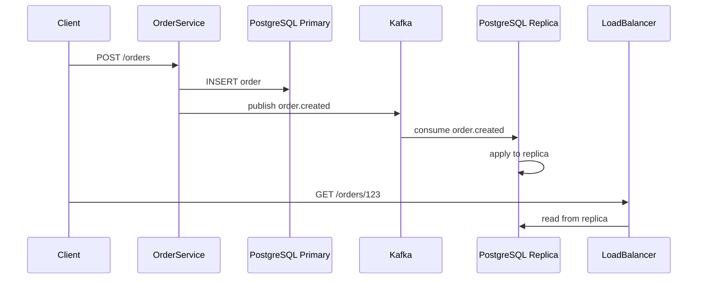

<!-- Generated by Groq via GitHub Actions -->
<!-- Topic ID: T109 -->
<!-- Category: Distributed Systems -->
<!-- Generated at UTC: 2026-10-19T06:24:45.664274+00:00 -->

# Eventual consistency

## 1. What problem does this solve?

**Motivation**  
In a distributed system, data is often replicated across multiple nodes (databases, caches, micro‑services). When a client updates data, that update must be propagated to all replicas. If we insist that every read immediately sees the latest write, we must serialize all updates through a single source of truth or use synchronous replication. Both approaches hurt latency, availability, and scalability.

**What problem exists**  
- *Latency vs. consistency*: Synchronous replication forces the client to wait for all replicas to acknowledge, increasing response time.  
- *Partition tolerance*: During network splits, insisting on immediate consistency can make the system unavailable (CAP theorem).  
- *Write throughput*: A single write path becomes a bottleneck when many clients write concurrently.

**Why the problem matters**  
- Users expect fast responses; a slow write hurts UX.  
- High‑traffic services (e.g., e‑commerce carts, social feeds) need to handle millions of writes per second.  
- Inconsistent reads can lead to subtle bugs (e.g., double‑spending, stale inventory).

**What happens if this concept is not used**  
If you force strong consistency everywhere, you may:
- Sacrifice availability during network partitions.  
- Reduce write throughput.  
- Increase operational complexity (lock management, distributed transactions).

**Where this concept appears in real backend systems**  
- **NoSQL databases** (Cassandra, DynamoDB) expose eventual consistency as the default.  
- **Cache invalidation** in Redis or Memcached often uses eventual consistency patterns.  
- **Event‑driven architectures**: services write events to a broker (Kafka) and later reconcile state.  
- **Micro‑service data replication**: each service owns its own copy of data and syncs asynchronously.

---

## 2. Mental model

**Analogy**  
Imagine a group of friends sharing a Google Doc. Each friend can edit the doc locally and later sync changes. When you open the doc, you might see an older version until your changes propagate. Eventually, everyone sees the same final version. The doc is *eventually consistent*.

**Engineering model**  
- **Write**: A client writes to a *primary* node.  
- **Propagation**: The primary asynchronously pushes the change to *secondary* replicas.  
- **Read**: Clients may read from any replica, possibly seeing stale data.  
- **Convergence**: Over time, all replicas converge to the same state.

---

## 3. Deep explanation

### Internals
1. **Write path**  
   - Client → Primary → Log (e.g., write‑ahead log, Kafka topic).  
   - Primary acknowledges immediately (optimistic).  
2. **Replication**  
   - Replicas consume the log and apply changes locally.  
   - Order of application is preserved (e.g., by sequence numbers).  
3. **Read path**  
   - Reads can hit any replica.  
   - Optionally, read‑repair or read‑through logic can reconcile differences.

### Important terminology
- **Primary / Leader**: The node that accepts writes.  
- **Replica / Follower**: Nodes that apply changes asynchronously.  
- **Log / Event stream**: Ordered sequence of changes.  
- **Read‑repair**: On read, detect stale data and trigger a background sync.  
- **Conflict resolution**: Strategy to merge concurrent updates (last‑write‑wins, CRDTs, application logic).  
- **Quorum**: Minimum number of replicas that must acknowledge for a write to be considered committed.

### Trade‑offs
| Aspect | Strong Consistency | Eventual Consistency |
|--------|--------------------|----------------------|
| Latency | High (wait for all replicas) | Low (acknowledge immediately) |
| Availability | Low during partitions | High |
| Write throughput | Limited by slowest replica | High |
| Complexity | Simple read/write paths | Requires conflict resolution, reconciliation |

### Failure modes
- **Network partitions**: Replicas may diverge.  
- **Clock skew**: If timestamps are used for conflict resolution, unsynchronized clocks cause wrong merges.  
- **Write storms**: Rapid concurrent writes to the same key can lead to many conflicts.  
- **Replication lag**: Reads may return stale data for an extended period.

### Limitations
- **Stale reads**: Clients may see outdated data.  
- **Complex conflict resolution**: Requires careful design.  
- **Eventual convergence time**: Not guaranteed to be fast; depends on network and load.

### Where it fits in a backend architecture
- **Data layer**: NoSQL stores, caches, message brokers.  
- **Service layer**: Micro‑services that maintain local state and sync via events.  
- **API layer**: Expose endpoints that may read from any replica; optionally provide a “consistent read” option (e.g., read‑from‑primary).

### Interaction with related concepts
- **CAP theorem**: Eventual consistency is the trade‑off for Availability + Partition tolerance.  
- **CQRS**: Command side writes to a log; Query side reads from replicas.  
- **Event sourcing**: Events are the source of truth; state is rebuilt by replaying events.  
- **Idempotency**: Ensures repeated writes produce the same result, simplifying conflict handling.

---

## 4. How it works

1. **Client writes** to `/orders` → Node.js service receives POST.  
2. Service writes to **PostgreSQL** (primary) and publishes an **order.created** event to **Kafka**.  
3. Kafka broker stores the event in a topic partition.  
4. **Read replicas** (e.g., a read‑only PostgreSQL cluster) consume the topic and apply the event to their local DB.  
5. **Client reads** from a replica (e.g., via a load‑balanced endpoint).  
6. If the replica is still catching up, the client may receive a stale order status.  
7. **Read‑repair**: On detecting a stale status, the service can trigger a background sync or fetch the latest from the primary.



---

## 5. Practical implementation

### TypeScript/Node.js example: Order service with Kafka replication

```ts
// src/orderService.ts
import { Kafka } from 'kafkajs';
import { Pool } from 'pg';
import express from 'express';

const kafka = new Kafka({ brokers: ['kafka:9092'] });
const producer = kafka.producer();
const consumer = kafka.consumer({ groupId: 'order-replicas' });

const pgPool = new Pool({
  connectionString: process.env.DATABASE_URL,
});

const app = express();
app.use(express.json());

// ---------- Write path ----------
app.post('/orders', async (req, res) => {
  const { userId, items } = req.body;
  const client = await pgPool.connect();
  try {
    await client.query('BEGIN');
    const insertRes = await client.query(
      'INSERT INTO orders(user_id, items, status) VALUES($1, $2, $3) RETURNING id',
      [userId, items, 'created']
    );
    const orderId = insertRes.rows[0].id;

    // Publish event
    await producer.send({
      topic: 'orders',
      messages: [
        { key: orderId.toString(), value: JSON.stringify({ orderId, userId, items }) },
      ],
    });

    await client.query('COMMIT');
    res.status(201).json({ orderId });
  } catch (err) {
    await client.query('ROLLBACK');
    res.status(500).json({ error: 'Internal error' });
  } finally {
    client.release();
  }
});

// ---------- Read path ----------
app.get('/orders/:id', async (req, res) => {
  const { id } = req.params;
  const client = await pgPool.connect();
  try {
    const { rows } = await client.query('SELECT * FROM orders WHERE id = $1', [id]);
    if (!rows.length) return res.status(404).json({ error: 'Not found' });
    res.json(rows[0]); // May be stale if replica lagging
  } finally {
    client.release();
  }
});

// ---------- Replication consumer ----------
async function startConsumer() {
  await consumer.connect();
  await consumer.subscribe({ topic: 'orders', fromBeginning: true });

  await consumer.run({
    eachMessage: async ({ message }) => {
      const { orderId, userId, items } = JSON.parse(message.value!.toString());
      const client = await pgPool.connect();
      try {
        await client.query(
          'INSERT INTO orders(id, user_id, items, status) VALUES($1, $2, $3, $4) ON CONFLICT(id) DO NOTHING',
          [orderId, userId, items, 'created']
        );
      } finally {
        client.release();
      }
    },
  });
}

startConsumer();

app.listen(3000, () => console.log('Order service listening on 3000'));
```

**Key points**

- The write path acknowledges after inserting into the primary and publishing to Kafka.  
- The consumer runs on every replica; it applies the same event to its local DB.  
- Reads can hit any replica; if you need strong consistency, route reads to the primary or add a read‑repair step.

---

## 6. Production considerations

| Concern | How to address it |
|---------|-------------------|
| **Scalability** | Use partitioned Kafka topics; scale consumers horizontally. |
| **Reliability** | Persist events to durable storage; enable consumer group rebalancing. |
| **Security** | Encrypt Kafka traffic; use TLS and SASL; restrict DB access. |
| **Observability** | Instrument write latency, replication lag, consumer offsets. |
| **Performance** | Batch Kafka messages; use connection pooling; tune PostgreSQL replication slots. |
| **Error handling** | Retry on transient DB errors; dead‑letter queue for malformed events. |
| **Resource usage** | Monitor CPU/memory of consumers; use lightweight event handlers. |
| **Operational concerns** | Automate schema migrations; monitor Kafka broker health. |
| **Failure recovery** | Replay events from a checkpoint; use Kafka’s offset reset. |
| **Deployment** | Containerize services; use Helm charts for Kafka and PostgreSQL. |

---

## 7. Common mistakes

| Mistake | Why it’s problematic |
|---------|----------------------|
| **Assuming reads are always fresh** | Replication lag can lead to stale data; clients may act on outdated state. |
| **Using `SELECT FOR UPDATE` on replicas** | Locks are local; other replicas may still see stale data. |
| **Ignoring conflict resolution** | Concurrent writes to the same key can overwrite each other unpredictably. |
| **Not handling message ordering** | Out‑of‑order events break eventual consistency. |
| **Publishing after DB commit only** | If the producer fails, the write is lost; use transactional outbox pattern. |
| **Over‑optimizing for latency** | Skipping replication can violate eventual consistency guarantees. |
| **Not monitoring replication lag** | Unnoticed lag can cause data loss during failover. |

---

## 8. Senior engineer perspective

### What changes at scale?

- **Architecture decisions**  
  - Adopt a **transactional outbox** or **eventual consistency** pattern to decouple writes from replication.  
  - Use **CRDTs** or **vector clocks** for conflict resolution in highly concurrent domains.  
  - Separate **write** and **read** clusters; use read‑replicas with TTL or read‑repair.

- **Trade‑offs**  
  - Strong consistency may be acceptable for critical data (e.g., bank balances) but not for feeds.  
  - Adding a **consistency layer** (e.g., read‑through cache) increases latency but reduces stale reads.

- **Bottlenecks**  
  - Kafka broker throughput; consumer lag; database write capacity.  
  - Network bandwidth between data centers.

- **Failure scenarios**  
  - Broker failure → consumer pauses; need to replay from last committed offset.  
  - Primary DB crash → replicas must be promoted; eventual consistency may be broken temporarily.

- **Monitoring**  
  - Track **consumer lag** per partition.  
  - Alert on **replication lag** > threshold.  
  - Log **conflict resolution events**.

- **Cost/performance**  
  - Running multiple replicas and Kafka clusters increases infra cost.  
  - Batch processing reduces CPU usage but may increase latency.

- **When NOT to use**  
  - If business requires **immediate consistency** (e.g., financial transactions).  
  - When data is highly sensitive to stale reads and cannot tolerate eventual convergence.

---

## 9. Interview questions

1. **Beginner**: *What is eventual consistency and how does it differ from strong consistency?*  
   *Answer*: Eventual consistency guarantees that all replicas will converge to the same state eventually, but reads may be stale. Strong consistency guarantees that every read sees the latest write immediately.

2. **Beginner**: *Why might a system choose eventual consistency over strong consistency?*  
   *Answer*: To improve write latency, availability during partitions, and scalability.

3. **Senior**: *Explain how you would implement conflict resolution for concurrent updates in an eventually consistent system.*  
   *Answer*: Use strategies like last‑write‑wins (timestamp), CRDTs, or application‑level merge logic; ensure timestamps are synchronized (e.g., NTP) or use logical clocks.

4. **Senior**: *Describe how you would monitor and alert on replication lag in a Kafka‑based eventual consistency architecture.*  
   *Answer*: Track consumer offsets vs. latest log offset per partition; alert when lag exceeds a threshold; use metrics dashboards (Prometheus/Grafana).

5. **Scenario/Debugging**: *A user reports that after placing an order, the order status is still “pending” for 30 seconds. What could be causing this, and how would you investigate?*  
   *Answer*: Likely replication lag or delayed event processing. Check Kafka consumer lag, verify that the consumer is running, inspect logs for errors, and confirm that the write was committed to the primary.

---

## 10. Hands‑on task

**Task**: Add a *read‑repair* endpoint to the order service that, when a stale order is detected, fetches the latest status from the primary and updates the replica.

**Steps**  
1. Create `/orders/:id/repair` POST endpoint.  
2. Inside, query the primary DB for the order.  
3. If status differs from the replica, update the replica.  
4. Return the reconciled order.

**Goal**: Observe how read‑repair reduces stale reads and understand the trade‑off of extra DB round‑trips.

---

## 11. Quick revision

- Eventual consistency: all replicas converge over time; reads may be stale.  
- Primary + log (Kafka) → replicas consume and apply events.  
- Conflict resolution: last‑write‑wins, CRDTs, application logic.  
- Trade‑offs: low latency vs. stale reads; high availability vs. consistency.  
- Common pitfalls: ignoring replication lag, no conflict handling, assuming fresh reads.  
- Monitoring: consumer lag, replication lag, conflict events.  
- Use transactional outbox pattern to guarantee write + event atomicity.  
- CAP theorem: eventual consistency sacrifices strong consistency for availability + partition tolerance.

---

## 12. References

- [CAP Theorem – Wikipedia](https://en.wikipedia.org/wiki/CAP_theorem)  
- [Kafka Documentation – Topics](https://kafka.apache.org/documentation/#topics)  
- [PostgreSQL Replication](https://www.postgresql.org/docs/current/warm-standby.html)  
- [Kafkajs – Official Docs](https://kafka.js.org/docs)  
- [Eventual Consistency – Amazon DynamoDB](https://docs.aws.amazon.com/amazondynamodb/latest/developerguide/HowItWorks.html#HowItWorks-Consistency)  
- [CRDTs – Wikipedia](https://en.wikipedia.org/wiki/Conflict-free_replicated_data_type)  
- [Transactional Outbox Pattern – Martin Fowler](https://martinfowler.com/articles/transactional-outbox.html)
