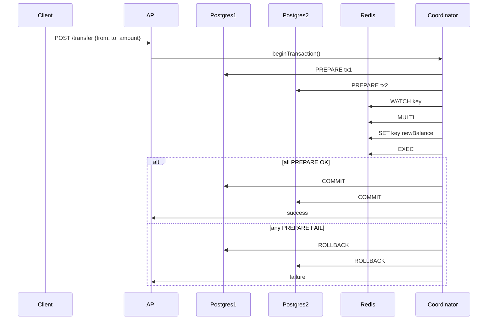

<!-- Generated by Groq via GitHub Actions -->
<!-- Topic ID: T110 -->
<!-- Category: Distributed Systems -->
<!-- Generated at UTC: 2026-10-19T06:24:45.664274+00:00 -->

# Strong Consistency

## 1. What problem does this solve?

In a distributed backend, data is often replicated across multiple nodes or services.  
When a client writes a value, that write must be visible to all subsequent reads, no matter which node the read hits.  
Strong consistency guarantees that **every read after a write returns the most recent value**.

### Why it matters

* **Business correctness** – e.g., a bank transfer must not allow overdrafts or double‑spending.
* **User experience** – a user updating a profile should immediately see the change.
* **Data integrity** – stale data can lead to cascading failures (e.g., inventory counts, seat reservations).

### Consequences of not using it

* **Inconsistent state** – different services may act on stale data, causing errors or data corruption.
* **Hard-to‑debug bugs** – race conditions become invisible until a read occurs on a stale replica.
* **Security risks** – stale authorization data can grant unintended access.

### Where it appears in real systems

* **Financial services** – transaction processing, ledger updates.
* **E‑commerce** – inventory, order status, cart updates.
* **Social platforms** – likes, follows, real‑time feeds.
* **Databases** – PostgreSQL, MySQL, MongoDB (with replica sets), Redis (with `SET`/`GET` in a single node).

---

## 2. Mental model

### Analogy: The “One‑Way Street”

Imagine a one‑way street that only allows cars to move forward.  
When a car (write) enters the street, it can’t be overtaken by another car (read) that hasn't yet passed it.  
Every car that follows will see the car that just entered before it.

In distributed systems, strong consistency is like that one‑way street: once a write is committed, all subsequent reads must see that write, regardless of which node they hit.

### Engineering model

* **Linearizability** – the strongest form of consistency: operations appear to occur instantaneously at some point between their invocation and completion.
* **Atomicity** – a transaction’s changes are all applied or none.
* **Isolation** – concurrent transactions don’t interfere.
* **Durability** – once committed, the data survives failures.

---

## 3. Deep explanation

### Internals

| Concept | What it is | How it works |
|---------|------------|--------------|
| **Two‑Phase Commit (2PC)** | Protocol to coordinate a transaction across multiple resources. | **Phase 1 (Prepare):** each participant votes “commit” or “abort”. <br>**Phase 2 (Commit/Abort):** coordinator sends commit if all voted yes, else abort. |
| **Write‑ahead logging** | Log changes before applying them. | Allows rollback and crash recovery. |
| **Consensus (Paxos/Raft)** | Agreement on the order of operations. | Ensures all replicas apply operations in the same order, preserving linearizability. |
| **Quorum reads/writes** | Majority of replicas must acknowledge. | Guarantees that a read sees the latest committed write. |

### Important terminology

* **Linearizability** – operations appear instantaneously.
* **Serializability** – transactions appear as if executed in some order.
* **Read‑your‑writes** – a client sees its own writes immediately.
* **Strong vs eventual consistency** – eventual consistency relaxes guarantees for higher availability.

### Trade‑offs

| Trade‑off | Impact |
|-----------|--------|
| **Latency** | 2PC and consensus add round‑trips; strong consistency often means higher latency. |
| **Availability** | CAP theorem: you can’t have Consistency + Partition tolerance + Availability simultaneously. Strong consistency sacrifices availability during partitions. |
| **Complexity** | Implementing 2PC or consensus is non‑trivial; bugs can be subtle. |
| **Throughput** | Locking and coordination reduce concurrency. |

### Failure modes

* **Coordinator failure** in 2PC → deadlock; participants may be left in uncertain state.
* **Network partitions** → some nodes can’t reach the coordinator; they must abort or block.
* **Clock skew** → ordering of events can be misinterpreted; consensus protocols mitigate this.

### Limitations

* **Not suitable for high‑write, low‑latency workloads** (e.g., real‑time analytics).
* **Requires synchronous communication**; not ideal for geographically distributed services.
* **Hard to scale horizontally** without sophisticated consensus layers.

### Where it fits

* **Monolithic services** – a single database with ACID guarantees.
* **Microservices** – use a distributed transaction coordinator or event sourcing with strong ordering.
* **Cache layers** – write‑through or write‑back caches that flush to the backing store before acknowledging the client.

### Interaction with related concepts

* **Caching** – strong consistency often forces cache invalidation or write‑through patterns.
* **Event sourcing** – events are appended to a log; strong consistency ensures the log order is preserved.
* **Idempotency** – necessary to safely retry writes in the face of failures.

---

## 4. How it works

Below is a simplified 2PC flow for a bank transfer that updates two PostgreSQL accounts and a Redis cache.



* **Step 1** – Client initiates transfer.  
* **Step 2** – API starts a distributed transaction.  
* **Step 3** – Each participant prepares (writes to log, locks rows).  
* **Step 4** – Coordinator decides to commit or abort.  
* **Step 5** – All participants commit or rollback atomically.

---

## 5. Practical implementation

Below is a Node.js example using `pg` (PostgreSQL) and `ioredis`.  
It demonstrates a two‑phase commit for a transfer between two accounts with a Redis cache update.

```ts
// transfer.ts
import { Client as PgClient } from 'pg';
import Redis from 'ioredis';

const pg = new PgClient({ connectionString: process.env.DATABASE_URL });
const redis = new Redis(process.env.REDIS_URL);

async function transfer(fromId: number, toId: number, amount: number) {
  await pg.connect();
  try {
    // 1️⃣ Begin a local transaction
    await pg.query('BEGIN');

    // 2️⃣ Lock rows to prevent concurrent updates
    const resFrom = await pg.query(
      'SELECT balance FROM accounts WHERE id = $1 FOR UPDATE',
      [fromId]
    );
    const resTo = await pg.query(
      'SELECT balance FROM accounts WHERE id = $2 FOR UPDATE',
      [toId]
    );

    const fromBalance = resFrom.rows[0].balance;
    const toBalance = resTo.rows[0].balance;

    if (fromBalance < amount) {
      throw new Error('Insufficient funds');
    }

    // 3️⃣ Update balances
    await pg.query(
      'UPDATE accounts SET balance = $1 WHERE id = $2',
      [fromBalance - amount, fromId]
    );
    await pg.query(
      'UPDATE accounts SET balance = $1 WHERE id = $2',
      [toBalance + amount, toId]
    );

    // 4️⃣ Write‑through cache update (optimistic)
    const cacheKeyFrom = `account:${fromId}`;
    const cacheKeyTo = `account:${toId}`;

    // Use WATCH/MULTI to ensure cache consistency
    await redis.watch(cacheKeyFrom, cacheKeyTo);
    const multi = redis.multi();
    multi.set(cacheKeyFrom, (fromBalance - amount).toString());
    multi.set(cacheKeyTo, (toBalance + amount).toString());
    const execResult = await multi.exec();

    if (!execResult) {
      // Cache was modified concurrently; abort the whole transaction
      throw new Error('Cache conflict');
    }

    // 5️⃣ Commit the DB transaction
    await pg.query('COMMIT');
    console.log('Transfer succeeded');
  } catch (err) {
    // Rollback on any error
    await pg.query('ROLLBACK');
    console.error('Transfer failed:', err);
    throw err;
  } finally {
    await pg.end();
  }
}
```

**Key points**

* `FOR UPDATE` locks the rows, preventing concurrent updates.  
* `WATCH` + `MULTI` ensures the Redis cache is updated atomically with the DB transaction.  
* If the cache changes between `WATCH` and `EXEC`, the transaction aborts, guaranteeing strong consistency.  
* In production, you’d replace the manual 2PC with a proper transaction coordinator or use a database that supports distributed transactions (e.g., CockroachDB).

---

## 6. Production considerations

| Concern | What to watch for | Mitigation |
|---------|-------------------|------------|
| **Scalability** | 2PC adds latency; high write volume may saturate the coordinator. | Use sharding, partitioning, or move to a strongly consistent distributed DB (e.g., CockroachDB). |
| **Reliability** | Coordinator failure → deadlock. | Implement timeouts, retry logic, and a recovery manager. |
| **Security** | Exposing transaction details over the network. | Encrypt traffic (TLS), use IAM roles for DB access. |
| **Observability** | Hard to trace distributed commits. | Add distributed tracing (OpenTelemetry), log transaction IDs. |
| **Performance** | Lock contention on rows. | Use optimistic concurrency control or version columns. |
| **Error handling** | Partial commits. | Ensure all participants can roll back; use idempotent operations. |
| **Resource usage** | Extra memory for logs. | Tune log retention, use WAL archiving. |
| **Operational concerns** | Monitoring coordinator health. | Alert on coordinator unavailability, use health checks. |
| **Failure recovery** | Network partitions. | Design for graceful degradation; fallback to eventual consistency if acceptable. |
| **Deployment** | Version compatibility between services. | Use semantic versioning, contract tests. |

---

## 7. Common mistakes

| Mistake | Why it’s problematic |
|---------|----------------------|
| **Assuming a single‑node DB gives strong consistency across services** | A cache or another microservice may still read stale data. |
| **Using `READ UNCOMMITTED` isolation** | Allows dirty reads; violates strong consistency. |
| **Ignoring cache invalidation** | Clients may read stale cache values after a write. |
| **Over‑locking** | Locking too many rows or using table locks reduces concurrency. |
| **Not handling coordinator failures** | Leads to deadlocks and stalled transactions. |
| **Using eventual consistency for critical ops** | Business logic may rely on immediate visibility. |
| **Failing to propagate transaction IDs** | Makes debugging distributed failures impossible. |

---

## 8. Senior engineer perspective

### What changes at scale?

* **Architecture** – You may replace a hand‑rolled 2PC with a distributed DB (CockroachDB, YugabyteDB) or a consensus layer (Raft) to simplify logic.
* **Trade‑offs** – You’ll weigh consistency vs latency; sometimes you’ll opt for *read‑your‑writes* with a local cache and eventual consistency for other reads.
* **Bottlenecks** – The transaction coordinator becomes a single point of contention; horizontal scaling requires sharding or partitioning.
* **Failure scenarios** – Network partitions can halt the entire system; you must design for graceful degradation or use *split‑brain* handling.
* **Monitoring** – Track commit latency, abort rates, and lock wait times. Use distributed tracing to surface slow paths.
* **Cost/performance** – Strong consistency often means more replicas, higher write amplification, and more expensive hardware. Evaluate ROI against business risk.
* **When NOT to use** – For analytics pipelines, real‑time metrics, or high‑frequency trading where latency dominates, eventual consistency or a hybrid approach may be preferable.

---

## 9. Interview questions

1. **Beginner** – *What is strong consistency and how does it differ from eventual consistency?*  
   *Answer:* Strong consistency guarantees that all reads after a write see the latest value (linearizability). Eventual consistency allows temporary divergence; all replicas converge eventually.

2. **Beginner** – *Why might a distributed system choose eventual consistency over strong consistency?*  
   *Answer:* To increase availability and reduce latency, especially during network partitions (CAP theorem).

3. **Senior** – *Explain how two‑phase commit ensures atomicity across multiple databases. What are its main failure points?*  
   *Answer:* 2PC has a prepare phase where participants vote, then a commit/abort phase. Failures: coordinator crash (deadlock), network partition (participants may be left in uncertain state), or participant crash after commit.

4. **Senior** – *Design a system that needs to transfer money between accounts in a microservice architecture while guaranteeing strong consistency. Discuss trade‑offs and alternatives.*  
   *Answer:* Use a distributed transaction coordinator, or a strongly consistent distributed DB. Alternatives: event sourcing with a single source of truth, or using a saga pattern with compensating actions (but sacrifices strong consistency).

5. **Scenario/Debugging** – *You notice that after a transfer, some services still read the old balance for a few seconds. What could be causing this and how would you investigate?*  
   *Answer:* Likely a cache stale issue (write‑through not flushed), or a read hitting a replica that hasn't caught up. Investigate by checking cache invalidation logic, replication lag metrics, and transaction commit logs.

---

## 10. Hands‑on task

**Task:** Add a “transfer” endpoint to the existing `express` app in this repository that:

1. Accepts `POST /transfer` with JSON `{ fromId, toId, amount }`.
2. Uses a PostgreSQL transaction to debit `fromId` and credit `toId`.
3. Updates a Redis cache (`account:{id}`) with the new balances.
4. Guarantees strong consistency: if the cache update fails, the DB transaction must roll back.
5. Logs the transaction ID and status.

*Hints:* Use `pg` for DB, `ioredis` for Redis, and `uuid` for transaction IDs. Wrap the DB operations in `BEGIN/COMMIT/ROLLBACK`. Use `WATCH/MULTI/EXEC` for Redis. Add error handling and retry logic.

---

## 11. Quick revision

- **Strong consistency** = linearizability; reads see latest write.
- **CAP theorem**: Consistency + Partition tolerance → Availability sacrificed.
- **2PC**: Prepare + Commit/Abort; coordinator‑driven.
- **Consensus (Raft/Paxos)**: Order operations across replicas.
- **Quorum**: Majority must acknowledge for read/write.
- **Write‑through cache**: Cache updated before acknowledging client.
- **Locking**: `SELECT … FOR UPDATE` prevents concurrent updates.
- **Watch/Multi**: Redis optimistic concurrency control.
- **Failure modes**: Coordinator crash, network partition, lock contention.
- **Trade‑offs**: Latency vs availability; complexity vs simplicity.
- **Monitoring**: Commit latency, abort rates, replication lag.

---

## 12. References

* [PostgreSQL Transactions](https://www.postgresql.org/docs/current/transaction-iso.html)  
* [Redis Transactions](https://redis.io/docs/manual/transactions/)  
* [Two‑Phase Commit](https://en.wikipedia.org/wiki/Two-phase_commit)  
* [Raft Consensus Algorithm](https://raft.github.io/)  
* [CAP Theorem](https://en.wikipedia.org/wiki/CAP_theorem)  
* [CockroachDB Strong Consistency](https://www.cockroachlabs.com/docs/stable/consistency.html)  
* [OpenTelemetry for Distributed Tracing](https://opentelemetry.io/docs/)
