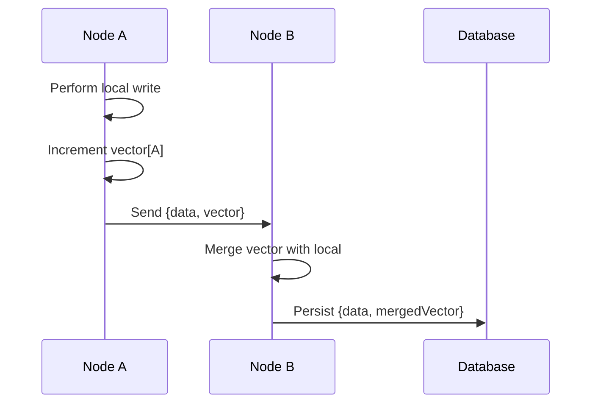

<!-- Generated by Groq via GitHub Actions -->
<!-- Topic ID: T111 -->
<!-- Category: Distributed Systems -->
<!-- Generated at UTC: 2026-10-19T19:24:53.497683+00:00 -->

# Vector clocks

## 1. What problem does this solve?

**Motivation**  
In a distributed system, many processes (or nodes) perform operations concurrently.  
Without a shared notion of time, it is impossible to determine whether two events
occurred in a causal relationship, concurrently, or in a particular order.  
This uncertainty leads to:

- **Lost updates** – two users edit the same record at the same time and one
  overwrite the other.
- **Inconsistent reads** – a read may return a stale value that has been
  superseded by a concurrent write.
- **Hard debugging** – tracing the origin of a bug across nodes is difficult.

**Why it matters**  
When you build multi‑master databases, CRDT‑based collaboration tools,
or event‑sourced services that run on multiple replicas, you need a lightweight
mechanism to reason about *causality* without a global clock.

**What happens if it is not used**  
- **Race conditions** become common; the system may silently discard updates.
- **Eventual consistency guarantees** become weak; you cannot prove that
  all replicas converge.
- **Debugging** turns into a guessing game because you cannot order events.

**Real‑world appearances**  
| System | Use case |
|--------|----------|
| **Cassandra** | Vector clocks for conflict resolution in multi‑write replicas. |
| **Riak** | Vector clocks to detect concurrent updates. |
| **CRDT libraries** (e.g., Automerge, Yjs) | Vector clocks to merge concurrent edits. |
| **Kafka** | Optional vector clocks for ordering messages in a partitioned stream. |
| **Distributed file systems** (e.g., GFS, HDFS) | Vector clocks for versioning blocks. |

---

## 2. Mental model

### Analogy: A shared calendar with per‑user counters  
Imagine each user has a personal calendar.  
Every time they add an event, they increment their own counter.  
When two users share a calendar entry, they exchange counters.  
If User A’s counter is higher than User B’s for the same event, we know
A’s event happened after B’s.  
If the counters are equal, the events are concurrent.

### Precise engineering model  
A **vector clock** is a map:

```
{ nodeId1: counter1, nodeId2: counter2, … }
```

- **Increment**: a node increments its own counter when it performs a local
  event.
- **Merge**: when two nodes communicate, they take the element‑wise maximum
  of their vectors.
- **Comparison**:  
  - `v1 < v2` if every counter in `v1` ≤ corresponding counter in `v2`
    and at least one is strictly less.  
  - `v1 == v2` if all counters are equal.  
  - Otherwise the vectors are **concurrent**.

This gives a *partial order* of events that respects causality.

---

## 3. Deep explanation

### Internals
- **Data structure**: a plain JavaScript object or `Map<string, number>`.
- **Serialization**: JSON or binary (e.g., Protocol Buffers) for network
  transport.
- **Storage**: persisted alongside the data item (e.g., in a column of a
  PostgreSQL table or a field in a MongoDB document).

### Important terminology
| Term | Meaning |
|------|---------|
| **Event** | A local operation that changes state. |
| **Process / Node** | The entity that owns a vector clock. |
| **Vector** | The entire map of counters. |
| **Causality** | `v1 < v2` indicates `v1` happened before `v2`. |
| **Concurrency** | Two vectors are incomparable; neither happened before the other. |
| **Merge** | Element‑wise maximum of two vectors. |

### Trade‑offs
| Aspect | Benefit | Drawback |
|--------|---------|----------|
| **No global clock** | Avoids clock skew and NTP issues. | Requires explicit vector maintenance. |
| **Fine‑grained ordering** | Detects concurrency precisely. | Vector size grows with node count. |
| **Deterministic merge** | Simple conflict resolution. | Cannot capture real‑time ordering. |

### Failure modes
- **Network partitions**: nodes may diverge; vector clocks help detect divergence.
- **Clock drift**: not an issue because vector clocks are logical, not physical.
- **Missing entries**: if a node never communicated, its counter may be absent;
  treat missing as zero.

### Limitations
- **Scalability**: vector size is O(N) where N is number of nodes that have
  ever interacted with the item.
- **Partial order**: cannot order all events; only causal relationships.
- **Storage overhead**: each data item carries a vector.

### Where it fits in a backend architecture
- **Conflict resolution layer**: after a write, attach a vector clock.
- **Replication protocol**: send vector clocks with data to replicas.
- **CRDT engine**: use vector clocks to merge concurrent updates.
- **Audit trail**: store vector clocks to reconstruct causal histories.

### Interaction with related concepts
- **Lamport clocks**: provide total order but cannot detect concurrency.
- **Consensus (Raft, Paxos)**: use vector clocks for *eventual* consistency,
  not for leader election.
- **Gossip protocols**: often carry vector clocks to propagate state.
- **Sharding**: each shard can maintain its own vector clock; cross‑shard
  merges require global identifiers.

---

## 4. How it works

1. **Local event**  
   Node `A` performs an operation → increment `A`’s counter in its vector.

2. **Send data**  
   Node `A` sends the updated item and its vector to node `B`.

3. **Merge on receive**  
   Node `B` merges its own vector with the received vector (element‑wise max).

4. **Conflict resolution**  
   If the vectors are concurrent, apply a deterministic merge strategy
   (e.g., last‑write‑wins, CRDT merge, or application‑specific logic).

5. **Persist**  
   Store the merged vector with the updated data.



---

## 5. Practical implementation

Below is a minimal Node.js/TypeScript example that demonstrates vector
clock usage in a simple key‑value store backed by Redis.

```ts
// vectorClock.ts
export class VectorClock {
  private clock: Record<string, number>;

  constructor(initial?: Record<string, number>) {
    this.clock = initial ? { ...initial } : {};
  }

  // Increment the counter for this node
  tick(nodeId: string): void {
    this.clock[nodeId] = (this.clock[nodeId] ?? 0) + 1;
  }

  // Merge another vector clock into this one
  merge(other: VectorClock): void {
    for (const [node, count] of Object.entries(other.toObject())) {
      this.clock[node] = Math.max(this.clock[node] ?? 0, count);
    }
  }

  // Compare with another vector clock
  // Returns -1 if this < other, 1 if this > other, 0 if equal, 2 if concurrent
  compare(other: VectorClock): number {
    let less = false;
    let greater = false;
    const keys = new Set([...Object.keys(this.clock), ...Object.keys(other.toObject())]);

    for (const key of keys) {
      const a = this.clock[key] ?? 0;
      const b = other.toObject()[key] ?? 0;
      if (a < b) less = true;
      if (a > b) greater = true;
    }

    if (less && !greater) return -1;
    if (!less && greater) return 1;
    if (!less && !greater) return 0;
    return 2; // concurrent
  }

  toObject(): Record<string, number> {
    return { ...this.clock };
  }

  static fromJSON(json: string): VectorClock {
    return new VectorClock(JSON.parse(json));
  }
}
```

```ts
// kvStore.ts
import { createClient } from 'redis';
import { VectorClock } from './vectorClock';

const redis = createClient();
await redis.connect();

const NODE_ID = process.env.NODE_ID ?? 'node-1';

export async function put(key: string, value: string): Promise<void> {
  const existing = await redis.get(key);
  const vc = existing
    ? VectorClock.fromJSON(JSON.parse(existing).vc)
    : new VectorClock();

  vc.tick(NODE_ID); // local event

  const payload = {
    value,
    vc: JSON.stringify(vc.toObject()),
  };

  await redis.set(key, JSON.stringify(payload));
}

export async function get(key: string): Promise<{ value: string; vc: VectorClock } | null> {
  const raw = await redis.get(key);
  if (!raw) return null;
  const { value, vc } = JSON.parse(raw);
  return { value, vc: VectorClock.fromJSON(JSON.stringify(vc)) };
}
```

**Usage**

```ts
await put('counter', '42');          // Node A writes
const data = await get('counter');   // Node B reads
console.log(data?.vc.compare(new VectorClock({ 'node-1': 1 }))); // -1, 0, 1, or 2
```

> **Note**: In a real system you would store the vector clock in a dedicated
> field of a database row or a separate Redis hash, and you would merge
> vector clocks when replicating data between nodes.

---

## 6. Production considerations

| Concern | How vector clocks affect it | Mitigation |
|---------|-----------------------------|------------|
| **Scalability** | Vector size grows with number of nodes that ever touched the item. | Use *partial* or *hybrid* vector clocks; prune stale entries; use hashing. |
| **Reliability** | Lost messages can leave clocks out of sync. | Ensure at‑least‑once delivery; gossip protocols; periodic reconciliation. |
| **Security** | Vector clocks can be tampered with if not authenticated. | Sign vector clocks or rely on transport security (TLS, mutual auth). |
| **Observability** | Hard to trace causal chains without logs. | Log vector clocks on every write; expose them via metrics. |
| **Performance** | Merge and comparison cost O(N). | Cache frequently accessed vectors; batch merges. |
| **Error handling** | Missing entries or malformed clocks. | Validate before merge; default missing counters to 0. |
| **Resource usage** | Memory overhead per item. | Store compressed representation (e.g., base‑64). |
| **Operational** | Need to monitor divergence. | Alert when vectors grow beyond threshold or when many concurrent updates. |
| **Failure recovery** | Partitioned nodes may diverge. | Periodic global sync; use conflict resolution strategies. |
| **Deployment** | Requires consistent node IDs across deployments. | Use deterministic IDs (e.g., Kubernetes pod name). |

---

## 7. Common mistakes

| Mistake | Why it’s problematic |
|---------|----------------------|
| **Using a single global counter** | Breaks causality; cannot detect concurrency. |
| **Not merging on receipt** | Nodes diverge; lost updates. |
| **Assuming vector clocks are total order** | They are only partial; comparing equal vectors may still mean concurrency. |
| **Storing raw JSON strings without validation** | Malformed data can corrupt the entire system. |
| **Ignoring missing node entries** | Treating missing as zero can falsely imply causality. |
| **Persisting vector clocks in a separate table without foreign key** | Risk of orphaned clocks. |
| **Using vector clocks for real‑time ordering** | They do not reflect wall‑clock time; use Lamport clocks or timestamps instead. |

---

## 8. Senior engineer perspective

### What changes at scale?
- **Vector size**: With thousands of nodes, a full vector becomes impractical.
  *Solution*: use *hybrid vector clocks* (combining a logical clock with a
  node ID) or *partial vectors* that only keep entries for nodes that have
  actually interacted with the item.
- **Network overhead**: Merging vectors on every message can dominate traffic.
  *Solution*: batch updates, compress vectors, or use gossip to propagate only
  deltas.
- **Storage cost**: Persisting a large vector per record can bloat the database.
  *Solution*: store vectors in a separate column family or use a compact
  binary format.

### Design decisions
| Decision | Trade‑off |
|----------|-----------|
| **Hybrid vector clocks** | Adds complexity but reduces size. |
| **Gossip vs. point‑to‑point** | Gossip scales better but introduces eventual consistency delays. |
| **CRDT vs. vector clocks** | CRDTs can merge automatically; vector clocks give explicit causal order. |
| **Per‑shard vs. global vectors** | Per‑shard vectors reduce size but require cross‑shard merge logic. |

### Bottlenecks
- **Vector merge latency** in high‑throughput services.
- **Memory consumption** in in‑memory stores (Redis, Memcached).
- **Disk I/O** when persisting large vectors.

### Failure scenarios
- **Partitioned network**: nodes may diverge; vector clocks help detect but not resolve.
- **Node crash**: lost vector entries; need to recover from persistent state.

### Monitoring
- **Vector size histogram** per item.
- **Concurrency rate** (percentage of concurrent writes).
- **Merge latency**.

### Cost/performance
- **Storage**: larger vectors → higher disk costs.
- **CPU**: merge/comparison is linear in vector size.

### When NOT to use
- **Single‑master systems**: simple timestamps suffice.
- **Low‑latency, low‑concurrency workloads**: overhead outweighs benefits.
- **Real‑time ordering needs**: use Lamport clocks or wall‑clock timestamps.

---

## 9. Interview questions

1. **Beginner** – *What is a vector clock and how does it differ from a Lamport clock?*  
   *Answer points*:  
   - Vector clock is a map of node IDs to counters.  
   - Lamport clock is a single counter per node.  
   - Vector clocks capture causality; Lamport clocks only give a total order.

2. **Beginner** – *How do you determine if two vector clocks are concurrent?*  
   *Answer points*:  
   - Compare element‑wise: if neither vector is ≤ the other, they are concurrent.  
   - No element in one is strictly greater than the other.

3. **Senior** – *Explain how you would scale vector clocks in a system with 10,000 nodes.*  
   *Answer points*:  
   - Use partial or hybrid vector clocks.  
   - Prune stale entries.  
   - Compress representation.  
   - Batch merges or gossip.

4. **Senior** – *Describe a scenario where vector clocks could lead to a false sense of consistency and how you would mitigate it.*  
   *Answer points*:  
   - Partitioned network → vectors diverge but appear consistent locally.  
   - Mitigation: detect divergence via monitoring, trigger reconciliation, use conflict resolution.

5. **Scenario/Debugging** – *You have a distributed counter that uses vector clocks. After a network partition, the counter shows a value that is lower than the sum of its parts. What could have gone wrong and how would you fix it?*  
   *Answer points*:  
   - Likely a merge bug: missing merge of concurrent updates.  
   - Check that on receipt, the vector is merged before applying the update.  
   - Ensure the merge logic uses element‑wise max.  
   - Add tests for concurrent increments.

---

## 10. Hands‑on task

**Build a simple collaborative counter**  
Create a Node.js service that exposes two endpoints:

1. `POST /increment` – increments a shared counter.  
2. `GET /value` – returns the current counter value and its vector clock.

Requirements:

- Store the counter value and its vector clock in Redis.  
- Each request must include a `X-Node-ID` header identifying the caller.  
- On increment, the service should:
  - Increment its own counter in the vector clock.
  - Merge the incoming vector clock from the request body (if any).
  - Persist the updated value and vector clock.
- On get, return the value and vector clock.

**Goal**  
After implementing, run two instances on different ports, simulate concurrent
increments, and observe that the final value is the sum of all increments and
that the vector clocks reflect causality.

---

## 11. Quick revision

- Vector clock = map of node IDs → counters.  
- Increment own counter on local event.  
- Merge = element‑wise max.  
- Compare: `v1 < v2` if all ≤ and at least one <; equal if all equal; otherwise concurrent.  
- Detects causality, not real time.  
- Used for conflict resolution in multi‑master replication, CRDTs, collaborative editing.  
- Size grows with number of interacting nodes; prune or use hybrid vectors.  
- Merge cost O(N).  
- Failure modes: partitions, missing entries, tampering.  
- Common mistake: treating equal vectors as causally ordered.  
- Senior considerations: scalability, monitoring, pruning, hybrid clocks.  
- Interview: causality vs. Lamport, concurrency detection, scaling strategies.

---

## 12. References

- [Vector Clocks – Wikipedia](https://en.wikipedia.org/wiki/Vector_clock)  
- [Cassandra Vector Clocks](https://cassandra.apache.org/doc/latest/cassandra/architecture/replication.html#vector-clocks)  
- [Riak Vector Clocks](https://riak.com/docs/riak/1.4.0/riak/riak.html#vector-clocks)  
- [CRDTs and Vector Clocks – Automerge](https://github.com/automerge/automerge)  
- [Hybrid Logical Clock (HLC)](https://arxiv.org/abs/1708.00023)  
- [Distributed Systems: Concepts and Design – Tanenbaum & Van Steen](https://www.pearson.com/us/higher-education/program/Tanenbaum-Distributed-Systems-Concepts-and-Design-2nd-Edition/PGM33287.html)  
- [Redis Documentation – Hashes](https://redis.io/docs/manual/data-types/#hashes)  
- [Node.js Redis Client – ioredis](https://github.com/luin/ioredis)  

---
