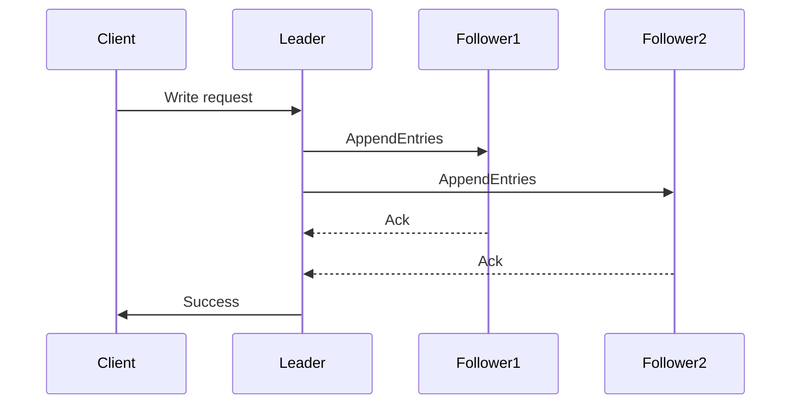

<!-- Generated by Groq via GitHub Actions -->
<!-- Topic ID: T114 -->
<!-- Category: Distributed Systems -->
<!-- Generated at UTC: 2026-10-20T06:13:16.385585+00:00 -->

# Split brain

## 1. What problem does this solve?

In a distributed system, multiple nodes cooperate to provide a single logical service (e.g., a database cluster, a cache cluster, or a microservice that needs high availability).  
When the network between nodes breaks into two or more partitions, each partition may continue to operate independently. If each partition believes it is the “real” cluster, they can both accept writes, leading to **inconsistent data** or **conflicting state**. This situation is called a *split‑brain*.

### Why it matters
- **Data corruption**: Two partitions may write different values for the same key, and when the network heals, reconciling those differences is hard or impossible.
- **Security**: A malicious partition could inject bad data or bypass access controls.
- **Reliability**: Clients may receive different responses depending on which partition they hit, breaking the illusion of a single service.

### Consequences of not handling split brain
- Inconsistent reads/writes
- Lost updates
- Unpredictable application behavior
- Hard-to‑debug failures

### Real‑world examples
- **Cassandra**: Uses quorum reads/writes to mitigate split brain, but still requires careful tuning.
- **Redis Sentinel**: Elects a master; if a partition occurs, the surviving master may be wrong.
- **MongoDB Replica Set**: Uses elections and voting to avoid split brain.
- **Kafka**: Uses Zookeeper (or KRaft) for leader election of partitions; split brain would cause duplicate message production.

---

## 2. Mental model

### Analogy
Imagine a city split by a broken bridge. Two groups of residents on each side think they are the only inhabitants and start building their own city plans. When the bridge is repaired, both sides have different roads, buildings, and rules. The city is now in chaos.

### Engineering model
- **Nodes** = city residents
- **Network partition** = broken bridge
- **Leader election** = city council deciding who leads
- **Quorum** = majority of residents agreeing on the plan
- **Fencing token** = a unique key that ensures only one council can govern at a time

If a single, agreed‑upon leader (or quorum) is enforced, only one side can make changes, preventing conflicting city plans.

---

## 3. Deep explanation

### Internals
1. **Leader election** – Nodes coordinate (via heartbeats or consensus) to elect a leader.
2. **Quorum** – Operations require a majority of nodes to agree before committing.
3. **Fencing tokens / epochs** – A monotonically increasing token that guarantees a new leader cannot override data written by an old leader.
4. **Consensus algorithms** – Raft, Paxos, or simpler protocols (e.g., ZooKeeper’s Zab) that guarantee safety and liveness.

### Important terminology
- **Leader** – Node that coordinates writes.
- **Follower** – Node that replicates data from the leader.
- **Candidate** – Node that requests votes during election.
- **Term / Epoch** – Version number of the election cycle.
- **Heartbeat** – Periodic signal from leader to followers.
- **Quorum** – Minimum number of nodes required for an operation to succeed.
- **Fencing** – Mechanism to prevent stale leaders from writing.

### Trade‑offs
| Aspect | Pros | Cons |
|--------|------|------|
| **Raft** | Simple to understand, strong safety | Higher latency due to log replication |
| **Paxos** | Very robust, proven | Harder to implement, higher overhead |
| **Quorum reads/writes** | Easy to implement in existing DBs | Requires tuning of read/write quorums |
| **Fencing tokens** | Prevents stale writes | Needs a reliable token store |

### Failure modes
- **Network partition** – Causes split brain if not mitigated.
- **Clock skew** – Can break election logic if timestamps are used.
- **Leader crash** – Requires fast election to maintain availability.
- **Stale follower** – May hold outdated data if not caught by fencing.

### Limitations
- No algorithm guarantees *both* high availability *and* strong consistency in the presence of partitions (CAP theorem).
- Requires additional infrastructure (e.g., a consensus store) which adds operational complexity.
- Fencing tokens can become a bottleneck if not distributed.

### Where it fits in a backend architecture
- **Database clusters** (PostgreSQL logical replication, MongoDB replica sets).
- **Cache clusters** (Redis Sentinel, Memcached with custom fencing).
- **Message brokers** (Kafka partition leaders).
- **Service discovery** (Consul, etcd).

### Interaction with related concepts
- **Leader election** ↔ **Health checks**: Heartbeats are essentially health checks.
- **Quorum** ↔ **Read/write consistency**: Determines how many replicas must agree.
- **Fencing** ↔ **Optimistic concurrency**: Prevents lost updates.
- **Observability** ↔ **Metrics**: Leader election events, heartbeat failures, split‑brain detection.

---

## 4. How it works

### Step‑by‑step flow (Raft‑style)

1. **Node starts** → becomes *Follower*.
2. **Follower** expects a heartbeat from the current *Leader* within a timeout.
3. If timeout expires → node becomes *Candidate*.
4. **Candidate** increments its term, votes for itself, and sends *RequestVote* to all peers.
5. Peers reply *VoteGranted* if they have not voted in this term.
6. If *Candidate* receives majority → becomes *Leader*.
7. **Leader** starts sending periodic heartbeats (`AppendEntries`) to followers.
8. **Clients** send write requests to the Leader; Leader appends to log, replicates to followers.
9. Once majority of followers acknowledge → Leader commits the entry and applies it.
10. **Follower** applies committed entries to its state machine.
11. If network partition splits cluster → only the partition containing a majority can elect a leader; the minority stays *Follower* or *Candidate* but cannot commit writes.
12. When partition heals → the surviving leader’s term is higher; the other side’s stale leader is fenced out by the term comparison.



---

## 5. Practical implementation

Below is a minimal **leader election** using Redis `SETNX` (set if not exists) with an expiry.  
It demonstrates fencing via a monotonically increasing epoch stored in Redis.

```ts
// leaderElection.ts
import { createClient } from 'redis';
import { randomUUID } from 'crypto';

const REDIS_URL = process.env.REDIS_URL ?? 'redis://localhost:6379';
const ELECTION_KEY = 'app:leader';
const ELECTION_TTL = 5000; // 5 seconds

const client = createClient({ url: REDIS_URL });

async function startElection() {
  await client.connect();

  const nodeId = randomUUID();
  let epoch = 0;

  // Try to acquire leadership
  const acquired = await client.set(ELECTION_KEY, `${nodeId}:${epoch}`, {
    NX: true,
    PX: ELECTION_TTL,
  });

  if (acquired) {
    console.log(`[${nodeId}] Became leader (epoch ${epoch})`);
    // Renew leadership periodically
    setInterval(async () => {
      // Increment epoch to fence out stale leaders
      epoch += 1;
      await client.set(ELECTION_KEY, `${nodeId}:${epoch}`, {
        PX: ELECTION_TTL,
      });
      console.log(`[${nodeId}] Renewed leadership (epoch ${epoch})`);
    }, ELECTION_TTL / 2);
  } else {
    console.log(`[${nodeId}] Not leader, watching for changes`);
    // Watch for changes to the key
    client.on('pmessage', (pattern, channel, message) => {
      console.log(`[${nodeId}] Detected change: ${message}`);
    });
    await client.psubscribe(`__keyevent@0__:expired`);
  }
}

startElection().catch(console.error);
```

**Key points**

- `SETNX` ensures only one node can set the key at a time.
- The key includes an `epoch` so that a new leader can “fence” out a stale one.
- The key has a TTL; if the leader dies, the key expires and a new election starts.
- In production, you would replace Redis with a more robust consensus store (etcd, ZooKeeper, or a Raft implementation).

---

## 6. Production considerations

| Concern | How to address it |
|---------|-------------------|
| **Scalability** | Use a distributed consensus store (etcd, ZooKeeper) rather than a single Redis instance. |
| **Reliability** | Ensure heartbeats are frequent enough to detect failures quickly but not too frequent to overload the network. |
| **Security** | Encrypt traffic between nodes (TLS). Use ACLs on the consensus store. |
| **Observability** | Expose metrics: `leader_election_success`, `leader_election_failures`, `heartbeat_lag`. Log election events. |
| **Performance** | Keep the election algorithm lightweight; avoid heavy log replication for simple leader election. |
| **Error handling** | Retry on transient errors. If election fails, fallback to read‑only mode. |
| **Resource usage** | Use lightweight clients; avoid keeping long‑lived connections if not needed. |
| **Operational concerns** | Monitor the health of the consensus store. Plan for its failure (e.g., multi‑AZ deployment). |
| **Failure recovery** | Implement graceful shutdown: leader should release the key before exiting. |
| **Deployment** | Use container orchestration (Kubernetes) with proper liveness/readiness probes. |

---

## 7. Common mistakes

| Mistake | Why it’s problematic |
|---------|----------------------|
| Using a single Redis instance for leader election | Single point of failure; if Redis goes down, the whole cluster stalls. |
| Not incrementing an epoch/fencing token | Stale leaders can overwrite newer data after a partition heals. |
| Relying solely on heartbeats without a quorum check | A minority partition can still accept writes if it believes it’s the majority. |
| Setting TTL too long | Delays detection of failed leaders, causing stale writes. |
| Ignoring clock skew | Time‑based elections can misbehave if nodes have different clocks. |
| Not handling network partitions gracefully | Clients may receive inconsistent data or timeouts. |

---

## 8. Senior engineer perspective

### Design decisions at scale
- **Consensus store**: Choose a proven system (etcd, ZooKeeper, Raft) instead of DIY.
- **Quorum size**: For 5 nodes, a quorum of 3 balances availability and consistency.
- **Read/write splits**: Use read‑quorum for high availability, but be aware of stale reads.
- **Fencing strategy**: Use monotonically increasing epoch or UUIDs; avoid relying on timestamps.
- **Network topology**: Deploy nodes across AZs; ensure heartbeats cross AZs to detect partitions early.
- **Monitoring**: Dashboards for election latency, leader churn, heartbeat lag.
- **Cost**: Running a consensus cluster adds compute and storage costs; weigh against the risk of split brain.
- **When NOT to use**: If your workload tolerates eventual consistency and you can live with occasional stale writes, a simpler leaderless approach (e.g., read‑replica) may be cheaper.

---

## 9. Interview questions

1. **Beginner**: *What is a split brain and why is it a problem in distributed systems?*  
   *Answer*: A split brain occurs when a network partition causes multiple groups of nodes to think they are the sole cluster, leading to conflicting writes and data inconsistency.

2. **Beginner**: *How does a quorum help prevent split brain?*  
   *Answer*: A quorum requires a majority of nodes to agree before committing changes, ensuring that only one partition can accept writes.

3. **Senior**: *Explain how Raft ensures safety during leader election and log replication.*  
   *Answer*: Raft uses terms, voting, and log matching. A candidate can only win if it has the majority and its log is at least as up‑to‑date as any other node. The leader appends entries to its log and replicates them; followers only commit entries once a majority acknowledges, guaranteeing consistency.

4. **Senior**: *What are the trade‑offs between using a consensus algorithm like Raft versus a simple leader election with heartbeats?*  
   *Answer*: Raft provides strong safety and guarantees log consistency but adds latency and complexity. Simple heartbeats are lightweight but only protect against stale leaders if combined with fencing; they don’t guarantee log consistency.

5. **Scenario/Debugging**: *You have a Redis‑based leader election. After a network split, both partitions think they are leaders and start processing writes. What symptoms would you see, and how would you resolve it?*  
   *Answer*: Symptoms: duplicate data, inconsistent reads, increased latency. Resolve by: ensuring the election key includes a monotonically increasing epoch, increasing TTL, adding a separate fencing token store, or switching to a robust consensus store like etcd.

---

## 10. Hands‑on task

**Goal**: Build a small Node.js service that uses Redis for leader election and exposes a `/status` endpoint that reports whether the instance is the current leader.

1. Clone the repository and run `npm install`.
2. Start Redis locally (`docker run -p 6379:6379 redis`).
3. Run `npm run start` to launch the service.
4. Open multiple terminals and start several instances (`npm run start -- --port 3001`, `--port 3002`, etc.).
5. Observe which instance reports `leader: true` and how leadership changes when you stop an instance or simulate a network partition (e.g., by stopping Redis).
6. Extend the service to log election events and expose Prometheus metrics.

---

## 11. Quick revision

- Split brain = conflicting partitions that both think they are the whole cluster.
- Prevented by **leader election**, **quorum**, and **fencing tokens**.
- Consensus algorithms (Raft, Paxos) provide safety and liveness.
- Heartbeats detect leader failure; TTLs prevent stale leaders.
- Fencing token (epoch) ensures stale leaders cannot overwrite newer data.
- Quorum size = ⌊N/2⌋ + 1 for N nodes.
- Common pitfalls: single point of failure, no fencing, long TTLs.
- Production: use etcd/ZooKeeper, monitor election metrics, secure traffic.
- Senior considerations: cost, scalability, read/write splits, monitoring, failure scenarios.

---

## 12. References

- [Raft Consensus Algorithm](https://raft.github.io/)
- [Paxos Explained](https://www.microsoft.com/en-us/research/publication/paxos-implanted/)
- [Redis SETNX and TTL](https://redis.io/commands/setnx)
- [Redis Sentinel](https://redis.io/docs/management/sentinel/)
- [etcd](https://etcd.io/docs/)
- [ZooKeeper](https://zookeeper.apache.org/doc/r3.7.0/zookeeperOver.html)
- [Kafka Leader Election](https://kafka.apache.org/documentation/#leader_election)
- [CAP Theorem](https://en.wikipedia.org/wiki/CAP_theorem)
