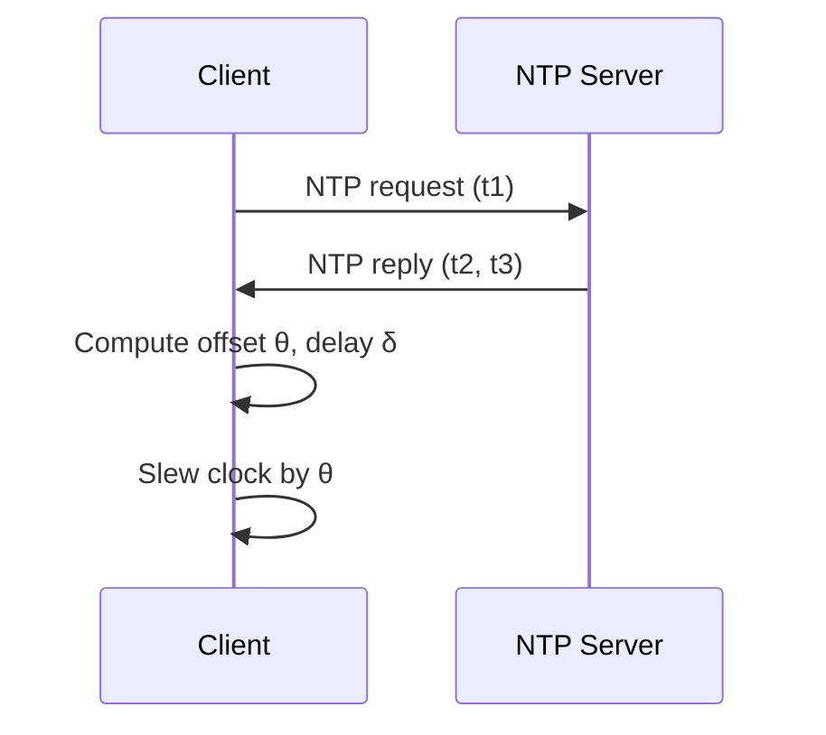
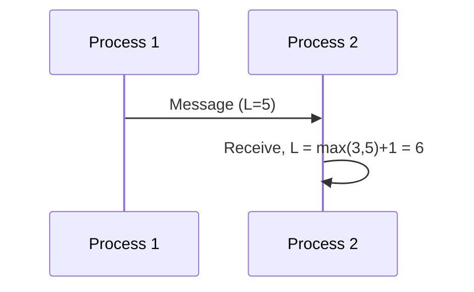

<!-- Generated by Groq via GitHub Actions -->
<!-- Topic ID: T115 -->
<!-- Category: Distributed Systems -->
<!-- Generated at UTC: 2026-10-21T06:11:39.784555+00:00 -->

# Clock Synchronization

## 1. What problem does this solve?

**Motivation**

In a distributed backend, many services run on different machines, in different data‑centers, or even in different clouds. Each machine has its own system clock. When those clocks drift apart, the following problems arise:

| Problem | Why it matters | Real‑world impact |
|---------|----------------|-------------------|
| **Inconsistent timestamps** | Logs, metrics, and audit trails become hard to correlate. | Debugging a request that spans services becomes impossible. |
| **Race conditions** | Two services may think they performed an operation at the same time, but actually one happened earlier. | Data corruption, double‑processing, or lost updates. |
| **Expiration & TTL logic** | Cache entries or tokens may expire too early or too late. | Users see stale data or get unexpectedly logged out. |
| **Leader election & distributed locks** | Algorithms like Raft or Zookeeper rely on timeouts to elect leaders. | System may split‑brain or stall. |
| **Event ordering** | Event sourcing or message queues need a deterministic order. | Wrong state transitions, inconsistent aggregates. |

If you ignore clock synchronization, you risk subtle bugs that surface only under load or after a few hours of operation. In production, this can lead to data loss, security holes, or service outages.

**Where it appears**

- **Databases** – PostgreSQL uses `clock_timestamp()` for row visibility; MongoDB uses `oplog` timestamps.
- **Message brokers** – Kafka’s `timestamp` field, RabbitMQ’s `timestamp` header.
- **Distributed tracing** – OpenTelemetry uses wall‑clock time for span start/end.
- **Cache layers** – Redis `EXPIRE` relies on server time.
- **Auth tokens** – JWT `exp` claim is validated against system time.

---

## 2. Mental model

### Analogy: The synchronized watch club

Imagine a club of watch‑makers who meet every morning to adjust their watches against a master clock. If everyone keeps their watches in sync, they can reliably coordinate a sunrise ceremony. If one member’s watch drifts, that member will arrive late, and the ceremony will be disrupted.

### Engineering model

- **Physical clocks** – The system clock on each machine.
- **Reference clocks** – NTP/PTP servers, GPS, atomic clocks.
- **Adjustment** – Periodic correction of the local clock based on the reference.
- **Logical clocks** – Algorithms (Lamport, vector) that assign monotonically increasing numbers without relying on physical time.

The goal is to keep the *relative* ordering of events correct, even if the absolute time is slightly off.

---

## 3. Deep explanation

### Internals

| Layer | What it does | Typical protocol |
|-------|--------------|------------------|
| **NTP (Network Time Protocol)** | Synchronizes a client’s clock to a reference server over UDP. | RFC 5905 |
| **PTP (Precision Time Protocol)** | Uses IEEE 1588 for sub‑microsecond accuracy on LANs. | IEEE 1588 |
| **GPS/Atomic clocks** | Provide the most accurate reference time. | NTP servers often use GPS. |

An NTP client sends a request, receives a response, and computes the round‑trip delay and offset. The client then adjusts its clock gradually (slewing) to avoid abrupt jumps.

### Important terminology

- **Offset** – Difference between local and reference time.
- **Skew** – Rate at which the offset changes (drift).
- **Jitter** – Variability in round‑trip delay.
- **Precision** – How close the clock is to the reference.
- **Accuracy** – How close the clock is to true time.

### Trade‑offs

| Factor | NTP | PTP | Logical clocks |
|--------|-----|-----|----------------|
| Accuracy | ~1–10 ms (internet) | < 1 µs (LAN) | None (only ordering) |
| Complexity | Low | High | Low |
| Cost | Free | Hardware | Free |
| Security | Vulnerable to spoofing | Same | None |

### Failure modes

- **Network partition** – Client cannot reach NTP server → drift increases.
- **Spoofed NTP response** – Attacker can shift time → security breach.
- **Clock skew** – Even with NTP, clocks can drift if the server is overloaded.
- **Container isolation** – Docker containers may not see host time changes.

### Limitations

- Absolute time cannot be guaranteed; you can only keep clocks *close*.
- NTP works best when network latency is symmetric; asymmetric paths introduce bias.
- Logical clocks cannot provide real timestamps, only ordering.

### Where it fits in backend architecture

- **Time‑based sharding** – Partition data by hour; requires synchronized clocks.
- **Cache invalidation** – TTL calculations rely on accurate time.
- **Audit logs** – Consistent timestamps across services.
- **Distributed tracing** – Span timestamps must be comparable.

### Interaction with related concepts

- **Consensus protocols (Raft, Paxos)** – Use timeouts; inaccurate clocks can cause split‑brain.
- **Distributed tracing** – OpenTelemetry expects wall‑clock time; mis‑sync leads to negative durations.
- **Event sourcing** – Event timestamps determine order; logical clocks can supplement physical time.

---

## 4. How it works

### NTP client flow (simplified)

1. **Client sends request** to NTP server with its current timestamp `t1`.
2. **Server receives** at `t2`, records its own timestamp, and replies with `t2` and `t3` (server receive & transmit times).
3. **Client receives** reply at `t4`.
4. **Client computes** offset `θ = ((t2 - t1) + (t3 - t4)) / 2` and round‑trip delay `δ = (t4 - t1) - (t3 - t2)`.
5. **Client slews** its clock by `θ` gradually.



### Logical clock flow (Lamport)

1. Each process maintains a counter `L`.
2. On internal event → `L = L + 1`.
3. On send → attach `L` to message.
4. On receive → `L = max(L, received_L) + 1`.



---

## 5. Practical implementation

### 5.1 NTP sync in Node.js

```ts
// ntp-sync.ts
import ntpClient from 'ntp-client';
import { execSync } from 'child_process';

const NTP_SERVER = 'pool.ntp.org';
const SYNC_INTERVAL_MS = 60 * 1000; // 1 minute

function syncClock() {
  ntpClient.getNetworkTime(NTP_SERVER, 123, (err, date) => {
    if (err) {
      console.error('NTP sync failed', err);
      return;
    }
    const local = new Date();
    const offsetMs = date.getTime() - local.getTime();
    console.log(`Offset: ${offsetMs} ms`);

    // On Linux, adjust system clock (requires root)
    // execSync(`sudo date -s @${Math.floor(date.getTime() / 1000)}`);
  });
}

setInterval(syncClock, SYNC_INTERVAL_MS);
syncClock(); // initial sync
```

> **Note**: Adjusting the system clock requires elevated privileges. In containers, you typically rely on the host’s NTP daemon.

### 5.2 Lamport clock for message ordering

```ts
// lamport.ts
class LamportClock {
  private counter = 0;

  internalEvent() {
    this.counter += 1;
    return this.counter;
  }

  sendEvent() {
    this.counter += 1;
    return this.counter; // attach to message
  }

  receiveEvent(received: number) {
    this.counter = Math.max(this.counter, received) + 1;
    return this.counter;
  }
}

// Usage
const clock = new LamportClock();
const msg = { ts: clock.sendEvent(), payload: 'hello' };
// ... send msg over network
// On receiver:
clock.receiveEvent(msg.ts);
```

### 5.3 Distributed lock with Redis and TTL

```ts
// redis-lock.ts
import { createClient } from 'redis';
import { v4 as uuidv4 } from 'uuid';

const client = createClient();
await client.connect();

async function acquireLock(key: string, ttlMs: number) {
  const id = uuidv4();
  const result = await client.set(key, id, {
    NX: true,
    PX: ttlMs,
  });
  return result === 'OK' ? id : null;
}

async function releaseLock(key: string, id: string) {
  const script = `
    if redis.call("GET", KEYS[1]) == ARGV[1]
    then
      return redis.call("DEL", KEYS[1])
    else
      return 0
    end
  `;
  await client.eval(script, {
    keys: [key],
    arguments: [id],
  });
}
```

> The lock’s TTL relies on the server’s clock; if the server’s clock drifts, the lock may expire too early or too late.

---

## 6. Production considerations

| Concern | How to address |
|---------|----------------|
| **Scalability** | Run a local NTP daemon on each host; use a pool of NTP servers; avoid per‑service NTP clients. |
| **Reliability** | Configure multiple NTP servers (primary, secondary). Use `ntpd` or `chrony` with fallback. |
| **Security** | Use NTP authentication (MD5 or SHA‑1). Prefer `chrony` with `allow`/`deny` rules. Avoid exposing NTP on the public internet. |
| **Observability** | Export metrics: `ntp_offset_ms`, `ntp_delay_ms`. Alert on offsets > 100 ms. |
| **Performance** | NTP traffic is negligible (UDP packets < 200 B). |
| **Error handling** | Retry with exponential backoff. If all servers fail, log and continue with local clock. |
| **Resource usage** | Minimal CPU/memory. |
| **Operational** | Monitor NTP service health; ensure containers share host time. |
| **Failure recovery** | On NTP outage, gradually adjust clock based on last known offset. |
| **Deployment** | In Kubernetes, mount host time (`/etc/localtime`) or run `chronyd` as a DaemonSet. |

---

## 7. Common mistakes

| Mistake | Why it’s bad |
|---------|--------------|
| **Only sync at startup** | Clocks drift over time; offsets grow. |
| **Ignoring network latency asymmetry** | Offset calculation becomes biased. |
| **Running NTP inside Docker without host time sync** | Container sees stale time; logs mis‑ordered. |
| **Using system clock for distributed lock TTL** | If clock jumps, locks may expire early or never. |
| **Assuming NTP guarantees absolute time** | NTP only guarantees relative closeness; cannot be used for legal timestamps. |
| **Using logical clocks for real timestamps** | Logical clocks give ordering but no real time; unsuitable for audit logs. |

---

## 8. Senior engineer perspective

### What changes at scale?

- **Redundancy**: Deploy multiple NTP/chrony servers per region; use GPS or atomic clocks for reference.
- **Monitoring**: Centralize offset metrics; alert on drift > threshold.
- **Automation**: Use configuration management (Ansible, Terraform) to enforce NTP settings.
- **Security hardening**: Disable unauthenticated NTP; restrict access to trusted IPs.
- **Container orchestration**: In Kubernetes, run a `chrony` DaemonSet and expose `/etc/localtime` to pods.

### Design decisions

| Decision | Trade‑off |
|----------|-----------|
| **NTP vs PTP** | PTP gives microsecond accuracy but requires hardware support; NTP is cheaper but less precise. |
| **Physical vs logical clocks** | Physical clocks needed for auditability; logical clocks for ordering when physical time is unreliable. |
| **Clock adjustment strategy** | Slewing avoids abrupt jumps but takes time; stepping fixes offset quickly but can disrupt time‑sensitive services. |
| **Lock TTL** | Short TTL reduces stale locks but increases lock churn; long TTL reduces churn but risks stale locks if clock drifts. |

### Bottlenecks & failure scenarios

- **NTP server overload** → increased latency → larger offsets.
- **Network partition** → some nodes drift apart → inconsistent ordering.
- **Clock skew during high load** → `chrony` may mis‑estimate drift → lock expiration errors.

### Monitoring & cost

- **Metrics**: `ntp_offset_ms`, `ntp_delay_ms`, `clock_skew_ms`.
- **Alerting**: Offsets > 50 ms, delay > 200 ms.
- **Cost**: Minimal; hardware clocks add cost but may be justified for high‑frequency trading or telecom.

### When NOT to use

- **Local, single‑node services** – No need for NTP; rely on host clock.
- **Purely logical ordering** – Use Lamport or vector clocks; no need for physical time.
- **High‑frequency trading** – Requires PTP or GPS; NTP is insufficient.

---

## 9. Interview questions

1. **Beginner**: *What is the purpose of NTP in a distributed system?*  
   **Answer**: To keep each node’s system clock close to a reference time, enabling consistent timestamps, ordering, and time‑based logic across services.

2. **Beginner**: *Explain the difference between offset and skew.*  
   **Answer**: Offset is the instantaneous difference between local and reference time; skew is the rate at which that offset changes (drift).

3. **Senior**: *How would you design a distributed lock service that is resilient to clock drift?*  
   **Answer**: Use a logical clock or a monotonic counter for lock identifiers, store the lock in a distributed store with a TTL based on the store’s internal clock, and avoid relying on the client’s system clock. Optionally, use a consensus algorithm (Raft) to agree on lock expiration.

4. **Senior**: *Describe a scenario where NTP spoofing could compromise your system and how you mitigate it.*  
   **Answer**: An attacker could send forged NTP responses to shift your system clock, causing tokens to expire early or logs to be mis‑dated. Mitigation: enable NTP authentication (MD5/SHA), restrict NTP access to trusted IPs, and monitor offsets for sudden jumps.

5. **Scenario/Debugging**: *Your microservice logs show that a request processed in 120 ms, but the downstream service reports it took 80 ms. What could cause this discrepancy?*  
   **Answer**: Likely a clock skew between the services. The upstream service’s clock is ahead by ~40 ms, making its duration appear longer. Verify NTP sync, check offset metrics, and consider using logical timestamps for ordering.

---

## 10. Hands‑on task

**Build a simple “time‑synchronization monitor”**

1. Create a Node.js service that:
   - Periodically queries an NTP server (e.g., `pool.ntp.org`).
   - Logs the offset and delay.
   - Exposes a `/metrics` endpoint that returns Prometheus metrics: `ntp_offset_ms`, `ntp_delay_ms`.
2. Deploy the service in Docker.
3. Run two instances on different hosts (or containers with different host times) and observe the metrics.
4. Introduce a network delay (e.g., using `tc` or Docker network settings) and see how the offset changes.
5. (Optional) Add a simple UI that visualizes the offset over time.

**Goal**: Understand how offsets evolve, how NTP corrects them, and how to expose observability.

---

## 11. Quick revision

- Clock sync keeps distributed clocks close to a reference (NTP/PTP).
- **Offset** = local time – reference time; **skew** = rate of offset change.
- NTP uses round‑trip delay to compute offset; adjusts clock gradually (slewing).
- Logical clocks (Lamport, vector) provide ordering without physical time.
- Distributed locks rely on TTL; clock drift can cause premature expiration.
- Security: enable NTP authentication; restrict access.
- Observability: expose offset/delay metrics; alert on large values.
- Common mistakes: syncing only at startup, ignoring latency asymmetry, running NTP inside isolated containers.
- At scale: use redundant NTP servers, monitor offsets, consider PTP/GPS for high precision.
- Use logical clocks when absolute time isn’t needed; use physical clocks for audit logs and TTL logic.

---

## 12. References

- [RFC 5905 – Network Time Protocol Version 4 (NTPv4)](https://www.ietf.org/rfc/rfc5905.txt)
- [NTP.org – NTP Overview](https://www.ntp.org/)
- [Chrony – NTP client/server](https://chrony.tuxfamily.org/)
- [IEEE 1588 Precision Time Protocol](https://standards.ieee.org/standard/1588-2008.html)
- [Lamport, L. (1978). Time, Clocks, and the Ordering of Events in a Distributed System.](https://dl.acm.org/doi/10.1145/359407.359414)
- [OpenTelemetry – Timestamp semantics](https://opentelemetry.io/docs/concepts/signals/traces/#timestamps)
- [Redis Distributed Lock](https://redis.io/docs/manual/patterns/distributed-locks/)
- [Prometheus – Exporting metrics](https://prometheus.io/docs/introduction/overview/)
