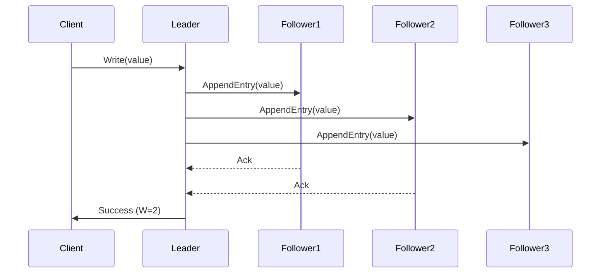
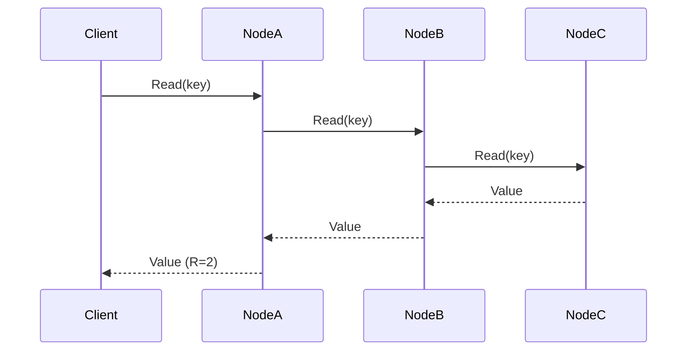

<!-- Generated by Groq via GitHub Actions -->
<!-- Topic ID: T117 -->
<!-- Category: Distributed Systems -->
<!-- Generated at UTC: 2026-10-21T18:10:05.024166+00:00 -->

# Quorum

## 1. What problem does this solve?

**Motivation**  
In a distributed system you often have multiple replicas of data or services. When a client asks for a value or performs an update, you need a *single, consistent answer* even though the replicas may be out of sync or some nodes may be down. Quorum solves the problem of **consistency vs. availability** by requiring that a majority (or a configurable subset) of replicas agree before an operation is considered successful.

**What problem exists**  
- Replicas can diverge due to network partitions, node failures, or concurrent writes.  
- A single node might return stale or conflicting data.  
- Without coordination, you risk *split-brain* where two parts of the system think they are the master.

**Why the problem matters**  
- Users see inconsistent data → loss of trust.  
- Business logic that depends on atomic updates (e.g., inventory, banking) can double‑count or lose money.  
- In microservices, a downstream service may propagate wrong state to others.

**What happens if this concept is not used**  
- You may return stale reads or accept writes that overwrite newer data.  
- In the worst case, you can have *data corruption* or *inconsistent state* that is hard to recover.

**Where this concept appears in real backend systems**  
- DynamoDB’s *read/write quorum* (N, R, W).  
- Cassandra’s consistency levels (ONE, QUORUM, ALL).  
- Raft and Paxos consensus algorithms.  
- Redis Sentinel’s majority vote for failover.  
- etcd’s Raft implementation.  
- MongoDB’s majority read/write concern.

---

## 2. Mental model

**Analogy**  
Imagine a group of friends deciding on a movie. Each friend votes. The group only moves forward when a *majority* (more than half) agree. If a few friends are absent or disagree, the group waits until enough votes are collected. This prevents the group from acting on a minority that might be wrong.

**Engineering model**  
- **Replica set**: a collection of nodes holding the same data.  
- **Quorum size (Q)**: the minimum number of nodes that must participate in an operation.  
- **Read quorum (R)** and **write quorum (W)**: separate thresholds for reads and writes.  
- **Consistency guarantee**: if `R + W > N` (total replicas), then every read sees the latest write.

---

## 3. Deep explanation

### Internals
1. **Replica metadata** – each node knows its ID, status, and last applied log index.  
2. **Voting protocol** – nodes exchange heartbeats or log entries; a leader (or coordinator) collects votes.  
3. **Commit rule** – a write is considered committed when `W` replicas acknowledge it.  
4. **Read rule** – a read is served after `R` replicas respond, optionally merging results.

### Important terminology
- **Majority / quorum** – the minimal set of nodes that must agree.  
- **N** – total number of replicas.  
- **R** – read quorum size.  
- **W** – write quorum size.  
- **Consistency level** – the chosen `(R, W)` pair.  
- **Split‑brain** – two disjoint quorums both think they are the leader.  
- **Leader election** – process to choose a coordinator that handles writes.

### Trade‑offs
| Aspect | Majority (R=W=⌈N/2⌉) | All (R=W=N) | None (R=W=1) |
|--------|----------------------|-------------|--------------|
| Availability | High (can tolerate ⌊N/2⌋ failures) | Low | Very high |
| Consistency | Strong (reads see latest writes) | Strong | Weak |
| Latency | Medium (needs multiple responses) | High | Low |
| Write throughput | Medium | Low | High |

### Failure modes
- **Network partition**: if a majority cannot be reached, writes stall.  
- **Node crash**: if a node fails, quorum may still be achievable if enough replicas remain.  
- **Clock skew**: in systems that rely on timestamps, unsynchronized clocks can cause stale reads.  
- **Split‑brain**: if two leaders each have a majority in different partitions, data diverges until re‑synchronization.

### Limitations
- **No absolute fault tolerance**: you cannot survive more than ⌊N/2⌋ failures if you want consistency.  
- **Write bottleneck**: the leader becomes a single point of contention.  
- **Complexity**: implementing a correct quorum protocol (e.g., Raft) is non‑trivial.

### Where it fits in a backend architecture
- **Data layer**: DynamoDB, Cassandra, MongoDB replica sets.  
- **Service coordination**: leader election for background workers.  
- **Cache invalidation**: ensuring cache replicas agree before serving.  
- **Event sourcing**: committing events to a log that requires quorum.

### Interaction with related concepts
- **CAP theorem**: quorum leans toward consistency (C) and partition tolerance (P) at the expense of availability (A).  
- **Replication**: quorum is the mechanism that guarantees replicated data stays consistent.  
- **Consensus algorithms**: Raft/Paxos are quorum‑based protocols.  
- **Load balancing**: read quorums can be distributed across nodes to reduce latency.

---

## 4. How it works

### Step‑by‑step flow for a write

1. Client sends write request to any node.  
2. Node becomes **leader** (or forwards to current leader).  
3. Leader writes the entry to its local log and sends it to all followers.  
4. Followers acknowledge receipt.  
5. Leader counts acknowledgments; once `W` are received, it marks the entry **committed**.  
6. Leader replies success to client.  
7. Followers apply the committed entry to their state machine.

### Mermaid diagram



### Read flow (R=2)



---

## 5. Practical implementation

Below is a minimal **Node.js** example that demonstrates a write quorum using HTTP and an in‑memory array of replicas. It is **not** production‑ready but illustrates the core idea.

```ts
// quorum.ts
import express from 'express';
import axios from 'axios';

const app = express();
app.use(express.json());

// In‑memory replica state
let data: Record<string, string> = {};
const REPLICAS = [
  'http://localhost:3001',
  'http://localhost:3002',
  'http://localhost:3003',
];
const N = REPLICAS.length;
const W = Math.ceil(N / 2); // write quorum

// Helper: send write to all replicas
async function replicate(key: string, value: string) {
  const promises = REPLICAS.map((url) =>
    axios.post(`${url}/replica/write`, { key, value }).catch(() => null)
  );
  const results = await Promise.all(promises);
  const successes = results.filter((r) => r && r.status === 200).length;
  return successes >= W;
}

// Leader endpoint
app.post('/write', async (req, res) => {
  const { key, value } = req.body;
  // Write locally
  data[key] = value;
  // Replicate to followers
  const ok = await replicate(key, value);
  if (!ok) return res.status(503).send('Quorum not reached');
  res.send('OK');
});

// Replica endpoint (used by leader)
app.post('/replica/write', (req, res) => {
  const { key, value } = req.body;
  data[key] = value;
  res.send('OK');
});

app.get('/read/:key', (req, res) => {
  const value = data[req.params.key];
  res.send({ value });
});

app.listen(3000, () => console.log('Leader listening on 3000'));
```

**How to run**

1. Create three directories `node1`, `node2`, `node3`.  
2. In each, copy the same file but change the port (`3001`, `3002`, `3003`) and set `REPLICAS` to point to the other two.  
3. Start all three processes.  
4. Send a POST to `http://localhost:3000/write` with JSON `{ "key": "foo", "value": "bar" }`.  
5. Read from any node: `GET http://localhost:3001/read/foo`.

**Key lines explained**

- `const W = Math.ceil(N / 2);` – calculates the majority quorum.  
- `replicate()` – sends the write to all replicas and counts successful acknowledgments.  
- `if (!ok) return res.status(503).send('Quorum not reached');` – fails the request if quorum is not met.

> **Tip**: In production you would use a real consensus library (e.g., `node-raft`, `etcd`, `consul`) instead of HTTP calls.

---

## 6. Production considerations

| Concern | How quorum affects it | Mitigation |
|---------|-----------------------|------------|
| **Scalability** | Majority quorum limits write throughput; adding replicas increases N but also increases quorum size. | Use **sharding**: apply quorum per shard. |
| **Reliability** | System can tolerate up to ⌊N/2⌋ node failures. | Deploy replicas across AZs, use health checks. |
| **Security** | Leader election can be spoofed if not authenticated. | Mutual TLS, signed messages, secure leader election. |
| **Observability** | Need to monitor quorum status, latency of acknowledgments. | Metrics: `quorum_success_rate`, `quorum_latency`. |
| **Performance** | Each write waits for `W` responses → latency. | Batch writes, use *optimistic* quorum for reads. |
| **Error handling** | Partial failures → retry logic. | Exponential backoff, circuit breakers. |
| **Resource usage** | Replicas store full copy of data. | Use compression, tiered storage. |
| **Operational concerns** | Leader churn can degrade performance. | Stable leader election, use heartbeats. |
| **Failure recovery** | After partition, need to reconcile divergent logs. | Log replication, conflict resolution. |
| **Deployment** | Need consistent configuration across replicas. | Use config management (Ansible, Terraform). |

---

## 7. Common mistakes

| Mistake | Why it’s problematic |
|---------|----------------------|
| **Using `W=1` for writes** | Allows writes to succeed even if the majority is offline → stale reads. |
| **Ignoring `R + W > N`** | Guarantees no read will see an uncommitted write. |
| **Treating quorum as a magic number** | Forgetting that quorum size changes when you add/remove replicas. |
| **Not handling partial failures** | A single failed follower can block all writes. |
| **Using synchronous HTTP for replication** | Blocks the leader and increases latency. |
| **Not securing leader election** | Attackers can hijack the leader and corrupt data. |
| **Assuming quorum guarantees linearizability** | Only true if the underlying algorithm (e.g., Raft) is correctly implemented. |
| **Over‑sharding without quorum per shard** | Reads/writes may hit different shards and see inconsistent state. |

---

## 8. Senior engineer perspective

### What changes at scale?

- **Leader bottleneck**: As the system grows, the leader becomes a hotspot. Mitigate with *leader‑sharded* writes or *multi‑leader* designs (e.g., Dynamo’s hinted handoff).  
- **Network partition handling**: Large clusters may experience partitions; you need robust failure detection and *split‑brain* prevention.  
- **Operational complexity**: Managing configuration, monitoring, and upgrades across many nodes.  
- **Cost**: More replicas mean higher infrastructure cost; balance against required availability.

### Design decisions

| Decision | Impact |
|----------|--------|
| **Quorum size** | Determines fault tolerance vs. latency. |
| **Read vs. write quorum** | Can be asymmetric (e.g., `R=1, W=2`) for performance. |
| **Replication factor** | Higher N increases durability but also quorum size. |
| **Leader election algorithm** | Raft is easier to reason about; Paxos is more flexible but complex. |
| **Data partitioning** | Sharding with per‑shard quorum reduces contention. |
| **Conflict resolution** | Last‑write‑wins vs. application‑level merge. |
| **Monitoring** | Need metrics per node, quorum health, latency distribution. |
| **Deployment** | Rolling upgrades, blue‑green deployments to avoid quorum loss. |

### When NOT to use quorum

- **Highly write‑heavy workloads** where latency is critical and eventual consistency is acceptable.  
- **Small, single‑node services** where replication overhead outweighs benefits.  
- **Stateless services** that can tolerate stale reads (e.g., cache warming).  
- **Systems with strict cost constraints** where adding replicas is prohibitive.

---

## 9. Interview questions

1. **Beginner**: *What is a quorum in distributed systems?*  
   *Answer*: A quorum is the minimum number of replicas that must agree on an operation (read or write) before it is considered successful.

2. **Beginner**: *Why do we need `R + W > N` for strong consistency?*  
   *Answer*: It guarantees that any read quorum overlaps with any write quorum, ensuring the read sees the latest committed write.

3. **Senior**: *Explain how Raft uses quorum to achieve consensus.*  
   *Answer*: Raft elects a leader via majority votes. The leader replicates log entries to followers; once a majority of followers acknowledge, the entry is committed. This ensures linearizability.

4. **Senior**: *What are the trade‑offs of using a write quorum of `⌈N/2⌉` versus `N`?*  
   *Answer*: `⌈N/2⌉` allows writes to succeed with up to ⌊N/2⌋ failures, improving availability but increasing risk of stale reads if `R` is low. `N` guarantees all replicas are updated but reduces availability and increases latency.

5. **Scenario/Debugging**: *You have a cluster of 5 replicas. The leader crashes, and the cluster splits into two partitions: one with 3 nodes, one with 2 nodes. What happens to writes and reads? How would you recover?*  
   *Answer*: The partition with 3 nodes can elect a new leader and continue writes (since `⌈5/2⌉=3`). The 2‑node partition cannot form a quorum, so writes stall. Reads may still succeed if `R` is low, but they will see stale data. Recovery: wait for the network to heal, then the 2‑node partition will catch up via log replication from the majority partition.

---

## 10. Hands‑on task

**Task**: Build a simple *write‑quorum* service in Node.js that uses Redis as the backing store for each replica.  
1. Spin up three Docker containers, each running a Node.js app and a Redis instance.  
2. Implement the `/write` endpoint that writes to the local Redis and forwards the write to the other two replicas via HTTP.  
3. Use `W = 2` (majority).  
4. Verify that if one Redis instance goes down, writes still succeed.  
5. Add a `/read` endpoint that reads from the local Redis.  
6. Experiment with `R = 1` and `R = 2` and observe read consistency.

**Deliverables**:  
- Dockerfile and `docker-compose.yml`.  
- Node.js source code.  
- README with instructions and observations.

---

## 11. Quick revision

- **Quorum** = majority of replicas that must agree.  
- **N** = total replicas; **R** = read quorum; **W** = write quorum.  
- **Strong consistency** requires `R + W > N`.  
- **Majority quorum** (`⌈N/2⌉`) tolerates up to ⌊N/2⌋ failures.  
- **Leader election** (Raft/Paxos) ensures a single coordinator for writes.  
- **Split‑brain** occurs if two partitions each have a majority.  
- **Read‑only replicas** can serve reads if `R` is low, but risk stale data.  
- **Trade‑offs**: availability vs. consistency vs. latency.  
- **Common pitfalls**: `W=1`, ignoring `R+W>N`, insecure leader election.  
- **Production**: monitor quorum health, use TLS, batch writes, shard per quorum.  
- **When not to use**: highly write‑heavy, cost‑sensitive, or eventual consistency acceptable workloads.

---

## 12. References

- [Amazon DynamoDB Consistency Models](https://docs.aws.amazon.com/amazondynamodb/latest/developerguide/HowItWorks.ReadConsistency.html)  
- [Apache Cassandra Consistency Levels](https://cassandra.apache.org/doc/latest/cassandra/consistency.html)  
- [etcd Raft Implementation](https://etcd.io/docs/v3.5/dev-guide/raft/)  
- [Raft Consensus Algorithm](https://raft.github.io/)  
- [Redis Sentinel](https://redis.io/docs/management/sentinel/)  
- [CAP Theorem](https://en.wikipedia.org/wiki/CAP_theorem)  
- [Node.js Express](https://expressjs.com/)  
- [Axios HTTP Client](https://axios-http.com/)  
- [Docker Compose](https://docs.docker.com/compose/)
