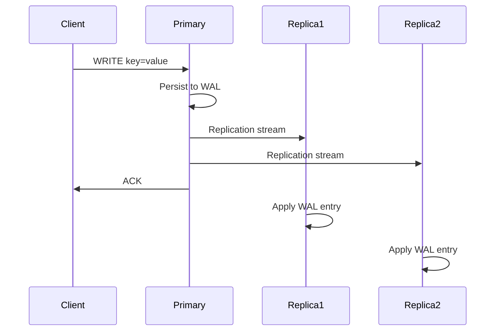
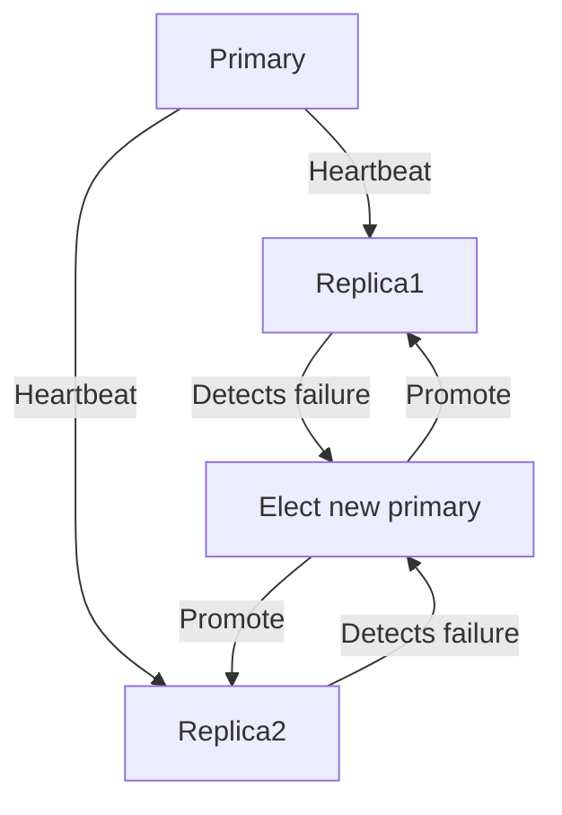

<!-- Generated by Groq via GitHub Actions -->
<!-- Topic ID: T118 -->
<!-- Category: Distributed Systems -->
<!-- Generated at UTC: 2026-10-21T18:10:05.024166+00:00 -->

# Replication strategies

## 1. What problem does this solve?

- **Problem**: A single database instance becomes a single point of failure and a bottleneck for read/write traffic. If the node crashes or becomes overloaded, the whole service can go down or become slow.
- **Why it matters**: Modern web services must stay online 24/7, serve millions of requests per day, and provide low latency. Users expect instant responses; downtime or slow queries hurt revenue and reputation.
- **What happens if not used**:  
  - *Availability*: A crash takes the whole system offline.  
  - *Scalability*: Reads are limited to one node; writes must be serialized.  
  - *Consistency*: With a single node, you can’t guarantee data is replicated across regions or recover from partial failures.
- **Real‑world appearance**:  
  - **PostgreSQL** with streaming replication for HA.  
  - **MongoDB** replica sets for read scaling.  
  - **Redis** Sentinel or Cluster for high‑availability caching.  
  - **Kafka** partitions replicated across brokers for fault tolerance.  
  - **Cloud services** (RDS, Cloud Spanner, DynamoDB) expose replication as a core feature.

## 2. Mental model

**Analogy**: Think of a library that keeps a copy of every book in three branches. If one branch closes, the other two still have the books. Readers can go to any branch, and the library can keep adding new editions to all branches simultaneously.

**Engineering model**:  
- **Primary (leader)**: The source of truth for writes.  
- **Secondary (followers)**: Read‑only replicas that receive updates from the primary.  
- **Replication**: The process of copying changes from primary to secondaries, either synchronously (blocking) or asynchronously (non‑blocking).  
- **Quorum**: A subset of nodes that must agree for a transaction to commit, ensuring consistency across replicas.

## 3. Deep explanation

### Internals

| Component | Role |
|-----------|------|
| **Write log / WAL** | Stores every change in order; used to replay on replicas. |
| **Replication stream** | Network channel (e.g., PostgreSQL’s `pgoutput`, MongoDB’s oplog). |
| **Apply thread** | On each replica, a worker reads the stream and applies changes. |
| **Heartbeat / liveness** | Detects node failures and triggers failover. |

### Important terminology

- **Synchronous replication**: The primary waits for at least one replica to acknowledge the write before returning success. Guarantees *strong consistency* but adds latency.
- **Asynchronous replication**: The primary returns immediately; replicas catch up later. Offers *high performance* but risks *eventual consistency*.
- **Multi‑master (multi‑primary)**: Multiple nodes can accept writes; changes are merged. Useful for low‑latency writes across regions but introduces *conflict resolution* complexity.
- **Quorum**: Minimum number of nodes that must agree on a write or read. E.g., in Raft, a majority of nodes must vote.
- **Read‑through / read‑ahead**: Caching strategies that read from replicas or prefetch data.

### Trade‑offs

| Strategy | Consistency | Latency | Complexity | Use‑case |
|----------|-------------|---------|------------|----------|
| Primary‑secondary (async) | Eventual | Low | Simple | High read traffic |
| Primary‑secondary (sync) | Strong | Medium‑High | Moderate | Financial apps |
| Multi‑master | Conflict‑prone | Low | High | Global e‑commerce |
| Quorum (Raft/Etcd) | Strong | Medium | High | Distributed config |

### Failure modes

- **Network partition**: Some replicas lose connectivity; writes may be blocked (sync) or diverge (async).
- **Primary crash**: Need automatic failover; otherwise, writes stall.
- **Replica lag**: If a replica falls behind, reads may return stale data.
- **Split brain**: Two nodes think they are primary; leads to data divergence.

### Limitations

- **Write amplification**: Replicating every change increases I/O.
- **Consistency gaps**: Async replication can lead to stale reads.
- **Operational overhead**: Monitoring replication lag, handling failover, and ensuring data integrity.

### Where it fits

- **Database layer**: Replication is a core feature of RDBMS, NoSQL, and in‑memory stores.
- **Cache layer**: Redis Cluster replicates shards for HA.
- **Message broker**: Kafka replicates partitions for durability.
- **Service mesh**: Consistency guarantees can be enforced at the application level.

### Interaction with related concepts

- **Sharding**: Partitioning data across nodes; replication can be applied per shard.
- **Caching**: Replicas can double as cache nodes.
- **CI/CD**: Deployment pipelines must handle rolling updates without breaking replication.
- **Observability**: Metrics like `replication_lag` are critical.

## 4. How it works

### Primary‑secondary asynchronous replication flow



### Failover process



## 5. Practical implementation

Below is a minimal Node.js example using **PostgreSQL** with `pg` and `pg-promise` to illustrate asynchronous replication and read scaling.

```ts
// db.ts
import { Pool } from 'pg';

// Primary pool (writes)
export const primaryPool = new Pool({
  connectionString: process.env.PG_PRIMARY_URL,
});

// Replica pool (reads)
export const replicaPool = new Pool({
  connectionString: process.env.PG_REPLICA_URL,
});
```

```ts
// write.ts
import { primaryPool } from './db';

export async function createUser(name: string, email: string) {
  const client = await primaryPool.connect();
  try {
    await client.query('BEGIN');
    const res = await client.query(
      'INSERT INTO users(name, email) VALUES($1, $2) RETURNING id',
      [name, email]
    );
    await client.query('COMMIT');
    return res.rows[0].id;
  } catch (e) {
    await client.query('ROLLBACK');
    throw e;
  } finally {
    client.release();
  }
}
```

```ts
// read.ts
import { replicaPool } from './db';

export async function getUser(id: number) {
  const res = await replicaPool.query(
    'SELECT id, name, email FROM users WHERE id = $1',
    [id]
  );
  return res.rows[0];
}
```

**Key points**

- Writes go to `primaryPool`; reads go to `replicaPool`.  
- The primary writes to the WAL; the replica streams and applies changes.  
- If the primary fails, you can promote a replica (e.g., using `pg_basebackup` + `pg_ctl promote`).  

### Redis Sentinel example

```ts
// redis.ts
import { createClient } from 'redis';

export const redisClient = createClient({
  url: process.env.REDIS_SENTINEL_URL, // e.g., redis://sentinel:26379
  // Sentinel options
  sentinel: [
    { host: 'sentinel1', port: 26379 },
    { host: 'sentinel2', port: 26379 },
    { host: 'sentinel3', port: 26379 },
  ],
  name: 'mymaster',
});

redisClient.on('error', console.error);
await redisClient.connect();
```

## 6. Production considerations

| Concern | How replication affects it | Mitigation |
|---------|---------------------------|------------|
| **Scalability** | Replicas increase read capacity. | Use read‑replica pools, auto‑scaling. |
| **Reliability** | Failover reduces downtime. | Health checks, automated failover scripts. |
| **Security** | Replicas may expose data. | Encrypt traffic, restrict network access. |
| **Observability** | Need metrics on lag, replication health. | Prometheus exporters, Grafana dashboards. |
| **Performance** | Async replication adds I/O; sync adds latency. | Tune WAL settings, use SSDs, adjust `max_wal_senders`. |
| **Error handling** | Write failures on primary propagate to replicas. | Retry logic, dead‑letter queues. |
| **Resource usage** | Replicas consume CPU/memory. | Right‑size instances, use spot instances for read replicas. |
| **Operational concerns** | Backup, patching, schema migrations. | Use tools like Flyway, Liquibase, or `pg_dump`. |
| **Failure recovery** | Lag can lead to stale reads. | Monitor `pg_stat_replication`, alert on lag > threshold. |
| **Deployment** | Rolling updates must not break replication. | Deploy to replicas first, then promote. |

## 7. Common mistakes

| Mistake | Why it’s bad |
|---------|--------------|
| **Assuming async replication is “good enough” for all writes** | Financial or inventory updates may require strong consistency. |
| **Not monitoring replication lag** | Stale reads can lead to incorrect business logic. |
| **Using the same connection pool for reads and writes** | Reads can block writes if the pool is saturated. |
| **Ignoring network partition scenarios** | Split brain can corrupt data. |
| **Failing to test failover** | Deployment may break if the primary goes down. |
| **Hard‑coding replica addresses** | Makes scaling and zero‑downtime deployments hard. |
| **Over‑replicating without need** | Extra replicas waste resources. |
| **Not handling schema changes on replicas** | Schema drift leads to query failures. |

## 8. Senior engineer perspective

### Architecture decisions

- **Replication mode**: Choose sync vs async based on SLA.  
- **Quorum size**: For Raft‑based systems, decide majority vs all.  
- **Geographic placement**: Place replicas in different AZs/regions for latency and disaster recovery.  
- **Failover strategy**: Manual vs automated (e.g., Patroni, Stolon).  
- **Backup strategy**: Point‑in‑time recovery vs full snapshots.

### Trade‑offs

- **Latency vs consistency**: Sync replication hurts latency; async may lead to stale reads.  
- **Cost vs availability**: More replicas increase cost but improve uptime.  
- **Operational complexity**: Multi‑master systems require conflict resolution logic.

### Bottlenecks

- **Write amplification**: Large WAL traffic can saturate network.  
- **Replica lag**: High write load can cause lag, impacting read freshness.  
- **Network partitions**: Can split the cluster.

### Failure scenarios

- **Primary crash**: Need rapid promotion.  
- **Network partition**: Detect and resolve split brain.  
- **Replica failure**: Rebuild from backup or promote another replica.

### Monitoring

- **Replication lag** (`pg_stat_replication` for Postgres).  
- **Health checks** (heartbeat, `pg_isready`).  
- **Metrics**: `replication_lag_seconds`, `write_latency_ms`.  
- **Alerting**: Trigger when lag > X seconds or when primary becomes unreachable.

### Cost/performance

- **SSD vs HDD**: Replication writes benefit from SSD.  
- **Instance sizing**: Under‑provisioned replicas cause lag.  
- **Network bandwidth**: Replication traffic can be significant.

### When NOT to use

- **Low‑write, high‑read workloads**: Simple read replicas suffice.  
- **Strict consistency required**: Use sync replication or a single node with high availability.  
- **Very small services**: The overhead may outweigh benefits.

## 9. Interview questions

1. **Beginner**: *What is the difference between synchronous and asynchronous replication?*  
   *Answer*: Sync waits for a replica to acknowledge before committing; async does not. Sync guarantees strong consistency but adds latency; async offers lower latency but eventual consistency.

2. **Beginner**: *Why do we need a write-ahead log (WAL) in replication?*  
   *Answer*: WAL records every change in order so replicas can replay the same sequence, ensuring data consistency across nodes.

3. **Senior**: *Explain how a Raft cluster achieves consensus and why a majority quorum is required.*  
   *Answer*: Raft elects a leader; all state changes must be replicated to a majority of followers before committing. Majority ensures that at least one node in any split brain scenario holds the latest state, preventing divergence.

4. **Senior**: *Describe a scenario where multi‑master replication could lead to data conflicts and how you would resolve them.*  
   *Answer*: Two nodes concurrently update the same row with different values. Conflict resolution could be last‑write‑wins, application‑level merge, or using vector clocks. The choice depends on business logic and consistency requirements.

5. **Scenario/Debugging**: *Your application reads stale data from a replica after a write. What steps would you take to diagnose and fix the issue?*  
   *Answer*:  
   - Check replication lag metrics (`pg_stat_replication`).  
   - Verify network connectivity between primary and replica.  
   - Inspect WAL shipping logs for errors.  
   - Ensure replica is not paused (`pg_basebackup` or `pg_ctl stop`).  
   - If lag is high, consider scaling the replica or moving to synchronous replication for critical reads.

## 10. Hands‑on task

**Task**: Add a read‑through cache layer using Redis to a Node.js service that currently writes to PostgreSQL.  
- **Goal**: On a `GET /users/:id` request, first check Redis. If miss, read from Postgres, cache the result, and return.  
- **Requirements**:  
  - Use `ioredis` for Redis connection.  
  - Cache key format: `user:{id}`.  
  - Set TTL to 60 seconds.  
  - Invalidate cache on `PUT /users/:id` (update).  
- **Deliverable**: A `cache.ts` module and updated route handlers in `users.ts`.  
- **Evaluation**: Correctness, error handling, and performance (use `console.time` to show cache hit vs miss).

## 11. Quick revision

- Replication copies data from a primary to one or more secondaries.  
- **Synchronous**: strong consistency, higher latency.  
- **Asynchronous**: eventual consistency, lower latency.  
- **Multi‑master**: low latency writes across regions, conflict resolution needed.  
- **Quorum**: majority of nodes must agree for a commit.  
- **WAL**: ensures ordered replay on replicas.  
- **Replication lag**: key metric; high lag = stale reads.  
- **Failover**: automatic promotion of a replica when primary fails.  
- **Observability**: monitor `replication_lag`, health checks, and heartbeat.  
- **Security**: encrypt replication traffic, restrict network access.  
- **Common pitfalls**: ignoring lag, using async for critical writes, hard‑coding replica addresses.  
- **Senior focus**: cost vs consistency trade‑offs, monitoring, operational automation.

## 12. References

- PostgreSQL Streaming Replication: https://www.postgresql.org/docs/current/warm-standby.html  
- Redis Sentinel: https://redis.io/docs/management/sentinel/  
- Raft Consensus Algorithm: https://raft.github.io/  
- Kafka Replication: https://kafka.apache.org/documentation/#replication  
- Patroni for Postgres HA: https://patroni.readthedocs.io/en/latest/  
- Etcd Consistency Model: https://etcd.io/docs/v3.5/op-guide/consistency/  

---
