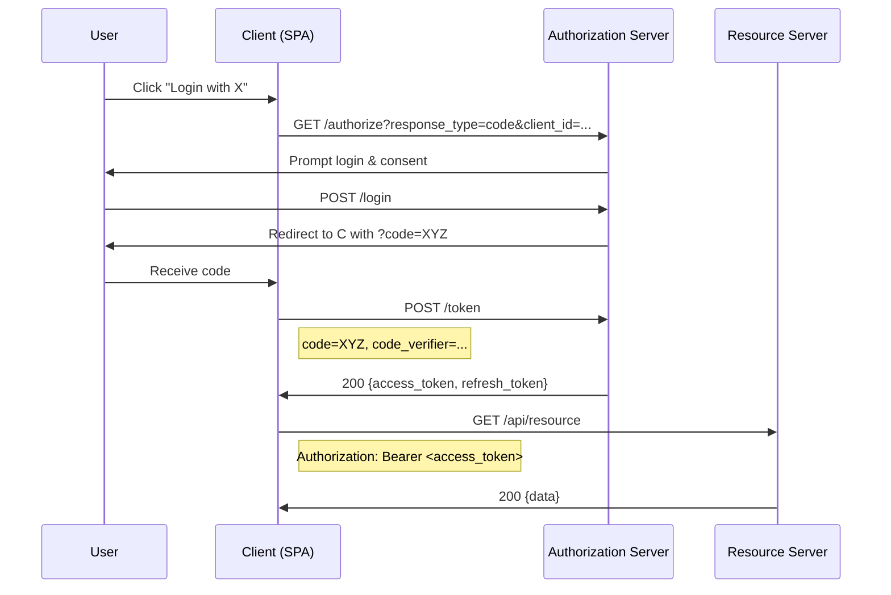

<!-- Generated by Groq via GitHub Actions -->
<!-- Topic ID: T119 -->
<!-- Category: Backend Security -->
<!-- Generated at UTC: 2026-10-22T06:16:17.328245+00:00 -->

# OAuth 2.0

## 1. What problem does this solve?

| Problem | Why it matters | Consequence if ignored | Real‑world appearance |
|---------|----------------|------------------------|-----------------------|
| **Credential leakage** – users often reuse passwords or share them with third‑party apps. | Exposes user accounts to compromise and data breaches. | Unauthorized access, data loss, regulatory fines. | Social login (Google, GitHub), SaaS integrations. |
| **Fine‑grained access control** – an app may need only read access to a user’s calendar, not full profile data. | Improves security by limiting what an attacker can do if a token is stolen. | Over‑privileged access, potential for mass data exfiltration. | API gateways, microservice boundaries. |
| **Stateless authentication** – scaling horizontally without session stores. | Enables load‑balanced, stateless services that can be deployed in containers or serverless. | Need for shared session stores, increased latency. | Cloud‑native APIs, serverless functions. |
| **Delegated authorization** – a user authorizes a third‑party app to act on their behalf without giving the app their password. | Enables OAuth‑based “Login with X” flows and API access. | Users must trust each app with their credentials. | OAuth providers (Google, Microsoft), GitHub Apps. |
| **Token revocation & expiration** – ability to revoke access when a user logs out or changes a password. | Keeps compromised tokens from being reused. | Stale tokens remain valid, leading to silent data leaks. | Revocation endpoints, introspection. |

---

## 2. Mental model

### Analogy – The Library Card

| Library | Library Card | Books | Borrowing |
|---------|--------------|-------|-----------|
| Resource Owner (you) | Access Token | Resource Server (books) | Authorization Server (librarian) |
| The card is valid for a limited time and can be returned (revoked). | You don’t hand the card to each book vendor. | You can read books without giving your password to each vendor. | The librarian checks the card before lending a book. |

**Takeaway**: An *access token* is a temporary, scoped credential that lets a *client* (app) act on behalf of a *resource owner* (user) at a *resource server* (API), without exposing the owner’s password.

### Engineering model

```
+----------------+          +----------------+          +----------------+
| Resource Owner |          |  Authorization |          |  Resource      |
| (User)         |          |  Server (Auth) |          |  Server (API)  |
+----------------+          +----------------+          +----------------+
        |                            |                           |
        | 1. Request Authorization   |                           |
        |---------------------------->|                           |
        |                            | 2. Issue Authorization    |
        |                            |    Code (or Token)        |
        |                            |<---------------------------|
        | 3. Exchange Code for Token |                           |
        |<----------------------------|                           |
        |                            | 4. Issue Access Token     |
        |                            |<---------------------------|
        | 5. Call API with Token     |                           |
        |---------------------------->|                           |
        |                            | 6. Validate Token         |
        |                            |<---------------------------|
        |                            | 7. Return Resource        |
```

---

## 3. Deep explanation

### Internals

1. **Authorization Server** – issues tokens, authenticates users, stores client registrations.
2. **Resource Server** – validates tokens and serves protected resources.
3. **Client** – application that requests tokens and calls APIs.
4. **Resource Owner** – end user who authorizes the client.

### Key terminology

| Term | Meaning |
|------|---------|
| **Client** | App requesting access (confidential or public). |
| **Client ID / Secret** | Credentials for confidential clients. |
| **Authorization Code** | Short‑lived code exchanged for tokens. |
| **Access Token** | Grants access to resources. |
| **Refresh Token** | Long‑lived token to obtain new access tokens. |
| **Scope** | Permissions requested (e.g., `read:user`). |
| **Redirect URI** | Where the auth server sends the code. |
| **PKCE** | Proof Key for Code Exchange – mitigates code interception. |
| **Introspection** | Endpoint to check token validity. |
| **ID Token** | OIDC extension for identity information. |

### Trade‑offs

| Aspect | Authorization Code (PKCE) | Implicit | Client Credentials |
|--------|---------------------------|----------|--------------------|
| **Security** | Highest – code is short‑lived, PKCE protects mobile/SPAs. | Lower – token in URL, risk of leakage. | Good for server‑to‑server, no user context. |
| **Complexity** | Requires redirect flow, server endpoint. | Simpler, but less secure. | Simple token request. |
| **Token type** | JWT or opaque. | JWT. | JWT or opaque. |
| **Revocation** | Refresh token revocation, introspection. | Harder – token in browser. | Revocation via introspection or blacklist. |

### Failure modes

- **Token leakage** – stored in localStorage, intercepted over insecure channels.
- **Replay attacks** – stolen code reused; mitigated by PKCE and one‑time codes.
- **CSRF** – redirect URI not validated.
- **Refresh token abuse** – stolen refresh token used to generate many access tokens.
- **Clock skew** – token expiration mis‑validated.

### Limitations

- **Opaque tokens** require introspection, adding latency.
- **JWT revocation** is non‑trivial; requires blacklist or short lifetimes.
- **PKCE** not supported by all legacy clients.
- **Scope granularity** limited by provider implementation.

### Where it fits

- **API Gateways** – validate tokens before routing.
- **Microservices** – each service validates tokens locally (JWT) or via introspection.
- **Mobile & SPA** – use Authorization Code with PKCE.
- **Server‑to‑Server** – Client Credentials flow.

### Interaction with related concepts

- **JWT** – common token format; self‑contained, signed.
- **OAuth 2.0 vs OpenID Connect** – OIDC adds identity layer (ID token).
- **Session management** – tokens replace server‑side sessions.
- **Redis** – token revocation lists, rate limiting.
- **Kafka** – event‑driven revocation notifications.

---

## 4. How it works – Authorization Code with PKCE



**Key points**

1. **PKCE** – client generates a `code_verifier` and `code_challenge`; server verifies challenge during token exchange.
2. **Redirect URI** – must be registered and validated to prevent open redirects.
3. **Access token** – short‑lived (e.g., 15 min) JWT signed by auth server.
4. **Refresh token** – long‑lived (e.g., 30 days) stored securely; used to obtain new access tokens.

---

## 5. Practical implementation

### 5.1 Authorization Server (Node.js + Express + `oauth2orize`)

```ts
// auth-server.ts
import express from 'express';
import session from 'express-session';
import bodyParser from 'body-parser';
import { createServer, AuthorizationServer, GrantType } from 'oauth2orize';
import { generateToken, verifyUser, findClient } from './utils';
import jwt from 'jsonwebtoken';
import Redis from 'ioredis';

const redis = new Redis(); // token revocation store

const app = express();
app.use(bodyParser.urlencoded({ extended: false }));
app.use(session({ secret: 's3cr3t', resave: false, saveUninitialized: false }));

const server = new AuthorizationServer();

server.grant(GrantType.AuthorizationCode((client, redirectURI, user, ares, done) => {
  const code = generateToken(32);
  // Store code in Redis with short TTL
  redis.set(`auth_code:${code}`, JSON.stringify({ clientId: client.id, redirectURI, userId: user.id }), 'EX', 300);
  return done(null, code);
}));

server.exchange(GrantType.AuthorizationCode((client, code, redirectURI, done) => {
  redis.get(`auth_code:${code}`, (err, data) => {
    if (err || !data) return done(null, false);
    const { clientId, redirectURI: storedURI, userId } = JSON.parse(data);
    if (clientId !== client.id || storedURI !== redirectURI) return done(null, false);
    // Issue JWT access token
    const accessToken = jwt.sign({ sub: userId, aud: client.id }, 'jwt-secret', { expiresIn: '15m' });
    // Issue opaque refresh token
    const refreshToken = generateToken(64);
    redis.set(`refresh_token:${refreshToken}`, JSON.stringify({ clientId, userId }), 'EX', 60 * 60 * 24 * 30);
    return done(null, accessToken, refreshToken, { expires_in: 900 });
  });
}));

app.get('/authorize', server.authorize((req, clientID, redirectURI, done) => {
  const client = findClient(clientID);
  if (!client) return done(null, false);
  // In real app: render login page
  return done(null, client, redirectURI);
}));

app.post('/authorize', server.decision());

app.post('/token', server.token(), server.errorHandler());

app.listen(3000, () => console.log('Auth server listening on 3000'));
```

> **Important lines**  
> *`redis.set(..., 'EX', 300)`* – short TTL for auth codes.  
> *`jwt.sign(..., { expiresIn: '15m' })`* – short‑lived access token.  
> *`redis.set(..., 'EX', 60 * 60 * 24 * 30)`* – 30‑day refresh token.

### 5.2 Resource Server (Node.js + Express + `express-jwt`)

```ts
// resource-server.ts
import express from 'express';
import jwt from 'express-jwt';
import jwksRsa from 'jwks-rsa';
import Redis from 'ioredis';

const redis = new Redis();

const app = express();

const checkJwt = jwt({
  secret: jwksRsa.expressJwtSecret({
    cache: true,
    rateLimit: true,
    jwksRequestsPerMinute: 5,
    jwksUri: 'http://localhost:3000/.well-known/jwks.json'
  }),
  audience: 'client-id',
  issuer: 'http://localhost:3000',
  algorithms: ['RS256']
});

app.get('/api/user', checkJwt, async (req, res) => {
  // Token is valid; payload available in req.user
  res.json({ userId: req.user.sub, message: 'Protected data' });
});

app.listen(4000, () => console.log('Resource server listening on 4000'));
```

> **Important lines**  
> *`jwksUri`* – fetches signing keys from auth server.  
> *`audience`* – ensures token is intended for this API.  

### 5.3 Client (Next.js + `next-auth`)

```ts
// pages/api/auth/[...nextauth].ts
import NextAuth from 'next-auth';
import Providers from 'next-auth/providers';

export default NextAuth({
  providers: [
    Providers.OAuth({
      id: 'custom',
      name: 'Custom OAuth',
      type: 'oauth',
      version: '2.0',
      scope: 'read:user',
      params: { grant_type: 'authorization_code' },
      accessTokenUrl: 'http://localhost:3000/token',
      authorizationUrl: 'http://localhost:3000/authorize?response_type=code',
      profileUrl: 'http://localhost:3000/userinfo',
      clientId: 'client-id',
      clientSecret: 'client-secret',
      // PKCE is automatically handled by next-auth
    })
  ],
  callbacks: {
    async jwt(token, user) {
      // token contains access_token, refresh_token
      return token;
    }
  }
});
```

---

## 6. Production considerations

| Concern | What to do |
|---------|------------|
| **Scalability** | Use stateless JWTs; cache public keys; avoid DB lookups for each request. |
| **Reliability** | Deploy auth server behind a load balancer; use sticky sessions only for auth code flow. |
| **Security** | Enforce HTTPS everywhere; use PKCE for public clients; rotate signing keys; short access token lifetimes; store refresh tokens in secure HTTP‑Only cookies or encrypted storage. |
| **Observability** | Log token issuance, revocation events; expose metrics (`oauth_tokens_issued`, `oauth_tokens_revoked`). |
| **Performance** | Prefer JWT over introspection; if introspection needed, cache results. |
| **Error handling** | Return RFC 6749 error codes (`invalid_grant`, `invalid_client`). |
| **Resource usage** | Keep token payload minimal; avoid storing large objects in JWT. |
| **Operational** | Automate key rotation; monitor Redis memory for revocation lists; set up alerts for high token revocation rates. |
| **Failure recovery** | Implement graceful fallback: if auth server down, serve cached tokens for a short grace period. |
| **Deployment** | Containerize with Docker; use environment variables for secrets; separate auth and resource servers for isolation. |

---

## 7. Common mistakes

| Mistake | Why it’s problematic |
|---------|----------------------|
| **Using Implicit flow for SPAs** | Tokens are exposed in URL fragment; vulnerable to XSS and leakage. |
| **Storing tokens in localStorage** | XSS can read them; use HTTP‑Only cookies instead. |
| **Not using PKCE for mobile/SPAs** | Authorization code can be intercepted and exchanged. |
| **Long‑lived access tokens** | Increases window for abuse if stolen. |
| **Ignoring scope validation** | Client may access resources beyond its intended permissions. |
| **Not revoking refresh tokens** | Stale tokens remain valid; attacker can keep generating access tokens. |
| **Using opaque tokens without introspection** | Resource server cannot validate tokens without hitting auth server, causing latency. |

---

## 8. Senior engineer perspective

### Architecture decisions

- **JWT vs opaque**: JWT gives stateless validation but hard to revoke; opaque + introspection allows revocation but adds network hop.
- **Key management**: rotate signing keys, expose JWKS endpoint, use asymmetric keys (RS256) for easier key rotation.
- **Token revocation strategy**: Redis blacklist, short access token TTL + refresh token revocation, or event‑driven revocation via Kafka.
- **Distributed auth**: Deploy auth server in multiple zones; use sticky sessions only for the short auth code exchange.

### Trade‑offs

| Decision | Pros | Cons |
|----------|------|------|
| **JWT** | Stateless, fast validation | Hard to revoke, larger payload |
| **Opaque + introspection** | Fine‑grained revocation | Extra latency, single point of failure |
| **Short access tokens + refresh** | Limits damage | Requires refresh token handling |
| **PKCE** | Mitigates interception | Adds complexity to client |

### Bottlenecks

- **Auth server DB**: client lookup, user authentication, token storage.
- **Redis revocation list**: memory usage grows with number of revoked tokens.
- **JWT signing**: CPU load for RSA signing; consider hardware acceleration.

### Failure scenarios

- **Token theft**: Mitigate with short lifetimes, token binding, device fingerprinting.
- **Revocation lag**: Use event streams to propagate revocation quickly.
- **Clock skew**: Synchronize NTP; validate `iat` and `exp` carefully.

### Monitoring

- **Token metrics**: issuance rate, revocation rate, average token age.
- **Auth server health**: response times, error rates.
- **Redis health**: memory usage, eviction count.

### Cost/performance

- **JWT**: minimal DB hits → lower cost, but larger payload → higher bandwidth.
- **Redis**: memory cost; use LRU eviction for short‑lived tokens.
- **Kafka**: high throughput for revocation events; cost of running brokers.

### When NOT to use OAuth 2.0

- **Internal services with mutual TLS**: simpler to use mTLS and service principals.
- **Single‑tenant, low‑traffic apps**: a simple session cookie may suffice.
- **Highly regulated environments**: consider custom identity solutions with stricter controls.

---

## 9. Interview questions

1. **Beginner** – *What is the difference between authentication and authorization?*  
   *Answer:* Authentication verifies who you are; authorization decides what you can do.

2. **Beginner** – *Explain the Authorization Code flow in OAuth 2.0.*  
   *Answer:* User authenticates at auth server → receives code → client exchanges code for access token → uses token to call APIs.

3. **Senior** – *How would you design a token revocation strategy for a distributed system with millions of users?*  
   *Answer:* Use short‑lived JWTs + refresh tokens stored in Redis; revoke by adding token ID to blacklist; propagate revocation via Kafka; cache introspection results.

4. **Senior** – *Compare JWT access tokens and opaque tokens in terms of scalability and revocation.*  
   *Answer:* JWTs are stateless → scale horizontally; revocation hard → rely on short lifetimes or blacklist. Opaque tokens require introspection → extra latency but allow immediate revocation.

5. **Scenario** – *A client receives a 401 after refreshing the token. What could be wrong?*  
   *Answer:* Refresh token expired or revoked; client sent wrong client credentials; token audience mismatch; clock skew causing `exp` check to fail.

---

## 10. Hands‑on task

**Build a minimal OAuth 2.0 Authorization Server**

1. Create a new Node.js project with `express`, `oauth2orize`, `jsonwebtoken`, and `ioredis`.
2. Register a client with a client ID and secret.
3. Implement the Authorization Code flow with PKCE.
4. Issue JWT access tokens and opaque refresh tokens.
5. Store refresh tokens in Redis with a 30‑day TTL.
6. Add a protected `/api/profile` endpoint that validates the access token.
7. Test the flow using `curl` or Postman:  
   - Request `/authorize` → login → get code → exchange for tokens → call `/api/profile`.

**Deliverables**

- `auth-server.ts` (authorization server)
- `resource-server.ts` (resource server)
- `README.md` with setup and test instructions

---

## 11. Quick revision

- OAuth 2.0 separates **authorization** (granting access) from **authentication** (verifying identity).
- **Authorization Server** issues tokens; **Resource Server** validates them.
- **Access Token** – short‑lived, scoped credential.
- **Refresh Token** – long‑lived, used to obtain new access tokens.
- **PKCE** protects public clients from code interception.
- **JWT** tokens are stateless; opaque tokens require introspection.
- **Revocation**: blacklist in Redis, short lifetimes, or event streams.
- **Scopes** limit permissions; validate on each request.
- **HTTPS** mandatory; never expose tokens in URLs or localStorage.
- **Error codes** follow RFC 6749 (`invalid_grant`, `invalid_client`, etc.).
- **Monitoring**: track token issuance, revocation, and auth server health.
- **Key rotation**: expose JWKS endpoint; rotate keys without downtime.

---

## 12. References

- RFC 6749 – OAuth 2.0 Authorization Framework: https://datatracker.ietf.org/doc/html/rfc6749  
- RFC 6750 – OAuth 2.0 Bearer Token Usage: https://datatracker.ietf.org/doc/html/rfc6750  
- RFC 7519 – JSON Web Token (JWT): https://datatracker.ietf.org/doc/html/rfc7519  
- OpenID Connect Core 1.0: https://openid.net/specs/openid-connect-core-1_0.html  
- Node.js `oauth2orize` documentation: https://github.com/jaredhanson/oauth2orize  
- `express-jwt` middleware: https://github.com/auth0/express-jwt  
- `jwks-rsa` library: https://github.com/auth0/node-jwks-rsa  
- Redis official docs: https://redis.io/docs/  
- NextAuth.js OAuth provider: https://next-auth.js.org/providers/oauth  

---
