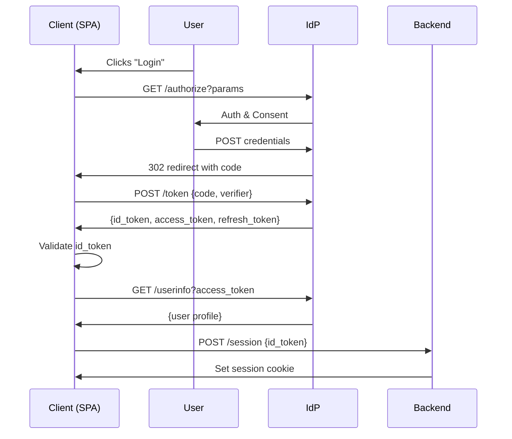

<!-- Generated by Groq via GitHub Actions -->
<!-- Topic ID: T120 -->
<!-- Category: Backend Security -->
<!-- Generated at UTC: 2026-10-22T06:16:17.328245+00:00 -->

# OpenID Connect

## 1. What problem does this solve?

| What | Why it matters | Consequence of not using it | Real‑world appearance |
|------|----------------|-----------------------------|-----------------------|
| **User authentication** – proving *who* a user is. | Modern apps need to know the identity of the caller to personalize data, enforce access control, and provide audit trails. | Without a reliable identity layer you must roll your own login system, which is error‑prone, hard to maintain, and often insecure. | Single‑sign‑on (SSO) portals, SaaS dashboards, mobile apps that delegate login to Google/Facebook/Apple. |
| **Delegated identity** – letting a trusted provider (Google, Azure AD, Okta) issue tokens. | Offloads credential storage, password management, MFA, and compliance to a specialist. | You must store passwords, implement MFA, and keep up with security patches. | OAuth 2.0 + OpenID Connect used by most modern web/mobile apps. |
| **Standardized token format** – JWT ID tokens with claims. | Enables stateless verification, easy integration across services. | You need custom token formats, which break interoperability. | REST APIs that validate JWTs, microservices that trust the same issuer. |

OpenID Connect (OIDC) is an authentication layer built on top of OAuth 2.0. It adds an **ID token** that contains identity claims and a **UserInfo endpoint** for additional profile data, while reusing OAuth’s authorization code flow for secure token exchange.

---

## 2. Mental model

### Analogy  
Think of **OIDC** as a *passport* that you receive from a government (the Identity Provider).  
- The **passport** (ID token) proves your identity to anyone who checks it.  
- The **visa** (access token) allows you to enter specific countries (APIs).  
- The **passport office** (Discovery endpoint) tells you where to get the passport and how to verify it.

### Engineering model  
1. **Client** (your app) asks the **Identity Provider (IdP)** for a passport.  
2. The IdP issues an **ID token** (signed JWT) and an **access token**.  
3. The client presents the ID token to your backend to prove the user’s identity.  
4. The backend can optionally call the **UserInfo endpoint** to fetch fresh profile data.  

---

## 3. Deep explanation

### Internals
| Concept | Description |
|---------|-------------|
| **ID Token** | A signed JWT containing claims such as `sub` (subject), `iss` (issuer), `aud` (audience), `exp`, `iat`, and optional profile claims (`email`, `name`). |
| **Discovery** (`/.well-known/openid-configuration`) | JSON document exposing IdP endpoints, supported scopes, response types, and JWKS URI. |
| **JWKS** (JSON Web Key Set) | Public keys used to verify ID token signatures. |
| **Scopes** | `openid` (required), plus optional scopes like `profile`, `email`, `offline_access`. |
| **Flows** | Authorization Code (recommended), Implicit, Hybrid, Device Authorization, PKCE (for public clients). |
| **UserInfo** | Optional endpoint that returns additional claims. |

### Important terminology
- **Client** – the application requesting tokens.  
- **Resource Owner** – the end user.  
- **Authorization Server** – the IdP.  
- **Redirect URI** – where the IdP sends the authorization code.  
- **State** – CSRF protection token.  
- **Nonce** – protects against replay attacks in the ID token.  

### Trade‑offs
| Decision | Pros | Cons |
|----------|------|------|
| **Authorization Code + PKCE** | Secure, no client secret needed, works for SPAs and mobile. | Requires redirect flow, slightly more complex. |
| **Implicit** | Simpler, no redirect. | Tokens in URL, vulnerable to leakage, deprecated. |
| **JWT vs opaque tokens** | Stateless verification, no introspection call. | Larger payload, key rotation complexity. |
| **Refresh tokens** | Long‑lived sessions without re‑auth. | Must be stored securely, risk of revocation. |

### Failure modes
- **Token replay** – mitigated by `nonce` and short expiry.  
- **Key rotation** – JWKS cache must be refreshed.  
- **State mismatch** – CSRF attack.  
- **Expired tokens** – client must handle refresh.  
- **Mis‑configured scopes** – missing claims.  

### Limitations
- OIDC is **authentication only**; it does not provide fine‑grained authorization.  
- Requires HTTPS everywhere.  
- Relies on the IdP’s uptime; provider outages can block login.  

### Where it fits
- **Auth layer**: Client → IdP → Backend.  
- **Microservices**: Backend validates ID token locally (JWT) or introspects via `/introspect`.  
- **API Gateway**: Enforces authentication before routing to services.  

### Interaction with related concepts
- **OAuth 2.0** – OIDC extends OAuth by adding the `openid` scope and ID token.  
- **JWT** – ID token is a JWT; libraries for parsing/validating.  
- **Session stores** – Backend may map ID token to a session ID in Redis.  
- **MFA** – IdP handles MFA before issuing tokens.  

---

## 4. How it works

### Authorization Code Flow with PKCE (public client)

1. **Client** generates `code_verifier` and `code_challenge`.  
2. **Client** redirects user to IdP’s `/authorize` with `response_type=code`, `client_id`, `redirect_uri`, `scope=openid profile email`, `state`, `nonce`, `code_challenge`, `code_challenge_method=S256`.  
3. **User** authenticates at IdP, consents.  
4. **IdP** redirects back to `redirect_uri` with `code` and `state`.  
5. **Client** verifies `state`, exchanges `code` + `code_verifier` at IdP’s `/token`.  
6. **IdP** returns `id_token`, `access_token`, `refresh_token`.  
7. **Client** validates `id_token` (signature, `aud`, `iss`, `nonce`, expiry).  
8. **Client** optionally calls `/userinfo` with `access_token` to fetch profile.  
9. **Client** establishes a session (e.g., JWT cookie, Redis session).  



---

## 5. Practical implementation

Below is a minimal **Node.js + Express + TypeScript** example that:

1. Discovers an IdP (Auth0).  
2. Implements the Authorization Code flow with PKCE.  
3. Validates the ID token.  
4. Stores a session in Redis.  

> **Prerequisites**  
> - Node 18+  
> - Redis running locally  
> - Auth0 tenant with a SPA application (client ID, domain)

```ts
// src/server.ts
import express from 'express';
import session from 'express-session';
import connectRedis from 'connect-redis';
import { Issuer, generators, custom } from 'openid-client';
import { createClient } from 'redis';
import crypto from 'crypto';
import dotenv from 'dotenv';

dotenv.config();

const app = express();
const RedisStore = connectRedis(session);
const redisClient = createClient({ url: process.env.REDIS_URL });
await redisClient.connect();

// Session middleware (stores session id in Redis)
app.use(
  session({
    store: new RedisStore({ client: redisClient }),
    secret: process.env.SESSION_SECRET!,
    resave: false,
    saveUninitialized: false,
    cookie: { secure: false, httpOnly: true, maxAge: 60 * 60 * 1000 },
  })
);

// 1️⃣ Discover the IdP
const oidcIssuer = await Issuer.discover(`https://${process.env.AUTH0_DOMAIN}/`);
const client = new oidcIssuer.Client({
  client_id: process.env.AUTH0_CLIENT_ID!,
  // No client_secret for SPA (public client)
  redirect_uris: [`http://localhost:3000/callback`],
  response_types: ['code'],
});

// Helper: generate PKCE pair
function generatePKCE() {
  const verifier = generators.codeVerifier();
  const challenge = generators.codeChallenge(verifier);
  return { verifier, challenge };
}

// 2️⃣ Login route
app.get('/login', (req, res) => {
  const { verifier, challenge } = generatePKCE();
  // Store verifier in session for later verification
  req.session.codeVerifier = verifier;
  const state = crypto.randomBytes(16).toString('hex');
  req.session.state = state;
  const nonce = crypto.randomBytes(16).toString('hex');
  req.session.nonce = nonce;

  const authUrl = client.authorizationUrl({
    scope: 'openid profile email',
    response_mode: 'query',
    state,
    nonce,
    code_challenge: challenge,
    code_challenge_method: 'S256',
  });
  res.redirect(authUrl);
});

// 3️⃣ Callback route
app.get('/callback', async (req, res) => {
  const params = client.callbackParams(req);
  const { state, code } = params;

  // Verify state
  if (state !== req.session.state) {
    return res.status(400).send('Invalid state');
  }

  try {
    const tokenSet = await client.callback(
      'http://localhost:3000/callback',
      params,
      {
        code_verifier: req.session.codeVerifier,
        nonce: req.session.nonce,
      }
    );

    // tokenSet.id_token is a JWT
    const claims = tokenSet.claims(); // verifies signature, aud, iss, nonce, exp

    // Store user info in session
    req.session.user = {
      sub: claims.sub,
      email: claims.email,
      name: claims.name,
    };

    res.redirect('/');
  } catch (err) {
    console.error(err);
    res.status(500).send('Authentication failed');
  }
});

// 4️⃣ Protected route
app.get('/', (req, res) => {
  if (!req.session.user) {
    return res.redirect('/login');
  }
  res.send(`Hello ${req.session.user.name}`);
});

app.listen(3000, () => console.log('Server listening on http://localhost:3000'));
```

**Key lines explained**

- `client.authorizationUrl(...)` – builds the IdP URL with PKCE parameters.  
- `client.callback(...)` – exchanges the code for tokens and validates the ID token.  
- `tokenSet.claims()` – verifies signature, `aud`, `iss`, `nonce`, and expiration.  
- Session stored in Redis keeps the backend stateless across instances.  

> **Tip**: In production, enable `secure: true` on cookies and serve over HTTPS.

---

## 6. Production considerations

| Concern | What to do | Why |
|---------|------------|-----|
| **Scalability** | Stateless JWT validation; cache JWKS in memory; use Redis for session store. | Avoid per‑request DB lookups. |
| **Reliability** | Fallback to local JWKS cache if IdP JWKS endpoint is down. | Prevent single point of failure. |
| **Security** | Enforce HTTPS, use PKCE for public clients, validate `state` & `nonce`, rotate client secrets, use short‑lived access tokens, store refresh tokens encrypted. | Mitigate token leakage, replay, CSRF. |
| **Observability** | Log auth events, token issuance, revocation; expose metrics (login success/failure, token refresh rate). | Detect abuse, performance bottlenecks. |
| **Performance** | Cache JWKS, use fast JWT libraries, avoid synchronous crypto calls in request path. | Reduce latency. |
| **Error handling** | Graceful redirects on auth errors, clear error messages, retry logic for JWKS fetch. | Better UX, resilience. |
| **Resource usage** | Keep session payload small, purge expired sessions, use Redis eviction policies. | Control memory footprint. |
| **Operational concerns** | Automate key rotation, monitor IdP health, set up alerting for failed logins. | Maintain trust. |
| **Failure recovery** | Provide fallback login (e.g., local auth) if IdP is unreachable. | Avoid service outage. |
| **Deployment** | Store IdP URLs, client IDs, secrets in environment variables or secret manager. | Avoid hard‑coding credentials. |

---

## 7. Common mistakes

| Mistake | Why it’s bad |
|---------|--------------|
| Using **Implicit flow** in SPAs | Tokens in URL → leaked via referrer, no refresh token support. |
| Storing **ID token** in localStorage | XSS can read it; use HttpOnly cookies or in-memory storage. |
| Ignoring **state** parameter | Susceptible to CSRF attacks. |
| Not validating **ID token signature** | Accepts forged tokens. |
| Using **client secret** in a public client | Secret is exposed; use PKCE instead. |
| Relying on **access token** for identity | Access token may not contain user claims; use ID token. |
| Not handling **token expiration** | Users get “session expired” errors; implement refresh flow. |
| Using **short `nonce`** | Reuse can lead to replay attacks. |
| Not caching **JWKS** | Repeated key fetches add latency. |

---

## 8. Senior engineer perspective

### When used at scale

- **Millions of users** → use a dedicated IdP (Auth0, Okta, Keycloak) or run your own Keycloak cluster.  
- **Microservices** → validate ID token locally; avoid introspection calls to reduce latency.  
- **Hybrid apps** (SPA + server‑side rendering) → share session store (Redis) to keep user state across front‑end and back‑end.  

### Design decisions

| Decision | Trade‑offs |
|----------|------------|
| **JWT vs introspection** | JWT → stateless, faster; introspection → revocation support. |
| **Refresh token rotation** | More secure but requires secure storage and revocation logic. |
| **Session store** | Redis (fast, distributed) vs database (durable). |
| **Key rotation strategy** | Auto‑refresh JWKS vs manual rollout. |
| **IdP choice** | Managed (Auth0) → less ops, higher cost; self‑hosted (Keycloak) → more control, ops overhead. |
| **Multi‑tenant** | Separate clients per tenant vs shared client with tenant claim. |

### Bottlenecks

- **JWKS fetch** – mitigate with in‑memory cache and background refresh.  
- **Token validation** – use optimized libraries (`node-jose`, `jose`).  
- **Database lookups** – avoid per‑request DB hits; embed necessary claims in ID token.  

### Failure scenarios

- **IdP outage** → fallback to local auth or cached tokens.  
- **Key rotation lag** → reject tokens until new key is cached.  
- **Session store failure** → fallback to cookie‑based session (less scalable).  

### Monitoring

- **Auth success/failure rates** – detect brute‑force attacks.  
- **Token revocation events** – audit.  
- **Latency of token validation** – spot performance regressions.  

### Cost/performance

- **Provider fees** – per active user or per authentication.  
- **Compute for validation** – minimal if using JWT; heavier if introspecting.  
- **Network** – token exchange adds round‑trip; consider same‑region IdP.  

### When NOT to use

- **Internal services** that never expose user identity → use service‑to‑service auth (mTLS, JWT without OIDC).  
- **Low‑traffic prototypes** → simple username/password + session cookie may suffice.  

---

## 9. Interview questions

| Level | Question | Answer points |
|-------|----------|---------------|
| **Beginner** | What is the purpose of the `openid` scope in OIDC? | Adds the `id_token` to the response; signals that the client wants authentication. |
| **Beginner** | Why do we use PKCE in public clients? | Prevents authorization code interception; the verifier is never sent over the network. |
| **Senior** | How would you design an OIDC‑based auth system for a SaaS product that needs to support millions of users and multiple tenants? | Use a dedicated IdP (Auth0/Keycloak), separate client per tenant, JWT validation, Redis session store, JWKS caching, key rotation, audit logs. |
| **Senior** | Explain how you would handle IdP key rotation in a production environment. | Cache JWKS, refresh on 401 or 403, fallback to local cache, rotate client secrets, update `jwks_uri` in discovery. |
| **Scenario** | A user reports that after logging in, they see “Invalid state” errors. What could be causing this and how would you debug it? | Possible causes: state mismatch due to session loss, CSRF token missing, concurrent logins, session store failure. Debug: check session persistence, verify `state` round‑trip, inspect cookies, enable logging. |

---

## 10. Hands‑on task

**Implement a secure login flow in a Next.js app using OIDC.**

1. Create a Next.js API route `/api/auth/login` that redirects to the IdP.  
2. Create a callback route `/api/auth/callback` that exchanges the code, validates the ID token, and stores the user in a Redis session.  
3. Protect a page `/dashboard` so that only authenticated users can view it.  
4. Add a logout route that revokes the refresh token (if supported) and clears the session.  

**Deliverables**  
- Working code in the `pages/api/auth` folder.  
- A README explaining how to set environment variables (`AUTH0_DOMAIN`, `AUTH0_CLIENT_ID`, `REDIS_URL`, `SESSION_SECRET`).  
- Unit tests for token validation logic.  

---

## 11. Quick revision

- OIDC = OAuth 2.0 + ID token + UserInfo.  
- **ID token**: signed JWT with user claims.  
- **Authorization Code + PKCE**: recommended for SPAs and mobile.  
- **State + Nonce**: CSRF and replay protection.  
- **Discovery** (`/.well-known/openid-configuration`) provides endpoints and JWKS URI.  
- **JWKS**: cache public keys; refresh on key rotation.  
- **Session store**: Redis for scalability; use HttpOnly cookies.  
- **Common pitfalls**: implicit flow, storing tokens in localStorage, ignoring state/nonce, using client secret in public client.  
- **Production tips**: HTTPS, short‑lived tokens, refresh token rotation, monitor auth metrics, fallback auth.  
- **Key decision**: JWT validation vs introspection; JWT is faster but cannot revoke tokens instantly.  

---

## 12. References

- OpenID Connect Core 1.0 – <https://openid.net/specs/openid-connect-core-1_0.html>  
- OAuth 2.0 Authorization Framework – <https://datatracker.ietf.org/doc/html/rfc6749>  
- JSON Web Token (JWT) – <https://datatracker.ietf.org/doc/html/rfc7519>  
- `openid-client` library – <https://github.com/panva/node-openid-client>  
- Auth0 OIDC docs – <https://auth0.com/docs/protocols/protocols/openid-connect>  
- Keycloak OIDC docs – <https://www.keycloak.org/docs/latest/securing_apps/#openid-connect>  
- OWASP OIDC Cheat Sheet – <https://cheatsheetseries.owasp.org/cheatsheets/OpenID_Connect_Cheat_Sheet.html>  

---
