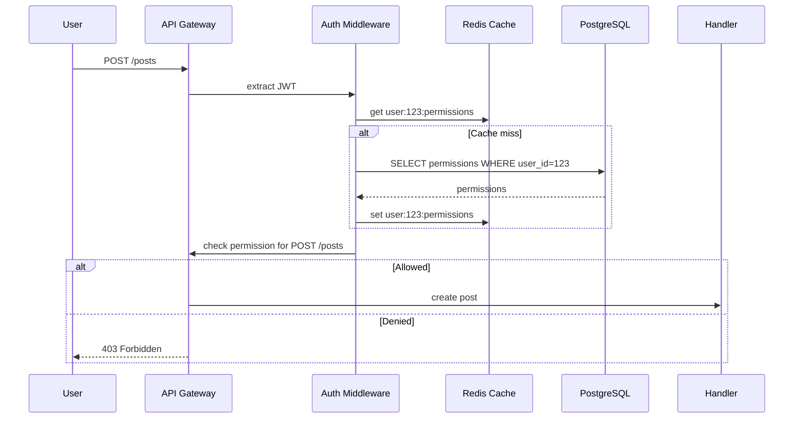

<!-- Generated by Groq via GitHub Actions -->
<!-- Topic ID: T123 -->
<!-- Category: Backend Security -->
<!-- Generated at UTC: 2026-10-23T06:10:02.955532+00:00 -->

# RBAC

## 1. What problem does this solve?

In a multi‑tenant or multi‑service backend, users and services must be granted only the capabilities they need.  
Without a clear model, you risk:

- **Over‑privileged access** – a user can read or delete data they shouldn’t see.
- **Security breaches** – attackers who compromise one account can pivot to others.
- **Compliance violations** – regulations (GDPR, HIPAA) require strict data access controls.
- **Maintenance pain** – hard‑coded permissions make it hard to add or revoke capabilities.

RBAC (Role‑Based Access Control) solves this by grouping permissions into *roles* and assigning roles to users or services. It lets you:

- Define a small set of roles (e.g., `admin`, `editor`, `viewer`).
- Attach granular permissions to those roles (`read:posts`, `write:posts`, `delete:users`).
- Assign roles to users or service accounts.
- Enforce permissions at request time.

In real backends you’ll see RBAC in:

- SaaS platforms (e.g., Stripe, GitHub) to control feature access.
- Enterprise APIs (e.g., Salesforce, AWS IAM).
- Internal micro‑service meshes where services call each other with specific scopes.

## 2. Mental model

**Analogy:** Think of a library.  
- **Roles** are the library membership types: *Student*, *Faculty*, *Guest*.  
- **Permissions** are the actions you can perform: *borrow books*, *access archives*, *reserve study rooms*.  
- **Users** are the library patrons.  
When a patron arrives, the librarian checks their membership type and only allows actions that belong to that type.

**Engineering model:**  
- **Role** → a named set of **Permission** objects.  
- **Permission** → a specific action on a resource (e.g., `POST /posts`).  
- **User** → a set of assigned roles.  
During a request, the system checks: *Does the user’s role set contain a permission that matches this request?* If yes, allow; otherwise deny.

## 3. Deep explanation

### Internals

1. **Data model**  
   - `users` table: `id`, `email`, `hashed_password`.  
   - `roles` table: `id`, `name`.  
   - `permissions` table: `id`, `action`, `resource`.  
   - `role_permissions` (many‑to‑many).  
   - `user_roles` (many‑to‑many).

2. **Authorization flow**  
   - Token (JWT, session cookie) contains user ID.  
   - Middleware resolves user → roles → permissions.  
   - Permission check against request method & path or a custom rule.

3. **Caching**  
   - Store a user’s permission set in Redis with a short TTL to avoid DB hits on every request.

### Important terminology

- **Role** – a named collection of permissions.  
- **Permission** – an atomic action on a resource (`action:resource`).  
- **Scope** – a subset of permissions, often used in OAuth/OIDC.  
- **Policy** – a rule that may combine roles, attributes, and conditions (e.g., “only allow `delete` if the user owns the resource”).

### Trade‑offs

| Aspect | RBAC | ABAC (Attribute‑Based) |
|--------|------|------------------------|
| Simplicity | High – roles are easy to understand | Low – complex rule engine |
| Flexibility | Moderate – add roles for new permissions | High – fine‑grained, context‑aware |
| Performance | Good – cache role sets | Variable – may need policy evaluation per request |
| Maintenance | Easy – change role definitions | Harder – rules can become tangled |

### Failure modes

- **Role explosion** – too many roles make management hard.  
- **Permission leakage** – accidentally assigning a permission to a role.  
- **Cache staleness** – user’s role changes but cache not invalidated.  
- **Privilege escalation** – a role inherits another role incorrectly.

### Limitations

- RBAC cannot express context‑dependent rules (e.g., “only edit own posts”) without additional attributes.  
- It assumes roles are static; dynamic, time‑based access requires extensions.

### Where it fits

- **API gateway** – enforce at the edge.  
- **Service‑to‑service** – use service accounts with specific roles.  
- **Database** – row‑level security can be driven by RBAC decisions.

### Interaction with related concepts

- **JWT claims** – embed role IDs or permission names.  
- **OAuth scopes** – map scopes to RBAC permissions.  
- **Row‑level security** – use role to decide which rows a query can see.  
- **Audit logs** – record role assignments and permission checks.

## 4. How it works

1. User logs in → receives JWT containing `sub` (user ID).  
2. API receives request → middleware extracts user ID.  
3. Middleware checks Redis cache for `user:{id}:permissions`.  
   - If hit → use cached set.  
   - If miss → query DB: `SELECT p.action, p.resource FROM permissions p JOIN role_permissions rp ON p.id = rp.permission_id JOIN user_roles ur ON rp.role_id = ur.role_id WHERE ur.user_id = $1`.  
   - Store result in Redis with TTL.  
4. Middleware builds a key from request (`method:path`).  
5. If key exists in permission set → allow; else → deny (403).  
6. Proceed to route handler.



## 5. Practical implementation

### TypeScript/Node.js example (Express)

```ts
// src/auth/roleBased.ts
import { Request, Response, NextFunction } from 'express';
import { Pool } from 'pg';
import Redis from 'ioredis';

const pool = new Pool();          // PostgreSQL pool
const redis = new Redis();        // Redis client

// Helper: build permission key
const permKey = (method: string, path: string) =>
  `${method.toUpperCase()}:${path}`;

export async function rbacMiddleware(req: Request, res: Response, next: NextFunction) {
  const authHeader = req.headers.authorization;
  if (!authHeader) return res.status(401).json({ error: 'Missing token' });

  const token = authHeader.split(' ')[1];
  const payload: any = verifyJwt(token); // assume verifyJwt returns { sub: userId }

  const userId = payload.sub;
  const cacheKey = `user:${userId}:perms`;

  // 1️⃣ Try cache
  let perms: string[] | null = await redis.get(cacheKey).then((v) => v ? JSON.parse(v) : null);

  // 2️⃣ Cache miss → load from DB
  if (!perms) {
    const query = `
      SELECT p.action, p.resource
      FROM permissions p
      JOIN role_permissions rp ON p.id = rp.permission_id
      JOIN user_roles ur ON rp.role_id = ur.role_id
      WHERE ur.user_id = $1
    `;
    const { rows } = await pool.query(query, [userId]);

    perms = rows.map((r) => `${r.action}:${r.resource}`);
    await redis.set(cacheKey, JSON.stringify(perms), 'EX', 300); // 5 min TTL
  }

  // 3️⃣ Build request key
  const reqKey = permKey(req.method, req.route.path);

  // 4️⃣ Decision
  if (perms.includes(reqKey)) {
    return next(); // allowed
  }

  return res.status(403).json({ error: 'Forbidden' });
}
```

**Usage**

```ts
import express from 'express';
import { rbacMiddleware } from './auth/roleBased';

const app = express();

app.use(express.json());

// Protect all routes
app.use(rbacMiddleware);

app.post('/posts', (req, res) => {
  // Only users with POST:/posts permission reach here
  res.json({ status: 'post created' });
});

app.listen(3000);
```

**Notes**

- `verifyJwt` should be a secure JWT verifier (e.g., `jsonwebtoken.verify`).  
- The `req.route.path` is the route pattern (`/posts`), not the raw URL.  
- For dynamic routes (`/posts/:id`), you may need to map to a canonical permission (`POST:/posts`).  
- In production, consider using a dedicated policy engine (OPA) for complex rules.

## 6. Production considerations

| Concern | How RBAC affects it | Mitigation |
|---------|---------------------|------------|
| **Scalability** | Permission checks are O(1) if cached. | Cache per user; use Redis cluster. |
| **Reliability** | Cache miss → DB hit; DB outage blocks auth. | Read‑replica pool; fallback to in‑memory cache. |
| **Security** | Storing permissions in JWT can expose them. | Keep JWT minimal; use opaque tokens + server‑side lookup. |
| **Observability** | Need to trace denied requests. | Log `userId`, `reqKey`, `decision`. |
| **Performance** | DB join per user on cache miss. | Pre‑compute role‑permission sets; use materialized views. |
| **Error handling** | Token tampering, DB errors. | Return generic 401/403; log details. |
| **Resource usage** | Redis memory per user. | Evict least‑used keys; set TTL. |
| **Operational concerns** | Role churn. | Provide admin UI; audit changes. |
| **Failure recovery** | Cache corruption. | Rebuild from DB on startup. |
| **Deployment** | Schema migrations for roles/permissions. | Versioned migrations; CI tests. |

## 7. Common mistakes

| Mistake | Why it’s problematic |
|---------|----------------------|
| **Granting every user `admin` role** | Breaks least‑privilege principle; opens attack surface. |
| **Hard‑coding permissions in code** | Hard to change; duplicate logic. |
| **Not invalidating cache after role change** | Users keep old permissions until TTL expires. |
| **Using JWT to store full permission list** | Token bloat; risk of leaking sensitive data. |
| **Treating roles as singletons** | Fails when a user needs multiple roles (e.g., `editor` + `viewer`). |
| **Ignoring row‑level security** | Even with RBAC, a user might query all rows if DB lacks RLS. |
| **Over‑granular roles** | Role explosion leads to maintenance nightmare. |
| **No audit trail** | Hard to investigate privilege misuse. |

## 8. Senior engineer perspective

### At scale

- **Architecture**: Separate *policy service* that serves permission sets; micro‑service architecture can cache locally.  
- **Trade‑offs**: Balancing cache consistency vs. latency.  
- **Bottlenecks**: DB join on role change; Redis memory.  
- **Failure scenarios**: Cache partition, DB replication lag.  
- **Monitoring**: Track cache hit rate, permission check latency, denied request rate.  
- **Cost/performance**: Redis cluster costs vs. DB query savings.  
- **When NOT to use**: For highly dynamic, context‑dependent access (ABAC) or when you need per‑resource fine‑grained rules that change frequently.

### Design decisions

- **Role hierarchy**: Decide if roles can inherit others; implement via `role_hierarchy` table.  
- **Permission granularity**: Use `action:resource` vs. `resource:action`.  
- **Cache strategy**: TTL vs. event‑driven invalidation (e.g., Pub/Sub on role change).  
- **Policy engine**: Consider OPA or Casbin if rules become complex.  
- **Audit**: Store role assignments in an immutable log (e.g., Kafka topic).  

## 9. Interview questions

1. **Beginner** – *What is the difference between a role and a permission?*  
   - *Answer:* A role is a named collection of permissions; a permission is an atomic action on a resource (e.g., `read:posts`).

2. **Beginner** – *How would you check if a user can access a route in Express?*  
   - *Answer:* Extract user ID from JWT, load their permission set (cached or DB), build a key from request method/path, and verify the key exists in the set.

3. **Senior** – *Explain how you would design a system that supports both RBAC and ABAC for a SaaS platform.*  
   - *Answer:* Use RBAC for baseline roles, extend with attribute checks (e.g., tenant ID, resource ownership) in a policy engine like OPA; cache combined decision.

4. **Senior** – *What are the main performance bottlenecks in a high‑traffic RBAC implementation and how would you mitigate them?*  
   - *Answer:* DB joins on role change, cache misses, Redis memory pressure. Mitigate with pre‑computed role sets, event‑driven cache invalidation, Redis clustering, and read replicas.

5. **Scenario/Debugging** – *A user reports they can delete a post they don’t own, but their role is only `viewer`. What could be wrong?*  
   - *Answer:* Possible causes:  
     - Permission set cached stale after role change.  
     - Route path mismatch leading to wrong permission key.  
     - Policy engine incorrectly granting `delete:posts` to `viewer`.  
     - Row‑level security missing, allowing delete via raw SQL.  
     - Bug in middleware that bypasses check for certain paths.  

## 10. Hands‑on task

Implement a **role hierarchy** feature:

1. Add a `role_hierarchy` table (`parent_role_id`, `child_role_id`).  
2. Update the permission loader to include inherited permissions.  
3. Write a test that creates roles `admin` → `editor` → `viewer` and verifies that an `admin` user can perform all actions of `editor` and `viewer`.  
4. Add a route `/admin/roles` that allows only `admin` users to list all roles.  

Use the existing Express app from section 5 and extend it.

## 11. Quick revision

- RBAC = roles → permissions → users.  
- Least‑privilege: grant only needed permissions.  
- Store permissions in DB; cache per user in Redis.  
- Middleware checks `method:path` against cached set.  
- Cache miss → DB join; set TTL.  
- Invalidate cache on role change (event or TTL).  
- Use JWT for auth, not for permissions.  
- Combine with row‑level security for data‑level checks.  
- Monitor cache hit rate, denied requests, and permission check latency.  
- Avoid role explosion; use role hierarchy if needed.  
- Audit role assignments and permission checks.  

## 12. References

- [RFC 7519 – JSON Web Token (JWT)](https://datatracker.ietf.org/doc/html/rfc7519)  
- [PostgreSQL Documentation – JOINs](https://www.postgresql.org/docs/current/queries-table-expressions.html)  
- [Redis Documentation – Caching](https://redis.io/docs/management/cache/)  
- [Open Policy Agent (OPA) – Policy Engine](https://www.openpolicyagent.org/docs/latest/)  
- [Casbin – Role‑Based Access Control](https://casbin.org/docs/en/overview)  
- [Node.js Express Middleware](https://expressjs.com/en/guide/writing-middleware.html)  

---
