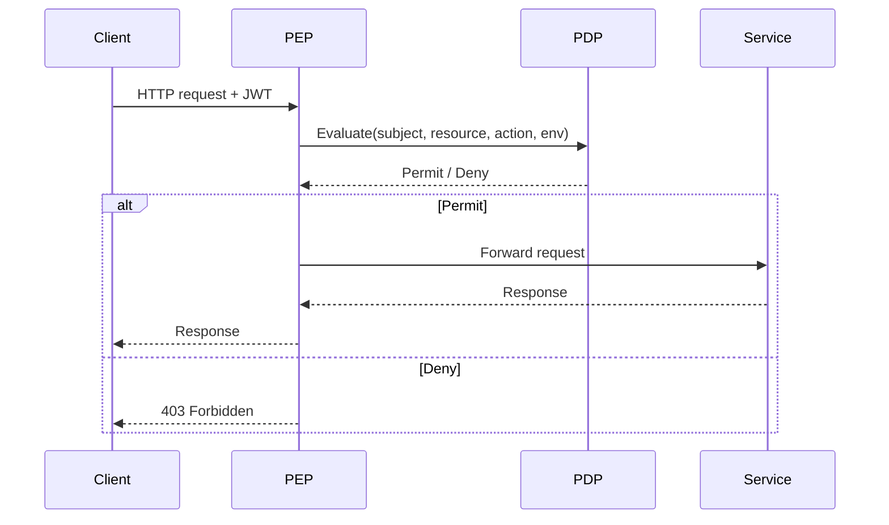

<!-- Generated by Groq via GitHub Actions -->
<!-- Topic ID: T124 -->
<!-- Category: Backend Security -->
<!-- Generated at UTC: 2026-10-23T06:10:02.955532+00:00 -->

# ABAC

## 1. What problem does this solve?

**Motivation**  
In modern backends you often need to decide *who* can do *what* on *which* resource *when* and *where*.  
Traditional approaches:

| Approach | Typical use | Limitation |
|----------|-------------|------------|
| **ACL** (Access Control Lists) | Explicitly list users per resource | Doesn’t scale – each resource needs its own list |
| **RBAC** (Role‑Based Access Control) | Assign roles to users, roles to permissions | Roles are coarse; adding a new permission requires changing many roles |
| **Custom logic** | Hard‑coded `if` statements | Hard to audit, hard to evolve |

**Problem**  
- **Granularity**: You need fine‑grained rules that depend on multiple attributes (user, resource, action, environment).  
- **Dynamicity**: Policies change frequently (e.g., a new feature flag, a new tenant).  
- **Auditability**: You must be able to trace *why* a decision was made.  
- **Scalability**: The system must evaluate thousands of decisions per second across many services.

**Why it matters**  
- A missing or incorrect rule can expose sensitive data or block legitimate users.  
- Hard‑coded logic leads to technical debt and security gaps.  
- In multi‑tenant SaaS, each tenant may have different rules; a one‑size‑fits‑all role model breaks.

**Consequences of not using ABAC**  
- Over‑privileged users (security breach).  
- Under‑privileged users (productivity loss).  
- Hard to maintain and audit.  
- Poor support for new business requirements.

**Real‑world appearance**  
- SaaS platforms (e.g., Stripe, Auth0) use ABAC to enforce tenant‑level permissions.  
- Cloud providers (AWS IAM, Azure RBAC) expose attribute‑based policies.  
- Healthcare systems enforce ABAC for patient data access.

---

## 2. Mental model

### Simple analogy  
Imagine a **library** where books are resources.  
- **Subjects** are patrons.  
- **Attributes**: membership level (student, faculty, guest), time of day, location (on‑campus, off‑campus).  
- **Policies**: “Faculty can borrow any book; students can borrow up to 5 books; guests can only read in the reading room.”  
The library staff (policy engine) checks the patron’s attributes against the policy before lending a book.

### Precise engineering model  
1. **Attributes** – data about the subject, resource, action, and environment.  
2. **Policy** – declarative rules that map attribute combinations to decisions (`Permit` or `Deny`).  
3. **Policy Decision Point (PDP)** – evaluates a request against the policy.  
4. **Policy Enforcement Point (PEP)** – intercepts requests, asks PDP, enforces the decision.  
5. **Attribute Sources** – databases, JWT claims, request headers, etc.

---

## 3. Deep explanation

### Internals
- **Policy Language**: XACML, Casbin’s model, Rego (OPA).  
- **PDP**: Parses the policy, fetches attributes, runs evaluation.  
- **PEP**: Middleware or gateway that blocks/lets through based on PDP output.  
- **Attribute Store**: May be in-memory, Redis, or external service.

### Important terminology
| Term | Meaning |
|------|---------|
| **Subject** | The entity performing the action (user, service). |
| **Resource** | The target of the action (document, API endpoint). |
| **Action** | What is being done (read, write, delete). |
| **Environment** | Contextual data (time, IP, device). |
| **Policy** | Set of rules expressed in a policy language. |
| **Decision** | `Permit`, `Deny`, `NotApplicable`, `Indeterminate`. |
| **Obligation** | Side‑effects that must happen if a decision is made. |

### Trade‑offs
| Factor | ABAC | RBAC | ACL |
|--------|------|------|-----|
| **Granularity** | High | Medium | Low |
| **Policy Management** | Complex | Simple | Simple |
| **Performance** | Potentially slower (attribute lookup) | Fast | Fast |
| **Scalability** | Requires caching & distributed PDP | Easy | Easy |
| **Auditability** | Rich (policy + attributes) | Good | Good |

### Failure modes
- **Missing attributes** → `Indeterminate` → often denied.  
- **Conflicting policies** → last‑write‑wins or explicit conflict resolution.  
- **Policy churn** → stale decisions if cache not invalidated.  
- **Attribute leakage** → sensitive data in JWT claims.

### Limitations
- **Complexity**: Hard to reason about policies without tooling.  
- **Debugging**: Determining why a decision was made can be opaque.  
- **Over‑privilege**: If attributes are too permissive, you may grant more than intended.

### Where it fits
- **API Gateway**: PEP sits in the gateway, evaluating every request.  
- **Microservice**: Each service can host a local PDP or delegate to a central one.  
- **Database**: Row‑level security can be implemented via ABAC policies.  

### Interaction with related concepts
- **JWT/OAuth**: Claims often serve as attributes.  
- **RBAC**: ABAC can embed roles as an attribute for hybrid models.  
- **Audit logs**: Must record attributes and decision for compliance.  
- **Caching**: Store decisions in Redis to reduce PDP load.

---

## 4. How it works

1. **Client** sends a request with a JWT (contains subject attributes).  
2. **PEP (Express middleware)** intercepts the request.  
3. PEP extracts **subject**, **resource**, **action**, **environment** attributes.  
4. PEP forwards these to the **PDP** (local or remote).  
5. PDP evaluates the **policy** and returns a **decision**.  
6. PEP enforces:  
   - `Permit` → passes request to handler.  
   - `Deny` → returns 403.  
   - `Indeterminate` → safe‑by‑default deny or fallback.  



---

## 5. Practical implementation

### 5.1 Install dependencies

```bash
npm install express jsonwebtoken casbin
```

### 5.2 Policy files

**casbin_model.conf**

```ini
[request_definition]
r = sub, obj, act

[policy_definition]
p = sub, obj, act, eft

[policy_effect]
e = some(where (p.eft == allow))

[matchers]
m = r.sub == p.sub && r.obj == p.obj && r.act == p.act
```

**casbin_policy.csv**

```csv
p, alice, /data1, read, allow
p, bob, /data1, write, allow
p, *, /data2, read, allow
```

### 5.3 Express middleware

```ts
// abac.ts
import { Enforcer } from 'casbin';
import * as jwt from 'jsonwebtoken';
import express from 'express';

const JWT_SECRET = 'super-secret'; // In prod: env var

// Load Casbin enforcer
const enforcer = await Enforcer.newEnforcer('casbin_model.conf', 'casbin_policy.csv');

// Helper to extract attributes from JWT
function getAttributes(req: express.Request) {
  const token = req.headers.authorization?.split(' ')[1];
  if (!token) throw new Error('Missing token');
  const payload = jwt.verify(token, JWT_SECRET) as any;
  return {
    sub: payload.sub,          // user id
    roles: payload.roles,      // e.g., ['admin', 'editor']
    tenant: payload.tenant,    // multi‑tenant id
  };
}

// PEP middleware
export async function abacMiddleware(req: express.Request, res: express.Response, next: express.NextFunction) {
  try {
    const attrs = getAttributes(req);
    const obj = req.path;          // resource
    const act = req.method.toLowerCase(); // action

    // Casbin expects string values; we can encode roles as comma‑separated
    const sub = attrs.roles.join(',');

    const allowed = await enforcer.enforce(sub, obj, act);
    if (!allowed) {
      return res.status(403).json({ error: 'Forbidden' });
    }
    next();
  } catch (err) {
    console.error('ABAC error', err);
    res.status(401).json({ error: 'Unauthorized' });
  }
}
```

### 5.4 Using the middleware

```ts
// server.ts
import express from 'express';
import { abacMiddleware } from './abac';

const app = express();

app.use(abacMiddleware); // Protect all routes

app.get('/data1', (req, res) => res.send('Data 1'));
app.post('/data1', (req, res) => res.send('Write to Data 1'));
app.get('/data2', (req, res) => res.send('Data 2'));

app.listen(3000, () => console.log('Server running on :3000'));
```

### 5.5 Testing

```bash
# Generate a token for alice
node -e "console.log(require('jsonwebtoken').sign({sub:'alice',roles:['alice']},'super-secret'))"
```

Send a request with `Authorization: Bearer <token>` and observe the result.

---

## 6. Production considerations

| Concern | How to address |
|---------|----------------|
| **Scalability** | Cache decisions in Redis; use a distributed PDP cluster; batch policy loads. |
| **Reliability** | PDP fallback to deny‑by‑default; circuit breaker if PDP is down. |
| **Security** | Store JWT secrets in Vault; encrypt policy files; audit logs. |
| **Observability** | Log every decision with attributes; expose metrics (`abac_decisions_total`, `abac_denied_total`). |
| **Performance** | Profile PDP; pre‑compile policies; use in‑memory enforcer for hot paths. |
| **Error handling** | Return 401 for auth errors, 403 for policy denials; surface clear error messages. |
| **Resource usage** | Keep policy size small; purge unused attributes; monitor memory. |
| **Operational** | CI pipeline for policy linting; versioned policy store; rollback strategy. |
| **Failure recovery** | Cache invalidation on policy change; graceful degradation. |
| **Deployment** | Containerize PDP; use sidecar pattern for distributed PDP; keep policy files in ConfigMap/Secrets. |

---

## 7. Common mistakes

| Mistake | Why it’s problematic |
|---------|----------------------|
| Using ABAC for trivial CRUD | Adds unnecessary complexity and latency. |
| Hard‑coding attributes in code | Breaks auditability and makes updates hard. |
| Ignoring environment attributes (time, IP) | Misses critical security constraints. |
| Not normalizing attribute values | Policies may never match (e.g., `admin` vs `Admin`). |
| Over‑granting wildcard policies (`*`) | Creates privilege escalation. |
| Not testing policies in staging | Undetected policy conflicts cause production failures. |
| Storing policies in plain text in repo | Security risk; no audit trail. |
| Forgetting to invalidate cache after policy change | Stale decisions lead to inconsistent access. |

---

## 8. Senior engineer perspective

### Design decisions at scale
- **Central vs distributed PDP**: Central PDP simplifies policy management but becomes a bottleneck; distributed PDPs (one per service) reduce latency but increase policy consistency overhead.  
- **Policy caching**: Use Redis or in‑memory LRU caches; decide eviction strategy based on policy churn.  
- **Audit logging**: Store decisions in a separate audit store (e.g., Kafka + ClickHouse) for compliance.  
- **Policy versioning**: Tag policies; allow rollback; use feature flags to roll out new policies gradually.  
- **Multi‑tenant isolation**: Store tenant‑specific policies separately; enforce tenant attribute in PDP.  
- **Conflict resolution**: Define precedence rules (e.g., deny overrides allow).  
- **Monitoring**: Track decision latency, denial rates, cache hit ratios.  
- **Cost**: Distributed PDPs increase compute; central PDP may require autoscaling.  
- **When NOT to use ABAC**: Small teams, simple CRUD apps, or when performance is critical and fine‑grained control is unnecessary.

---

## 9. Interview questions

1. **Beginner/Intermediate**  
   *Q:* What is the difference between ABAC and RBAC?  
   *A:* ABAC uses attributes (user, resource, action, environment) to evaluate permissions; RBAC assigns permissions to roles and users to roles. ABAC is more fine‑grained and dynamic.

2. **Beginner/Intermediate**  
   *Q:* How would you implement ABAC in a Node.js Express app?  
   *A:* Use a PDP library (e.g., Casbin), load policies, create a middleware that extracts attributes from JWT, calls `enforcer.enforce`, and permits or denies.

3. **Senior‑level**  
   *Q:* Design an ABAC system for a multi‑tenant SaaS that needs to support tenant‑specific policies and global policies.  
   *A:* Use a central policy store with tenant namespaces; PDP loads tenant policies first, then global policies; enforce precedence; cache decisions per tenant; use feature flags for gradual rollout.

4. **Senior‑level**  
   *Q:* How do you handle policy updates in a distributed system where multiple services use ABAC?  
   *A:* Publish policy change events to Kafka; services subscribe and reload policies; use versioned policy files; maintain backward compatibility; use a fallback cache until new policy is fully propagated.

5. **Scenario/Debugging**  
   *Q:* A user receives a 403 Forbidden even though they should have access. How would you debug the ABAC decision?  
   *A:*  
   - Enable verbose logging in PDP.  
   - Inspect the request attributes (JWT claims, path, method).  
   - Verify the policy rules for that subject/resource/action.  
   - Check for attribute normalization mismatches.  
   - Look for conflicting policies or missing environment attributes.  
   - Validate that the PDP is using the latest policy version.

---

## 10. Hands‑on task

**Goal**: Add ABAC to the provided Express starter repo.

1. Install `casbin`, `jsonwebtoken`, and `express`.  
2. Create `casbin_model.conf` and `casbin_policy.csv` with at least two policies.  
3. Implement `abacMiddleware.ts` that:
   - Extracts `sub` and `roles` from a JWT.  
   - Calls Casbin’s `enforce`.  
   - Denies or allows the request.  
4. Protect `/secure` route with the middleware.  
5. Write a script to generate a JWT for a test user.  
6. Test with `curl` or Postman:  
   - Successful access → 200.  
   - Forbidden access → 403.  
7. Add a Redis cache for decisions and benchmark latency.

---

## 11. Quick revision

- ABAC = Attribute‑Based Access Control.  
- **Attributes**: subject, resource, action, environment.  
- **Policy**: declarative rule set (XACML, Casbin, Rego).  
- **PDP**: evaluates policy.  
- **PEP**: intercepts request, asks PDP, enforces decision.  
- **Decision**: Permit / Deny / NotApplicable / Indeterminate.  
- **Common libraries**: Casbin (Node), OPA (Rego).  
- **Performance**: cache decisions; batch policy loads.  
- **Security**: store JWT secrets securely; audit logs.  
- **Failure**: missing attributes → Indeterminate → deny.  
- **When to use**: fine‑grained, dynamic, multi‑tenant access.  
- **When not to use**: simple CRUD, low latency requirements.  
- **Key trade‑off**: complexity vs. flexibility.  
- **Testing**: policy linting, unit tests, integration tests.  

---

## 12. References

- Casbin official docs: https://casbin.org/docs/en/overview  
- OASIS XACML 3.0 spec: https://docs.oasis-open.org/xacml/xacml-3.0/  
- OPA (Open Policy Agent) docs: https://www.openpolicyagent.org/docs/latest/  
- JWT spec (RFC 7519): https://datatracker.ietf.org/doc/html/rfc7519  
- AWS IAM policy language: https://docs.aws.amazon.com/IAM/latest/UserGuide/reference_policies_elements.html  
- Azure RBAC and ABAC: https://learn.microsoft.com/en-us/azure/role-based-access-control/overview  
- Redis caching patterns: https://redis.io/docs/management/cache/  

---
