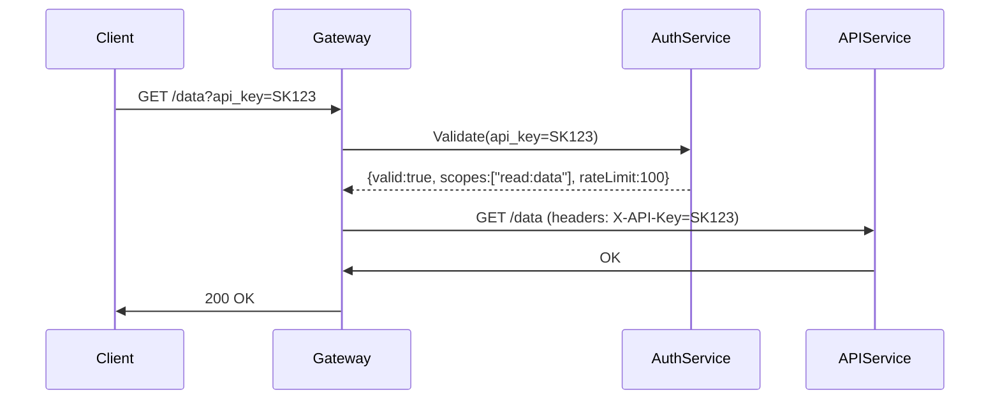

<!-- Generated by Groq via GitHub Actions -->
<!-- Topic ID: T125 -->
<!-- Category: Backend Security -->
<!-- Generated at UTC: 2026-10-23T17:55:48.274498+00:00 -->

# API keys

## 1. What problem does this solve?

**Motivation**  
When a backend exposes functionality to external clients (mobile apps, third‑party services, internal micro‑services), it must authenticate the caller and enforce fine‑grained permissions. API keys are a lightweight credential that:

- **Identify** the client or application.
- **Authorize** access to specific endpoints or resources.
- **Track** usage for billing, rate‑limiting, or analytics.

**Problem exists**  
Without a credential mechanism, anyone could call your endpoints, leading to:

- Unauthorized data exposure.
- Abuse of compute resources.
- Difficulty in attributing actions to a particular client.

**Why the problem matters**  
- **Security**: Prevent data leaks and privilege escalation.
- **Compliance**: Many regulations require audit trails and access control.
- **Operational**: Uncontrolled traffic can overload services, causing outages.

**What happens if not used**  
- Open APIs become public; attackers can scrape data or trigger expensive operations.
- No way to revoke or rotate credentials.
- No billing or usage monitoring.

**Real‑world appearance**  
- Stripe, Twilio, AWS, and many SaaS platforms issue API keys to customers.
- Internal services often use service‑to‑service keys for inter‑micro‑service calls.
- Mobile apps embed keys (or use OAuth) to call backend APIs.

---

## 2. Mental model

**Analogy**  
Think of an API key as a *library card*.  
- The card identifies you (who you are).
- The card grants you access to specific books (endpoints).
- The library can track which books you borrow (usage).

**Engineering model**  
- **Key**: a random, opaque string (e.g., `sk_1a2b3c...`).
- **Secret**: a value stored server‑side, never sent to the client.
- **Metadata**: permissions, rate limits, expiration, owner.
- **Validation**: on each request, the server looks up the key, verifies the secret, checks permissions, and applies rate limits.

---

## 3. Deep explanation

### Internals
1. **Generation**  
   - Random, cryptographically strong bytes → hex/base64 string.  
   - Store hash of the secret (not plain text) in DB.

2. **Storage**  
   - Relational DB (PostgreSQL) or key‑value store (Redis).  
   - Index on key for fast lookup.

3. **Lookup**  
   - On request, extract key from header (`x-api-key`) or query param.  
   - Query DB/Redis for key record.  
   - Verify secret hash matches (if secret is sent, e.g., HMAC).

4. **Authorization**  
   - Check scopes/permissions stored with the key.  
   - Enforce rate limits (e.g., token bucket stored in Redis).

5. **Audit**  
   - Log request metadata: key ID, IP, endpoint, timestamp.

### Important terminology
- **Key**: public identifier.
- **Secret**: confidential component, often hashed.
- **Scope**: set of allowed actions.
- **Rate limiting**: throttling per key.
- **Revocation**: disabling a key.
- **Rotation**: replacing a key with a new one.

### Trade‑offs
| Aspect | Pros | Cons |
|--------|------|------|
| Simplicity | Easy to implement, no OAuth flow | No user context, limited revocation granularity |
| Performance | Single DB lookup, minimal overhead | DB/Redis latency can be a bottleneck |
| Security | Secret stored hashed | If DB compromised, attacker can still use key if secret leaked elsewhere |
| Auditing | Straightforward logs | Requires careful logging of key usage |

### Failure modes
- **Key leakage**: If a key is exposed, attacker can impersonate the client.
- **Replay attacks**: Same key used repeatedly; mitigated by rate limiting or nonce.
- **Stale keys**: Expired keys still accepted if not checked.
- **Denial of Service**: Attackers can flood with many keys; mitigated by per‑key rate limits and IP throttling.

### Limitations
- **No user identity**: Cannot tie actions to a specific user unless combined with other auth.
- **Granularity**: Permissions are coarse‑grained; fine‑grained ACLs require additional layers.
- **Revocation latency**: If stored in a distributed cache, revocation may take time to propagate.

### Where it fits
- **API gateway**: Handles key extraction and validation before routing.
- **Micro‑service**: Each service validates the key or trusts the gateway.
- **Auth server**: Generates and manages keys, exposes admin UI.

### Interaction with related concepts
- **OAuth**: API keys are simpler; OAuth adds user context.
- **JWT**: JWT can carry scopes; API keys are opaque.
- **Rate limiting**: Often implemented per key.
- **Secrets management**: Store key secrets in Vault or KMS.

---

## 4. How it works



**Step‑by‑step flow**

1. **Client** sends request with `x-api-key` header.
2. **Gateway** extracts key, forwards to **AuthService**.
3. **AuthService** looks up key, verifies secret hash, checks scopes and rate limits.
4. If valid, **AuthService** returns metadata; otherwise, 401/403.
5. **Gateway** forwards request to the target **APIService**, optionally adding `X-API-Key` or `X-API-Scopes`.
6. **APIService** trusts the gateway or re‑validates if needed.
7. Response flows back to client.

---

## 5. Practical implementation

### TypeScript/Node.js example (Express + Redis)

```ts
// src/middleware/apiKeyAuth.ts
import { Request, Response, NextFunction } from 'express';
import { createClient } from 'redis';
import crypto from 'crypto';

const redis = createClient(); // assume env vars for URL
await redis.connect();

/**
 * Validate API key header.
 * Expects header: x-api-key: <key>
 */
export async function apiKeyAuth(req: Request, res: Response, next: NextFunction) {
  const key = req.headers['x-api-key'] as string | undefined;
  if (!key) return res.status(401).json({ error: 'Missing API key' });

  // Lookup key metadata in Redis (JSON string)
  const data = await redis.get(`api_key:${key}`);
  if (!data) return res.status(401).json({ error: 'Invalid API key' });

  const meta = JSON.parse(data);
  // Verify secret hash if secret is sent (optional)
  // const providedSecret = req.headers['x-api-secret'] as string | undefined;
  // if (providedSecret && crypto.createHash('sha256').update(providedSecret).digest('hex') !== meta.secretHash) {
  //   return res.status(401).json({ error: 'Invalid secret' });
  // }

  // Rate limiting (simple counter)
  const counterKey = `rate:${key}:${Math.floor(Date.now() / 60000)}`; // per minute
  const count = await redis.incr(counterKey);
  await redis.expire(counterKey, 60);
  if (count > meta.rateLimit) {
    return res.status(429).json({ error: 'Rate limit exceeded' });
  }

  // Attach metadata to request for downstream handlers
  (req as any).apiKeyMeta = meta;
  next();
}
```

```ts
// src/server.ts
import express from 'express';
import { apiKeyAuth } from './middleware/apiKeyAuth';

const app = express();

app.use(apiKeyAuth);

app.get('/data', (req, res) => {
  const meta = (req as any).apiKeyMeta;
  // Check scopes
  if (!meta.scopes.includes('read:data')) {
    return res.status(403).json({ error: 'Insufficient scope' });
  }
  res.json({ data: 'Secret data', keyOwner: meta.owner });
});

app.listen(3000, () => console.log('API listening on :3000'));
```

**Key generation script (one‑time)**

```ts
// scripts/generateKey.ts
import { createClient } from 'redis';
import crypto from 'crypto';

const redis = createClient();
await redis.connect();

const key = crypto.randomBytes(32).toString('hex'); // public key
const secret = crypto.randomBytes(32).toString('hex'); // secret
const secretHash = crypto.createHash('sha256').update(secret).digest('hex');

const meta = {
  owner: 'my-app',
  scopes: ['read:data', 'write:data'],
  rateLimit: 1000,
  secretHash,
};

await redis.set(`api_key:${key}`, JSON.stringify(meta));
console.log('API Key:', key);
console.log('Secret:', secret);
```

Run `ts-node scripts/generateKey.ts` to create a key. Store the secret securely (e.g., in Vault).

---

## 6. Production considerations

| Concern | Recommendation |
|---------|----------------|
| **Scalability** | Store keys in a distributed cache (Redis cluster) or a highly‑available DB. Use read replicas for lookup. |
| **Reliability** | Cache fallback to DB if cache miss. Use circuit breakers for AuthService. |
| **Security** | - Store secret hashes, not plain secrets. <br>- Use TLS for all traffic. <br>- Rotate keys regularly. <br>- Use HMAC or JWT if you need to avoid round‑trip validation. |
| **Observability** | Log key usage, rate‑limit hits, and failures. Expose metrics (`api_key_hits`, `api_key_rate_limit_exceeded`). |
| **Performance** | Keep lookup in < 5 ms. Use in‑memory store. Avoid heavy DB joins. |
| **Error handling** | Return clear 401/403/429 codes. Avoid leaking whether key exists. |
| **Resource usage** | Keys are lightweight; memory cost is minimal. |
| **Operational concerns** | Provide admin UI to create/rotate/revoke keys. Use CI/CD to deploy key changes. |
| **Failure recovery** | If AuthService is down, fallback to cached keys or temporary allowlist. |
| **Deployment** | Run AuthService behind an API gateway (NGINX, Envoy). Use sidecar pattern for key validation if needed. |

---

## 7. Common mistakes

| Mistake | Why it’s problematic |
|---------|----------------------|
| **Storing secrets in plain text** | Anyone with DB access can impersonate clients. |
| **Hard‑coding keys in source** | Secrets leak when code is pushed to VCS. |
| **No rate limiting** | Keys can be abused to overload services. |
| **Using the same key for all clients** | No isolation; revoking key affects everyone. |
| **Not expiring keys** | Long‑lived keys increase risk if leaked. |
| **Relying on client‑side key validation** | Client can tamper with logic; must validate server‑side. |
| **Ignoring scope checks** | All endpoints become accessible regardless of intended permissions. |
| **Using weak random generator** | Predictable keys can be brute‑forced. |

---

## 8. Senior engineer perspective

### Architecture decisions
- **Centralized vs. distributed validation**: Central AuthService simplifies revocation but can become a bottleneck; distributed token validation (e.g., JWT) removes round‑trip but sacrifices revocation immediacy.
- **Cache strategy**: Use Redis cluster with TTL for key metadata; fallback to DB on miss.
- **Key rotation policy**: Automate rotation via CI/CD; use dual keys during transition.

### Trade‑offs
- **Speed vs. revocation latency**: In‑memory validation is fast but revocation may take seconds to propagate.
- **Granularity vs. complexity**: Adding per‑resource scopes increases DB schema complexity.

### Bottlenecks
- **AuthService throughput**: Each request incurs a DB/Redis lookup. Scale horizontally; use connection pooling.
- **Rate‑limit counters**: High cardinality counters can exhaust Redis memory; use probabilistic counters if acceptable.

### Failure scenarios
- **Cache outage**: Fallback to DB; degrade performance but maintain availability.
- **AuthService crash**: API gateway can return 503; implement graceful degradation.

### Monitoring
- **Key usage metrics**: Hits per key, rate‑limit violations.
- **Health checks**: AuthService liveness, cache connectivity.
- **Audit logs**: Store in immutable log store (e.g., Cloud Logging, ELK).

### Cost/performance
- **Redis cost**: Memory per key ~ few KB. For millions of keys, consider sharding or moving to a key‑value store like DynamoDB.
- **DB cost**: Use indexes on key column; avoid heavy joins.

### When NOT to use API keys
- **User‑specific actions**: Prefer OAuth or session tokens.
- **Highly sensitive data**: Use short‑lived signed tokens (JWT) with revocation lists.
- **Zero‑trust environments**: Use mutual TLS instead of keys.

---

## 9. Interview questions

1. **Beginner**: *What is an API key and why do we use it?*  
   **Answer**: An opaque string that identifies a client and authorizes access to API endpoints. It simplifies authentication for services or apps that don’t need user context.

2. **Beginner**: *How would you protect an API key stored in a database?*  
   **Answer**: Store a cryptographic hash of the secret, not the plain secret. Use a strong hash function (SHA‑256) and salt if desired. Ensure the DB is secure and access is restricted.

3. **Senior**: *Explain how you would design a system that allows instant revocation of API keys without a cache miss.*  
   **Answer**: Use a central revocation list stored in a fast, distributed store (e.g., Redis with a small TTL). Each request checks the list before proceeding. Alternatively, use signed tokens (JWT) with a revocation blacklist that is checked on each request.

4. **Senior**: *Compare API keys with OAuth 2.0 in terms of security and use cases.*  
   **Answer**: API keys are simple, stateless, and suitable for service‑to‑service or machine‑to‑machine auth. OAuth provides user context, fine‑grained scopes, and token lifecycle management (refresh tokens). OAuth is more complex but necessary when user identity matters.

5. **Scenario/Debugging**: *You notice that a particular API key is hitting the rate limit frequently, but the logs show the key is not being used by any of your clients. What could be happening and how would you investigate?*  
   **Answer**: Possible causes:  
   - Key leakage to an attacker.  
   - Misconfigured client sending the key to wrong endpoint.  
   - Replay attacks or automated scripts.  
   Investigation steps:  
   - Check request IPs and user agents.  
   - Correlate with logs to see which endpoints are hit.  
   - Verify key’s scopes and rate limits.  
   - If malicious, revoke the key and rotate.  
   - Add additional logging (e.g., request payload, headers) to detect patterns.

---

## 10. Hands‑on task

**Task**: Add a *per‑endpoint* rate limit for a specific API key.

1. Extend the `apiKeyAuth` middleware to accept a `rateLimitPerEndpoint` field in the key metadata (e.g., `{ "/data": 100, "/admin": 10 }`).
2. Implement a counter per key‑endpoint pair using Redis.
3. Write a test endpoint `/admin` that requires the `admin` scope.
4. Demonstrate that exceeding the limit returns `429` while other endpoints are unaffected.

**Hints**:
- Use Redis keys like `rate:${key}:${endpoint}:${minute}`.
- Update the middleware to read the limit from `meta.rateLimitPerEndpoint[endpoint]`.

---

## 11. Quick revision

- API key = opaque identifier + secret (hashed).
- Stored in DB/Redis; lookup on each request.
- Validate key → check scopes → enforce rate limits.
- Store secret hash; never expose secret.
- Use TLS, rotate keys, audit logs.
- Common pitfalls: hard‑coding, no revocation, weak randomness.
- For instant revocation, use a revocation list or signed tokens.
- Rate limiting per key can be implemented with Redis counters.
- Monitor key usage, rate‑limit violations, and auth failures.
- Prefer centralized AuthService for simplicity; consider JWT for scale.
- Never use API keys for user‑specific actions; use OAuth instead.

---

## 12. References

- [RFC 7235 – HTTP Authentication: Basic and Bearer](https://datatracker.ietf.org/doc/html/rfc7235)
- [Node.js Redis client (ioredis)](https://github.com/luin/ioredis)
- [Express.js middleware](https://expressjs.com/en/guide/writing-middleware.html)
- [OWASP API Security Top 10 – API Keys](https://owasp.org/www-project-api-security/)
- [AWS API Key Management](https://docs.aws.amazon.com/apigateway/latest/developerguide/api-gateway-api-keys.html)
- [Stripe API keys](https://stripe.com/docs/api/authentication)
- [Redis rate limiting patterns](https://redis.io/docs/stack/monitoring/rate-limiting/)
