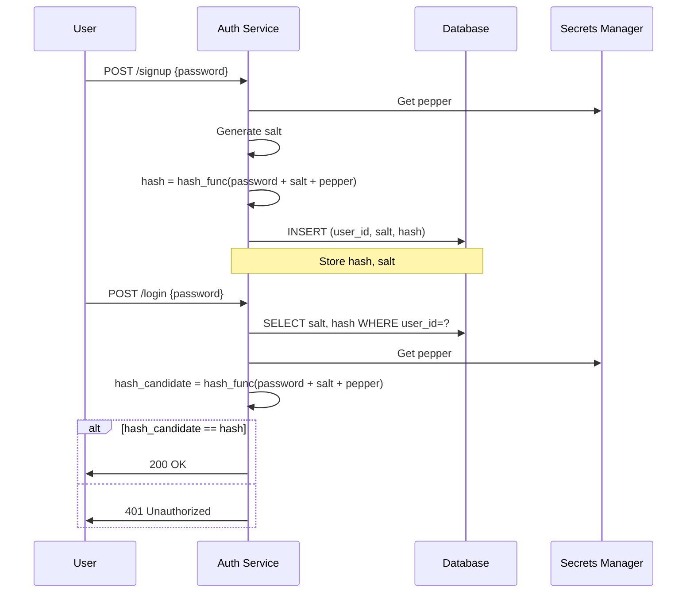

<!-- Generated by Groq via GitHub Actions -->
<!-- Topic ID: T126 -->
<!-- Category: Backend Security -->
<!-- Generated at UTC: 2026-10-23T17:55:48.274498+00:00 -->

# Password hashing

## 1. What problem does this solve?

- **Problem**: Storing user passwords in plain text or using weak reversible encryption exposes every account if the database is compromised.
- **Why it matters**: Attackers who obtain a dump of the user table can immediately log in as any user, and often reuse the same passwords across services.
- **Consequences of not using it**:  
  - Immediate credential compromise.  
  - Loss of user trust and regulatory penalties (GDPR, CCPA).  
  - Potential for credential stuffing attacks on other services.
- **Real‑world appearance**:  
  - Authentication microservices in SaaS platforms.  
  - User tables in PostgreSQL, MongoDB, or Redis.  
  - Password reset endpoints in Next.js API routes or FastAPI endpoints.

## 2. Mental model

### Analogy  
Think of a password as a secret recipe.  
- **Hash**: The recipe is turned into a unique “signature” that cannot be reversed.  
- **Salt**: A random ingredient added to each recipe so that even identical recipes produce different signatures.  
- **Pepper**: A secret ingredient known only to the kitchen (the application) that is never stored with the signature.

### Engineering model  
1. **Input**: User’s plain‑text password.  
2. **Salt generation**: Random bytes unique per user.  
3. **Key stretching**: Apply a computationally expensive hash (bcrypt, Argon2, scrypt).  
4. **Store**: Save the salt, the hash, and optionally a pepper‑derived key.  
5. **Verification**: Re‑apply the same process to the input and compare hashes.

## 3. Deep explanation

| Term | Meaning | Why it matters |
|------|---------|----------------|
| **Hash** | One‑way function producing a fixed‑size output. | Prevents reversing to the original password. |
| **Salt** | Random data added to the password before hashing. | Defeats rainbow‑table attacks and ensures identical passwords hash differently. |
| **Pepper** | Secret key stored outside the database (e.g., in a secrets manager). | Adds an extra layer of secrecy; if the DB leaks, the pepper is still protected. |
| **Key stretching** | Repeating the hash function many times or using memory‑hard algorithms. | Increases the cost of brute‑force attacks. |
| **Memory‑hard** | Requires a large amount of RAM per hash (e.g., Argon2id). | Makes GPU/ASIC attacks expensive. |

### Trade‑offs

| Aspect | Fast hash (e.g., SHA‑256) | Slow hash (bcrypt/Argon2) |
|--------|---------------------------|---------------------------|
| **Speed** | Very fast (microseconds). | Slow (milliseconds to seconds). |
| **Security** | Weak against brute‑force. | Stronger against brute‑force. |
| **Resource usage** | Low CPU, low RAM. | High CPU, high RAM. |
| **Scalability** | Can handle millions of logins per second. | Limited by CPU/RAM; may need dedicated workers. |

### Failure modes

- **Reusing salts**: Same salt for multiple users → identical hashes for identical passwords.  
- **Using a fast hash**: Enables attackers to try billions of guesses per second.  
- **Storing the hash in plain text**: No protection if DB leaks.  
- **Not rotating the algorithm**: Stale algorithms become vulnerable over time.  

### Limitations

- **One‑way**: You cannot recover the original password.  
- **No protection against social‑engineering**: Users may reuse passwords elsewhere.  
- **Requires secure storage of pepper**: If the pepper leaks, all hashes become vulnerable.

### Where it fits in architecture

- **Auth service**: Handles registration, login, password reset.  
- **Database**: Stores `user_id`, `password_hash`, `salt`, `pepper_hash` (if used).  
- **Cache (Redis)**: May cache failed login attempts for rate limiting.  
- **Secrets manager**: Holds the pepper value.

### Interaction with related concepts

- **Rate limiting**: Throttle login attempts to reduce brute‑force impact.  
- **Account lockout**: After N failures, temporarily block the account.  
- **Password policy enforcement**: Ensure complexity before hashing.  
- **Audit logs**: Record password changes securely.

## 4. How it works

1. **User signs up**  
   - Receive plain‑text password.  
   - Generate a 16‑byte random salt.  
   - Compute hash = `hash_function(password + salt + pepper)`.  
   - Store `user_id`, `salt`, `hash` in DB.

2. **User logs in**  
   - Retrieve stored `salt` and `hash`.  
   - Compute `hash_candidate = hash_function(input_password + salt + pepper)`.  
   - Compare `hash_candidate` with stored `hash`.  
   - If equal → authentication success.

3. **Password reset**  
   - Generate a time‑limited token (JWT or random string).  
   - Send token via email.  
   - On reset, hash new password as in step 1.



## 5. Practical implementation

### Node.js example with `argon2`

```ts
// src/auth/hash.ts
import argon2 from 'argon2';
import { randomBytes } from 'crypto';
import { getPepper } from '../secrets/pepper'; // fetch from secrets manager

/**
 * Hash a plain‑text password.
 * @param password - User supplied password
 * @returns {salt: string, hash: string}
 */
export async function hashPassword(password: string) {
  const salt = randomBytes(16).toString('hex'); // 128‑bit salt
  const pepper = await getPepper(); // e.g., from AWS Secrets Manager
  const hash = await argon2.hash(password + salt + pepper, {
    type: argon2.argon2id,
    memoryCost: 2 ** 16, // 64 MB
    timeCost: 3,
    parallelism: 1,
  });
  return { salt, hash };
}

/**
 * Verify a password against stored salt and hash.
 */
export async function verifyPassword(
  password: string,
  salt: string,
  storedHash: string
) {
  const pepper = await getPepper();
  const hashCandidate = await argon2.hash(password + salt + pepper, {
    type: argon2.argon2id,
    memoryCost: 2 ** 16,
    timeCost: 3,
    parallelism: 1,
  });
  return hashCandidate === storedHash;
}
```

### Express route example

```ts
// src/routes/auth.ts
import express from 'express';
import { hashPassword, verifyPassword } from '../auth/hash';
import { getUserByEmail, createUser, updateUserPassword } from '../db/users';

const router = express.Router();

/**
 * POST /signup
 * Body: { email, password }
 */
router.post('/signup', async (req, res) => {
  const { email, password } = req.body;
  const existing = await getUserByEmail(email);
  if (existing) return res.status(409).send('Email already in use');

  const { salt, hash } = await hashPassword(password);
  await createUser(email, salt, hash);
  res.status(201).send('Account created');
});

/**
 * POST /login
 * Body: { email, password }
 */
router.post('/login', async (req, res) => {
  const { email, password } = req.body;
  const user = await getUserByEmail(email);
  if (!user) return res.status(401).send('Invalid credentials');

  const ok = await verifyPassword(password, user.salt, user.password_hash);
  if (!ok) return res.status(401).send('Invalid credentials');

  // Issue JWT or session cookie here
  res.send('Logged in');
});
```

> **Tip**: Keep the pepper out of the codebase; fetch it at runtime from a secrets manager.

### Storing in PostgreSQL

```sql
CREATE TABLE users (
  id          UUID PRIMARY KEY DEFAULT gen_random_uuid(),
  email       TEXT UNIQUE NOT NULL,
  salt        TEXT NOT NULL,
  password_hash TEXT NOT NULL,
  created_at  TIMESTAMP WITH TIME ZONE DEFAULT now()
);
```

## 6. Production considerations

| Concern | Recommendation |
|---------|----------------|
| **Scalability** | Offload hashing to a dedicated worker pool or use a microservice. Use async workers (e.g., BullMQ) to queue heavy hash jobs. |
| **Reliability** | Retry hashing on transient failures. Use idempotent DB writes. |
| **Security** | - Store pepper in a secrets manager (AWS KMS, HashiCorp Vault).<br>- Use Argon2id with recommended parameters (memoryCost ≥ 64 MiB, timeCost ≥ 3).<br>- Rotate pepper every 6–12 months. |
| **Observability** | Log hash algorithm version, memory/time cost. Monitor CPU/RAM usage of hashing workers. |
| **Performance** | Benchmark hash cost; adjust `timeCost`/`memoryCost` to balance security and latency. |
| **Error handling** | Return generic “Invalid credentials” to avoid timing attacks. |
| **Resource usage** | Hashing is CPU‑bound; scale horizontally. |
| **Operational concerns** | Ensure secrets manager is highly available. Use environment variables for config. |
| **Failure recovery** | If hashing service crashes, queued jobs persist. |
| **Deployment** | Use container images with pinned dependencies. Run hashing workers in separate pods/containers. |

## 7. Common mistakes

| Mistake | Why it’s problematic |
|---------|----------------------|
| Using MD5/SHA‑1 for passwords | Extremely fast → brute‑force feasible. |
| No salt or reused salt | Enables rainbow‑table attacks; identical passwords produce identical hashes. |
| Storing pepper with the hash | If DB leaks, attacker has all secrets. |
| Hard‑coding pepper in code | Exposes it if repository is compromised. |
| Using a single hash function for all users | If the algorithm becomes weak, all accounts are exposed. |
| Not handling errors during hashing | Can leak timing information or crash the service. |
| Ignoring password policy | Weak passwords are still vulnerable even if hashed. |

## 8. Senior engineer perspective

### What changes at scale?

- **Architecture**: Separate auth service, hashing workers, and secrets manager. Use message queues (Kafka, RabbitMQ) to decouple registration from hashing.  
- **Trade‑offs**:  
  - *Latency vs. cost*: Higher `memoryCost` protects better but increases CPU/RAM.  
  - *Centralized vs. distributed pepper*: Centralized pepper simplifies rotation but introduces a single point of failure.  
- **Bottlenecks**:  
  - CPU‑bound hashing can saturate servers.  
  - Secrets manager latency can become a choke point.  
- **Failure scenarios**:  
  - Pepper rotation failure → new passwords cannot be verified.  
  - Hashing worker crash → registration stalls.  
- **Monitoring**:  
  - Track hashing latency, error rates, and resource usage.  
  - Alert on sudden increases in failed logins (possible brute‑force).  
- **Cost/performance**:  
  - Memory‑hard algorithms increase RAM usage; may require larger instances.  
  - Offloading to GPU or specialized hardware can reduce cost if traffic is high.  
- **When NOT to use**:  
  - Low‑security internal tools where password reuse is acceptable.  
  - Passwordless authentication (OAuth, magic links) where passwords are never stored.

## 9. Interview questions

| # | Question | Answer points |
|---|----------|---------------|
| 1 | *Beginner*: What is a salt and why do we use it? | • Random data added to password before hashing.<br>• Prevents identical passwords from producing identical hashes.<br>• Defeats rainbow‑table attacks. |
| 2 | *Intermediate*: Explain the difference between a hash function and a key derivation function (KDF). | • Hash: one‑way, fixed output, fast.<br>• KDF: intentionally slow, configurable cost, designed for passwords.<br>• Examples: SHA‑256 vs. bcrypt/Argon2. |
| 3 | *Senior*: How would you design a password hashing service that can handle millions of registrations per day? | • Use a dedicated worker pool or microservice.<br>• Queue hashing jobs (e.g., BullMQ).<br>• Scale workers horizontally.<br>• Use efficient KDF (Argon2id) with tuned parameters.<br>• Store pepper in a secrets manager. |
| 4 | *Senior*: What are the security implications of rotating the pepper value? | • Requires re‑hashing all existing passwords.<br>• Must maintain backward compatibility (store algorithm version).<br>• Use migration scripts or incremental rehash on login. |
| 5 | *Scenario*: A user reports that they cannot log in after a password reset. The system logs show the hash comparison failed. What could be wrong? | • Password input mismatch (typo).<br>• Salt or pepper corrupted or missing.<br>• Hash algorithm version mismatch (e.g., old bcrypt vs. new Argon2).<br>• Database row truncated or corrupted.<br>• Verify by re‑hashing the reset password with stored salt and pepper. |

## 10. Hands‑on task

**Build a “Password Reset” micro‑service**

1. Create a Next.js API route `/api/auth/reset` that accepts `{ email, newPassword }`.  
2. Generate a time‑limited JWT token (expires in 15 min) and send it to the user’s email (mock the email).  
3. Create a second route `/api/auth/reset/confirm` that accepts `{ token, newPassword }`.  
4. Verify the token, hash the new password using Argon2, and update the user record.  
5. Log the password reset event with timestamp and user ID.  
6. Add unit tests for hashing, verification, and token expiration.

**Goal**: Demonstrate end‑to‑end password hashing, secure storage, and proper error handling.

## 11. Quick revision

- Passwords must never be stored in plain text.  
- Use a **salt** (unique per user) to defeat rainbow tables.  
- Use a **pepper** (kept outside the DB) for extra secrecy.  
- Prefer **memory‑hard KDFs** (Argon2id, scrypt) over fast hashes.  
- Store algorithm version, salt, and hash; never store the pepper.  
- Verify by re‑hashing input + salt + pepper and comparing.  
- Rotate pepper periodically; re‑hash on login if needed.  
- Offload hashing to workers for high traffic.  
- Monitor hashing latency, CPU/RAM usage, and failed login rates.  
- Avoid reusing salts, hard‑coding secrets, or using weak algorithms.  

## 12. References

- [OWASP Password Storage Cheat Sheet](https://cheatsheetseries.owasp.org/cheatsheets/Password_Storage_Cheat_Sheet.html)  
- [Node.js `crypto` module](https://nodejs.org/api/crypto.html)  
- [argon2 npm package](https://www.npmjs.com/package/argon2)  
- [bcrypt npm package](https://www.npmjs.com/package/bcrypt)  
- [PostgreSQL `gen_random_uuid()`](https://www.postgresql.org/docs/current/functions-uuid.html)  
- [AWS Secrets Manager](https://docs.aws.amazon.com/secretsmanager/latest/userguide/intro.html)  
- [HashiCorp Vault](https://www.vaultproject.io/docs)  
- [FastAPI security docs](https://fastapi.tiangolo.com/tutorial/security/)  
- [Next.js API routes](https://nextjs.org/docs/api-routes/introduction)
