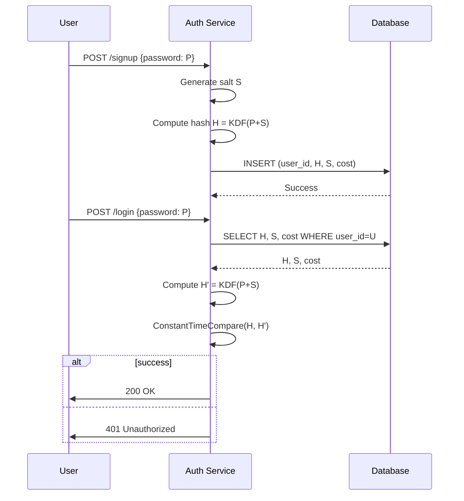

<!-- Generated by Groq via GitHub Actions -->
<!-- Topic ID: T127 -->
<!-- Category: Backend Security -->
<!-- Generated at UTC: 2026-10-24T06:05:14.104682+00:00 -->

# Argon2 / bcrypt

## 1. What problem does this solve?

- **Problem**: Storing user passwords in plain text or weakly hashed form exposes them to attackers if the database is compromised.  
- **Why it matters**: Passwords are often reused across sites. A single leak can lead to credential stuffing attacks, account takeover, and downstream data breaches.  
- **Consequence of not using**:  
  - Attackers can brute‑force or pre‑compute rainbow tables quickly.  
  - Even if the hash is stored, a fast hash (e.g., MD5) can be cracked in seconds.  
- **Real‑world appearance**:  
  - Authentication services (OAuth providers, SaaS platforms).  
  - Any system that stores user credentials (web apps, mobile backends, microservices).  
  - Password reset flows, multi‑factor authentication setups, and audit logs.

## 2. Mental model

**Analogy**  
Think of a password as a secret recipe.  
- **Plain text**: You write the recipe on a sticky note and leave it on the kitchen counter. Anyone can read it.  
- **Fast hash (e.g., SHA‑256)**: You put the recipe in a small lockbox that opens in a few seconds. Still easy for a thief.  
- **bcrypt/Argon2**: You put the recipe in a heavy, tamper‑evident vault that requires a slow, computationally expensive key‑derivation process to open. Even if the vault is stolen, the thief must spend a lot of time and resources to get the recipe.

**Engineering model**  
- **Key‑Derivation Function (KDF)**: Takes a password + salt → produces a hash.  
- **Cost parameters**:  
  - *bcrypt*: `cost` (log₂ of the number of iterations).  
  - *Argon2*: `time`, `memory`, `parallelism`.  
- **Salt**: Random per‑user value to defeat pre‑computed tables.  
- **Pepper** (optional): A server‑side secret added to every password before hashing, stored outside the database.

## 3. Deep explanation

### Internals

| Feature | bcrypt | Argon2 |
|---------|--------|--------|
| Algorithm | Blowfish‑based, iterative key‑expansion | Memory‑hard, uses a variant of the BLAKE2 hash |
| Output | 184‑bit hash (22‑char base64) | 256‑bit hash (base64 or hex) |
| Salt | 128‑bit (16 bytes) | 128‑bit (16 bytes) |
| Parallelism | Single‑threaded (but can be run in parallel across users) | Configurable parallelism (threads) |
| Memory usage | Fixed small (≈128 kB) | Tunable (e.g., 64 MiB) |

### Important terminology

- **Cost factor**: Determines how many iterations or how much memory is used.  
- **Work factor**: Same as cost factor but often used in Argon2 context.  
- **Salt**: Random data appended to the password before hashing.  
- **Pepper**: Server‑side secret added to the password before hashing.  
- **Hash**: The derived value stored in the database.  
- **Time‑memory trade‑off**: Argon2 allows explicit tuning of CPU vs. memory consumption.

### Trade‑offs

| Aspect | bcrypt | Argon2 |
|--------|--------|--------|
| **Speed** | Fast on modern CPUs; can be tuned. | Slower by design; can be tuned for memory hardness. |
| **Memory usage** | Low | High (configurable). |
| **Security** | Strong against GPU cracking; still vulnerable to side‑channel attacks if not implemented carefully. | Memory‑hardness makes GPU/ASIC attacks expensive. |
| **Maturity** | Widely deployed; many libraries. | Newer but standardized (RFC 9106). |
| **Backwards compatibility** | Legacy systems often use bcrypt. | Argon2 may require migration. |

### Failure modes

- **Weak cost factor**: Allows attackers to brute‑force quickly.  
- **Reusing salts**: Breaks uniqueness; leads to identical hashes for identical passwords.  
- **Storing pepper in code**: If the code is leaked, pepper is compromised.  
- **Not verifying timing**: Timing attacks can leak hash comparison results.

### Limitations

- **bcrypt**: Limited to 2⁶⁴ iterations; cannot use memory hardness.  
- **Argon2**: Requires careful tuning; too high memory can exhaust server resources.  
- Both: Still vulnerable if the password itself is weak (short, common).

### Where it fits in a backend architecture

```
┌───────────────────────┐
│  Client (Web/Mobile)  │
└─────────────┬─────────┘
              │
              ▼
┌───────────────────────┐
│  API Gateway / Auth   │
│  Service (Node.js)    │
└───────┬───────────────┘
        │
        ▼
┌───────────────────────┐
│  User Service         │
│  - Hashes passwords   │
│  - Stores hash+salt   │
└───────┬───────────────┘
        │
        ▼
┌───────────────────────┐
│  PostgreSQL / MongoDB │
└───────────────────────┘
```

- Hashing happens **before** persisting to the database.  
- Verification happens on login: retrieve hash+salt, recompute, compare.

### Interaction with related concepts

- **Password policy enforcement**: Hashing is only part of security; enforce length, complexity, or use password‑strength libraries.  
- **Rate limiting**: Protect login endpoints to mitigate brute‑force attempts.  
- **Account lockout / MFA**: Complement hashing with additional layers.  
- **Secrets management**: Store pepper in Vault, AWS KMS, or environment variables.

## 4. How it works

### Step‑by‑step flow

1. **User signs up** with password `P`.  
2. **Generate a random salt `S`** (16 bytes).  
3. **Concatenate** `P + S` (and optional pepper `K`).  
4. **Run KDF** (bcrypt or Argon2) with chosen cost parameters → hash `H`.  
5. **Store** `S`, `H`, and cost parameters in the database.  
6. **Login**: Retrieve `S`, `H`, cost.  
7. **Re‑hash** input password with same `S` and cost → `H'`.  
8. **Compare** `H'` to stored `H` using constant‑time comparison.  
9. **Grant access** if equal; otherwise reject.

#### Mermaid diagram



## 5. Practical implementation

### TypeScript/Node.js example (bcrypt)

```ts
// src/auth/hash.ts
import { randomBytes } from 'crypto';
import { hash, compare } from 'bcryptjs'; // lightweight, pure JS

const BCRYPT_COST = 12; // 2^12 iterations (~4096 rounds)

// Hash a password
export async function hashPassword(plain: string): Promise<string> {
  // bcryptjs automatically generates a salt when cost is provided
  return await hash(plain, BCRYPT_COST);
}

// Verify a password
export async function verifyPassword(
  plain: string,
  hashed: string
): Promise<boolean> {
  return await compare(plain, hashed);
}
```

### TypeScript/Node.js example (Argon2)

```ts
// src/auth/argon2.ts
import argon2 from 'argon2';

const ARGON2_OPTIONS: argon2.Options = {
  type: argon2.argon2id, // recommended
  memoryCost: 64 * 1024, // 64 MiB
  timeCost: 3,           // 3 iterations
  parallelism: 2,        // 2 threads
};

export async function hashPassword(plain: string): Promise<string> {
  return await argon2.hash(plain, ARGON2_OPTIONS);
}

export async function verifyPassword(
  plain: string,
  hashed: string
): Promise<boolean> {
  return await argon2.verify(hashed, plain);
}
```

### Using the hash in a FastAPI endpoint (Python)

```python
# auth.py
import bcrypt
from fastapi import FastAPI, HTTPException

app = FastAPI()

@app.post("/signup")
async def signup(username: str, password: str):
    hashed = bcrypt.hashpw(password.encode(), bcrypt.gensalt())
    # store username, hashed in DB
    return {"status": "ok"}

@app.post("/login")
async def login(username: str, password: str):
    # fetch hashed from DB
    if not bcrypt.checkpw(password.encode(), stored_hash):
        raise HTTPException(status_code=401, detail="Invalid credentials")
    return {"status": "ok"}
```

> **Note**: In production, use a dedicated auth service, store salts explicitly if needed, and never log raw passwords.

## 6. Production considerations

| Concern | bcrypt | Argon2 |
|---------|--------|--------|
| **Scalability** | CPU‑bound; can be parallelized across users. | Memory‑bound; may limit concurrent users per instance. |
| **Reliability** | Mature libraries; stable. | Newer but stable; watch for library bugs. |
| **Security** | Resistant to GPU cracking; still vulnerable to side‑channel. | Memory hardness makes GPU/ASIC attacks expensive. |
| **Observability** | Log hash generation times; monitor for slow operations. | Monitor memory usage per hash; alert on spikes. |
| **Performance** | Fast; cost factor 12 ≈ 100 ms on modern CPU. | Slower; cost factor 3, memory 64 MiB ≈ 200–300 ms. |
| **Error handling** | Catch `bcrypt` errors; fallback to retry. | Catch `argon2` errors; ensure proper exception mapping. |
| **Resource usage** | CPU heavy; keep cost factor reasonable. | Memory heavy; avoid exceeding container limits. |
| **Operational concerns** | Upgrade libraries regularly; keep cost factor in sync. | Tune memory/time/parallelism per deployment; monitor for OOM. |
| **Failure recovery** | Re‑hash on upgrade; migration scripts. | Migration from bcrypt to Argon2: store both hashes until all users migrate. |
| **Deployment** | Simple; no external dependencies. | Requires enough RAM; may need larger Docker images. |

## 7. Common mistakes

| Mistake | Why it’s problematic |
|---------|----------------------|
| Using a **fixed salt** for all users | Enables rainbow table attacks; identical passwords produce identical hashes. |
| Setting **cost factor too low** | Makes brute‑force feasible. |
| Storing **plain passwords** in logs or error messages | Immediate credential leakage. |
| Using **bcrypt on a GPU‑optimized environment** without monitoring | Attackers can massively parallelize cracking. |
| Ignoring **constant‑time comparison** | Timing attacks can reveal hash equality. |
| Forgetting to **upgrade cost factors** over time | Security degrades as hardware improves. |
| Using **argon2id** incorrectly (e.g., wrong options) | May produce insecure hashes or crash. |
| Storing **pepper** in the same repo as code | If repo is compromised, pepper is lost. |

## 8. Senior engineer perspective

### Architecture decisions

- **Dedicated Auth Service**: Isolate hashing logic to avoid accidental leaks.  
- **Hash Migration Strategy**: Store both bcrypt and Argon2 hashes during transition; re‑hash on next successful login.  
- **Secrets Management**: Store pepper in Vault or KMS; rotate periodically.  
- **Cost Parameter Policy**: Define a policy (e.g., cost 12 for bcrypt, memory 128 MiB for Argon2) and enforce via CI checks.  
- **Resource Allocation**: For Argon2, allocate enough RAM per container; consider using a separate pool of workers.

### Trade‑offs

- **Performance vs. Security**: Higher memory/time reduces attack surface but increases latency and resource cost.  
- **Operational Complexity**: Argon2 requires monitoring memory usage; bcrypt is simpler.  
- **Compatibility**: Legacy systems may still rely on bcrypt; migrating to Argon2 may require user re‑registration or staged rollout.

### Bottlenecks

- **CPU**: bcrypt can saturate CPU on high login traffic.  
- **Memory**: Argon2 can exhaust RAM on large clusters if not tuned.  
- **Database**: Storing salts and cost parameters increases row size; consider compression.

### Failure scenarios

- **OOM during Argon2**: Crash the worker; implement graceful shutdown and retry.  
- **Hash collision**: Extremely unlikely; still log and alert if detected.  
- **Pepper compromise**: Trigger immediate rotation and re‑hash all passwords.

### Monitoring

- **Hashing latency**: Histogram per endpoint.  
- **Memory usage**: Prometheus metrics for Argon2 workers.  
- **Failed login attempts**: Rate‑limit alerts.  
- **Cost factor drift**: Alert if cost factor falls below policy threshold.

### Cost/performance

- **CPU cost**: bcrypt 12 ≈ 100 ms; Argon2 3×64 MiB ≈ 250 ms.  
- **Memory cost**: Argon2 64 MiB per hash; consider batching or worker pools.  
- **Infrastructure**: May need larger instances or more workers for Argon2.

### When NOT to use

- **Very low‑traffic sites**: bcrypt may be sufficient and simpler.  
- **Resource‑constrained environments**: Argon2’s memory usage may be prohibitive.  
- **Legacy systems**: If migration is impossible, stick with bcrypt but keep cost high.

## 9. Interview questions

1. **Beginner**: *What is the purpose of a salt in password hashing?*  
   *Answer*: Prevents identical passwords from producing identical hashes; defeats rainbow tables.

2. **Beginner**: *Why is bcrypt considered slow, and why is that good?*  
   *Answer*: It intentionally performs many iterations to make brute‑force attacks computationally expensive.

3. **Senior**: *Explain how Argon2’s memory hardness protects against GPU cracking.*  
   *Answer*: GPUs excel at parallel CPU operations but have limited memory bandwidth; Argon2 forces each hash to use a large memory block, making GPU parallelism ineffective.

4. **Senior**: *Design a migration strategy to move from bcrypt to Argon2 in a production system without forcing users to reset passwords.*  
   *Answer*: Store both hashes; on login, verify with bcrypt, then re‑hash with Argon2 and update DB; gradually phase out bcrypt after all users have logged in.

5. **Scenario/Debugging**: *A login endpoint is suddenly slower by 5×. You suspect hashing is the culprit. How would you investigate and resolve this?*  
   *Answer*:  
   - Profile request latency; isolate hashing time.  
   - Check cost parameters (maybe bumped).  
   - Verify memory usage spikes (Argon2).  
   - Consider scaling workers or adjusting cost.  
   - Add caching for repeated logins? (not advisable).  
   - Update monitoring and alert thresholds.

## 10. Hands‑on task

**Task**: Implement a password migration endpoint in a Node.js/Express app that:

1. Accepts a username and password.  
2. Retrieves the stored bcrypt hash.  
3. Verifies the password.  
4. Re‑hashes the password with Argon2 (using `argon2id`).  
5. Stores the new Argon2 hash and marks the user as migrated.  

**Goal**: Demonstrate understanding of both KDFs, migration logic, and secure storage.

## 11. Quick revision

- Passwords must never be stored in plain text.  
- **Salt**: unique per user; prevents rainbow tables.  
- **Pepper**: server‑side secret; adds an extra layer.  
- **bcrypt**: CPU‑bound, cost factor 2ⁿ iterations.  
- **Argon2**: memory‑hard, configurable time/memory/parallelism.  
- Use **constant‑time comparison** to avoid timing attacks.  
- **Migration**: store both hashes until all users re‑hash.  
- Monitor **latency** and **resource usage**; adjust cost parameters over time.  
- Keep **cost factors** in sync with hardware improvements.  
- **Never log** raw passwords or hash errors.  
- Use **secrets management** for pepper.  
- **Rate limit** login attempts to mitigate brute‑force.  
- **Unit test** hashing and verification functions.  
- **Upgrade** libraries regularly; watch for deprecations.

## 12. References

- [bcrypt RFC 2898 (PBKDF2) – but bcrypt is a separate algorithm](https://tools.ietf.org/html/rfc2898)  
- [bcrypt.js documentation](https://github.com/dcodeIO/bcrypt.js)  
- [argon2 RFC 9106](https://datatracker.ietf.org/doc/html/rfc9106)  
- [argon2 npm package](https://github.com/ranisalt/node-argon2)  
- [OWASP Password Storage Cheat Sheet](https://cheatsheetseries.owasp.org/cheatsheets/Password_Storage_Cheat_Sheet.html)  
- [Node.js crypto module](https://nodejs.org/api/crypto.html)  
- [FastAPI security docs](https://fastapi.tiangolo.com/tutorial/security/)
