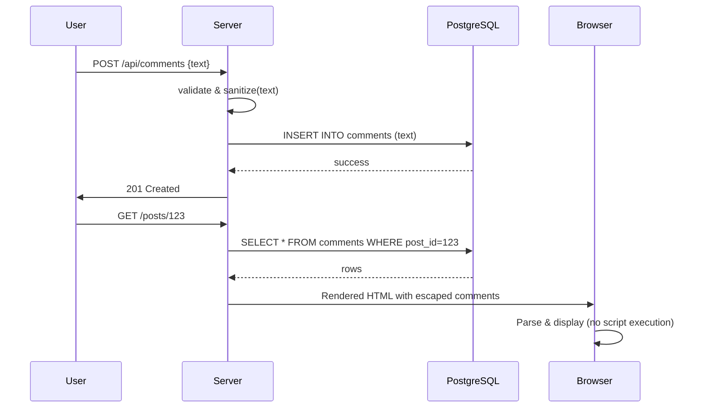

<!-- Generated by Groq via GitHub Actions -->
<!-- Topic ID: T129 -->
<!-- Category: Backend Security -->
<!-- Generated at UTC: 2026-10-24T16:48:03.951484+00:00 -->

# XSS

## 1. What problem does this solve?

**Motivation**  
When a web application accepts user‑generated content (comments, profiles, posts, etc.) and later renders that content back to browsers, an attacker can inject malicious JavaScript. That script runs in the victim’s browser with the same origin as the site, giving the attacker access to cookies, session tokens, or the ability to perform actions on behalf of the user.  

**What problem exists**  
- Arbitrary code execution in the client’s browser.  
- Theft of authentication credentials or session data.  
- Manipulation of the UI to trick users into revealing secrets (phishing).  
- Silent data exfiltration or account takeover.  

**Why the problem matters**  
- **Security**: Compromised user accounts, data leaks, and loss of trust.  
- **Compliance**: Regulations (GDPR, PCI‑DSS) require protection of personal data.  
- **Reputation**: A single XSS incident can damage brand credibility.  

**What happens if this concept is not used**  
- Attackers can inject `<script>` tags, inline event handlers, or malicious URLs.  
- The browser will execute the code, potentially sending cookies to an attacker’s server.  
- Users may unknowingly perform actions (e.g., transfer money) that the attacker orchestrates.  

**Where this concept appears in real backend systems**  
- Social media comment sections.  
- User profile bios.  
- Forum posts.  
- Search result snippets.  
- Any API that returns HTML fragments or JSON that is later rendered with `innerHTML`.

---

## 2. Mental model

**Analogy**  
Think of a kitchen where you store food (user data) in a pantry (database). If you let anyone bring in raw, unwashed ingredients (untrusted input) and you put them directly on the counter (rendered page) without washing or inspecting them, a thief could slip in a poison pill. The kitchen staff (backend) must inspect, clean, and sanitize every ingredient before it reaches the dining table (browser).

**Precise engineering model**  
- **Input** → **Sanitization / Escaping** → **Storage** → **Rendering** → **Browser**  
- The backend is responsible for ensuring that any data that ends up in the DOM cannot be interpreted as executable code.  
- The browser is a *trusted* environment that will execute any script it receives unless the content is properly escaped or the browser is instructed not to execute it (via CSP).

---

## 3. Deep explanation

| Topic | Explanation |
|-------|-------------|
| **Internals** | XSS exploits the fact that browsers parse HTML, CSS, and JavaScript. If a string containing `<script>` or an event attribute (`onclick`) is inserted into the DOM, the browser will execute it. |
| **Terminology** | - **Reflected XSS**: payload is reflected in the same request (e.g., query string). <br> - **Stored XSS**: payload is persisted (database) and served later. <br> - **DOM‑based XSS**: payload is processed by client‑side JavaScript. |
| **Trade‑offs** | - **Strict escaping** (e.g., `&lt;script&gt;`) is safe but may break legitimate markup. <br> - **Content Security Policy (CSP)** reduces risk by blocking inline scripts but may require refactoring. <br> - **Sanitization libraries** (DOMPurify) allow safe HTML but add CPU overhead. |
| **Failure modes** | - Skipping escaping on dynamic attributes. <br> - Using `innerHTML` without sanitization. <br> - Disabling CSP or using `unsafe-inline`. <br> - Trusting data from third‑party APIs. |
| **Limitations** | CSP cannot protect against all XSS if the attacker can inject a script tag that is allowed by the policy. Sanitization libraries may not cover every edge case. |
| **Where it fits** | XSS protection is part of the **request → response** pipeline, usually in the rendering layer (templates, React SSR) or in API responses that are consumed by client‑side rendering. |
| **Interaction with related concepts** | - **CSRF**: XSS can be a vector for CSRF tokens. <br> - **Session management**: stolen cookies lead to session hijacking. <br> - **CORS**: misconfigured CORS can amplify XSS impact. |

---

## 4. How it works

1. **User submits content** (e.g., comment) → HTTP POST to `/api/comments`.  
2. **Server receives payload** → validates schema.  
3. **Server sanitizes** the content (escape or DOMPurify).  
4. **Server stores** sanitized content in PostgreSQL.  
5. **When rendering** a page, server fetches content and injects it into the template.  
6. **Browser receives HTML** → parses it; because the content is escaped, no script executes.  



---

## 5. Practical implementation

Below is a minimal Express + TypeScript example that protects against stored XSS using `DOMPurify` and enforces a CSP header.

```ts
// src/server.ts
import express from 'express';
import { Pool } from 'pg';
import { JSDOM } from 'jsdom';
import { createServer } from 'http';
import helmet from 'helmet';

const app = express();
app.use(express.json());

// 1️⃣ CSP header (strict, no inline scripts)
app.use(
  helmet.contentSecurityPolicy({
    directives: {
      defaultSrc: ["'self'"],
      scriptSrc: ["'self'"],
      objectSrc: ["'none'"],
      upgradeInsecureRequests: [],
    },
  })
);

// 2️⃣ PostgreSQL pool
const pool = new Pool({
  connectionString: process.env.DATABASE_URL,
});

// 3️⃣ Sanitizer helper
function sanitize(html: string): string {
  const window = new JSDOM('').window;
  const purify = require('dompurify')(window);
  return purify.sanitize(html, { USE_PROFILES: { html: true } });
}

// 4️⃣ Create comment
app.post('/api/comments', async (req, res) => {
  const { postId, text } = req.body;
  if (!postId || !text) return res.status(400).json({ error: 'Missing fields' });

  const safeText = sanitize(text); // ← XSS protection

  await pool.query(
    'INSERT INTO comments (post_id, text) VALUES ($1, $2)',
    [postId, safeText]
  );
  res.status(201).json({ status: 'ok' });
});

// 5️⃣ Render post with comments
app.get('/posts/:id', async (req, res) => {
  const { id } = req.params;
  const { rows } = await pool.query(
    'SELECT text FROM comments WHERE post_id = $1 ORDER BY created_at',
    [id]
  );

  // Simple EJS‑like rendering
  const commentsHtml = rows
    .map((row) => `<p>${row.text}</p>`) // already sanitized
    .join('');

  const html = `
    <!DOCTYPE html>
    <html>
      <head><title>Post ${id}</title></head>
      <body>
        <h1>Post ${id}</h1>
        <div id="comments">${commentsHtml}</div>
      </body>
    </html>
  `;
  res.send(html);
});

const server = createServer(app);
server.listen(3000, () => console.log('🚀 Server listening on :3000'));
```

**Key lines**

- `helmet.contentSecurityPolicy` → forces the browser to reject inline scripts.  
- `sanitize(text)` → removes `<script>` tags, event attributes, and dangerous URLs.  
- The database stores the *sanitized* string, so even if the rendering layer is compromised, the data is safe.

---

## 6. Production considerations

| Concern | Recommendation |
|---------|----------------|
| **Scalability** | Use a CDN to cache static pages; keep sanitization in a microservice if CPU‑heavy. |
| **Reliability** | Fallback to a safe default if sanitization fails; log errors. |
| **Security** | Combine CSP, sanitization, and strict HTTP headers (`X-Content-Type-Options`, `X-Frame-Options`). |
| **Observability** | Log XSS attempts (e.g., payloads that were sanitized). |
| **Performance** | Cache sanitized results; use a lightweight sanitizer for simple text. |
| **Error handling** | Return 400 for malformed input; do not expose stack traces. |
| **Resource usage** | Sanitization libraries can be CPU‑intensive; consider worker threads. |
| **Operational concerns** | Keep libraries up‑to‑date; monitor CSP violation reports. |
| **Failure recovery** | If CSP is misconfigured, revert to a safe policy and alert. |
| **Deployment** | Use environment variables for CSP directives; test in staging before prod. |

---

## 7. Common mistakes

| Mistake | Why it’s problematic |
|---------|----------------------|
| **Using `innerHTML` without sanitization** | Directly injects attacker payloads. |
| **Trusting user input in URLs or CSS** | Allows `javascript:` URLs or `url()` functions to execute code. |
| **Disabling CSP or using `unsafe-inline`** | Gives attackers a wide attack surface. |
| **Relying solely on server‑side escaping** | Some frameworks (e.g., React) escape by default; mixing with raw HTML can bypass. |
| **Not escaping dynamic attributes** | `<a href="${url}">` can inject `onclick`. |
| **Using `eval` or `new Function`** | Executes arbitrary code; should never be used with user data. |
| **Ignoring third‑party content** | External widgets can introduce XSS if not sandboxed. |

---

## 8. Senior engineer perspective

### Design decisions at scale

| Decision | Trade‑off | Bottleneck | Monitoring |
|----------|-----------|------------|------------|
| **Auto‑escaping templates** (e.g., EJS, Handlebars) | Simplicity vs. flexibility | Template rendering CPU | Render latency |
| **CSP with nonces** | Strong protection vs. complexity | Generating nonces per request | CSP violation logs |
| **Sanitization microservice** | Isolation vs. latency | Network hop | Sanitization success rate |
| **Content‑based caching** | Faster response vs. stale data | Cache invalidation | Cache hit ratio |
| **Database‑level constraints** (e.g., `CHECK` on length) | Prevents huge payloads | Write throughput | Storage usage |

### When NOT to use the approach

- If the application requires **rich, untrusted HTML** (e.g., a WYSIWYG editor) and cannot afford to strip all markup, consider a **sandboxed iframe** or a **trusted‑content store** with strict CSP.  
- For **high‑throughput logging** of user comments where sanitization is too expensive, batch sanitize or use a dedicated worker pool.

---

## 9. Interview questions

1. **Beginner** – *What is XSS and why is it dangerous?*  
   - *Answer:* XSS injects malicious scripts into a page, allowing attackers to steal data, hijack sessions, or perform actions as the user.

2. **Beginner** – *How does a Content Security Policy help mitigate XSS?*  
   - *Answer:* CSP instructs the browser to block execution of inline scripts, external scripts from untrusted sources, and restricts `eval`, reducing the attack surface.

3. **Senior** – *Explain the difference between reflected, stored, and DOM‑based XSS, and give an example of how you would mitigate each.*  
   - *Answer:*  
     - *Reflected:* payload in query string; mitigate by escaping output.  
     - *Stored:* payload persisted; mitigate by sanitizing before storage.  
     - *DOM:* payload processed by client JS; mitigate by sanitizing input before DOM manipulation or using CSP.

4. **Senior** – *You have a microservice that accepts user comments and returns them via a REST API. How would you design the service to be XSS‑safe while keeping performance high?*  
   - *Answer:* Use a lightweight sanitizer (e.g., `escape-html`) for plain text, store sanitized data, enforce CSP headers, cache sanitized results, and run sanitization in a worker thread pool.

5. **Scenario/Debugging** – *A production site reports that a user’s comment containing `<script>alert(1)</script>` is still executing in the browser. What could be wrong?*  
   - *Answer:* Possible causes:  
     1. Sanitization not applied before rendering.  
     2. The comment was stored unsanitized.  
     3. The template uses `dangerouslySetInnerHTML` or `innerHTML` without escaping.  
     4. CSP is misconfigured or missing, allowing inline scripts.  
     5. The comment is rendered in a context that bypasses escaping (e.g., JSON embedded in a `<script>` tag).  

---

## 10. Hands‑on task

**Task**: Build a small Express app that exposes `/api/comments` (POST) and `/posts/:id` (GET).  
1. Store comments in PostgreSQL.  
2. Sanitize input with `DOMPurify`.  
3. Add a CSP header that blocks inline scripts.  
4. Write a test script that posts a malicious payload and verifies that the rendered page does **not** execute the script (e.g., by checking the DOM in a headless browser).  
5. Dockerise the app and run it locally.

*Hints*: Use `jest` + `puppeteer` for the test; expose the app on port 3000; use `docker-compose` to spin up PostgreSQL.

---

## 11. Quick revision

- XSS = injection of malicious scripts via user input.  
- Types: reflected, stored, DOM‑based.  
- Mitigation: escape output, sanitize input, CSP, `helmet`.  
- CSP directives: `script-src 'self'`, `object-src 'none'`.  
- Sanitization libraries: DOMPurify, `escape-html`.  
- Don’t use `innerHTML` with untrusted data.  
- Store sanitized data to avoid re‑sanitization on every render.  
- Monitor CSP violations and XSS logs.  
- At scale, balance CPU cost of sanitization with caching.  
- Never disable CSP or use `unsafe-inline`.  

---

## 12. References

- OWASP XSS Prevention Cheat Sheet: https://cheatsheetseries.owasp.org/cheatsheets/XSS_Prevention_Cheat_Sheet.html  
- MDN Web Docs – Content Security Policy: https://developer.mozilla.org/en-US/docs/Web/HTTP/CSP  
- Express.js – Helmet middleware: https://github.com/helmetjs/helmet  
- DOMPurify – Official docs: https://github.com/cure53/DOMPurify  
- PostgreSQL – `pg` Node.js client: https://node-postgres.com/  
- MDN – `innerHTML` security: https://developer.mozilla.org/en-US/docs/Web/API/Element/innerHTML  
- OWASP – CSP Cheat Sheet: https://cheatsheetseries.owasp.org/cheatsheets/Content_Security_Policy_Cheat_Sheet.html

---
