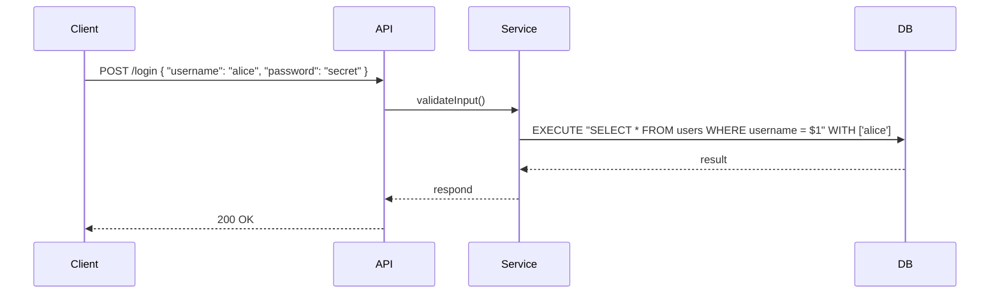

<!-- Generated by Groq via GitHub Actions -->
<!-- Topic ID: T130 -->
<!-- Category: Backend Security -->
<!-- Generated at UTC: 2026-10-24T16:48:03.951484+00:00 -->

# SQL injection

## 1. What problem does this solve?

**Motivation**  
When a backend receives user input and plugs it directly into an SQL query, an attacker can inject arbitrary SQL. This turns a harmless lookup into a full‑blown database compromise.

**What problem exists**  
- Untrusted data is concatenated into SQL strings.
- The database engine interprets the concatenated string as a single SQL command.

**Why the problem matters**  
- Data theft or destruction.
- Privilege escalation (e.g., bypassing authentication).
- Exposure of sensitive configuration or credentials.
- Legal/regulatory penalties for data breaches.

**What happens if this concept is not used**  
- Attackers can read, modify, or delete data.
- They can execute administrative commands (e.g., `DROP TABLE`).
- The application can become a pivot point for further attacks.

**Where this concept appears in real backend systems**  
- User authentication (login forms).
- Search or filter endpoints that build queries from query strings.
- Admin dashboards that allow raw SQL execution.
- Legacy codebases that use string interpolation for queries.

---

## 2. Mental model

**Analogy**  
Imagine a mail‑room where you hand a letter to a clerk and ask them to deliver it. If you write the recipient’s name on the envelope, the clerk will deliver it to that person. But if you write a note that says “Deliver to *all* employees and also delete the office keys,” the clerk will follow that instruction because the note is part of the letter.  
In SQL injection, the user’s input is like that note: it becomes part of the SQL command that the database executes.

**Engineering model**  
- **Input** → **Query Builder** → **SQL String** → **Database Engine**  
If the query builder blindly concatenates input, the input can alter the structure of the SQL string, leading to unintended commands.

---

## 3. Deep explanation

### Internals
- **SQL parser**: The database parses the received string into an abstract syntax tree (AST).
- **Execution plan**: The planner decides how to run the query.
- **Security context**: The database checks permissions for each operation in the AST.

When injection occurs, the attacker’s payload changes the AST, adding new nodes (e.g., `UNION`, `DROP`).

### Important terminology
- **Parameterized queries / prepared statements**: SQL statements with placeholders (`?`, `$1`) that separate code from data.
- **Binding**: The process of associating user input with placeholders.
- **Escaping**: Transforming special characters so they lose syntactic meaning.
- **SQL injection vector**: The part of the input that can alter the query structure.

### Trade‑offs
| Approach | Pros | Cons |
|----------|------|------|
| Parameterized queries | Prevents injection, simple to use | Requires ORM or driver support |
| Escaping | Works with legacy code | Error‑prone, hard to maintain |
| ORM query builders | High abstraction | May still allow raw SQL if misused |

### Failure modes
- **Blind injection**: No visible error, attacker infers data via timing or error messages.
- **Error‑based injection**: Database errors leak schema information.
- **Union-based injection**: Appends a second query to retrieve data.

### Limitations
- Parameterized queries only protect the *structure* of the query; they do not validate business logic (e.g., ensuring a user can only access their own records).
- Some ORMs allow raw SQL; developers must be vigilant.

### Where this concept fits in a backend architecture
- **API layer**: Receives HTTP requests, validates input.
- **Service layer**: Builds queries, often via an ORM or query builder.
- **Data access layer**: Executes parameterized statements against PostgreSQL/MongoDB (for Mongo, use query objects, not string interpolation).

### Interaction with related concepts
- **Authentication & authorization**: Even with safe queries, you must enforce row‑level security.
- **Input validation**: Sanitizing input reduces risk but is not a substitute for parameterization.
- **Logging & monitoring**: Detect anomalous query patterns.

---

## 4. How it works

1. **Client sends request** with user data (e.g., `username`).
2. **API parses JSON** and validates structure.
3. **Service layer** constructs a parameterized query:
   ```sql
   SELECT * FROM users WHERE username = $1
   ```
4. **Database driver** binds the `username` value to `$1`.
5. **Database parses** the query AST; the bound value is treated as data, not code.
6. **Execution** proceeds safely; no injected SQL can alter the AST.



---

## 5. Practical implementation

### TypeScript/Node.js with `pg` (PostgreSQL)

```ts
import { Pool } from 'pg';

const pool = new Pool({
  connectionString: process.env.DATABASE_URL,
});

export async function getUserByUsername(username: string) {
  // 1️⃣ Use a parameterized query
  const query = {
    text: 'SELECT id, email FROM users WHERE username = $1',
    values: [username], // 2️⃣ Binding
  };

  const res = await pool.query(query);
  return res.rows[0];
}
```

**Key points**

- `text` contains placeholders (`$1`, `$2`, …).
- `values` is an array of user‑supplied data; the driver escapes it internally.
- No string concatenation; the query structure is fixed.

### Using an ORM (Prisma)

```ts
import { PrismaClient } from '@prisma/client';
const prisma = new PrismaClient();

export async function getUserByUsername(username: string) {
  return await prisma.user.findUnique({
    where: { username }, // Prisma automatically parameterizes
  });
}
```

### MongoDB (no SQL injection risk)

```ts
import { MongoClient } from 'mongodb';

const client = new MongoClient(process.env.MONGO_URI);
await client.connect();
const db = client.db('app');

export async function findUser(username: string) {
  // 1️⃣ Use a query object, not a string
  return await db.collection('users').findOne({ username });
}
```

---

## 6. Production considerations

| Concern | How to address |
|---------|----------------|
| **Scalability** | Use connection pooling (`pg.Pool`). Keep query plans cached. |
| **Reliability** | Wrap queries in transactions when multiple statements are needed. |
| **Security** | Enable TLS for DB connections. Store credentials in secrets manager. |
| **Observability** | Log query latency. Use APM to detect slow or anomalous queries. |
| **Performance** | Avoid unnecessary `SELECT *`. Use indexes on filter columns. |
| **Error handling** | Catch database errors, map to user‑friendly messages. |
| **Resource usage** | Close idle connections. Use `pool.end()` on shutdown. |
| **Operational concerns** | Monitor connection pool exhaustion. |
| **Failure recovery** | Implement retry logic with exponential backoff for transient errors. |
| **Deployment** | Use environment variables for DB URLs. Separate dev/qa/prod databases. |

---

## 7. Common mistakes

| Mistake | Why it’s problematic |
|---------|----------------------|
| **String concatenation** (`'SELECT * FROM users WHERE id=' + id`) | Allows injection; attacker can alter query logic. |
| **Using `LIKE` with `%` without escaping** | `%` can match anything, enabling pattern injection. |
| **Assuming input validation is enough** | Validation removes obvious bad characters but cannot prevent logical injection. |
| **Using raw SQL in ORMs without parameterization** | ORMs often expose a `raw` method; misuse can re‑introduce injection. |
| **Neglecting to bind all variables** | Leaving a placeholder unbound can lead to syntax errors or unintended defaults. |
| **Hard‑coding credentials** | Not a direct injection issue, but exposes credentials that could be used in injection attacks. |

---

## 8. Senior engineer perspective

### When used at scale

- **Architecture decisions**: Adopt a data access layer that enforces parameterization by design. Prefer ORMs that abstract away raw SQL.
- **Trade‑offs**: Parameterized queries add a tiny overhead (binding), but the security benefit outweighs it.
- **Bottlenecks**: Connection pool exhaustion; mitigate with proper sizing and connection reuse.
- **Failure scenarios**: If a developer bypasses the abstraction layer, injection can re‑appear. Enforce code reviews.
- **Monitoring**: Track query plan changes; sudden plan changes may indicate injection attempts.
- **Cost/performance**: Parameterized queries reduce the need for expensive `EXPLAIN` analysis; they also lower the risk of costly data breaches.
- **When NOT to use**: In highly dynamic query generation where the structure must change at runtime, use a query builder that still separates data from code (e.g., Knex.js).

---

## 9. Interview questions

1. **Beginner**: *What is SQL injection and why is it dangerous?*  
   *Answer*: It’s a technique where an attacker injects malicious SQL into a query, potentially reading or modifying data. It’s dangerous because it can expose or destroy data and compromise the system.

2. **Beginner**: *How does a parameterized query prevent SQL injection?*  
   *Answer*: The query structure is fixed with placeholders; user input is bound as data, not parsed as SQL code, so it cannot alter the query logic.

3. **Senior**: *Explain how prepared statements work under the hood in PostgreSQL.*  
   *Answer*: The driver sends the query text once, the server parses it into an AST, and creates a plan. Subsequent executions bind new parameters to the same plan, avoiding reparsing and improving performance.

4. **Senior**: *What are the risks of using an ORM’s raw SQL feature, and how can you mitigate them?*  
   *Answer*: Raw SQL bypasses the ORM’s safety nets, re‑introducing injection risk. Mitigate by validating inputs, using parameterized raw queries, or restricting raw usage to trusted code paths.

5. **Scenario/Debugging**: *You notice a login endpoint is returning all users when a special username is supplied (`' OR 1=1 --`). What is happening and how would you fix it?*  
   *Answer*: The endpoint concatenates the username into the SQL string, so the injected `OR 1=1` makes the WHERE clause always true, returning all rows. Fix by switching to a parameterized query or using an ORM that binds the username.

---

## 10. Hands‑on task

**Task**: Refactor the existing `/search` endpoint in the `src/routes/search.ts` file to use parameterized queries instead of string interpolation.  
- The current code builds a query like:  
  ```ts
  const sql = `SELECT * FROM posts WHERE title ILIKE '%${req.query.q}%'`;
  ```
- Replace it with a safe version using `$1` placeholder.  
- Add unit tests that attempt to inject `'; DROP TABLE posts; --` and verify that the table is not dropped.  
- Update the README to document the change.

---

## 11. Quick revision

- SQL injection injects malicious SQL via user input.
- Parameterized queries (`$1`, `?`) separate code from data.
- Prepared statements parse once, bind many times.
- ORMs often provide safe abstractions; avoid raw SQL unless necessary.
- Always validate input, but don’t rely on it for security.
- Monitor query patterns for anomalies.
- Use connection pools and TLS for production DB access.
- Test with malicious payloads to ensure safety.
- Code reviews should flag any string‑concatenated queries.
- Keep secrets out of source control; use secrets managers.

---

## 12. References

- [PostgreSQL: Prepared Statements](https://www.postgresql.org/docs/current/sql-prepare.html)
- [Node.js `pg` documentation – Parameterized Queries](https://node-postgres.com/features/queries)
- [Prisma: Querying](https://www.prisma.io/docs/concepts/components/prisma-client/querying)
- [OWASP: SQL Injection](https://owasp.org/www-community/attacks/SQL_Injection)
- [MongoDB: Query Objects](https://docs.mongodb.com/manual/tutorial/query-documents/)
- [SQL Injection Prevention Cheat Sheet – OWASP](https://cheatsheetseries.owasp.org/cheatsheets/SQL_Injection_Prevention_Cheat_Sheet.html)
