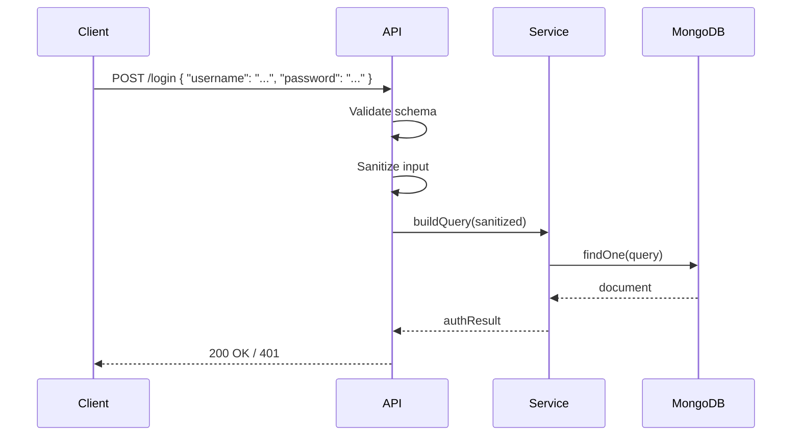

<!-- Generated by Groq via GitHub Actions -->
<!-- Topic ID: T131 -->
<!-- Category: Backend Security -->
<!-- Generated at UTC: 2026-10-25T06:25:07.107519+00:00 -->

# NoSQL injection

## 1. What problem does this solve?

**Motivation**  
When a backend receives user data and uses it to build a query against a NoSQL database (MongoDB, Couchbase, DynamoDB, etc.), the developer often concatenates or merges the input directly into the query object. If the input contains special characters or an entire query fragment, the database interprets it as part of the query, potentially returning data the user shouldn’t see, modifying data, or even deleting collections.

**What problem exists**  
- Untrusted input is injected into a query structure.
- The database engine executes the injected fragment as a real query clause.

**Why the problem matters**  
- Data confidentiality: attackers can read arbitrary documents.
- Data integrity: attackers can update or delete data.
- Availability: attackers can trigger expensive queries that exhaust resources.

**What happens if this concept is not used**  
- Sensitive data leaks (e.g., user profiles, financial records).
- Unauthorized data modification or deletion.
- Potential denial‑of‑service by forcing heavy queries.

**Where this concept appears in real backend systems**  
- User authentication endpoints that build MongoDB queries from `req.body`.
- Search APIs that merge query parameters into a `$match` stage.
- Admin dashboards that allow dynamic filtering without sanitization.

---

## 2. Mental model

**Analogy**  
Imagine a chef who writes a recipe by copying the customer’s handwritten note directly into the cooking instructions. If the note contains a hidden ingredient or a dangerous command (“add *poison*”), the chef will unknowingly follow it, ruining the dish. The chef needs a safe way to interpret the note—like a parser that only accepts known ingredients and ignores unknown words.

**Engineering model**  
NoSQL injection is like giving the database a *raw* recipe that includes the user’s handwritten note. The database engine reads the note as part of the query. To prevent this, we must *sanitize* or *parameterize* the input so that only the intended fields are used, and any special characters are treated as data, not as query operators.

---

## 3. Deep explanation

### Internals
- **Query objects**: In MongoDB, a query is a JSON object. Operators like `$gt`, `$ne`, `$or` start with `$`. If user input contains these keys, they become operators.
- **Dynamic query construction**: Many ORMs or raw drivers allow building queries by merging objects (`{ ...userInput }`). If `userInput` contains `$ne`, the resulting query will include that operator.
- **Injection vector**: The attacker supplies a payload such as `{ "$ne": null }` or `{ "$gt": "" }` to bypass authentication or retrieve all documents.

### Important terminology
- **Injection**: Untrusted data is interpreted as part of a query.
- **Operator injection**: Injecting query operators (`$gt`, `$or`, `$where`).
- **Field injection**: Injecting field names that the application didn’t intend to expose.
- **Sanitization**: Removing or escaping dangerous characters/keys.
- **Parameterized queries**: Using driver APIs that separate data from query structure.

### Trade‑offs
| Approach | Pros | Cons |
|----------|------|------|
| **Strict schema validation** | Prevents unknown keys | Requires schema definition; may limit flexibility |
| **Whitelist of allowed fields** | Simple to implement | Must maintain list; new fields need updates |
| **Use of ODM/ORM** | Built‑in sanitization | May add overhead; not all ORMs fully protect |
| **Manual sanitization** | Full control | Error‑prone; hard to maintain |

### Failure modes
- **False positives**: Over‑sanitizing may reject legitimate data.
- **False negatives**: Missing a new operator in the whitelist.
- **Performance hit**: Deep validation can slow request handling.

### Limitations
- NoSQL injection is mitigated by *input validation*, not by database configuration alone.
- Some NoSQL engines (e.g., DynamoDB) have stricter query syntax, reducing risk but not eliminating it.

### Where this concept fits in a backend architecture
- **API layer**: Receives raw input; must validate before passing to data layer.
- **Service layer**: Builds query objects; should use safe APIs.
- **Data layer**: Executes queries; should not expose raw query construction to callers.

### Interaction with related concepts
- **Authentication/Authorization**: Even if a query is safe, missing auth can expose data.
- **Rate limiting**: Prevents attackers from flooding with injection attempts.
- **Logging**: Capture raw queries for audit; ensure logs are sanitized.

---

## 4. How it works

1. **Receive request** – User sends JSON payload to `/login`.
2. **Validate schema** – Use a JSON schema validator to ensure only `username` and `password` fields exist.
3. **Sanitize input** – Strip any keys starting with `$` or containing dots (`.`).
4. **Build query** – Construct a MongoDB query object with only the sanitized fields.
5. **Execute query** – Pass the query to the driver; the database treats it as a literal match.
6. **Return result** – Send back authentication status.



---

## 5. Practical implementation

### TypeScript/Node.js example (MongoDB)

```ts
import express from 'express';
import { MongoClient, Db } from 'mongodb';
import Ajv from 'ajv';

const app = express();
app.use(express.json());

// 1️⃣ JSON schema for login payload
const loginSchema = {
  type: 'object',
  properties: {
    username: { type: 'string' },
    password: { type: 'string' },
  },
  required: ['username', 'password'],
  additionalProperties: false, // ❌ disallow extra keys
};

const ajv = new Ajv();
const validateLogin = ajv.compile(loginSchema);

// 2️⃣ Connect to MongoDB
let db: Db;
MongoClient.connect('mongodb://localhost:27017', { useUnifiedTopology: true })
  .then((client) => {
    db = client.db('app');
    console.log('MongoDB connected');
  })
  .catch(console.error);

// 3️⃣ Helper: strip dangerous keys
function sanitizeUserInput(input: any) {
  const sanitized: any = {};
  for (const key in input) {
    if (!key.startsWith('$') && !key.includes('.')) {
      sanitized[key] = input[key];
    }
  }
  return sanitized;
}

app.post('/login', async (req, res) => {
  // Validate schema
  if (!validateLogin(req.body)) {
    return res.status(400).json({ error: 'Invalid payload' });
  }

  // Sanitize
  const { username, password } = sanitizeUserInput(req.body);

  try {
    // Build query safely
    const user = await db
      .collection('users')
      .findOne({ username, password }); // ❗️ No string interpolation

    if (!user) {
      return res.status(401).json({ error: 'Invalid credentials' });
    }

    // ... generate JWT, etc.
    res.json({ token: 'fake-jwt' });
  } catch (err) {
    console.error(err);
    res.status(500).json({ error: 'Server error' });
  }
});

app.listen(3000, () => console.log('Server listening on 3000'));
```

**Key lines explained**

- `additionalProperties: false` – Rejects any field not explicitly defined.
- `sanitizeUserInput` – Removes keys that could become operators.
- `findOne({ username, password })` – Uses a plain object; no string concatenation.

---

## 6. Production considerations

| Concern | Recommendation |
|---------|----------------|
| **Scalability** | Keep validation lightweight; use compiled schemas (Ajv). |
| **Reliability** | Wrap DB calls in try/catch; use circuit breakers if DB latency spikes. |
| **Security** | Enforce strict schema, whitelist fields, log attempts. |
| **Observability** | Log sanitized queries (not raw payloads). Use metrics for failed validation counts. |
| **Performance** | Cache schema validators; avoid per-request schema compilation. |
| **Error handling** | Return generic error messages; avoid leaking DB errors. |
| **Resource usage** | Use connection pooling; close idle connections. |
| **Operational concerns** | Rotate DB credentials; monitor query performance. |
| **Failure recovery** | Retry on transient DB errors; fallback to read‑replicas. |
| **Deployment** | Ensure environment variables for DB URI are secured; use secrets manager. |

---

## 7. Common mistakes

| Mistake | Why it’s problematic |
|---------|----------------------|
| **String concatenation** – `db.collection('users').findOne({ username: req.body.username + '' })` | Allows `$` keys to be interpreted as operators. |
| **Missing schema validation** – Accepting any JSON shape | Attacker can add `$ne: null` to bypass auth. |
| **Using `$where` or JavaScript eval** | Enables arbitrary code execution on the DB server. |
| **Logging raw queries** | Exposes sensitive data in logs. |
| **Assuming driver safety** – e.g., `mongoose.find({ ...req.body })` without schema | Mongoose may still allow operator injection if schema is lax. |
| **Over‑sanitizing** – Removing all keys with `$` even if legitimate | Breaks functionality for legitimate operators (e.g., `$in`). |
| **Not handling nested objects** – Only sanitizing top level | Nested `$gt` inside `profile` can still inject. |

---

## 8. Senior engineer perspective

### What changes at scale?

- **Architecture decisions**: Centralized validation service vs. per‑service validation. A shared library reduces duplication.
- **Trade‑offs**: Strict schemas improve security but may slow development cycles. Consider feature toggles for rapid iteration.
- **Bottlenecks**: Validation can become CPU‑bound if schemas are complex; offload to worker threads or use native libraries.
- **Failure scenarios**: A misconfigured whitelist can expose data; implement automated tests that try known injection payloads.
- **Monitoring**: Track `validation_failures`, `injection_attempts`, and `db_query_latency`. Alert on spikes.
- **Cost/performance**: Sanitization adds negligible cost compared to DB round‑trips, but heavy logging can inflate storage costs.
- **When NOT to use**: If the NoSQL engine guarantees query safety (e.g., DynamoDB’s strict API), you might relax validation, but still enforce auth.

---

## 9. Interview questions

1. **Beginner**: *What is NoSQL injection and how does it differ from SQL injection?*  
   **Answer**: NoSQL injection exploits untrusted input in query objects (e.g., MongoDB) by injecting operators like `$gt`. SQL injection injects SQL code into string queries. Both aim to manipulate queries, but NoSQL uses JSON structures.

2. **Beginner**: *How can you prevent NoSQL injection in a Node.js app using MongoDB?*  
   **Answer**: Use schema validation, whitelist allowed fields, strip keys starting with `$`, avoid string concatenation, and use driver APIs that separate data from query structure.

3. **Senior**: *Explain how operator injection can lead to privilege escalation in a multi‑tenant application.*  
   **Answer**: An attacker can inject `$ne: null` into a tenant filter, causing the query to ignore the tenant constraint and return data from other tenants. This bypasses isolation and can expose sensitive data.

4. **Senior**: *Design a validation pipeline for a microservice that accepts dynamic filters for a search endpoint. Discuss trade‑offs.*  
   **Answer**: Use a JSON schema with a whitelist of filter fields, validate per request, optionally cache compiled schemas. Trade‑offs: strictness vs. flexibility; performance overhead vs. security; need to update schema when new fields are added.

5. **Scenario/Debugging**: *You notice that legitimate queries with `$in` are failing after a recent deployment. What could be the cause and how would you fix it?*  
   **Answer**: Likely the sanitization logic removed `$in` keys. Fix by updating the whitelist to allow `$in` on specific fields, or adjust the sanitization to only strip unknown keys, not all `$` keys.

---

## 10. Hands‑on task

**Task**: Add a `/search` endpoint to the existing Express app that accepts a `filters` object. Implement:

1. JSON schema validation that allows only `name`, `age`, and `tags` fields.
2. Sanitize the `filters` to remove any keys starting with `$` or containing `.`.
3. Query MongoDB’s `people` collection using the sanitized filters.
4. Return the matching documents.

**Goal**: Verify that a payload like `{ "filters": { "$gt": {}, "name": "Alice" } }` is rejected, while `{ "filters": { "name": "Alice", "age": { "$gt": 30 } } }` is accepted (the `$gt` inside `age` should be sanitized out or allowed based on design).

---

## 11. Quick revision

- NoSQL injection = injecting operators into query objects.
- Prevent by **schema validation** + **whitelisting**.
- Strip keys starting with `$` and containing `.`.
- Use driver APIs that accept plain objects, not strings.
- Avoid `$where` and JavaScript eval in queries.
- Log sanitized queries, not raw payloads.
- Monitor validation failures and injection attempts.
- In multi‑tenant apps, ensure tenant filters cannot be bypassed.
- Use compiled schemas (Ajv) for performance.
- Keep validation logic in a shared library for consistency.

---

## 12. References

- MongoDB Security: https://www.mongodb.com/docs/manual/security/
- MongoDB Injection Prevention: https://www.mongodb.com/docs/manual/tutorial/security-application-architecture/#preventing-injection
- Ajv JSON Schema Validator: https://ajv.js.org/
- OWASP NoSQL Injection: https://owasp.org/www-community/attacks/NoSQL_Injection
- Node.js MongoDB Driver: https://mongodb.github.io/node-mongodb-native/4.0/quick-start/quick-start.html
- Express.js Request Parsing: https://expressjs.com/en/guide/routing.html#request-objects

---
