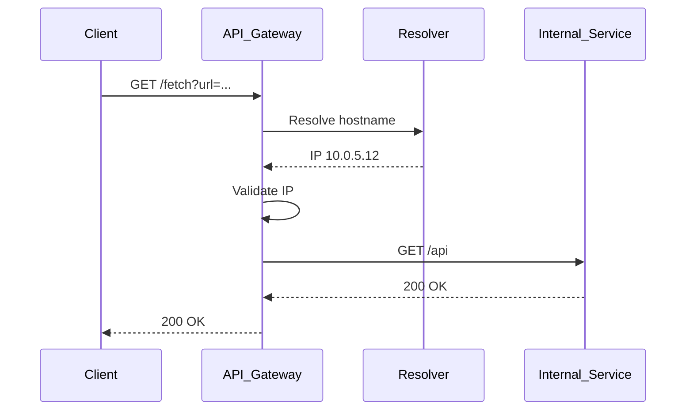

<!-- Generated by Groq via GitHub Actions -->
<!-- Topic ID: T132 -->
<!-- Category: Backend Security -->
<!-- Generated at UTC: 2026-10-25T06:25:07.107519+00:00 -->

# SSRF

## 1. What problem does this solve?

**Motivation**  
When a backend service fetches data from an external URL supplied by a user (or another service), the request can be redirected to internal resources that should be hidden from the outside world. This is called **Server‑Side Request Forgery (SSRF)**. It lets an attacker turn your server into a proxy to reach internal services, read sensitive data, or trigger actions that should be protected.

**What problem exists**  
- A public endpoint accepts a URL (e.g., `GET /fetch?url=...`) and blindly forwards the request.
- The attacker supplies a URL that points to an internal IP (e.g., `http://127.0.0.1:8000/admin`) or a private DNS name.
- The server resolves the URL, connects to the internal host, and returns the response.

**Why the problem matters**  
- **Data exfiltration**: Internal databases, configuration files, or secrets can be read.
- **Privilege escalation**: Internal services often expose privileged APIs that are not authenticated externally.
- **Denial of Service**: The server can be used to flood internal resources.
- **Breach of compliance**: Many regulations forbid exposing internal networks to the internet.

**What happens if this concept is not used**  
- Attackers can discover internal topology, exploit unprotected services, and potentially compromise the entire infrastructure.
- Even a single vulnerable endpoint can become a pivot point for larger attacks.

**Where this concept appears in real backend systems**  
- Image proxy services that fetch user‑supplied URLs.
- Webhooks that call external callbacks.
- Microservice discovery patterns that resolve service URLs from user input.
- Third‑party integrations that allow specifying a callback URL.

---

## 2. Mental model

**Analogy**  
Think of your server as a **mailroom** that receives envelopes (HTTP requests) from the outside. If the mailroom blindly forwards every envelope to the address written on it, an attacker could send an envelope addressed to the **CEO’s office** (internal service) and get the CEO’s personal mail. To prevent this, the mailroom checks that the address is on an approved list before forwarding.

**Engineering model**  
- **Input**: User‑supplied URL or hostname.
- **Validation**: Ensure the target is allowed (public IP, DNS whitelist, etc.).
- **Resolution**: Resolve DNS to IP, but only after validation.
- **Connection**: Open a socket to the resolved IP on the intended port.
- **Response**: Relay the data back to the requester, optionally sanitizing it.

---

## 3. Deep explanation

### Internals
1. **URL parsing** – Extract scheme, host, port, path.
2. **DNS resolution** – Convert hostname to IP(s).  
   *Note*: DNS can return internal IPs (e.g., `10.x.x.x`) or private ranges.
3. **IP filtering** – Check if the resolved IP is in a disallowed range (RFC1918, link‑local, loopback).
4. **Port filtering** – Some services expose sensitive ports (e.g., 22, 3306).  
5. **Proxying** – Make the HTTP/HTTPS request and stream the response.

### Important terminology
- **Internal IP ranges** – RFC1918 (`10.0.0.0/8`, `172.16.0.0/12`, `192.168.0.0/16`).
- **Private DNS** – Hostnames that resolve only inside a VPC or corporate network.
- **Reverse DNS** – Mapping IP back to hostname; can be spoofed.
- **Proxy bypass** – The act of using a proxy to reach internal resources.
- **CORS** – Cross‑Origin Resource Sharing; not directly related but often confused.

### Trade‑offs
- **Strict filtering** reduces risk but may block legitimate use cases (e.g., fetching from internal services intentionally).
- **Whitelist approach** (allow only known hosts) is safer but requires maintenance.
- **Performance**: Extra DNS lookups and validation add latency.

### Failure modes
- **DNS rebinding**: Attacker changes DNS after validation, causing the server to connect to a new IP.
- **IPv6**: Internal ranges also exist in IPv6 (`fd00::/8`).
- **Proxy chaining**: The server may be used to chain requests to other internal hosts.

### Limitations
- **Cannot detect all internal hosts**: Some internal services may have public IPs but should still be protected.
- **Dynamic IPs**: Cloud services that change IPs can slip through if only hostname is checked.
- **Encrypted traffic**: HTTPS may hide the target host; certificate validation is required.

### Where this concept fits in a backend architecture
- **API Gateway**: Central place to validate URLs before forwarding.
- **Service Mesh**: Handles internal routing; SSRF protection can be enforced at the mesh sidecar.
- **Proxy servers**: Dedicated reverse proxies can filter requests.

### Interaction with related concepts
- **CORS**: SSRF is server‑side; CORS is client‑side. Both can be misinterpreted.
- **Rate limiting**: Helps mitigate DoS via SSRF.
- **Input validation**: SSRF protection is a form of input validation at the network level.

---

## 4. How it works

1. **Client** sends `GET /fetch?url=http://internal-service.local/api`.
2. **API Gateway** parses the query string.
3. **Validation**:  
   - Check scheme (`http`/`https`).  
   - Resolve `internal-service.local` → `10.0.5.12`.  
   - Verify IP not in RFC1918 ranges.  
   - If fails, return `403 Forbidden`.
4. **Proxy**: If validation passes, open a socket to `10.0.5.12:80`.
5. **Relay**: Stream response back to the client, optionally filtering headers.



---

## 5. Practical implementation

### TypeScript/Node.js example

```ts
import http from 'http';
import https from 'https';
import { URL } from 'url';
import dns from 'dns/promises';
import net from 'net';

const PRIVATE_IP_RANGES = [
  { start: '10.0.0.0', end: '10.255.255.255' },
  { start: '172.16.0.0', end: '172.31.255.255' },
  { start: '192.168.0.0', end: '192.168.255.255' },
  { start: '127.0.0.0', end: '127.255.255.255' },
];

// Convert dotted IP to number for comparison
const ipToLong = (ip: string) =>
  ip.split('.').reduce((acc, oct) => (acc << 8) + parseInt(oct, 10), 0);

const isPrivateIP = (ip: string) => {
  const long = ipToLong(ip);
  return PRIVATE_IP_RANGES.some(
    ({ start, end }) => long >= ipToLong(start) && long <= ipToLong(end)
  );
};

async function fetchFromUrl(targetUrl: string) {
  const parsed = new URL(targetUrl);
  if (!['http:', 'https:'].includes(parsed.protocol)) {
    throw new Error('Only http/https allowed');
  }

  // Resolve hostname to IP(s)
  const addresses = await dns.resolve4(parsed.hostname);
  if (addresses.some(isPrivateIP)) {
    throw new Error('Target resolves to a private IP');
  }

  // Choose first IP (could add round‑robin)
  const ip = addresses[0];
  const options = {
    hostname: ip,
    port: parsed.port || (parsed.protocol === 'https:' ? 443 : 80),
    path: parsed.pathname + parsed.search,
    method: 'GET',
    headers: parsed.headers,
  };

  const client = parsed.protocol === 'https:' ? https : http;
  return new Promise<string>((resolve, reject) => {
    const req = client.request(options, (res) => {
      let data = '';
      res.on('data', (chunk) => (data += chunk));
      res.on('end', () => resolve(data));
    });
    req.on('error', reject);
    req.end();
  });
}

// Example usage in an Express route
import express from 'express';
const app = express();

app.get('/fetch', async (req, res) => {
  const url = req.query.url as string;
  if (!url) return res.status(400).send('url query param required');
  try {
    const body = await fetchFromUrl(url);
    res.send(body);
  } catch (err: any) {
    res.status(403).send(err.message);
  }
});

app.listen(3000, () => console.log('SSR‑proxy listening on :3000'));
```

**Key lines explained**

- `dns.resolve4` → ensures we only get IPv4 addresses; you can add `resolve6` for IPv6.
- `isPrivateIP` → blocks RFC1918 and loopback ranges.
- `options.hostname` → uses the resolved IP, not the hostname, preventing DNS rebinding after validation.

---

## 6. Production considerations

| Concern | What to watch for |
|---------|-------------------|
| **Scalability** | Each request incurs a DNS lookup and socket creation. Use DNS caching (`dns-cache` or OS resolver) and connection pooling. |
| **Reliability** | Timeouts on DNS and HTTP requests. Use exponential backoff for retries. |
| **Security** | Enforce TLS verification (`rejectUnauthorized: true`). Avoid `http://` if possible. |
| **Observability** | Log the resolved IP, request duration, and status. Tag logs with `target_ip`. |
| **Performance** | Cache allowed URLs or IPs. Use a reverse proxy (NGINX) with `proxy_pass` and `proxy_bind` to enforce IP checks. |
| **Error handling** | Return generic error messages to avoid leaking internal IPs. |
| **Resource usage** | Limit concurrent connections per worker. Use `http.Agent` with `maxSockets`. |
| **Operational concerns** | Monitor DNS resolution failures. Keep the whitelist up‑to‑date. |
| **Failure recovery** | If a protected service becomes unreachable, return a 502 with a friendly message. |
| **Deployment** | In Kubernetes, use NetworkPolicy to block outbound traffic to private ranges; SSRF protection becomes a secondary defense. |

---

## 7. Common mistakes

| Mistake | Why it’s problematic |
|---------|----------------------|
| **Only checking the hostname** | DNS rebinding can change the IP after validation. |
| **Allowing all `http://` URLs** | Internal services often expose HTTP on private IPs. |
| **Not validating the port** | Attackers can target privileged ports (e.g., 22, 3306). |
| **Using `http://localhost`** | Resolved to `127.0.0.1`; bypasses network isolation. |
| **Ignoring IPv6** | Internal IPv6 ranges (`fd00::/8`) can slip through. |
| **Not setting timeouts** | Server can hang waiting for a slow internal host. |
| **Logging raw URLs** | May expose internal hostnames in logs. |
| **Relying solely on client IP** | Client can spoof the request; SSRF is server‑side. |

---

## 8. Senior engineer perspective

### What changes at scale
- **Architecture**: SSRF protection is often moved to a dedicated API gateway or service mesh sidecar to centralize policy enforcement.
- **Policy**: Use a dynamic whitelist stored in a config service or database, refreshed via a sidecar.
- **Monitoring**: Aggregate metrics on blocked requests, DNS failures, and latency spikes.
- **Cost**: DNS lookups and extra socket handling add CPU/memory overhead; balance with caching.

### Design decisions
- **Central vs. per‑service**: Central gateway reduces duplication but becomes a single point of failure.
- **Whitelist vs. blacklist**: Whitelist is safer but requires maintenance; blacklist is easier but riskier.
- **DNS caching**: Use a local resolver or in‑memory cache to reduce latency.
- **Rate limiting**: Protect against DoS via SSRF by limiting requests per IP or per endpoint.

### Bottlenecks
- DNS resolution latency.
- Connection pool exhaustion.
- Logging overhead for every request.

### Failure scenarios
- **DNS cache miss** → long latency.
- **Internal service down** → 502 errors; need graceful degradation.
- **Policy misconfiguration** → legitimate traffic blocked.

### Monitoring
- `ssrf.blocked_requests_total`
- `ssrf.latency_seconds`
- `ssrf.resolved_ip_distribution`

### Cost/performance
- Caching reduces DNS cost (~$0.0001 per query).
- Connection pooling reduces CPU (~10%).
- Over‑aggressive filtering can increase latency by 50–100 ms per request.

### When NOT to use
- If the service must fetch from any internal host (e.g., internal microservice discovery), use a dedicated internal API gateway with proper authentication instead of a generic SSRF proxy.

---

## 9. Interview questions

1. **Beginner**: *What is SSRF and why is it dangerous?*  
   *Answer*: SSRF is a vulnerability where an attacker forces a server to make requests to internal resources. It can expose sensitive data, allow privilege escalation, or cause DoS.

2. **Beginner**: *How would you prevent SSRF in a simple Node.js endpoint that accepts a URL?*  
   *Answer*: Validate the scheme, resolve the hostname, check that the IP is not private, enforce timeouts, and use a whitelist or blacklist.

3. **Senior**: *Describe how you would design a system-wide SSRF protection strategy in a microservices architecture.*  
   *Answer*: Use an API gateway or service mesh sidecar to centralize URL validation, maintain a dynamic whitelist, cache DNS, enforce rate limits, and monitor blocked requests.

4. **Senior**: *Explain the difference between DNS rebinding and SSRF, and how to mitigate each.*  
   *Answer*: DNS rebinding is a technique where the attacker changes the DNS after validation to redirect the request. Mitigation: validate the IP after resolution, use a whitelist, and enforce strict DNS caching.

5. **Scenario/Debugging**: *Your production API returns 403 for all requests to `https://internal-service.local/api`. Logs show the resolved IP is `10.0.5.12`. What could be wrong and how would you fix it?*  
   *Answer*: The IP is private, so the SSRF filter blocks it. If the service is intended to be internal, either add the hostname/IP to the whitelist or move the request behind an internal gateway that bypasses the filter.

---

## 10. Hands‑on task

**Task**: Build a small Express server that exposes `/proxy?url=...`.  
- Implement SSRF protection as shown above.  
- Add a whitelist file (`whitelist.json`) containing allowed hostnames.  
- Write a test that attempts to fetch `http://127.0.0.1:8000/secret` and verifies it is blocked.  
- Then add `127.0.0.1` to the whitelist and confirm the request succeeds.

**Goal**: Understand DNS resolution, IP filtering, and the impact of whitelisting.

---

## 11. Quick revision

- SSRF = Server‑Side Request Forgery: attacker forces server to request internal resources.
- Key attack vector: user‑supplied URL → internal IP.
- Protect by:
  1. Validating scheme (`http/https`).
  2. Resolving hostname to IP(s).
  3. Blocking RFC1918, loopback, and link‑local IPs.
  4. Optionally enforcing a whitelist of allowed hosts.
  5. Setting DNS and request timeouts.
- Use DNS caching and connection pooling for performance.
- Log resolved IPs, request duration, and blocked attempts.
- In microservices, centralize SSRF checks in API gateway or service mesh.
- Common mistakes: only checking hostname, ignoring IPv6, no timeouts, logging raw URLs.
- Senior considerations: policy management, monitoring, cost, and failure recovery.

---

## 12. References

- https://owasp.org/www-community/attacks/Server_Side_Request_Forgery
- https://nodejs.org/api/dns.html
- https://expressjs.com/en/guide/routing.html
- https://www.cloudflare.com/learning/ddos/what-is-ssrf/
- https://kubernetes.io/docs/concepts/services-networking/network-policies/
- https://docs.aws.amazon.com/elasticloadbalancing/latest/application/load-balancer.html#security-groups
- https://developer.mozilla.org/en-US/docs/Web/HTTP/Headers/CORS
- https://github.com/OWASP/SSRF-Map
- https://github.com/GoogleCloudPlatform/security-headers/blob/main/ssrf.md

---
