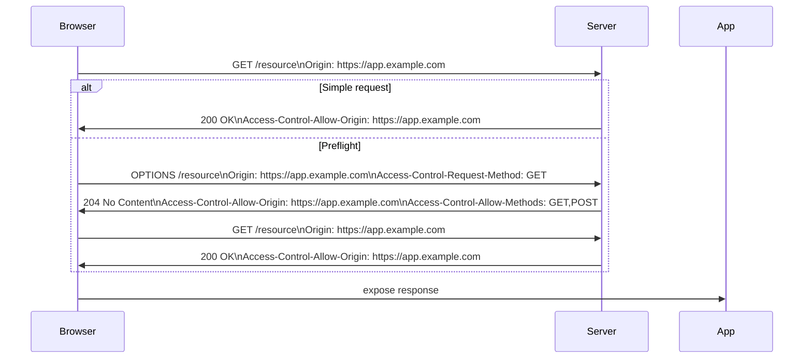

<!-- Generated by Groq via GitHub Actions -->
<!-- Topic ID: T133 -->
<!-- Category: Backend Security -->
<!-- Generated at UTC: 2026-10-25T17:09:41.568328+00:00 -->

# CORS security

## 1. What problem does this solve?

**Motivation**  
When a web page served from one origin (scheme + host + port) wants to call an API on another origin, browsers enforce the *Same‑Origin Policy* (SOP). SOP protects users from malicious sites reading sensitive data from other sites. However, legitimate cross‑origin requests are common: a React app on `https://app.example.com` calling a REST API on `https://api.example.com`. CORS (Cross‑Origin Resource Sharing) is the mechanism that tells the browser *which* cross‑origin requests are allowed.

**What problem exists**  
- Browsers block cross‑origin requests unless the server explicitly permits them.  
- Without CORS, a malicious site could trick a user’s browser into sending requests to a private API and read the responses.  
- Developers often misconfigure CORS, either over‑permitting (open to all origins) or under‑permitting (blocking legitimate clients).

**Why the problem matters**  
- **Security**: Unrestricted CORS can expose private APIs to the public.  
- **User experience**: Legitimate clients fail with 403/401 or CORS errors.  
- **Compliance**: Certain regulations (GDPR, HIPAA) require strict access controls.

**What happens if this concept is not used**  
- Browsers will refuse to expose the response to JavaScript, effectively blocking the request.  
- The client may silently fail or show a CORS error in the console.  
- If a server mistakenly allows all origins, any site can read API responses, leading to data leaks.

**Where this concept appears in real backend systems**  
- Public APIs behind API gateways (AWS API Gateway, Cloudflare Workers).  
- Microservice architectures where services call each other over HTTP.  
- Server‑side rendered apps that fetch data from a separate domain.  
- Mobile/web hybrid apps that use webviews.

---

## 2. Mental model

**Analogy**  
Think of the web as a city with gated neighborhoods.  
- **Origin** = a neighborhood.  
- **Browser** = a resident who can only enter other neighborhoods if the gatekeeper (the server) says “yes.”  
- **CORS** = the gatekeeper’s list of visitors allowed to enter.  
If the gatekeeper says “everyone is welcome,” the city is open but insecure. If the gatekeeper says “only residents of this neighborhood,” legitimate visitors are blocked.

**Engineering model**  
CORS is a *handshake* between the browser and the server:  
1. The browser sends a **preflight** `OPTIONS` request to ask “Can I talk to you?”  
2. The server replies with `Access-Control-Allow-Origin`, `Access-Control-Allow-Methods`, etc.  
3. If the reply matches the browser’s expectations, the actual request proceeds.  
4. For simple requests, the browser may skip the preflight and just send the request with an `Origin` header; the server must still respond with the appropriate `Access-Control-Allow-Origin`.

---

## 3. Deep explanation

### Internals
- **Origin header**: `Origin: https://app.example.com` is sent with every cross‑origin request.  
- **Preflight**: For non‑simple requests (e.g., `PUT`, `DELETE`, custom headers), the browser sends an `OPTIONS` request with `Access-Control-Request-Method` and `Access-Control-Request-Headers`.  
- **Response headers**:  
  - `Access-Control-Allow-Origin` (string or `*`)  
  - `Access-Control-Allow-Methods`  
  - `Access-Control-Allow-Headers`  
  - `Access-Control-Allow-Credentials` (if cookies or auth headers are used)  
  - `Access-Control-Expose-Headers` (to expose non‑simple headers)  
  - `Access-Control-Max-Age` (caching preflight result)

### Important terminology
- **Simple request**: GET/HEAD/POST with standard headers (`Accept`, `Content-Type` limited to `application/x-www-form-urlencoded`, `multipart/form-data`, or `text/plain`).  
- **Preflight**: The `OPTIONS` request that checks permissions.  
- **Wildcard (`*`)**: Allows any origin; cannot be used with `Access-Control-Allow-Credentials: true`.  
- **Credentials**: Cookies, HTTP auth, or TLS client certs.  
- **Exposed headers**: Headers that the browser will make available to JavaScript.

### Trade‑offs
| Approach | Pros | Cons |
|----------|------|------|
| `Access-Control-Allow-Origin: *` | Simple, no config | Cannot send credentials; risky if API is public |
| Whitelist specific origins | Fine‑grained control | Requires maintenance when new clients are added |
| Dynamic origin check (e.g., regex) | Flexible | More complex, potential for bugs |
| No CORS headers | Avoids CORS errors in same‑origin dev | Exposes API to all origins if mis‑used |

### Failure modes
- **Missing `Access-Control-Allow-Origin`** → Browser blocks response.  
- **Wrong origin value** (e.g., typo) → Browser blocks.  
- **Preflight fails** (e.g., missing `Access-Control-Allow-Methods`) → Browser aborts request.  
- **Using `*` with credentials** → Browser ignores response.  
- **Caching preflight incorrectly** → Clients may use stale permissions.

### Limitations
- CORS is a *browser enforcement* mechanism; it does **not** protect non‑browser clients (curl, Postman).  
- It only controls *who* can read the response, not *what* data is returned.  
- CORS does not replace authentication/authorization.

### Where this concept fits in a backend architecture
- **API Gateway**: Often the first point to inject CORS headers.  
- **Reverse Proxy** (NGINX, Envoy): Can add CORS headers centrally.  
- **Microservice**: Each service may expose its own CORS policy; a shared library can standardize it.  
- **Authentication layer**: CORS must be configured before auth to avoid leaking credentials.

### Interaction with related concepts
- **Same‑Origin Policy**: CORS is an extension of SOP.  
- **CSRF**: CORS does not prevent CSRF; you still need CSRF tokens or same‑site cookies.  
- **JWT / OAuth**: CORS must allow the `Authorization` header if using bearer tokens.  
- **Rate limiting / IP whitelisting**: CORS is orthogonal; both can be applied together.

---

## 4. How it works

1. **Client** sends a request to `https://api.example.com/resource`.  
2. Browser adds `Origin: https://app.example.com`.  
3. If the request is *simple*, browser sends it directly.  
4. If the request is *non‑simple*, browser first sends an `OPTIONS` preflight.  
5. **Server** receives the request, reads the `Origin` header.  
6. Server decides whether to allow the origin.  
7. Server responds with appropriate `Access-Control-*` headers.  
8. Browser checks the response.  
9. If allowed, browser proceeds with the actual request.  
10. Browser exposes the response to JavaScript if permitted.



---

## 5. Practical implementation

### Node.js / Express example

```ts
// src/server.ts
import express from 'express';
import cors from 'cors';

const app = express();
app.use(express.json());

// 1️⃣ Whitelist origins
const whitelist = ['https://app.example.com', 'https://admin.example.com'];
const corsOptions: cors.CorsOptions = {
  origin: (origin, callback) => {
    // Allow requests with no origin (e.g., mobile apps, curl)
    if (!origin) return callback(null, true);
    if (whitelist.includes(origin)) {
      callback(null, true);
    } else {
      callback(new Error('Not allowed by CORS'));
    }
  },
  credentials: true, // allow cookies / auth headers
  optionsSuccessStatus: 204,
};

// 2️⃣ Apply CORS globally
app.use(cors(corsOptions));

// 3️⃣ Sample protected route
app.get('/api/data', (req, res) => {
  res.json({ message: 'Secure data', user: req.headers['x-user-id'] });
});

app.listen(3000, () => console.log('Server listening on :3000'));
```

**Key lines**

- `origin` callback checks the incoming `Origin` header against a whitelist.  
- `credentials: true` allows cookies; must not use `*` as `Access-Control-Allow-Origin`.  
- `optionsSuccessStatus` ensures older browsers receive `200` instead of `204`.

### Next.js API route example

```ts
// pages/api/hello.ts
import type { NextApiRequest, NextApiResponse } from 'next';

export default function handler(req: NextApiRequest, res: NextApiResponse) {
  // 1️⃣ Set CORS headers manually
  res.setHeader('Access-Control-Allow-Credentials', 'true');
  res.setHeader('Access-Control-Allow-Origin', 'https://app.example.com');
  res.setHeader('Access-Control-Allow-Methods', 'GET,POST,OPTIONS');
  res.setHeader('Access-Control-Allow-Headers', 'Content-Type, Authorization');

  // 2️⃣ Handle preflight
  if (req.method === 'OPTIONS') {
    res.status(200).end();
    return;
  }

  // 3️⃣ Actual logic
  res.status(200).json({ hello: 'world' });
}
```

**Why manual?**  
Next.js API routes run on Vercel’s serverless environment; using a middleware like `cors` is possible but manual headers give fine control and avoid extra dependencies.

### FastAPI example (Python)

```py
# main.py
from fastapi import FastAPI
from fastapi.middleware.cors import CORSMiddleware

app = FastAPI()

app.add_middleware(
    CORSMiddleware,
    allow_origins=["https://app.example.com"],
    allow_credentials=True,
    allow_methods=["GET", "POST"],
    allow_headers=["Authorization", "Content-Type"],
)

@app.get("/api/data")
async def get_data():
    return {"message": "Secure data"}
```

---

## 6. Production considerations

| Concern | How to address |
|---------|----------------|
| **Scalability** | CORS headers are lightweight; no extra CPU. Use shared config in API gateway or reverse proxy to avoid per‑request logic. |
| **Reliability** | Ensure CORS middleware is applied before any error handling that might short‑circuit the response. |
| **Security** | Never use `*` if credentials are needed. Validate origins strictly; consider rate‑limiting preflight requests to mitigate DoS. |
| **Observability** | Log rejected origins; monitor CORS errors in client logs (e.g., via Sentry). |
| **Performance** | Preflight caching (`Access-Control-Max-Age`) reduces round‑trips. Keep it high (e.g., 86400 seconds) for stable APIs. |
| **Error handling** | Return 403 for disallowed origins; 204 for successful preflight. |
| **Resource usage** | Minimal; just header checks. |
| **Operational concerns** | Keep origin whitelist in environment variables or a config service. |
| **Failure recovery** | If CORS middleware crashes, fallback to a safe default (deny all). |
| **Deployment** | In Kubernetes, use Envoy or NGINX Ingress to inject CORS headers centrally, reducing code duplication. |

---

## 7. Common mistakes

| Mistake | Why it’s problematic |
|---------|----------------------|
| Using `Access-Control-Allow-Origin: *` with `credentials: true` | Browser ignores the response; credentials are never sent. |
| Forgetting to set `Access-Control-Allow-Headers` for custom headers (e.g., `Authorization`) | Preflight fails; legitimate requests are blocked. |
| Hard‑coding origins in code and forgetting to update after adding a new client | New clients cannot access the API. |
| Adding CORS headers after error middleware | Errors may bypass CORS, causing 500 instead of 403. |
| Not handling `OPTIONS` requests in serverless functions | Preflight receives 404; browsers block the request. |
| Over‑permitting origins (e.g., regex that matches malicious domains) | Opens API to unintended clients. |
| Relying on CORS for authentication | CORS only controls *who* can read the response, not *who* can access data. |
| Not setting `Access-Control-Expose-Headers` when needed | Client JS cannot read important headers (e.g., `X-RateLimit-Remaining`). |

---

## 8. Senior engineer perspective

### Architecture decisions
- **Centralized CORS**: Use an API gateway or reverse proxy to inject headers, keeping services stateless.  
- **Dynamic origin service**: For large ecosystems, maintain an origin registry service that validates origins at runtime.  
- **Policy as code**: Store CORS policies in a Git repo and deploy via CI/CD.

### Trade‑offs
- **Central vs. per‑service**: Centralized reduces duplication but can become a single point of failure.  
- **Static whitelist vs. dynamic**: Static is simpler; dynamic allows rapid onboarding but adds latency.

### Bottlenecks
- **Preflight flood**: Attackers can send many `OPTIONS` requests; mitigate with rate limiting or caching.  
- **Large `Access-Control-Allow-Headers`**: Exposing many headers can increase response size; keep it minimal.

### Failure scenarios
- **Misconfigured gateway**: All cross‑origin requests fail; monitor with client‑side error tracking.  
- **Origin registry outage**: New clients cannot be validated; fallback to a safe default (deny all).

### Monitoring
- **CORS error metrics**: Count 403 responses due to CORS.  
- **Preflight latency**: Track `OPTIONS` response times.  
- **Origin hit ratio**: How many requests come from whitelisted origins.

### Cost/performance
- **Cache preflight**: Reduces network traffic and latency.  
- **Edge CORS**: Deploy CORS logic at CDN edge (e.g., Cloudflare Workers) to offload origin servers.

### When NOT to use the approach
- **Internal APIs**: If all clients are same‑origin, CORS is unnecessary.  
- **Non‑browser clients**: CORS does not protect CLI tools; rely on auth instead.  
- **Highly dynamic origins**: If origins change every request, consider token‑based access instead of CORS.

---

## 9. Interview questions

1. **Beginner**: *What is the purpose of the `Origin` header in a CORS request?*  
   *Answer:* It tells the server which origin (scheme+host+port) is making the request so the server can decide whether to allow it.

2. **Beginner**: *When does a browser send a preflight request?*  
   *Answer:* For non‑simple requests: methods other than GET/HEAD/POST, custom headers, or non‑standard `Content-Type` values.

3. **Senior**: *Explain how you would design a CORS policy for a microservice architecture with dozens of services and multiple client types.*  
   *Answer:* Use a central API gateway to inject CORS headers, maintain a dynamic origin registry, apply per‑service policies via configuration, and enforce rate limiting on preflight.

4. **Senior**: *Describe a scenario where misconfiguring `Access-Control-Allow-Credentials` could lead to a security breach.*  
   *Answer:* Setting `Access-Control-Allow-Credentials: true` with `Access-Control-Allow-Origin: *` causes browsers to ignore the header, potentially allowing cross‑origin requests with credentials to be sent to a public API, exposing sensitive data.

5. **Scenario/Debugging**: *A React app on `https://app.example.com` receives a CORS error when calling `https://api.example.com/users`. The server logs show a 200 response with `Access-Control-Allow-Origin: https://app.example.com`. What could be wrong?*  
   *Answer:* Likely the request is a preflight that the server did not handle (missing `OPTIONS` route), or the client is sending a non‑simple request (e.g., `PUT`) without proper `Access-Control-Allow-Methods`. Check that the server responds to `OPTIONS` with the correct headers and that the method is allowed.

---

## 10. Hands‑on task

**Task**: Add a secure CORS policy to the existing Express API in this repository.

1. Create a `.env` file with `CORS_WHITELIST=https://app.example.com,https://admin.example.com`.  
2. Implement a middleware that reads this env variable, splits it into an array, and validates the `Origin` header.  
3. Ensure credentials are allowed only for `https://admin.example.com`.  
4. Add an `OPTIONS` handler that returns the correct CORS headers.  
5. Write a simple Jest test that sends an `OPTIONS` request from a disallowed origin and expects a 403.

---

## 11. Quick revision

- CORS is a browser security mechanism that extends Same‑Origin Policy.  
- Browser sends `Origin` header; server replies with `Access-Control-Allow-Origin`.  
- Preflight (`OPTIONS`) is required for non‑simple requests.  
- `Access-Control-Allow-Credentials: true` requires a specific origin, not `*`.  
- Whitelist origins; use environment variables for flexibility.  
- Cache preflight with `Access-Control-Max-Age`.  
- CORS does not replace authentication/authorization.  
- Centralize CORS in API gateway or reverse proxy for scalability.  
- Monitor CORS errors and preflight latency.  
- Common mistakes: using `*` with credentials, missing headers, hard‑coding origins.

---

## 12. References

- [MDN Web Docs – Cross-Origin Resource Sharing (CORS)](https://developer.mozilla.org/en-US/docs/Web/HTTP/CORS)  
- [W3C CORS Specification](https://www.w3.org/TR/cors/)  
- [Express CORS Middleware](https://github.com/expressjs/cors)  
- [Next.js API Routes – CORS](https://nextjs.org/docs/api-routes/api-middlewares)  
- [FastAPI CORS Middleware](https://fastapi.tiangolo.com/tutorial/middleware/#cors-middleware)  
- [OWASP – CORS Misconfiguration](https://owasp.org/www-community/attacks/Cross-Origin_Request_Forgery)
